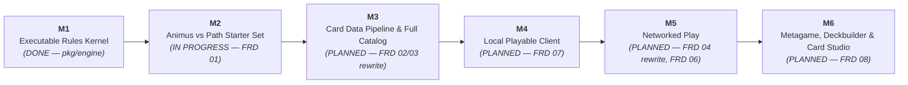

# Animus Mundi (Card Town) — Product Summary & Technical Roadmap

---

## 1. Executive Summary & Vision

**Animus Mundi** (working title: *Card Town*) is a competitive, digital collectible strategy card game (CCG) built with the **Godot 4.x Engine** and backed by a **server-authoritative game engine**. The game combines high-tactical depth with spatial battlefield positioning, a rich multi-resource economy, and an event-driven ability resolution stack.

### Key Game Pillars
- **Spatial Board Topology**: Combat and deployment are divided across dedicated battlefield zones: the frontline **Main Theater**, the tactical **Reserves**, and the fortified **Headquarters (HQ) Zone**. Units maneuver between reserves and the main theater to strike or regroup.
- **Dual Resource Economy**: Assets generate **Requisition** and **Tactics** by exhausting, creating dynamic turn-by-turn decisions between economy ramp and battlefield pressure.
- **Authoritative Determinism**: 100% of game logic, state transitions, fog-of-war security, and ability triggers execute on an authoritative server. The client is a thin, predictive visual presenter.
- **Declarative Architecture**: Card mechanics are defined not through ad-hoc script code, but through a structured, declarative Abstract Syntax Tree (AST) that the engine executes deterministically.
- **Executable Rules**: The game rules are specified in one version-controlled document ([FRD 01](frd/01_Game_Rules_FRD.md)) and executed by a headless Go kernel (`pkg/engine`) whose scenario tests pin each rule by requirement ID. Other specifications are written when their milestone starts, and technical choices are recorded as decision records when the code needs them.

---

## 2. What We Have Built (Current Foundation)

The repository is organized around an executable rules kernel, the one active rules specification, verified balance datasets, quality assurance tooling, and a task-file build loop:

```text
animus-mundi/
├── .agents/
│   ├── skills/                            # Persona definitions (pm-lead, lead-architect, rules-test-author, kernel-engineer, ...)
│   └── tasks/m2/                          # M2 build loop: BOARD.md (directives + index), archive/ (done tasks T-0001 ... T-0155, applied directives), runs/ (wave-run logs)
├── docs/
│   ├── AGENTS.md                          # Engineering & agent guidelines
│   ├── PRODUCT_SUMMARY.md                 # This product roadmap & architecture summary
│   ├── architecture/
│   │   ├── m2-ability-model.md            # M2 design note: ability shapes, boundaries, ordered deliverables
│   │   └── decisions/                     # Decision records ADR-0001 ... ADR-0006
│   ├── design/
│   │   ├── m2_starter_set_ability_survey.md # Every Animus/Path card mapped to shapes, waves A1-G, SVY-R* rulings
│   │   └── outcomes/                      # game-designer Design Outcome Reports, one file per decision
│   ├── tdd/                               # Frozen TDD 03 and an overview of the retired TDD path (design intent only)
│   └── frd/
│       ├── README.md                                    # Status, precedence & question-to-ruling workflow
│       ├── 01_Game_Rules_FRD.md                         # ACTIVE — Master FRD v3.20 (Pure Game Rules & Keywords)
│       ├── keyword_interaction_matrix.md                # ACTIVE — Bounded keyword edge-case register
│       ├── 02_Card_Data_Pipeline_FRD.md                 # FROZEN — FRD v1.3 (Ingestion, AST, 26 Primitives & Text Rules)
│       ├── 03_Card_Compiler_FRD.md                      # FROZEN — FRD v1.2 (Go Catalog Linker, Keyword Lookup, AST Registry & Parity)
│       ├── 04_Client_Engine_Protocol_Networking_FRD.md  # FROZEN — FRD v1.5 (Networking, Fog-of-War & Wire Protocol)
│       └── 05_Headless_Game_Engine_FRD.md               # FROZEN — Master FRD v1.4 (design reference for pkg/engine)
├── data/
│   ├── cards/                             # 10 Authoritative RFC-4180 CSV Balance Sheets
│   │   ├── maneuvers-{animus, concordia, path, soulless}.csv
│   │   └── units-and-structures-{animus, concordia, path, soulless, HQ, common}.csv
│   ├── decks/                             # Starter decklists (animus-starter.txt, path-starter.txt)
│   └── schemas/                           # Target directory for JSON schemas & blueprints.json
├── cmd/
│   └── cardtown/                          # Native Go developer CLI, one file per command (lint, sim, replay, play, tools)
├── pkg/
│   ├── engine/                            # Executable FRD 01: rules kernel and TestFR_*/TestCard_* scenario tests
│   │   ├── ability/                       # Ability shapes as Go data: hooks, gates, steps, subjects, values, targets
│   │   └── cards/                         # Card ability definitions and the NotYetExecutable list
│   ├── sim/                               # Policies, playouts, `cardtown sim` driver and rule monitors (imports engine only)
│   ├── eventlog/                          # Event formatting and JSON Lines output (imports engine only)
│   ├── view/                              # Per-seat PlayerView, hidden-information log lines, and the viewtest leak oracle
│   └── toolchain/                         # Linters, pre-commit hook and the docs snapshot behind `cardtown whats-up`
└── tools/
    ├── linter/
    │   └── pre-commit                     # Pre-commit hook template
    └── sheets/
        └── publish_card_sheets            # Export from local CSVs to Google Sheets
```

### 2.1 The Five Master FRDs (Core Architectural Pillars)

> [!IMPORTANT]
> Since 2026-10-19 only **FRD 01** is an active specification. FRDs 02–05 are frozen as design intent: summarized below for context, not audited or synced, and each is rewritten when its milestone starts (Section 4). See [`frd/README.md`](frd/README.md).

Requirement counts below are linter-registered IDs (`cardtown lint frd`). Following the SOC-002 de-duplication passes and the 2026-10-19 devil's-advocate audits, each FRD keeps superseded IDs as *Subsumed* traceability stubs that point to their canonical owner. The active count is given alongside the total.

Berserk N was retired on 2026-10-28 and replaced by Overkill (`SVY-R12`, [Design Outcome](design/outcomes/2026-10-28-berserk-replaced-by-overkill.md)). This section describes the FRDs without Berserk. `pm-frd-drafter` made the matching edits in FRD 01 v3.14 and removed it from the frozen FRDs 02–05 and TDD 03.

1. **[Game Rules FRD](frd/01_Game_Rules_FRD.md) (Master FRD v3.20 — 71 Requirement IDs, 62 active; 9 subsumed)**
   - **Deck Construction, Match Setup & First-Turn Rules (`FR-SET-001` - `FR-SET-004`, `FR-DEK-001` - `FR-DEK-002`, `FR-WIN-001`)**: 50-card minimum main deck, 1 faction Headquarters, rarity copy limits (4/3/2/1), pre-mulligan First-Player Determination (15s clock), 6-card opening hand with single partial mulligan (25s clock), Turn 1 draw skip, absence of summoning sickness, mandatory post-search shuffle, empty-deck draw loss, and a simultaneous empty-deck **Match Draw** (`RESULT_MATCH_DRAW`).
   - **Pure Game Rules, Card Taxonomy & Spatial Zone Model (`FR-CRD-101`, `FR-ZON-001` - `FR-ZON-005`, `FR-ENT-102` - `FR-ENT-103`)**: 14 printed card characteristics, Battlefield Assets vs. non-battlefield Cards, ownership vs. control, uncapped zone capacities (Reserves, Main Theater, Headquarters Zone, Hand, Deck, Discard, Attached Sub-Zone, and Resolution Stack), double-blind `1/1/1/1` Scratch Company lifecycle, tucked cards, and face-down transformation. Runtime memory structs (`FR-ENT-001` - `FR-ENT-003`, `FR-SNP-101`) are owned by FRD 05 (`SOC-002`).
   - **Dual-Resource Economy, Turn Sequence & Clean-Stack Model (`FR-RES-001` - `FR-RES-003`, `FR-TRN-001` - `FR-TRN-003a`, `FR-CAP-001`, `FR-MNV-001`, `FR-QUE-001`)**: Explicit off-stack Requisition and Tactics generation, one-way `2R -> 1T` conversion, unified Inherent Capabilities Matrix (`FR-CAP-001`, subsuming `FR-INH-001` - `FR-INH-004`) with what counts as exhausting (every Readied-to-Exhausted change, never entering Exhausted; `SVY-R17`), discard-pile and in-resolution free deployments with destination-zone selection (`FR-TRN-003a`), Ready Phase (unexhaust + start-of-turn triggers), Draw Phase (draw + draw triggers), Main Phase (75s turn clock + 60s Reserve Time Bank, clean-stack priority), and End Phase (Sub-Phases 4a–4d).
   - **Trigger Timing & Delayed Triggers (`FR-TRG-002` - `FR-TRG-006`)**: APNAP simultaneous trigger ordering, optional trigger confirmation, *"you may X. If you do, Y"* actions carried out on resolution rather than paid as costs (`SVY-R14`), and turn-scoped delayed triggered abilities (*Rage's Wake*, *Redline Infusion*).
   - **Targeting, Fizzle & Interactive Choice Rules (`FR-TGT-001` - `FR-TGT-003`, `FR-MOD-001`)**: Conjunction target filtering, upfront target selection for conditional triggers, two-stage target verification, distributed pool evaporation, composite clause survival, single-option fast-path, and 15s/10s choice clocks with deterministic timeout fallbacks that pick in a fixed order, never at random (`SVY-R16`). A mode is legal only if its exactly-one target slots can be filled and its costs paid (`SVY-R28`, `SVY-R33`), and chosen modes are one stack item that resolves in printed order (`SVY-R31`). A chosen asset removed earlier in the same effect is no longer that target (`SVY-R25`). "Another chosen" must name a different entity, while separate "chosen" clauses may name the same one (`SVY-R34`, `SVY-R35`).
   - **Six-Layer Attribute Calculation & 5-Stage Damage Mitigation (`FR-LAY-001` - `FR-LAY-003`, `FR-REP-001` - `FR-REP-004`)**: Continuous evaluation across Layers 1–6 (Base Printed/Face-Down $\rightarrow$ Type/Subtype $\rightarrow$ Keywords $\rightarrow$ Continuous Auras $\rightarrow$ Temp Modifiers $\rightarrow$ Exclusive Combat Power clamping at `0`), inline replacement effects (a replaced action or cost still counts as done, `SVY-R15`), and 5-stage damage mitigation (Stage 1 Redirection $\rightarrow$ Stage 2 Flat `Resistant N` $\rightarrow$ Stage 3 `Stalwart` Combat Cap $\rightarrow$ Stage 4 Dynamic `Armor` $\rightarrow$ Stage 5 Health Commit). A destruction replacement sees every death at the same moment as its source's own (`SVY-R20`, `SVY-R21`), the affected asset's controller chooses between several (`SVY-R23`), and one saves an asset at most once per death sweep (`SVY-R24`).
   - **Deterministic 3-Step Combat Sequence (`FR-CBT-001` - `FR-CBT-003`)**: Step 1 (Declaration & Upfront Exhaustion), Step 2 (Pre-Combat Trigger & Reaction Window), and Step 3 (Simultaneous Combat Damage & 100% Symmetric Retaliation across Units, Structures, and Headquarters), with attacker-scoped `EVENT_COMBAT_KILL` attribution and simultaneous-defeat Match Draw. A replaced death is not a kill (`SVY-R19`).
   - **Canonical Keywords Catalog (`FR-KWD-002a` - `FR-KWD-002p`)**: Formal definitions for all 15 core game keywords (Unbowed, Resistant N, Stalwart, Heal N, Cornered, Aggressive N, Ethereal, Ward, Versatile, Guardian, Armor N, Deploys Exhausted, Scratch N, Regroup N, Overkill). Overkill (`FR-KWD-002p`, replacing the retired Berserk N `FR-KWD-002o`) triggers when an attacker's combat damage leaves the defender below 0 Current Health, and its effect may use the excess. Exactly lethal damage is not overkill, and two Overkill abilities on one unit trigger separately (`KIM-O01`). Unbowed triggers even on lethal damage, and is placed after the death sweep with any death triggers from the same event (`SVY-R13`). A keyword behind Cornered counts only while Cornered is active (`SVY-R18`), and the Scratch Company face prints Deploys Exhausted (`KIM-S01`).

2. **[Card Data Pipeline & Ability Authoring FRD](frd/02_Card_Data_Pipeline_FRD.md) (FRD v1.3 — 33 Requirement IDs, 29 active; 4 subsumed)**
   - **Three-Tier Data Authority Lifecycle (`FR-DAT-001` - `FR-DAT-002`)**: Tier 1 (Authoritative Repository CSVs in `data/cards/*.csv`) $\leftrightarrow$ Tier 2 (Cloud Google Sheets Inspection Mirror synced via freshness-checked `tools/sheets/publish_card_sheets` and diff-verified `tools/sheets/import_card_sheets`) $\rightarrow$ Tier 3 (Compiled Production `blueprints.json` bound with 256-bit `catalogChecksum` and `cardDataVersion`). Compilation, bundling, checksum, and versioning (`FR-DAT-003`, `FR-DAT-004`) are subsumed by FRD 03 (`FR-CMP-002`, `FR-CMP-003`, `FR-CMP-024` - `FR-CMP-026`).
   - **Zero-Aliasing Target Enums & Normalization (`FR-DAT-005` - `FR-DAT-008`)**: Direct `CardBlueprint` schema header parity on all 10 CSVs with zero runtime aliases (`UNIT`, `STRUCTURE`, `MANEUVER`, `HEADQUARTERS`; `CONCORDIA`, `SOULLESS`, `PATH`, `ANIMUS`, `NEUTRAL`), deterministic immutable slug IDs (`<faction>_<snake_case_title>`, `FR-DAT-002`), Title Case subtype normalization with case-insensitive runtime filtering, and `"--"` sentinel handling.
   - **Declarative Ability AST & Extended Mechanics (`FR-ABL-001` - `FR-ABL-012`)**: Polymorphic schemas for `TRIGGERED`, `ACTIVATED`, `CONTINUOUS_AURA` (Layer 4 modifiers & `abilityGrants`), `REPLACEMENT_WATCHER`, `MANEUVER_EFFECT`, and `KEYWORD_GRANT`, supported by `FilterDef`, composable `ValueToken.query` aggregates, `CostDef` (`RESOURCE`, `EXHAUST_SELF`, `EXHAUST_ASSET`, `KILL_ASSET`, `DISCARD_CARD`, `MOVE_CARD_ZONE`), `TargetRef` (`DISTRIBUTED_POOL`), `maxPerTurn` gates, modal choices, and 14 keyword AST mappings (Overkill gets one in the M3 rewrite).
   - **Event Hook Taxonomy, 26 Atomic Primitives & Upfront Target Locking (`FR-TRG-001`, `FR-TRG-007`, `FR-PRM-001`, `FR-TGT-101`)**: Canonical catalog of 28 `EVENT_*` hooks and 3 `WOULD_*` replacement hooks with causality lineage, **26 standard atomic effect primitives** (including `REGISTER_DELAYED_TRIGGER`, plus `COMPOSITE_SEQUENCE` / `CONDITIONAL_CLAUSE`), upfront target locking (`bindingPolicy: "UPFRONT_LOCK"`) with the canonical `TargetRole` set, and 4 benchmark card AST implementations.
   - **MTG-Aligned Rules Text Standards (`FR-TXT-001` - `FR-TXT-006`)**: Standardized capitalization, trigger preambles (*When*, *Whenever*, *At*), cost notation (`[Cost]: [Effect].`), passive aura phrasing (*has*/*have*), temporary stat modification phrasing (*gets*/*get*), keyword grants (*gains*/*gain*), and conjunction targeting syntax (*chosen*), with two-stage dynamic filter verification owned by `FR-TGT-003`.
   - **Prototype Gating & Card Audit Register (`FR-VAL-003`, Domain 7)**: Two-tier compilation (`needsRework` cards allowed in dev builds, blocked by `ERR_STRICT_PROTOTYPE_REJECTED` under `--strict`) and canonical `DA-DAT-003` design rulings. Linter and text-to-AST parity verification (`FR-VAL-001`, `FR-VAL-002`) are subsumed by FRD 03 (`FR-CMP-001`, `FR-CMP-019` - `FR-CMP-022`).

3. **[Card Compiler & Blueprint Bundler FRD](frd/03_Card_Compiler_FRD.md) (FRD v1.2 — 28 Requirement IDs, 17 active; 11 subsumed)**
   - **Five-Stage Catalog Linker Pipeline & CLI Contract (`FR-CMP-001` - `FR-CMP-003`)**: Standalone, statically linked pure Go CLI (`cmd/compile-blueprints`) executing 5 deterministic stages (Environment & Schema Init $\rightarrow$ Atomic CSV Ingestion & Slug Derivation $\rightarrow$ Catalog Linking & Keyword Lookup $\rightarrow$ Parity/Strict/Schema Gates $\rightarrow$ RFC 8785 Fingerprinting & Atomic Emission) with a `< 500 ms` warm execution SLA, CI/CD exit codes `0`–`5` (absorbing `FR-CMP-028`), POSIX flags (`--source-dir`, `--overrides-file`, `--validate-only`, `--emit-schemas`, `--strict`, `--minify`, etc.), and atomic `.tmp.<pid>` staging with zero-corrupt rollback.
   - **CSV Reader Mechanics & Prototype Policy (`FR-CMP-004` - `FR-CMP-007`)**: BOM/CRLF-tolerant RFC-4180 reader across all 10 sheets, blank-row skipping, global `<faction>_<slug>` collision prevention (`ERR_SLUG_COLLISION`), deterministic coercion-error mapping (column schemas delegated to `FR-DAT-001` - `FR-DAT-008`), and `needsRework` cards rejected under `--strict`.
   - **Catalog Linking & Declarative AST Registry (`FR-CMP-013`, `FR-CMP-017`)**: **Architecture pivot (Decision 1):** the compiler is a deterministic Catalog Linker, Validator & Checksum Bundler, not a natural-language parser. Vanilla cards emit `abilities: []`, and cards whose rules text is entirely standalone keyword lines (9 of FRD 02's 14 keywords) resolve from the `FR-ABL-012` lookup table. Every other ability, including the 5 non-standalone keywords (Unbowed, Cornered, Heal N, Scratch N, Regroup N) and all Maneuver payloads, must be hand-modeled in `data/schemas/ast_overrides.json`. The sentence-level regex NLP synthesizer (`FR-CMP-008` - `FR-CMP-012`, `FR-CMP-014` - `FR-CMP-016`, `FR-CMP-018`) is retired and subsumed by FRD 02 and `FR-CMP-017`.
   - **Build-Time Parity, Sign-Off & Schema Gates (`FR-CMP-019` - `FR-CMP-022`)**: Forward parity (`ERR_PARITY_UNMAPPED_TEXT`, `ERR_PARITY_VERB`), reverse parity (`ERR_PARITY_ORPHAN_AST`), mandatory designer sign-off per registry entry (`parityVerified`, `verifiedBy`, `verifiedAt` → `ERR_OVERRIDE_UNVERIFIED`), `rulesText` sync and orphan checks, and JSON Schema Draft 2020-12 validation (`CardBlueprint`, `AbilityDef`, `ast_overrides` schemas, generated from Go structs via standalone `--emit-schemas`). `FR-CMP-021` (strict review gate) is subsumed into `FR-CMP-005` / `FR-CMP-020`.
   - **RFC 8785 Fingerprinting, Envelope Emission & Diagnostics (`FR-CMP-023` - `FR-CMP-027`)**: 2-space indented, `id`-sorted `blueprints.json` envelope (plus optional `blueprints.min.json`), SHA-256 `catalogChecksum` over the RFC 8785 canonical `blueprints` array with the dev-only `needsRework` flag stripped, SemVer 2.0 `cardDataVersion`, and 25 active structured `ERR_*` diagnostic codes. Go domain structs are shared with the engine to eliminate type drift.

4. **[Client-Engine Protocol & Networking FRD](frd/04_Client_Engine_Protocol_Networking_FRD.md) (FRD v1.5 — 25 Requirement IDs, 22 active; 3 subsumed)**
   - **Transport & DoS-Hardened Liveness (`FR-NET-001` - `FR-NET-004`)**: Isolated stateful GCP match containers (GKE/Agones or Cloud Run) communicating over TLS WebSockets (`wss://` port 443) via Godot 4.x's native `WebSocketPeer`, using binary Protocol Buffers v3 (`ccg.network`) with JSON debug fallback, 1,000 ms `Ping`/`Pong` heartbeats (rate-limited to max 5/s), and 3,000 ms disconnect detection.
   - **Session Lifecycle & Zero-Trust Setup (`FR-SES-001` - `FR-SES-005`)**: Strict version/JWT handshake with 256-bit `catalogChecksum` verification, backend-fetched deck legality validation (`FR-SET-001`) with zero client card-list transmission, wire-level first-player prompts (rule owned by `FR-SET-003`; `FR-SES-003` subsumed), 25-second continuous partial mulligan negotiation, and reconnect/`StateSyncSnapshot` recovery.
   - **Fog-of-War & Double-Blind Security Boundary (`FR-SEC-001` - `FR-SEC-004`, `FR-ZON-005`)**: Ephemeral opaque proxy IDs (`proxy_scratch_<id>`) for Scratch Companies in server RAM, split owner/opponent zone-departure reveal packets (`DISCARD`, `HAND`/`DECK`, `ATTACHED`), and opponent hand/deck sanitization. Server randomness is the engine's seeded deterministic PRNG (`FR-SEC-005` subsumed by `FR-ENG-002` / `FR-DEK-002`), which removes the earlier CSPRNG-vs-replay-reproducibility contradiction.
   - **Full Command, Event & Rejection Taxonomy (`FR-MSG-001` - `FR-MSG-005`, `FR-ERR-001`)**: `GameEnvelope` framing 16 `ClientCommand` actions (session/orchestration, off-stack economy, stack-pushed tactical actions, stack card/ability actions, phase flow, choice responses, concede) with boundary clamping on `tactics_requested` `[1..50]` and canonical `TargetBinding` roles (including `MOVE_COST`; an attack binds exactly one target). It also defines 21 `EngineEvent` detail schemas covering all 26 primitives and every `FR-PAC-004` hashed attribute, synchronous `PlayerChoicePrompt` modals (15s active / 10s non-active decision clocks), and 18 `CommandRejection` error codes plus the non-fatal `WARN_TARGET_INVALIDATED_FIZZLE`.
   - **Pacing, Desync Hashing & Quarantined Replays (`FR-PAC-001` - `FR-PAC-004`, `FR-SPC-002`)**: Client FIFO animation queue with 2,000 ms / 3.0x fast-forwarding, 5,000 ms turn-handover and 3,000 ms prompt animation grace buffers, 60-second Unified Reserve Time Bank with opponent-turn forfeiture protection, atomic 5-stage `DamagePipelineStageEvent` batching, per-batch 64-bit Layer 6 `PublicStateHash` verification (snapshot recovery throttled to 1 per 3,000 ms), and unmasked `.rec` match replays quarantined until tournament series completion.

5. **[Headless Game Engine FRD](frd/05_Headless_Game_Engine_FRD.md) (Master FRD v1.4 — 46 Requirement IDs, 35 active; 11 subsumed)**
   - **Standalone Go Kernel (`FR-ENG-001` - `FR-ENG-005`)**: Pure Go (`CGO_ENABLED=0`) headless engine (`cardtown/engine`) with isolated 3-stream PCG32/SplitMix64 PRNG (`StreamShuffle`, `StreamTargeting`, `StreamMatchDecisions`; seed derivation consolidated into `FR-ENG-002`), pure 32-bit discrete integer arithmetic, and rolling 64-bit FNV-1a state checksums (`FR-PAC-004`).
   - **Transactional State Machine, 3-Tier Entity Architecture & Phase Engine (`FR-ENG-006` - `FR-ENG-011`, `FR-ENT-001` - `FR-ENT-003`, `FR-SNP-101`)**: In-place mutable state with delta-memento rollback (including PRNG stream counters) and two-phase choice-prompt transaction boundaries. It covers the 3-tier runtime entity structs (`CardBlueprint` singleton $\rightarrow$ `CardInstance` $\rightarrow$ `AssetInstance` + `AssetSnapshot` LKI), a dedicated `StackZone`, and a turn-scoped `DelayedTriggers` registry. Also specified: the 4-step pre-game setup/mulligan handshake, deterministic turn sub-phases, off-stack resource operations vs. clean-stack manual actions, and 75s/15s/10s clocks cascading into the 60s Reserve Time Bank.
   - **LIFO Stack Runner & Replacement Interception (`FR-ENG-012` - `FR-ENG-017`)**: 5-archetype LIFO resolution stack, atomic upfront cost deduction (`EXHAUST_SELF`, `EXHAUST_ASSET`, `KILL_ASSET`, `DISCARD_CARD`), inline reactive `ReplacementWatcherDef` interception, and choice prompt yield/fast-path/resumption. APNAP ordering and two-stage target verification (`FR-ENG-014`, `FR-ENG-015`) are subsumed by their canonical rules owners (`FR-TRG-003`, `FR-TGT-003`).
   - **Declarative Ability AST Interpreter (`FR-ENG-018`, `FR-ENG-021` - `FR-ENG-023`)**: Exhaustive Go type-switch AST visitor evaluating all 6 `abilityType` archetypes plus `FilterDef`/`ValueToken` expressions (absorbing `FR-ENG-019`, `FR-ENG-020`), double-blind `Scratch Company` (`proxy_scratch_*`) lifecycle, continuous aura grant/revocation (including `HAND`/`DISCARD`-zone cost modifiers), and 1:1 execution handlers for all **26 canonical atomic primitives** (`FR-PRM-001`).
   - **Stateless 6-Layer Attribute Pipeline (`FR-ENG-025`, `FR-ENG-029`)**: Stateless continuous on-demand evaluation across Layers 1–6 with timestamp precedence and exclusive Layer 6 Combat Power clamping (`EffectivePower = max(0, RawPower)`), consolidated into `FR-ENG-025` (dirty-flag caching de-scoped; `FR-ENG-026` - `FR-ENG-028` subsumed), and End Phase Sub-Phase 4c modifier cleanup.
   - **3-Step Combat, 5-Stage Mitigation & Victory Engine (`FR-ENG-031` - `FR-ENG-035`, `FR-ENG-042`)**: 3-step combat sequence (`FR-CBT-002`), execution of the canonical 5-stage damage mitigation owned by `FR-REP-004` (with `EVENT_DEAL_DAMAGE` / `EVENT_TAKE_DAMAGE` emission), inter-resolution state-based death sweeps with buffered APNAP triggers, `ATTACHED` sub-zone cleanup, and authoritative match conclusion including simultaneous HQ-defeat and empty-deck Match Draws.
   - **Headless Test Harness & Diagnostics (`FR-ENG-036` - `FR-ENG-041`)**: Standalone CLI runner (`cmd/engine-sim`), scripted YAML/JSON scenario DSL, deterministic `.rec` replay validator (`FR-SPC-002`), combinatorial monkey/fuzz runner, throughput benchmarks ($\ge 10,000$ turns/sec/core), and wire-aligned error taxonomy (`FR-ERR-001`).

### 2.2 Balance Datasets & Card Standardization
- **10 Clean RFC-4180 CSV Balance Sheets** in `data/cards/` covering 4 distinct factions (Animus, Concordia, Path, Soulless), Neutral/Common units, and Headquarters. **169 card rows** are present today.
- **167 Cards Audited in the Standardization Pass**:
  - **127 Cards Standardized**: Rules text updated to adhere to MTG-style grammar and terminology.
  - **52 Cards Flagged for Design Review (56 Documented Entries)**: These include the resolved `DA-DAT-003` mechanical triage rulings (*Animoceps Rager*, *Funeral Fungus*, *Rift*, *Mutation Swell*, *Steel Rain*, and the *Daggerspine Rangers* $\rightarrow$ *Spoil Forest Irregulars* IP rename).
  - **Live Review Status**: Ongoing per-card review is tracked through the CSV `needsRework` column (`FR-VAL-003`). Per-entry designer sign-off in `data/schemas/ast_overrides.json` (`FR-CMP-020`) is frozen design intent: that file doesn't exist yet, and the M3 rewrite decides whether it will. The FRD-embedded Master Review Register has been retired.

### 2.3 Verification & Quality Assurance Tooling
- **Executable Rules Verification (`pkg/engine`)**:
  - `go tool task check` is the standard gate: gofmt, `go vet`, every test, and `cardtown lint --all`.
  - `go test ./pkg/engine` runs the FR-named (`TestFR_*`) and card (`TestCard_*`) scenario tests. `go test ./pkg/sim` runs 300 seeded random playouts that check termination and state invariants after every action. `go tool task test` (`go test ./...`) runs every Go test, both of these included.
  - `cardtown lint rules` traces every `TestFR_*` test to an active FRD 01 requirement and lists requirements with no executable test yet.
  - `cardtown lint fences` keeps card names out of engine code and requires every `OPEN(…)` marker to match a matrix or survey item.
  - `cardtown sim` plays seeded matches on real card data. It takes the starter decklists (`-deck starter`, or `go tool task sim`) or the faction stress decks, plus a choice of `ProgressPolicy` (the default) or `RandomPolicy` (`-policy`).
    - **Rule monitors** check named FRD 01 rules across every event of every game and print a coverage table. They cover attack declaration, entry state, resources, the damage sequence and targeting.
    - **Structured events** ([ADR-0005](architecture/decisions/0005-structured-game-events-and-observer.md)): a readable game log (`-log`), and a JSON Lines stream (`-events`) with match-start, turn-start snapshot and match-end records.
  - `cardtown replay` rebuilds a recorded game deterministically and prints its state at any event.
  - `cardtown play` (`go tool task play`) is a text-mode match: one human against a sim policy, drawn only from that seat's `PlayerView`.
  - `cardtown lint frd` enforces a single owner per requirement ID and rejects keyword definitions restated outside FRD 01.
- **Native Go Developer CLI & Automated Linter Suite (`cardtown lint`, `cmd/cardtown`)**:
  - Blazing-fast sub-100ms native Go toolchain replacing legacy PowerShell scripts.
  - Validates **203 defined requirement IDs** (165 active, 38 subsumed traceability stubs) and verifies **2,191 cross-references** across 7 FRD files, with **0 dangling references** (`cardtown lint frd`).
  - Validates CSV table integrity, column consistency, and target enum conformance across 10 balance sheets (`cardtown lint sheets`).
  - Audits card rules text against forbidden terminology (`friendly` $\rightarrow$ `allied`, raw `~`, raw `attack` $\rightarrow$ `power`) (`cardtown lint syntax`).
- **Workflow Tooling & Pre-commit Hooks**:
  - Native Git pre-commit hook (`cardtown hook install`) enforcing zero lint violations in < 100ms prior to local commits; it rebuilds a stale `cardtown` binary first.
  - `cardtown whats-up` prints a live snapshot of capabilities and state for the docs workflow.
  - `go tool task sim-compare` checks a pure move: the starter and stress sims must print the same bytes and exit codes as a base ref.
  - `go tool task wave-run` builds one wave unattended on an `autoloop/` branch, and the user merges the branch afterwards.
- **Sheets Publisher ([`tools/sheets/publish_card_sheets`](../tools/sheets/README.md))**:
  - Publishes the local CSVs in `data/cards/` to two Google Sheets for inspection, overwriting each managed tab in place. The CSVs stay authoritative. The import path and freshness checks described in frozen FRD 02 (`FR-DAT-001`) do not exist today.

---

## 3. Current Milestone: M2 — Animus vs Path Starter Set

The physical prototype has shown the core loop is fun, so the open risk is not whether the game is good. It is whether the digital rules are complete and consistent enough to referee every card. The roadmap is therefore ordered around making [FRD 01](frd/01_Game_Rules_FRD.md) executable first, and building everything else on top of a kernel that already plays the game (see [ADR-0001](architecture/decisions/0001-executable-rules-and-frozen-frds.md)).

### 3.1 Delivered in M1: Executable Rules Kernel (2026-10-19)
- **`pkg/engine`**: a pure Go rules kernel built directly from FRD 01. It covers match setup, first-player choice and partial mulligan, turn phases, the dual-resource economy, deploy/march/attack/Scratch Company actions, the LIFO stack with clean-stack actions, 3-step combat with symmetric retaliation, 5-stage damage mitigation, state-based death sweeps, HQ defeat, empty-deck loss and Match Draws. It also covers the ten standalone keywords (Resistant N, Stalwart, Aggressive N, Ethereal, Ward, Versatile, Guardian, Armor N, Deploys Exhausted, Berserk N). Berserk was later retired (`SVY-R12`), and board directive #68 removed it from the kernel.
- **Scenario tests named after FR IDs** (`TestFR_<DOM>_<NNN>_*`): 30 of 62 active FRD 01 requirements are pinned, including a regression for an FRD 01/05 contradiction over a keyword since retired (`SVY-R12`).
- **Random-policy fuzz playouts**: 300 seeded matches per test run, checking termination and state invariants after every action. `cardtown sim` runs the same playouts on real card data.
- **29 of 169 cards** are executable (vanilla or standalone-keyword rules text). The rest load with their unsupported lines listed.
- **[Keyword Interaction Matrix](frd/keyword_interaction_matrix.md)**: all 105 keyword pairs and 15 self-stacking cases classified. 29 are defined and 87 have no interaction. Open items await rulings: 4 undefined pairs, plus 3 undefined and 4 inferred keyword-vs-core-rule cases, ranked by whether current cards can reach them.

### 3.2 M2 Deliverables
The build plan is the [M2 design note](architecture/m2-ability-model.md). Abilities are Go data values that the kernel interprets ([ADR-0004](architecture/decisions/0004-abilities-as-data-in-go.md)), and player choices go through a synchronous per-seat `Chooser` ([ADR-0003](architecture/decisions/0003-synchronous-chooser-for-player-choices.md)). Work runs through the task-file loop in [`.agents/tasks/m2/`](../.agents/tasks/m2/BOARD.md): `lead-architect` writes and reviews every task, `rules-test-author` writes the failing tests, and `kernel-engineer` makes them pass.

1. **Rulings for reachable open matrix items. ✅ Done 2026-10-19 (FRD 01 v3.3–v3.4).** Eleven items were ruled, covering Berserk targeting and fizzles (superseded when Berserk was retired, `SVY-R12`), Scratch Companies entering Exhausted, committed combat targets, zero-yield generation, and HQ defeat and empty-deck loss both settling at the death sweep. The one remaining open item (`KIM-C01`) is unreachable with current cards; `KIM-B07` was superseded by the ruled `KIM-O01`. New cards or new keywords reopen this.
   - **Survey rulings:**
     - **Ruled in FRD 01 v3.8:** `SVY-R8`. An attack's defender is a target, re-verified at resolution against the attacker's current controller, so a side change on either side fizzles the attack. Its Berserk clause is superseded by `SVY-R12`. No current card reaches it (*Rhapsody's Hollow* is an activated ability, so it can't be used while an Attack is on the stack), and it no longer counts against the Done-when. The kernel fix landed in T-0053 (board directive #29).
     - **Ward (user ruling, v3.8):** Ward is checked on placement and at resolution for every chosen target (`FR-TGT-003`, `FR-KWD-002h`) and never applies to the defender. The kernel already did this; T-0053 added the general test.
     - **Ruled in FRD 01 v3.9:** `SVY-R9`–`SVY-R11` (optional triggers asked on placement, source power read at resolution or last-known, "up to N" distinct targets), ruled on 2026-10-21 and already implemented.
     - **Ruled in FRD 01 v3.10:** `SVY-R13` (2026-10-23). Lethal damage still triggers Unbowed, and the trigger is placed after the death sweep, in one APNAP window with that event's death triggers. The kernel already did this (T-0050); T-0052 pinned it (board directive #46).
     - **Ruled in FRD 01 v3.11:** `SVY-R14`–`SVY-R17` (2026-10-23, design note Open Question 8, [Design Outcome](design/outcomes/2026-10-23-oq8-wave-b-rulings.md)). "You may X. If you do, Y" carries X out on resolution (*Infested Apostle*, *Arkha, Sun's Fury*); a replaced action or cost still counts as done; timeout fallbacks pick in a fixed order, never at random, and choosing from your own hand fast-paths on one card; every Readied-to-Exhausted change counts as exhausting (*Animoceps Shambler*). Built through board directive #47.
     - **Ruled in FRD 01 v3.12–v3.13:** the Scratch Company face prints Deploys Exhausted (board directive #48, T-0057), and a keyword behind Cornered counts only while Cornered is active (`SVY-R18`, board directive #60).
     - **Ruled in FRD 01 v3.14:** `SVY-R12` and `KIM-O01` ([Design Outcome](design/outcomes/2026-10-28-berserk-replaced-by-overkill.md)). Berserk N needed one special ruling after another for its secondary target, so the user retired it. Overkill (`FR-KWD-002p`) replaces it: *"Overkill: [Effect]."* triggers when the attacker's combat damage leaves the defender below 0 Current Health, and the effect may use the excess. No M2 card is affected. *Tempest Surge* and *Redline Infusion* (both M3) get new text. Board directive #68 took Berserk out of the kernel.
     - **Ruled in FRD 01 v3.15–v3.18:** `SVY-R19` (a replaced death is not a kill) and `SVY-R20`–`SVY-R24` (what a destruction replacement sees, choosing between several, and once per sweep). Built by T-0096 to T-0101 and T-0106.
     - **Ruled in FRD 01 v3.19:** `SVY-R25`–`SVY-R31` (targets removed during resolution, and legal modes). Built through board directives #82 and #88.
     - **Ruled in FRD 01 v3.20:** `SVY-R32`–`SVY-R35` (repeated-target timeouts, mode costs, "another" and separate clauses). Built through board directive #91, except the `SVY-R33` mode-cost convention, which waits for the first card with a cost on a mode. No M2 card has one.
2. **Animus vs Path starter set, fully executable. 🟡 In progress.** These are the two factions with the most physical playtest time, so their matchup is the one we can check the digital rules against. Both decks run in full, including Maneuvers and Headquarters abilities, and are construction-legal under `FR-SET-001`. The [ability survey](design/m2_starter_set_ability_survey.md) maps every card and orders the work in waves A1–G. At M2 start, 9 of the 82 in-scope cards were executable (5 Animus, 4 Path) and no Maneuvers were.
   - **Now:** 53 of 82 are executable: the 9 from before M2, waves A1 (8), A2 (7), B (10 of 13) and C (18 of 20), and *Shifting Impossibility*, built early from wave G for board directive #73. Both Headquarters execute. 29 cards remain on `cards.NotYetExecutable`.
   - **Starter decks:** 33 of the 46 distinct cards in the two lists (44 main-deck cards plus the two Headquarters) execute. Counting copies, 42 of Animus's 50 main-deck cards and 32 of Path's execute. The 13 still missing are:
     - **Wave D:** *Sinuous Growth*, *Cliff of Portents* and *Boneyard Scavenger*.
     - **Wave E:** *Boneyard Amalgam* and *Macabre Dancers*.
     - **Wave F:** *Veil Render*, *Forced Mutation*, *Allshan's Battle Trance*, *Reaver's Rush*, *Devilhorn Scouting Party*, *Eerie Remnant*, *Chainbreaker Phalanx* and *Broken Horn Armorer*.
   - **Build order** (board directive #14): deck cards first. Shapes needed only by non-deck cards wait for a playtest checkpoint, and the other 16 cards on the list wait with them. At the checkpoint, every deck card is executable, starter sim is clean, and a human can finish `cardtown play`. The user then decides whether the remaining Animus and Path cards stay in M2 or move to M3. The checkpoint has not been reached.
3. **Kernel coverage pulled by starter cards. 🟡 In progress: 51 of 62 FRD 01 requirements pinned (M1: 30; `cardtown lint rules`, 2026-11-04).** The kernel gains a rule when a starter card needs it, and each rule arrives with a `TestFR_*` scenario test plus a test that uses the card.
   - **Pinned during M2:** triggers, APNAP order and cascades (`FR-TRG-002`–`FR-TRG-005`), targeting and two-stage verification (`FR-TGT-001`–`FR-TGT-003`), choices and timeout fallbacks (`FR-MOD-001`), Layers 1–3 (`FR-LAY-001`–`FR-LAY-003`), Maneuvers (`FR-MNV-001`), additional costs (`FR-TRN-003a`; its free deploys arrive in wave F), destruction replacement (`FR-REP-001`, `FR-REP-003`), Unbowed (`FR-KWD-002a`), Heal N (`FR-KWD-002d`), Cornered (`FR-KWD-002e`) and self-tracking death triggers (`FR-ZON-004`).
   - **Still to pin in M2 (7):** `FR-ACT-001`/`002`, `FR-CST-001`, `FR-DEK-001`/`002`, `FR-ENT-103` and `FR-REP-002`. Only a non-deck card reaches `FR-REP-002` (damage redirection, *Animoceps Spore Cloud*), so the checkpoint decision also decides whether it stays in M2.
   - **Out of starter reach, so they move to M3 (4):** `FR-ENT-102`, `FR-KWD-002n`, `FR-TRG-006` and Overkill (`FR-KWD-002p`). The M2 target is 58 of 62. Berserk (`FR-KWD-002o`), pinned in M1, left the active set in FRD 01 v3.14, and its tests went with board directive #68.
4. **`cardtown play`: a text-mode match. ✅ Done 2026-10-22.** One human plays a starter deck against a sim policy in the terminal, so the digital rules can be compared with the physical prototype long before the M4 client. It is built as a thin client of a per-player `PlayerView` (board directive #24), which gives the M4/M5 client boundary a cheap first draft. T-0036 built `PlayerView` and the per-seat log lines in `pkg/view`; T-0037 built the terminal play loop. The user then finished a match by hand (Animus vs Path) and asked for a structural review before card work resumed. Its cleanup tasks (T-0045 to T-0049) are done. The M2 Done-when repeats this check once every card executes.
5. **Write-up of the ability shapes the kernel needed. ⏳ Not started.** `docs/design/m2_ability_shapes.md` will be the input to rewriting FRD 02/03 in M3.

**Done when:** every FRD 01 requirement that a starter card reaches is pinned by a scenario test (`cardtown lint rules`), every Animus and Path card plus the starter Headquarters (Animoceps Rager, Eternal Watchman) is executable, no reachable matrix item or survey ruling is open, `cardtown sim` runs clean on construction-legal Animus and Path decks, and a human can finish a `cardtown play` match.

### 3.3 M2 Accomplished So Far (pm-lead reconciliation, 2026-11-04)
All 155 build tasks written so far are done and merged into `main`: 48 shape, 31 card and 76 harness tasks (T-0001 to T-0155). Wave C finished on 2026-11-03. Wave C.1, the structural review 7 cleanup (board directives #92–#102), was merged on 2026-11-04, and the board has no active tasks. Next are waves D, E and F. Board directive #103 (removing the TDD toolchain from the code) is also open.

| # | Design-note deliverable | Status | Tasks |
| :---: | :--- | :---: | :--- |
| 1 | Scaffold: `ability` and `cards` packages, coverage tests, fences | ✅ Done | T-0001, T-0002 |
| 2 | Starter decks: `data/decks/`, `ValidateDeck`/`LoadDeck` (`FR-SET-001`), `sim -deck` | ✅ Done | T-0003, T-0004 |
| 3 | Wave A1 (8 cards): events, self-hook triggers, APNAP and cascade, `Chooser`, self-tracking death triggers | ✅ Done | T-0006–T-0014, T-0015 |
| 4 | Wave A2 (7 cards): targets, filters, two-stage verification, optional and "up to N" triggers, `DealDamage`, `Heal`, `AddArmor` | ✅ Done | T-0017–T-0019, T-0027–T-0031 |
| 4a | Cleanup: engine files split by responsibility, deduplicated rule code, CLI split per command | ✅ Done | T-0032–T-0035 |
| 5 | `cardtown play` (text mode): `PlayerView`, then the play loop | ✅ Done (a human finished a match, 2026-10-22) | T-0036, T-0037 |
| 6 | Waves B–G | 🟡 In progress: B and C done, with 5 non-deck cards deferred by board directive #14. D, E and F not started. G has only damage redirection left | T-0050 to T-0084, T-0116 to T-0143 |
| 6a | Wave B.1 cleanup: placing modes and targets, one discard from hand | ✅ Done | T-0085–T-0088 |
| 6b | Wave B.2 cleanup: Berserk out of the kernel, attack legality in `combat.go` | ✅ Done | T-0089–T-0095 |
| 6c | Wave G's destruction replacement, moved ahead of wave C | ✅ Done | T-0096–T-0101 |
| 6d | Wave G.1 cleanup: asset moves, one APNAP order, the death sweep in `sweep.go` | ✅ Done | T-0102–T-0106 |
| 6e | Wave G.2 cleanup: removed targets, one `kill`, one `moveOnBattlefield`, event kinds as constants | ✅ Done | T-0107–T-0115 |
| 6f | Wave C.1 cleanup: one declare sequence, one read of a card's cost, one `deployCard`, one `bufferTrigger`, resource names and policy names in one place, a shared linter scan (board directives #92–#102) | ✅ Done | T-0144–T-0155 |
| 7 | Ability shapes write-up | ⏳ Planned | — |

Tasks outside the deliverables list:
- **Tooling:** the hook's stale-binary rebuild (T-0005), refreshed engine docs (T-0016), structured events and the observer (T-0020, T-0021), `ProgressPolicy` (T-0022), `cardtown replay` (T-0023), the move of sim code out of the engine (T-0024), and the rule monitors (T-0025, T-0026).
- **Structural review 1** (board directives #30–#37): every package under `pkg/` fenced with an import table, `sim`, `eventlog` and `view` moved to the top of `pkg/`, and file splits and shared readers (T-0038 to T-0044).
- **Structural review 2** (#38–#44): `Decision.Valid` for clients, one hidden-information oracle, one match-setup scheme, a split `play.go` and an alias map for CLI flags (T-0045 to T-0049).
- **Structural review 3** (#49–#54): one place exhausts an asset, one place moves a card between deck, hand and discard, and a stack item carries an effect rather than a whole trigger (T-0058 to T-0062).
- **Rulings:** attack re-verification against the attacker's current controller (`SVY-R8`, T-0053), a timed-out target that picks the first legal options in fixed order (`SVY-R16`, T-0056), and a Scratch Company face that prints Deploys Exhausted, so a scratch is a unit deploying (directive #48, T-0057).

**Machinery now in the kernel:**
- **Hooks:** deploy, killed, attacks, damage taken, exhausted and combat kill. Gates on turn owner, deploy zone and Cornered, and a once-per-turn limit (`Trigger.MaxPerTurn`).
- **Optional triggers:** "you may" triggers are asked on placement.
- **Maneuvers and costs:** enacting a Maneuver, "Choose N" modes as one stack item, and additional costs that kill, exhaust or discard.
- **Steps:** Scratch, Draw, ReturnToHand, PutOnDeck (top or bottom), DealDamage, Heal, AddArmor, Discard, ModifyStat (power until end of turn), Kill and MoveZone. Each effect op has its own `step<Op>` function (board directive #40).
- **Subjects and values:** controller, self (tracked across zones), opponents, a target, all matching assets, an untargeted pick on resolution, or the replaced asset. Values are fixed, or read from the power of the source (last-known effective) or a chosen dealer.
- **Targeting:** targets are locked on placement with conjunction filters (including a zone criterion, "in the Main Theater"), "up to N" distinct targets, one pick per discarded card, "another chosen" slots, and two-stage verification. An attack's defender is re-verified against the attacker's current controller.
- **Replacement:** destruction replacement at the death sweep and for kill steps, with the controller's choice between several.
- **Infrastructure:** a pending-trigger buffer with APNAP order and a last-known effective snapshot taken when an asset leaves.

**Not built yet:** activated abilities, `GainControl` and deck search (wave D), Layer 4 auras and cost reduction (wave E), free deploys and off-battlefield triggers (wave F), damage redirection (wave G), and turn-boundary triggers (board directive #15).

**Gates (re-run by pm-lead, 2026-11-04):**
- `go tool task check` passes, with 1,073 tests (508 `TestFR_*`, 353 `TestCard_*`; counted with `go test -list`).
- `go tool task sim` passes: 200 Animus vs Path starter games, all invariants hold and no monitor violations. Animus wins 82.5%, Path 17.5%, and the first player 46.5%, with no draws and an average of 31.4 turns.
- **The Animus skew is not a seat effect.** With the seats swapped Animus still wins 75.5%, and under `-policy random` it wins 85–85.5% from either seat. This is not yet a balance signal: 42 of Animus's 50 main-deck cards execute against 32 of Path's, and the policies don't play strategically. Re-check it at the playtest checkpoint, when both decks run in full.
- The monitor coverage table reports five checks never reached in starter games: Guardian, Ethereal, Ward, Deploys Exhausted and `KIM-S03`.
- The [keyword interaction matrix](frd/keyword_interaction_matrix.md) has 32 defined, 0 undefined and 88 no-interaction cells. Its 1 open item (`KIM-C01`) is unreachable. Every survey ruling through `SVY-R35` is answered, and no Design Outcome is waiting to be applied.

**Not yet verified:** catalog-wide executable count (all 169 cards).

> [!NOTE]
> **Why the card compiler moved from "Phase 2" to M3.** Retiring regex rules-text synthesis (FRD 03 v1.2, Decision 1) made hand-authored ability data the long pole: roughly 140 of 169 cards need a hand-modeled `ast_overrides.json` entry. Writing those against an ability format that no engine has executed yet risks redoing all of them. M2 settles the format by running real abilities; M3 then builds the pipeline around it, planned with a design note. [TDD 03](tdd/03_Card_Compiler_TDD.md) stays frozen as design intent.

---

## 4. Roadmap (Milestones M1–M6)

Each milestone ends with something that runs. The FRD for a milestone is written or rewritten **when that milestone starts**, from what the earlier milestones taught us. Technical choices are recorded as [decision records](architecture/decisions/README.md) when the code needs them.



### M3: Card Data Pipeline & Full Catalog
- **Specs at start:** rewrite FRD 02 (card data and ability format) and FRD 03 (compiler) from the M2 ability write-up. `lead-architect` then plans the build with a design note (`architecture/m3-<topic>.md`) and decision records, as in M2. M3 has no TDD: the path was retired on 2026-11-03, and [TDD 03](tdd/03_Card_Compiler_TDD.md) stays frozen as design intent.
- **Build:** CSV ingestion, ability data for every card, a compiled catalog, and a pipeline that checks rules text against ability data. Each card gets at least one kernel scenario test. Soulless and Concordia cards, plus the Rift and Encampment Headquarters deferred from M2, pull in the FRD 01 rules that the M2 starter set did not reach.
- **Overkill and granted triggered abilities:** *Tempest Surge* and *Redline Infusion* need Overkill (`FR-KWD-002p`). It is its own hook, not a trigger on the combat-kill hook: it fires from combat Step 3 when the attacker's combat damage leaves the defender's Current Health below 0, so it still fires when the defender's death is replaced, and it fixes the excess when it fires. *Redline Infusion* is the first card to grant a quoted triggered ability until end of turn (*gains "Overkill: Ready this unit."*), a new M3 ability shape. The settling tests are named in the [M2 design note](architecture/m2-ability-model.md), Open Question 12.
- **Done when:** `cardtown lint rules` reports every active FRD 01 requirement pinned, every card without a `needsRework` flag compiles and executes in the kernel, and `cardtown sim` runs clean on full faction decks.

### M4: Local Playable Client
- **Specs at start:** draft FRD 07 (Godot client) around what the player sees and does: board and zones, stack visualization, choice prompts, animation pacing.
- **Build:** a Godot 4.x client driving the local Go kernel for hot-seat and bot play.
- **Done when:** a full match between any two factions is playable locally.

### M5: Networked Play
- **Specs at start:** rewrite FRD 04 (protocol, fog of war, reconnect) from what the local client actually exchanges with the kernel, and draft FRD 06 (server and matchmaking). Transport, serialization, hosting and PRNG-stream isolation get decision records (see [ADR-0002](architecture/decisions/0002-single-prng-stream-in-m1.md)).
- **Build:** server daemon, session lifecycle, hidden-information boundary, state sync and replays.
- **Done when:** two remote players complete a match without either client ever receiving the other's hidden information.

### M6: Metagame, Deckbuilder, Card Studio & Telemetry
- **Specs at start:** draft FRD 08.
- **Build:** in-game deckbuilder enforcing `FR-SET-001`, deck codes, the card authoring studio, and win-rate and play-frequency telemetry for balance patches.

---

### 4.1 Specification Status

| Document | Status | Serves | Next action |
| :--- | :--- | :--- | :--- |
| [`01_Game_Rules_FRD.md`](frd/01_Game_Rules_FRD.md) | **Active** (Master v3.20 — 71 IDs, 62 active) | M1–M3, and every milestone | Pin the requirements Animus and Path cards reach (M2), then the rest (M3); keep in lockstep with `pkg/engine` tests |
| [`keyword_interaction_matrix.md`](frd/keyword_interaction_matrix.md) | **Active** | M2 | Reachable items closed; reopen when new cards or keywords make an item reachable |
| [`m2_starter_set_ability_survey.md`](design/m2_starter_set_ability_survey.md) | **Active** | M2 | Every ruling through `SVY-R35` is answered and recorded in FRD 01; add new ones as waves D, E and F raise them |
| [`m2-ability-model.md`](architecture/m2-ability-model.md) (design note) | **Active** | M2 | Deliverables 1–5 done; Deliverable 6 in progress: waves B, C and C.1 done, then D, E and F |
| [`design/outcomes/`](design/outcomes/) (Design Outcome Reports) | **Active** | M2 onward | One file per `game-designer` decision; `pm-frd-drafter` sets each one's `Status:` when applied |
| [`02_Card_Data_Pipeline_FRD.md`](frd/02_Card_Data_Pipeline_FRD.md) | Frozen as design intent (v1.3) | M3 | Rewrite at M3 start |
| [`03_Card_Compiler_FRD.md`](frd/03_Card_Compiler_FRD.md) | Frozen as design intent (v1.2) | M3 | Rewrite at M3 start |
| M3 design note (`architecture/m3-<topic>.md`) | Not started | M3 | `lead-architect` writes it after the FRD 02/03 rewrites |
| [`03_Card_Compiler_TDD.md`](tdd/03_Card_Compiler_TDD.md) | Frozen as design intent (2026-11-03) | M3 | None: reference only, not revised. The M3 design note does its job |
| [`04_Client_Engine_Protocol_Networking_FRD.md`](frd/04_Client_Engine_Protocol_Networking_FRD.md) | Frozen as design intent (v1.5) | M5 | Rewrite at M5 start |
| [`05_Headless_Game_Engine_FRD.md`](frd/05_Headless_Game_Engine_FRD.md) | Frozen as design reference (v1.4) | M2 | Consult while extending `pkg/engine` |
| `06_Server_Daemon_Matchmaking_FRD.md` | Not started | M5 | Draft at M5 start |
| `07_Godot_Client_Architecture_FRD.md` | Not started | M4 | Draft at M4 start |
| `08_Deckbuilder_and_Card_Studio_FRD.md` | Not started | M6 | Draft at M6 start |
