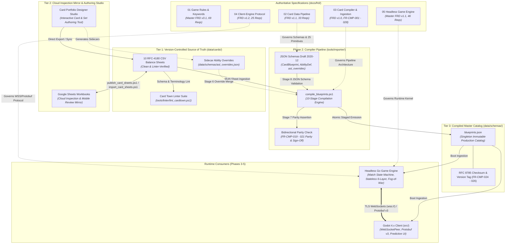
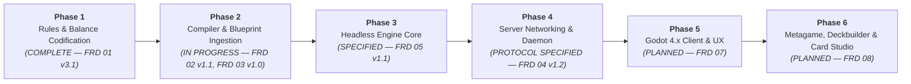

# Animus Mundi (Card Town) — Product Summary & Technical Roadmap

---

## 1. Executive Summary & Vision

**Animus Mundi** (working title: *Card Town*) is a competitive, digital collectible strategy card game (CCG) built with the **Godot 4.x Engine** and backed by a **server-authoritative game engine**. The game combines high-tactical depth with spatial battlefield positioning, a rich multi-resource economy, and an event-driven ability resolution stack.

### Key Game Pillars
- **Spatial Board Topology**: Combat and deployment are divided across dedicated battlefield zones: the frontline **Main Theater**, the tactical **Reserves**, and the fortified **Headquarters (HQ) Zone**. Units maneuver between reserves and the main theater to strike or regroup.
- **Dual Resource Economy**: Assets generate **Requisition** and **Tactics** by exhausting, creating dynamic turn-by-turn decisions between economy ramp and battlefield pressure.
- **Authoritative Determinism**: 100% of game logic, state transitions, fog-of-war security, and ability triggers execute on an authoritative server. The client is a thin, predictive visual presenter.
- **Declarative Architecture**: Card mechanics are defined not through ad-hoc script code, but through a structured, declarative Abstract Syntax Tree (AST) that the engine executes deterministically.
- **Rigorous Specification-Driven Design**: The game rules, wire protocols, and card data pipelines are fully specified through version-controlled Functional Requirements Documents (FRDs) verified by automated linters.

---

## 2. What We Have Built (Current Foundation)

The repository is currently organized around authoritative specifications, verified balance datasets, and automated quality assurance tooling:

```text
animus-mundi/
├── docs/
│   ├── AGENTS.md                          # Engineering & agent guidelines
│   ├── PRODUCT_SUMMARY.md                 # This product roadmap & architecture summary
│   ├── audit/                             # Socratic audit registry, guidelines & pending reviews
│   └── frd/
│       ├── 01_Game_Rules_FRD.md                         # Master FRD v3.1 (Pure Game Rules & Keywords)
│       ├── 02_Card_Data_Pipeline_FRD.md                 # FRD v1.1 (Ingestion, AST, 25 Primitives & Text Rules)
│       ├── 03_Card_Compiler_FRD.md                      # FRD v1.0 (Compiler CLI, Scoped Grammar, Overrides & Parity)
│       ├── 04_Client_Engine_Protocol_Networking_FRD.md  # FRD v1.2 (Networking, Fog-of-War & Wire Protocol)
│       └── 05_Headless_Game_Engine_FRD.md               # Master FRD v1.1 (Headless Go Kernel, 3-Tier Entities & Stack)
├── data/
│   ├── cards/                             # 10 Authoritative RFC-4180 CSV Balance Sheets
│   │   ├── maneuvers-{animus, concordia, path, soulless}.csv
│   │   └── units-and-structures-{animus, concordia, path, soulless, HQ, common}.csv
│   └── schemas/                           # Target directory for JSON schemas & blueprints.json
└── tools/
    ├── audit/                             # Audit status and resolution lifecycle tools
    ├── docs/                              # Live capability and state discovery (whats_up.ps1)
    ├── linter/
    │   ├── lint_cardtown.ps1              # Unified orchestrator & full-suite linter
    │   ├── lint_frd.ps1                   # FRD requirement cross-reference validator
    │   ├── lint_card_sheets.ps1           # CSV schema integrity linter
    │   ├── lint_card_syntax.ps1           # Rules text syntax & terminology linter
    │   ├── card_standardization_audit.json# 167-card audit & review log
    │   └── standardize_all_cards.ps1      # Automated normalization pipeline
    └── sheets/
        ├── publish_card_sheets.ps1        # Freshness-checked export from local CSVs to Google Sheets
        ├── import_card_sheets.ps1         # Interactive diff ingestion from Google Sheets to local CSVs
        └── publish_audit.ps1              # Card standardization audit Google Drive publisher
```

### 2.1 The Five Master FRDs (Core Architectural Pillars)

1. **[Game Rules FRD](frd/01_Game_Rules_FRD.md) (Master FRD v3.1 — 69 Requirements)**
   - **Deck Construction, Match Setup & First-Turn Rules (`FR-SET-001` - `FR-SET-004`, `FR-DEK-001` - `FR-DEK-002`, `FR-WIN-001`)**: 50-card minimum main deck, 1 faction Headquarters, rarity copy limits (4/3/2/1), pre-mulligan First-Player Determination (15s clock), 6-card opening hand with single partial mulligan (25s clock), Turn 1 draw skip, absence of summoning sickness, mandatory post-search shuffle, and empty-deck draw loss.
   - **Pure Game Rules, Card Taxonomy & Spatial Zone Model (`FR-CRD-101`, `FR-ZON-001` - `FR-ZON-005`, `FR-ENT-102` - `FR-ENT-103`)**: 14 printed card characteristics, Battlefield Assets vs. non-battlefield Cards, ownership vs. control, uncapped zone capacities (Reserves, Main Theater, Headquarters Zone, Hand, Deck, Discard, Attached Sub-Zone, and Resolution Stack), double-blind `1/1/1/1` Scratch Company lifecycle, tucked cards, and face-down transformation.
   - **Dual-Resource Economy, Turn Sequence & Clean-Stack Model (`FR-RES-001` - `FR-RES-003`, `FR-TRN-001` - `FR-TRN-003a`, `FR-CAP-001`, `FR-QUE-001`)**: Explicit off-stack Requisition and Tactics generation, one-way `2R -> 1T` conversion, Ready Phase (unexhaust + start-of-turn triggers), Draw Phase (draw + draw triggers), Main Phase (75s turn clock + 60s Reserve Time Bank, clean-stack priority), and End Phase (Sub-Phases 4a–4d).
   - **Targeting, Fizzle & Interactive Choice Rules (`FR-TGT-001` - `FR-TGT-003`, `FR-MOD-001`)**: Conjunction target filtering, upfront target selection for conditional triggers, two-stage target verification, distributed pool evaporation, composite clause survival, single-option fast-path, and 15s/10s choice clocks with deterministic timeout fallbacks.
   - **Six-Layer Attribute Calculation & 5-Stage Damage Mitigation (`FR-LAY-001` - `FR-LAY-003`, `FR-REP-001` - `FR-REP-004`)**: Continuous evaluation across Layers 1–6 (Base Printed/Face-Down $\rightarrow$ Type/Subtype $\rightarrow$ Keywords $\rightarrow$ Continuous Auras $\rightarrow$ Temp Modifiers $\rightarrow$ Exclusive Combat Power clamping at `0`), inline replacement effects, and 5-stage damage mitigation (Stage 1 Redirection $\rightarrow$ Stage 2 Flat `Resistant N` $\rightarrow$ Stage 3 `Stalwart` Combat Cap $\rightarrow$ Stage 4 Dynamic `Armor` $\rightarrow$ Stage 5 Health Commit).
   - **Deterministic 3-Step Combat Sequence (`FR-CBT-001` - `FR-CBT-003`)**: Step 1 (Declaration & Upfront Exhaustion), Step 2 (Pre-Combat Trigger & Reaction Window), and Step 3 (Simultaneous Combat Damage & 100% Symmetric Retaliation across Units, Structures, and Headquarters).
   - **Canonical Keywords Catalog (`FR-KWD-002a` - `FR-KWD-002o`)**: Formal definitions for all 15 core game keywords (Unbowed, Resistant N, Stalwart, Heal N, Cornered, Aggressive N, Ethereal, Ward, Versatile, Guardian, Armor N, Deploys Exhausted, Scratch N, Regroup N, Berserk).

2. **[Card Data Pipeline & Ability Authoring FRD](frd/02_Card_Data_Pipeline_FRD.md) (FRD v1.1 — 33 Requirements)**
   - **Three-Tier Data Authority Lifecycle (`FR-DAT-001` - `FR-DAT-004`)**: Tier 1 (Authoritative Repository CSVs in `data/cards/*.csv`) $\leftrightarrow$ Tier 2 (Cloud Google Sheets Inspection Mirror synced via freshness-checked `publish_card_sheets.ps1` and diff-verified `import_card_sheets.ps1`) $\rightarrow$ Tier 3 (Compiled Production `blueprints.json` bound with 256-bit `catalogChecksum` and `cardDataVersion`).
   - **Zero-Aliasing Target Enums & Normalization (`FR-DAT-005` - `FR-DAT-008`)**: Direct `CardBlueprint` schema header parity on all 10 CSVs with zero runtime aliases (`UNIT`, `STRUCTURE`, `MANEUVER`, `HEADQUARTERS`; `CONCORDIA`, `SOULLESS`, `PATH`, `ANIMUS`, `NEUTRAL`), deterministic immutable slug IDs (`<faction>_<snake_case_title>`, `FR-DAT-002`), Title Case subtype normalization with case-insensitive runtime filtering, and `"--"` sentinel handling.
   - **Declarative Ability AST & Extended Mechanics (`FR-ABL-001` - `FR-ABL-012`)**: Polymorphic schemas for `TRIGGERED`, `ACTIVATED`, `CONTINUOUS_AURA` (Layer 4 modifiers & `abilityGrants`), `REPLACEMENT_WATCHER`, `MANEUVER_EFFECT`, and `KEYWORD_GRANT`, supported by `FilterDef`, composable `ValueToken.query` aggregates, `CostDef` (`EXHAUST_SELF`), `TargetRef` (`DISTRIBUTED_POOL`), `maxPerTurn` gates, modal choices, and all 15 keyword AST mappings.
   - **Event Hook Taxonomy, 25 Atomic Primitives & Upfront Target Locking (`FR-TRG-001`, `FR-TRG-007`, `FR-PRM-001`, `FR-TGT-101`)**: Canonical catalog of 24 `EVENT_*` hooks and 3 `WOULD_*` replacement hooks with causality lineage, **25 standard atomic effect primitives** (plus `COMPOSITE_SEQUENCE` / `CONDITIONAL_CLAUSE`), upfront target locking (`bindingPolicy: "UPFRONT_LOCK"`), and 4 benchmark card AST implementations.
   - **MTG-Aligned Rules Text Standards (`FR-TXT-001` - `FR-TXT-006`)**: Standardized capitalization, trigger preambles (*When*, *Whenever*, *At*), cost notation (`[Cost]: [Effect].`), passive aura phrasing (*has*/*have*), temporary stat modification phrasing (*gets*/*get*), keyword grants (*gains*/*gain*), and conjunction targeting syntax (*chosen*) with two-stage dynamic filter verification (`FR-TGT-103`).
   - **Validation, Parity & Prototype Gating (`FR-VAL-001` - `FR-VAL-003`, Domain 7)**: Automated 1-to-1 rules-text-to-AST parity verification, two-tier prototype compilation (`currentProxy` / `needsRework` allowed in dev builds, blocked by `ERR_STRICT_PROTOTYPE_REJECTED` under `-Strict`), and the 167-card Master Review Register.

3. **[Card Compiler & Blueprint Ingestion FRD](frd/03_Card_Compiler_FRD.md) (FRD v1.0 — 28 Requirements)**
   - **Ten-Stage Compilation Pipeline & CLI Contract (`FR-CMP-001` - `FR-CMP-003`)**: Parameterized PowerShell 5.1/7+ CLI (`compile_blueprints.ps1`) with `< 5,000 ms` warm execution SLA, standardized CI/CD exit codes (`0`–`5`), and atomic `.tmp.$PID` file staging with zero-corrupt rollback guarantees.
   - **Atomic Multi-Sheet Ingestion & Prototype Policy (`FR-CMP-004` - `FR-CMP-007`)**: Strict UTF-8 RFC-4180 parsing across all 10 CSV sheets, global `<faction>_<slug>` collision prevention (`ERR_SLUG_COLLISION`), strict attribute type coercion, and harmonized prototype handling (`"proxy": true` / `"needsRework": true` in dev builds vs. `ERR_STRICT_PROTOTYPE_REJECTED` under `-Strict`).
   - **Scoped Rules Text Lexer & AST Synthesizer (`FR-CMP-008` - `FR-CMP-016`)**: Decoupled Declarative Catalog Model (`Direction B`) scoping automated regex synthesis to predictable patterns—standalone canonical keywords (`FR-CMP-013`), standard cost headers (`FR-CMP-010`), and single-clause triggers/auras/replacements—into polymorphic `AbilityDef` AST structures.
   - **Two-Tier Sidecar Overrides Registry (`FR-CMP-017` - `FR-CMP-018`)**: Authoritative sidecar registry (`data/schemas/ast_overrides.json`) for bespoke multi-clause cards (*NO-AH-5*, *Samsara*, *Ambush Tactics*, *Blind Defile*, *Forced Mutation*), enforcing orphan detection, schema conformance, designer verification metadata, and sanitized CSV `rulesText` string-match checks (`ERR_OVERRIDE_TEXT_MISMATCH`).
   - **Bidirectional Text-to-AST Parity Engine (`FR-CMP-019` - `FR-CMP-021`)**: Enforces forward and reverse clause-to-AST parity on synthesized cards, while verifying sidecar overrides via explicit designer sign-off (`parityVerified: true`), standalone keyword presence, and CSV `rulesText` equality, plus dynamic Master Review Register gating under `-Strict`.
   - **JSON Schema Validation & Production Packaging (`FR-CMP-022` - `FR-CMP-023`)**: Validates blueprints and overrides against JSON Schema Draft 2020-12 (`CardBlueprint.schema.json`, `AbilityDef.schema.json`, `ast_overrides.schema.json` via `-EmitSchemas`) and emits 2-space indented `blueprints.json` (plus optional `blueprints.min.json` via `-Minify`).
   - **RFC 8785 Canonical Fingerprinting & Diagnostics (`FR-CMP-024` - `FR-CMP-028`)**: Session-cached RFC 8785 JCS canonicalization, 256-bit SHA-256 `catalogChecksum`, SemVer 2.0 `cardDataVersion`, and 22 structured diagnostic error codes (`ERR_*`).

4. **[Client-Engine Protocol & Networking FRD](frd/04_Client_Engine_Protocol_Networking_FRD.md) (FRD v1.2 — 25 Requirements)**
   - **Transport & DoS-Hardened Liveness (`FR-NET-001` - `FR-NET-004`)**: Isolated stateful GCP match containers (GKE/Agones or Cloud Run) communicating over TLS WebSockets (`wss://` port 443) via Godot 4.x's native `WebSocketPeer`, using binary Protocol Buffers v3 (`ccg.network`) with JSON debug fallback, 1,000 ms `Ping`/`Pong` heartbeats (rate-limited to max 5/s), and 3,000 ms disconnect detection.
   - **Session Lifecycle & Zero-Trust Setup (`FR-SES-001` - `FR-SES-005`)**: Strict version/JWT handshake, backend-fetched deck legality validation (`FR-SET-001`) with zero client card-list transmission, 15-second first-player choice prompt, and 25-second continuous partial mulligan negotiation.
   - **Fog-of-War & Double-Blind Security Boundary (`FR-SEC-001` - `FR-SEC-005`, `FR-ZON-005`)**: Ephemeral opaque proxy IDs (`proxy_scratch_<id>`) for Scratch Companies in server RAM, split owner/opponent zone-departure reveal packets (`DISCARD`, `HAND`/`DECK`, `ATTACHED`), opponent hand/deck sanitization, and authoritative server CSPRNG.
   - **Full Command, Event & Rejection Taxonomy (`FR-MSG-001` - `FR-MSG-005`, `FR-ERR-001`)**: `GameEnvelope` framing 14 client commands (with boundary clamping on `tactics_requested` `[1..50]` and Berserk target counts), 15 core `EngineEvent` schemas, synchronous `PlayerChoicePrompt` modals (10s decision clock), and 8 `CommandRejection` error codes (including `ERR_GUARDIAN_PRIORITY_VIOLATION`).
   - **Pacing, Desync Hashing & Quarantined Replays (`FR-PAC-001` - `FR-PAC-004`, `FR-SPC-002`)**: Client FIFO animation queue with 2,000 ms / 3.0x fast-forwarding, 5,000 ms turn-handover and 3,000 ms prompt animation grace buffers, 60-second Unified Reserve Time Bank with opponent-turn forfeiture protection, atomic 5-stage `DamagePipelineStageEvent` batching, per-batch 64-bit Layer 6 `PublicStateHash` verification (snapshot recovery throttled to 1 per 3,000 ms), and unmasked `.rec` match replays quarantined until tournament series completion.

5. **[Headless Game Engine FRD](frd/05_Headless_Game_Engine_FRD.md) (Master FRD v1.1 — 46 Requirements)**
   - **Standalone Go Kernel (`FR-ENG-001` - `FR-ENG-005`)**: Pure Go (`CGO_ENABLED=0`) headless engine (`cardtown/engine`) with isolated 3-stream PCG32/SplitMix64 PRNG (`StreamShuffle`, `StreamTargeting`, `StreamMatchDecisions`), pure 32-bit discrete integer arithmetic, and rolling 64-bit FNV-1a state checksums (`FR-PAC-004`).
   - **Transactional State Machine, 3-Tier Entity Architecture & Phase Engine (`FR-ENG-006` - `FR-ENG-011`, `FR-ENT-001` - `FR-ENT-003`, `FR-SNP-101`)**: In-place mutable state with delta-memento rollback (including PRNG stream counters), 3-tier runtime entity structs (`CardBlueprint` singleton $\rightarrow$ `CardInstance` $\rightarrow$ `AssetInstance` + `AssetSnapshot` LKI), 4-step pre-game setup/mulligan handshake, deterministic turn sub-phases, off-stack resource operations vs. clean-stack manual actions, and 75s/15s/10s clocks cascading into the 60s Reserve Time Bank.
   - **LIFO Stack Runner & APNAP Dispatcher (`FR-ENG-012` - `FR-ENG-017`)**: 5-archetype LIFO resolution stack, atomic upfront cost deduction (with conditional `EXHAUST_SELF`), APNAP simultaneous trigger ordering, two-stage target verification & pool evaporation, inline reactive `ReplacementWatcherDef` interception, and single-option choice prompt fast-pathing.
   - **Declarative Ability AST Interpreter (`FR-ENG-018` - `FR-ENG-024`)**: Exhaustive Go type-switch AST visitor evaluating all 6 `abilityType` archetypes, dynamic `FilterDef`/`ValueToken` expressions, double-blind `Scratch Company` (`proxy_scratch_*`) lifecycle, and 1:1 execution handlers for all **25 canonical atomic primitives** (`FR-PRM-001`).
   - **Stateless 6-Layer Attribute Pipeline (`FR-ENG-025` - `FR-ENG-029`)**: Stateless continuous on-demand evaluation across Layers 1–6 with timestamp precedence, exclusive Layer 6 Combat Power clamping (`EffectivePower = max(0, RawPower)`), and End Phase Sub-Phase 4c modifier cleanup.
   - **3-Step Combat, 5-Stage Mitigation & Victory Engine (`FR-ENG-030` - `FR-ENG-035`, `FR-ENG-042`)**: Spatial Main Theater/HQ combat eligibility, upfront `Berserk` secondary target binding, 3-step combat sequence (`FR-CBT-002`), canonical 5-stage damage mitigation (Target Redirection $\rightarrow$ `Resistant N` $\rightarrow$ `Stalwart` $\rightarrow$ `Armor` $\rightarrow$ Health Commit & `EVENT_TAKE_DAMAGE` gate), `ATTACHED` sub-zone cleanup, recursive post-`Berserk` death sweeps, and authoritative match conclusion/draw rules.
   - **Headless Test Harness & Diagnostics (`FR-ENG-036` - `FR-ENG-041`)**: Standalone CLI runner (`cmd/engine-sim`), scripted YAML/JSON scenario DSL, deterministic `.rec` replay validator (`FR-SPC-002`), combinatorial monkey/fuzz runner, throughput benchmarks ($\ge 10,000$ turns/sec/core), and wire-aligned error taxonomy (`FR-ERR-001`).

### 2.2 Balance Datasets & Card Standardization
- **10 Clean RFC-4180 CSV Balance Sheets** in `data/cards/` covering 4 distinct factions (Animus, Concordia, Path, Soulless), Neutral/Common units, and Headquarters.
- **167 Cards Fully Audited**:
  - **127 Cards Standardized**: Rules text updated to adhere to MTG-style grammar and terminology.
  - **52 Cards Flagged for Design Review (56 Documented Entries)**: Cataloged in Section 7.2 of the Card Data Pipeline FRD and in `tools/linter/card_standardization_audit.json` (including resolved `DA-DAT-003` mechanical triage items for *Rift*, *Steel Rain*, *Gemstone Titan*, and the *Daggerspine Rangers* $\rightarrow$ *Spoil Forest Irregulars* IP rename).

### 2.3 Verification & Quality Assurance Tooling
- **Automated Linter Suite ([`tools/linter/lint_cardtown.ps1`](../tools/linter/lint_cardtown.ps1))**:
  - Validates **201 defined requirement IDs** across all 5 FRDs and verifies **1,557 cross-references** with **0 dangling references** (`lint_frd.ps1`).
  - Validates CSV table integrity, column consistency, and target enum conformance across 10 balance sheets (`lint_card_sheets.ps1`).
  - Audits card rules text against forbidden terminology (`friendly` $\rightarrow$ `allied`, raw `~`, raw `attack` $\rightarrow$ `power`) (`lint_card_syntax.ps1`).
- **Audit Lifecycle & Pre-commit Hooks**:
  - Git pre-commit hook (`tools/linter/install_hooks.ps1`) enforcing zero lint violations prior to local commits.
  - Socratic audit triage and resolution engine (`tools/audit/audit_status.ps1`, `tools/audit/resolve_audit.ps1`) tracking audits in `docs/audit/audit_registry.md`.
- **Sheets Publisher & Importer ([`tools/sheets/publish_card_sheets.ps1`](../tools/sheets/publish_card_sheets.ps1), [`tools/sheets/import_card_sheets.ps1`](../tools/sheets/import_card_sheets.ps1))**:
  - Synchronizes local Tier 1 CSV balance data with Tier 2 Google Sheets workbooks using pre-publish timestamp freshness checks (`--Force` override) and interactive terminal diff ingestion (`FR-DAT-001`).

---

## 3. Current Phase: Card Compiler Implementation & Blueprint Ingestion (Phase 2)

With the game rules, data pipeline, compiler, wire protocol, and headless engine architectures codified across all five Master FRDs and the authoring balance CSVs normalized, the active implementation milestone is the **Card Compiler Pipeline (`compile_blueprints.ps1`)** that translates raw CSV rows and sidecar overrides into machine-executable JSON blueprint assets (`data/schemas/blueprints.json`).



### 3.1 Deliverables in Phase 2

1. **[Card Compiler Functional Requirements Document](frd/03_Card_Compiler_FRD.md) (`03_Card_Compiler_FRD.md`) [CODIFIED & COMPLETE]**:
   - Technical specification (`FR-CMP-001` - `FR-CMP-028`) detailing compiler CLI interface (`FR-CMP-001`), 10-stage pipeline (`FR-CMP-002`), scoped parsing grammar (`FR-CMP-008`), AST synthesis rules (`FR-CMP-013`), two-tier sidecar overrides (`FR-CMP-017`), forward/reverse parity validation & override sign-off (`FR-CMP-019` - `FR-CMP-021`), RFC 8785 JCS fingerprinting (`FR-CMP-024` - `FR-CMP-026`), and 22 diagnostic error codes (`FR-CMP-027`).
2. **Formal JSON Schemas (`data/schemas/`)**:
   - `CardBlueprint.schema.json`: Complete JSON Schema Draft 2020-12 validation for production blueprints (`FR-DAT-005`, `FR-CMP-022`).
   - `AbilityDef.schema.json`: Polymorphic schema validating ability archetypes, event hooks, 25 atomic primitives, composable `ValueToken.query` aggregates, condition gates, cost models, and targeting filters (`FR-ABL-001` - `FR-ABL-012`, `FR-TRG-001`, `FR-PRM-001`, `FR-TGT-101`, `FR-CMP-022`).
   - `ast_overrides.schema.json`: Formal schema validating the sidecar overrides registry (`FR-CMP-017`, `FR-CMP-022`).
3. **Card Compiler Script (`tools/importer/compile_blueprints.ps1`)**:
   - **CSV Ingestion**: Parse all 10 CSV sheets atomically, strictly validating types, ranges, and zero-aliasing enums (`FR-VAL-003`, `FR-CMP-004` - `FR-CMP-007`).
   - **Slug Derivation**: Compute canonical IDs (`<faction>_<slug>`) with global collision prevention per `FR-DAT-002`, `FR-CMP-006`.
   - **Scoped Ability AST Synthesizer & Sidecar Merger**: Translate predictable rules text and standalone keyword lines into declarative JSON AST payloads while merging authoritative `ast_overrides.json` entries for complex multi-clause cards (`FR-ABL-001` - `FR-ABL-012`, `FR-CMP-008` - `FR-CMP-018`).
   - **Bidirectional Text-to-AST Parity Checker**: Automate `FR-VAL-002`, `FR-CMP-019` - `FR-CMP-020` to verify forward/reverse clause parity on synthesized cards and enforce designer sign-off (`parityVerified: true`) + sanitized CSV `rulesText` equality on overridden cards.
   - **RFC 8785 JCS Catalog Fingerprinting**: Compute the 256-bit SHA-256 `catalogChecksum` over canonical RFC 8785 bytes (via session-cached serializer) and stamp semantic `cardDataVersion` (`FR-DAT-004`, `FR-CMP-024` - `FR-CMP-026`).
   - **Atomic Catalog Emission**: Generate 2-space indented `data/schemas/blueprints.json` (and optional `blueprints.min.json`) atomically via `.tmp.$PID` staging (`FR-CMP-003`, `FR-CMP-023`).
4. **Resolution of Domain 7 Designer Review Items**:
   - Designer review and sign-off on flagged cards with unresolved items in the Master Review Register to finalize card behaviors prior to release consumption. In development builds, rework/proxy cards compile with `"proxy": true` / `"needsRework": true` metadata flags, but are dynamically gated under `-Strict` mode (`FR-CMP-005`, `FR-CMP-021`).

---

## 4. What's Left Beyond That (The Long-Term Roadmap)

Following completion of the Card Compiler and production blueprint catalog, development proceeds across four subsequent phases:



### Phase 3: Core Headless Game Engine Implementation (`05_Headless_Game_Engine_FRD.md`)
- **Authoritative Match State Machine & 3-Tier Entity Kernel (`FR-ENG-001` - `FR-ENG-011`, `FR-ENT-001` - `FR-ENT-003`, `FR-SNP-101`)**:
  - Implement pure Go (`CGO_ENABLED=0`) transactional state engine (`cardtown/engine`) with isolated 3-stream PCG32/SplitMix64 PRNG, delta-memento rollback, and 3-tier runtime entity structs (`CardBlueprint` $\rightarrow$ `CardInstance` $\rightarrow$ `AssetInstance` + `AssetSnapshot`).
  - Implement 4-step pre-game setup/mulligan handshake, turn sub-phases (Ready 1a–1b, Draw 2a–2b, Main, End 4a–4d), off-stack resource operations vs. clean-stack manual actions, and the 5-archetype LIFO Resolution Stack (`FR-QUE-001`, `FR-ENG-012` - `FR-ENG-017`).
- **Stateless 6-Layer Attribute Pipeline (`FR-LAY-001` - `FR-LAY-003`, `FR-ENG-025` - `FR-ENG-029`)**:
  - Implement stateless continuous on-demand attribute recalculation across Layers 1–6 (Base Printed/Face-Down $\rightarrow$ Type/Subtype Grants $\rightarrow$ Keyword Grants/Suppressions $\rightarrow$ Continuous Auras $\rightarrow$ Temporary Turn Modifiers $\rightarrow$ Exclusive Layer 6 Combat Power Clamping at `0`).
- **Combat Resolution & 5-Stage Damage Mitigation Engine (`FR-CBT-001` - `FR-CBT-003`, `FR-REP-004`, `FR-ENG-030` - `FR-ENG-035`, `FR-ENG-042`)**:
  - Step 1 (Declaration, `Guardian` priority check, upfront `SECONDARY_BERSERK_TARGET` binding & Exhaustion), Step 2 (APNAP Pre-Combat Trigger/Reaction Window & survival check), Step 3 (Simultaneous Combat Damage & 100% Symmetric Retaliation; `FR-CBT-002`).
  - Canonical 5-stage damage mitigation sequence: Stage 1 Target Redirection $\rightarrow$ Stage 2 Flat `Resistant N` modification $\rightarrow$ Stage 3 `Stalwart` combat damage cap $\rightarrow$ Stage 4 Dynamic `Armor` absorption $\rightarrow$ Stage 5 Health commit & `EVENT_TAKE_DAMAGE` gate, followed by state-based death sweeps and recursive `Berserk` excess damage resolution.
- **Declarative Ability AST Interpreter (`FR-ENG-018` - `FR-ENG-024`)**:
  - Go type-switch AST visitor evaluating `AbilityDef` structures, dynamic `FilterDef` predicates, and composable `ValueToken.query` expressions against match state, including upfront target locking (`FR-TGT-101`) and event causality lineage (`FR-TRG-007`).
  - Implement all **25 canonical atomic effect primitives** (`FR-PRM-001`: `DEAL_DAMAGE`, `HEAL`, `ADD_ARMOR`, `MODIFY_STAT`, `MOVE_ZONE`, `DRAW_CARD`, `DISCARD_CARD`, `SCRATCH`, `REGROUP`, `TUCK_UNDER`, `MORPH_SCRATCH`, `LOOK_TOP_CARDS`, etc.).
- **Headless Test Harness & Simulation Suite (`FR-ENG-036` - `FR-ENG-041`)**:
  - Implement standalone `cmd/engine-sim` CLI runner, JSON/YAML scenario assertion DSL, deterministic `.rec` replay validator (`FR-SPC-002`), combinatorial monkey/fuzz runner, and Go throughput benchmarks ($\ge 10,000$ turns/sec/core).

### Phase 4: Server Networking, Security & Match Orchestration (`04_Client_Engine_Protocol_Networking_FRD.md`, `06_Server_Daemon_Matchmaking_FRD.md`)
- **Dedicated Game Server Daemon (`FR-NET-001` - `FR-NET-004`, `FR-SRV-`)**:
  - High-concurrency stateful single-match container process hosted on GCP (GKE/Agones or Cloud Run).
  - TLS WebSockets (`wss://` port 443) and Protocol Buffers v3 (`ccg.network`) wire protocol integration wrapping the pure Go headless engine daemon (`FR-ENG-001`).
- **Session Lifecycle & Match Orchestration (`FR-SES-001` - `FR-SES-005`)**:
  - Version/JWT handshake protocol (`FR-SES-001`) and zero-trust backend-fetched deck legality validation (`FR-SET-001`, `FR-SES-002`).
  - 15-second first-player coin toss choice (`FR-SES-003`) and 25-second continuous partial mulligan negotiation (`FR-SES-004`).
- **Fog of War & Double-Blind Anti-Cheat Boundary (`FR-SEC-001` - `FR-SEC-005`, `FR-ZON-005`)**:
  - Dynamic payload sanitization, opaque `proxy_scratch_<id>` masking, split owner/opponent zone-departure reveal packets, and boundary clamping (`DA-NET-003`).
- **State Checksum Synchronization & Snapshot Throttling (`FR-PAC-004`, `DA-NET-002`)**:
  - Per-batch 64-bit CRC/FNV-1a `PublicStateHash` verification over Layer 6 effective attributes, with `FullStateSnapshot` recovery throttled to max 1 per 3,000 ms (and automated backoff after 3 failures in 15s).
- **Disconnect Handling, Grace Buffers & Quarantined Replay Recording (`FR-NET-004`, `FR-SES-005`, `FR-PAC-001`, `FR-SPC-002`)**:
  - 1,000 ms heartbeat (5/s DoS rate limit), 3,000 ms disconnect detection, 60-second Unified Reserve Time Bank with opponent-turn forfeiture protection (`DA-NET-001`), 5,000 ms turn-handover and 3,000 ms prompt animation grace buffers (`DA-NET-004`), and unmasked `.rec` deterministic match recording quarantined until tournament series completion (`DA-NET-006`).

### Phase 5: Godot Client Development & User Experience (`src/`, `07_Godot_Client_Architecture_FRD.md`)
- **Godot 4.x Client Scaffolding (`FR-CLN-`)**:
  - Project setup in `src/` (`res://`), assets layout, theme definitions, resolution scaling, and local headless Go engine sidecar spawning for offline/bot play (`FR-ENG-036`).
- **Card Catalog Resource Loader**:
  - Ingest `blueprints.json` at client boot, verifying `catalogChecksum` (`FR-CMP-025`) and instantiating card visual resources, artwork links, and localized text templates.
- **Battlefield & Spatial Zone Visualizer**:
  - Interactive board representation: Reserves, Main Theater, Headquarters zones, Hand carousel, Discard pile, Attached sub-zones, and Deck (with card compaction for uncapped zones; `FR-ZON-001`).
  - Interactive LIFO Resolution Stack visualizer displaying pending deployments, maneuvers, attacks, and triggered abilities (`FR-QUE-001`).
- **Network Client Integration (`FR-NET-002` - `FR-NET-004`, `FR-MSG-001` - `FR-MSG-004`, `FR-ERR-001`)**:
  - `WebSocketPeer` wrapper with binary Protobuf serialization, automatic reconnect, ping/latency tracking, optimistic action rollback on `CommandRejection`, and mandatory Guardian target flashing on `ERR_GUARDIAN_PRIORITY_VIOLATION` (`DA-NET-005`).
- **Interactive Choice Prompt Modals (`FR-MSG-005`, `FR-MOD-001`)**:
  - Synchronous `PlayerChoicePrompt` modals (10s decision clock + 3,000 ms animation grace buffer) supporting `PartitionedSelection`.
  - Scry / `LOOK_TOP_CARDS` modal UI with keep/bottom reordering, `SEARCH_DECK` modal with category filtering, `MODAL_SELECT` dialogs (*Ambush Tactics*, *Rogue Fleshshaper*), `TRIGGER_ORDER_SELECT` simultaneous allied trigger ordering, and `DISTRIBUTED_POOL` allocation sliders.
- **Audio, VFX & Paced Animation Queue (`FR-PAC-001` - `FR-PAC-003`)**:
  - Decoupled FIFO `AnimationEventQueue` with 2,000 ms backlog / 3.0x fast-forwarding, 5-stage `DamagePipelineStageEvent` visual cascades, attack animation paths, card exhaust/ready rotation tweens, and phase banner announcements.

### Phase 6: Metagame, Deckbuilder, Authoring Studio & Balance Lifecycle (`08_Deckbuilder_and_Card_Studio_FRD.md`)
- **In-Game Deckbuilder (`FR-DCK-`, `FR-SET-001`)**:
  - Visual deck construction enforcing HQ selection, faction color identity, 50-card minimum, and rarity copy caps (Common 4, Uncommon 3, Rare 2, Mythic 1; Scratch Company exclusion).
  - Deck export/import codes and server-side deck registration tokens (`FR-SES-002`).
- **Card Portfolio & Set Designer Studio (Interactive Card Authoring Tool)**:
  - Standalone interactive workstation (web/desktop application) replacing manual spreadsheet maintenance with structured card and set portfolio design (`FR-DAT-001`).
  - **Form-Based Card Inspector**: Real-time attribute validation, faction/type gating, Title Case subtype taggers, and deployment zone assignment enforcing `CardBlueprint.schema.json` (`FR-DAT-005` - `FR-DAT-008`).
  - **Visual Ability AST Builder**: Declarative block editor for assembling polymorphic ability trees (`TRIGGERED`, `ACTIVATED`, `CONTINUOUS_AURA`, `REPLACEMENT_WATCHER`, `MANEUVER_EFFECT`, `KEYWORD_GRANT`), 25 atomic primitives (`FR-PRM-001`), composable `ValueToken.query` aggregates, condition gates, cost tokens, and target filters without hand-writing raw JSON (`FR-ABL-001` - `FR-ABL-012`).
  - **Live Syntax & Parity Engine**: Real-time bidirectional translation between MTG-aligned rules text (`FR-TXT-001` - `FR-TXT-006`) and declarative AST nodes, with instant parity verification (`FR-VAL-002`, `FR-CMP-019` - `FR-CMP-020`), designer override sign-off, and canonical keyword autocomplete.
  - **Set & Portfolio Management**: Multi-set cataloging, expansion tagging, card versioning, rarity curves, and deterministic slug derivation (`FR-DAT-002`, `FR-CMP-006`).
  - **Version-Controlled Serialization**: Direct round-trip export into Git-versioned Tier 1 CSV balance sheets (`data/cards/*.csv`) and sidecar override definitions (`data/schemas/ast_overrides.json`, `FR-CMP-017`), preserving version control as the single source of truth.
- **Automated Balance Pipeline Integration**:
  - Live round-trip synchronization: Designer edits Google Sheets or Card Studio $\rightarrow$ `import_card_sheets.ps1` / `publish_card_sheets.ps1` $\rightarrow$ `data/cards/*.csv` $\rightarrow$ `compile_blueprints.ps1` $\rightarrow$ `cmd/engine-sim` automated engine regression tests.
- **Telemetry & Match Analytics**:
  - Win-rate tracking per faction, card play frequency, and turn-duration metrics to guide future balance patches.

---

### 4.1 Master Specification Roadmap (Phases 1–6)

In alignment with the requirement prefix taxonomy defined across `.agents/skills/pm-frd-drafter/SKILL.md` and `docs/frd/`, the following Functional Requirements Documents govern the complete six-phase product lifecycle:

| Roadmap Phase | Target Specification Document | Domain Prefixes | Primary Scope | Status |
| :--- | :--- | :--- | :--- | :--- |
| **Phase 1** | `01_Game_Rules_FRD.md` | `FR-SET-`, `FR-DEK-`, `FR-WIN-`, `FR-CRD-`, `FR-ZON-`, `FR-ENT-`, `FR-RES-`, `FR-TRN-`, `FR-CST-`, `FR-CAP-`, `FR-INH-`, `FR-ACT-`, `FR-MNV-`, `FR-TGT-`, `FR-MOD-`, `FR-QUE-`, `FR-TRG-`, `FR-LAY-`, `FR-REP-`, `FR-CBT-`, `FR-KWD-` | Pure game rules, card & asset taxonomy, spatial zone topology, turn structure, 6-layer evaluation, 5-stage damage mitigation, 3-step combat, and 15-keyword catalog | Codified (Master v3.1 — 69 Reqs) |
| **Phase 2** | `02_Card_Data_Pipeline_FRD.md` | `FR-DAT-`, `FR-ABL-`, `FR-TRG-`, `FR-PRM-`, `FR-TGT-`, `FR-TXT-`, `FR-VAL-` | 3-tier data authority lifecycle, `CardBlueprint` & `AbilityDef` JSON schemas, 24 event hooks, 25 atomic primitives, upfront target locking, MTG text rules, and 167-card review register | Codified (v1.1 — 33 Reqs) |
| **Phase 2** | `03_Card_Compiler_FRD.md` | `FR-CMP-` | 10-stage CSV-to-JSON compiler CLI (`compile_blueprints.ps1`), scoped AST synthesizer, sidecar override registry, bidirectional parity checker, and RFC 8785 SHA-256 fingerprinting | Codified (v1.0 — 28 Reqs) |
| **Phase 3** | `05_Headless_Game_Engine_FRD.md` | `FR-ENG-`, `FR-ENT-`, `FR-SNP-` | Pure Go headless kernel, 3-tier runtime entity memory model, 3-stream PCG32 PRNG, transactional LIFO stack runner, 25-primitive AST interpreter, stateless 6-layer pipeline, 5-stage mitigation, and `engine-sim` test harness | Codified (Master v1.1 — 46 Reqs) |
| **Phase 4** | `04_Client_Engine_Protocol_Networking_FRD.md` | `FR-NET-`, `FR-SES-`, `FR-SEC-`, `FR-MSG-`, `FR-PAC-`, `FR-SPC-`, `FR-ERR-` | TLS WebSockets (`wss://`), Protobuf v3 wire schemas, zero-trust handshake, double-blind Fog-of-War, 14 client commands, 15 engine events, choice prompts, grace buffers, state hashing, and quarantined `.rec` replays | Codified (v1.2 — 25 Reqs) |
| **Phase 4** | `06_Server_Daemon_Matchmaking_FRD.md` | `FR-SRV-` | Dedicated server daemon, GCP Agones container lifecycle, matchmaker queue orchestration, session persistence, and JWT authentication | Planned |
| **Phase 5** | `07_Godot_Client_Architecture_FRD.md` | `FR-CLN-` | Godot 4.x scene graph, presentation layer, optimistic UI state caches, input dispatchers, modal widgets, and paced audio/VFX animation queues | Planned |
| **Phase 6** | `08_Deckbuilder_and_Card_Studio_FRD.md` | `FR-DCK-` | In-game visual deckbuilder, export/import codes, and standalone Card Portfolio Designer Studio | Planned |
