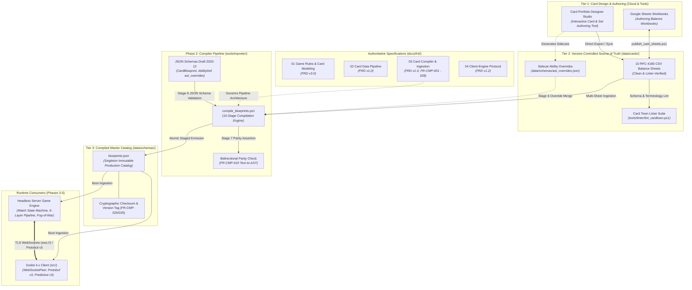
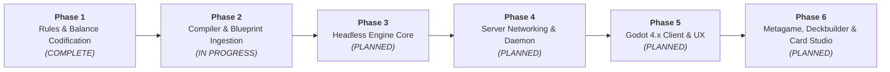

# Animus Mundi (Card Town) — Product Summary & Technical Roadmap

---

## 1. Executive Summary & Vision

**Animus Mundi** (working title: *Card Town*) is a competitive, digital collectible strategy card game (CCG) built with the **Godot 4.x Engine** and backed by a **server-authoritative game engine**. The game combines high-tactical depth with spatial battlefield positioning, a rich multi-resource economy, and an event-driven ability resolution stack.

### Key Game Pillars
- **Spatial Board Topology**: Combat and deployment are divided across dedicated battlefield zones: the frontline **Main Theater**, the tactical **Reserves**, and the fortified **Headquarters (HQ) Zone**. Units maneuver between reserves and the main theater to strike or regroup.
- **Dual Resource Economy**: Assets generate **Requisition** and **Tactics** by exhausting, creating dynamic turn-by-turn decisions between economy ramp and battlefield pressure.
- **Authoritative Determinism**: 100% of game logic, state transitions, fog-of-war security, and ability triggers execute on an authoritative server. The client is a thin, predictive visual presenter.
- **Declarative Architecture**: Card mechanics are defined not through ad-hoc script code, but through a structured, declarative Abstract Syntax Tree (AST) that the engine executes deterministically.
- **Rigorous Specification-Driven Design**: The game rules, wire protocols, and card data pipelines are fully specified through version-controlled Functional Requirements Documents (FRDs) verified by automated linters.

---

## 2. What We Have Built (Current Foundation)

The repository is currently organized around authoritative specifications, verified balance datasets, and automated quality assurance tooling:

```text
animus-mundi/
├── docs/
│   ├── AGENTS.md                          # Engineering & agent guidelines
│   ├── PRODUCT_SUMMARY.md                 # This product roadmap & architecture summary
│   ├── audit/                             # Socratic audit registry, guidelines & pending reviews
│   └── frd/
│       ├── 01_Game_Rules_and_Card_Modeling_FRD.md       # Master FRD v3.0 (Rules & Modeling)
│       ├── 02_Card_Data_Pipeline_FRD.md                 # FRD v1.0 (Ingestion, AST & Text Rules)
│       ├── 03_Card_Compiler_FRD.md                      # FRD v1.0 (Compiler CLI, Grammar & Parity)
│       ├── 04_Client_Engine_Protocol_Networking_FRD.md  # FRD v1.2 (Networking & Wire Protocol)
│       └── 05_Headless_Game_Engine_FRD.md               # Master FRD v1.0 (Headless Kernel, Determinism & Stack)
├── data/
│   ├── cards/                             # 10 Authoritative RFC-4180 CSV Balance Sheets
│   │   ├── maneuvers-{animus, concordia, path, soulless}.csv
│   │   └── units-and-structures-{animus, concordia, path, soulless, HQ, common}.csv
│   └── schemas/                           # Target directory for JSON schemas & blueprints.json
└── tools/
    ├── audit/                             # Audit status and resolution lifecycle tools
    ├── docs/                              # Live capability and state discovery (whats_up.ps1)
    ├── linter/
    │   ├── lint_cardtown.ps1              # Unified orchestrator & full-suite linter
    │   ├── lint_frd.ps1                   # FRD requirement cross-reference validator
    │   ├── lint_card_sheets.ps1           # CSV schema integrity linter
    │   ├── lint_card_syntax.ps1           # Rules text syntax & terminology linter
    │   ├── card_standardization_audit.json# 167-card audit & review log
    │   └── standardize_all_cards.ps1      # Automated normalization pipeline
    └── sheets/
        ├── publish_card_sheets.ps1        # One-way export from local CSVs to Google Sheets
        ├── import_card_sheets.ps1         # Planned Phase 2: Ingest remote Sheets edits with diff
        └── publish_audit.ps1              # Card standardization audit Google Drive publisher
```

### 2.1 The Five Master FRDs (Core Architectural Pillars)

1. **[Master Game Rules & Card Modeling FRD](file:///c:/Users/blade/animus-mundi/animus-mundi/docs/frd/01_Game_Rules_and_Card_Modeling_FRD.md) (Master FRD v3.0)**
   - **Three-Tier Entity Taxonomy**: Formal separation between immutable blueprint definitions (`CardBlueprint`), session-level instances (`CardInstance`), and battlefield objects (`AssetInstance`).
   - **Six-Layer Attribute Calculation Pipeline (`FR-LAY-001` - `FR-LAY-003`)**: Continuous evaluation order: Layer 1 (Base Stats) $\rightarrow$ Layer 2 (Blueprint Modifiers) $\rightarrow$ Layer 3 (Instance Modifiers) $\rightarrow$ Layer 4 (Continuous Auras) $\rightarrow$ Layer 5 (Temporary Effects) $\rightarrow$ Layer 6 (Counters / Effective Stats).
   - **Match State Machine**: Complete turn sequencing spanning Ready Phase, Draw Phase, Main Phase, and End Phase, coupled with a clean-stack execution model (`FR-QUE-001`).
   - **Deterministic Combat Sequence (`FR-CBT-002`)**: Three distinct combat steps: (1) Declaration & Exhaustion, (2) Reaction & Trigger Window, and (3) Simultaneous Damage Resolution & Retaliation.
   - **Canonical Keywords Catalog**: Formal definitions for all 15 core game keywords (Stalwart, Resistant N, Aggressive N, Unbowed, Ward, Ethereal, Cornered, Versatile, Guardian, Armor N, Deploys Exhausted, Scratch N, Regroup N, Berserk).
   - **Spatial Zone Model**: Reserves, Main Theater, Headquarters Zone, Hand, Deck, Discard Pile, and the Resolution Stack.

2. **[Card Data Pipeline & Ability Authoring FRD](file:///c:/Users/blade/animus-mundi/animus-mundi/docs/frd/02_Card_Data_Pipeline_FRD.md) (FRD v1.0)**
   - **Data Authority Lifecycle**: Tier 1 (Cloud Google Sheets) $\rightarrow$ Tier 2 (Repository CSVs) $\rightarrow$ Tier 3 (Compiled Production `blueprints.json`).
   - **Zero-Aliasing Target Enums (`FR-DAT-006`)**: Direct schema header parity on all CSVs with zero runtime aliases (`UNIT`, `STRUCTURE`, `MANEUVER`, `HEADQUARTERS`; `CONCORDIA`, `SOULLESS`, `PATH`, `ANIMUS`, `NEUTRAL`).
   - **Deterministic Slug ID Derivation (`FR-DAT-002`)**: Algorithmically derived, immutable slugs (`<faction>_<snake_case_title>`).
   - **Declarative Ability AST Specification (`FR-ABL-001` - `FR-ABL-012`)**: Polymorphic schemas for `TRIGGERED`, `ACTIVATED`, `CONTINUOUS_AURA`, `REPLACEMENT_WATCHER`, `MANEUVER_EFFECT`, and `KEYWORD_GRANT` abilities, supported by `FilterDef`, `ValueToken`, `CostDef`, and `TargetRef` primitives.
   - **MTG-Aligned Rules Text Standards (`FR-TXT-001` - `FR-TXT-006`)**: Standardized capitalization, trigger preambles (*When*, *Whenever*, *At*), cost notation (`[Cost]: [Effect].`), passive aura phrasing (*have*), stat modification phrasing (*gets*), and canonical targeting syntax (*chosen*).

3. **[Card Compiler & Blueprint Ingestion FRD](file:///c:/Users/blade/animus-mundi/animus-mundi/docs/frd/03_Card_Compiler_FRD.md) (FRD v1.0)**
   - **Ten-Stage Compilation Pipeline (`FR-CMP-001`)**: End-to-end ingestion orchestrator transforming authoring CSV sheets and sidecar overrides into immutable JSON catalog assets.
   - **Atomic Ingestion & Encoding Contract (`FR-CMP-004`)**: Strict UTF-8 RFC-4180 parsing across all 10 CSV sheets with atomic transaction rollback on failure.
   - **Deterministic Slug & Collision Invariants (`FR-CMP-006`)**: Global lookup guaranteeing zero slug collisions across factions and neutral assets.
   - **Natural Language AST Synthesizer (`FR-CMP-008` - `FR-CMP-016`)**: Deterministic recursive descent parser and regex grammar mapping MTG-style card rules text into polymorphic `AbilityDef` AST structures.
   - **Two-Tier Sidecar Overrides (`FR-CMP-017` - `FR-CMP-018`)**: Authoritative sidecar override registry (`data/schemas/ast_overrides.json`) and schema (`ast_overrides.schema.json`) for complex abilities exceeding pure natural language synthesis.
   - **Bidirectional Text-to-AST Parity Checker (`FR-CMP-019` - `FR-CMP-021`)**: Strict parity verification asserting that every rules text clause has a corresponding executable AST node.
   - **Cryptographic Fingerprinting (`FR-CMP-025` - `FR-CMP-026`)**: 256-bit SHA-256 catalog checksum (`catalogChecksum`) and semantic version stamping (`cardDataVersion`) enforcing client-server data parity.

4. **[Client-Engine Protocol & Networking FRD](file:///c:/Users/blade/animus-mundi/animus-mundi/docs/frd/04_Client_Engine_Protocol_Networking_FRD.md) (FRD v1.2)**
   - **Transport Architecture**: Secure WebSockets over TLS (`wss://`) utilizing Godot 4.x's native `WebSocketPeer`.
   - **Wire Protocol**: Protocol Buffers v3 (`Protobuf`) binary encoding with uncompressed JSON fallback for development/debugging.
   - **Fog-of-War Security Boundary (`FR-SEC-001` - `FR-SEC-005`, `FR-ZON-005`)**: Strict server-side event masking preventing hidden data leaks (opponent hands, deck order, face-down cards).
   - **Full Command & Event Taxonomy**: Protobuf schemas for 15 core engine events, match commands, choice prompts (`ChoicePrompt`), and public state hash masks (`FR-PAC-004`) for instantaneous desync detection.
   - **Resilience & Replay**: 1,000 ms heartbeat, 3,000 ms disconnect detection, 75-second turn clock (`FR-TRN-001`), 60-second Reserve Time Bank (`FR-SES-005`), 3,000 ms prompt animation buffer (`FR-PAC-001`), and deterministic `.rec` replay formats (`FR-SPC-002`).

5. **[Headless Game Engine FRD](file:///c:/Users/blade/animus-mundi/animus-mundi/docs/frd/05_Headless_Game_Engine_FRD.md) (Master FRD v1.0)**
   - **Standalone Go Kernel (`FR-ENG-001` - `FR-ENG-005`)**: Pure Go (Golang) headless engine with multi-stream PCG32/SplitMix64 PRNG, pure discrete integer math, and rolling 64-bit state checksums (`FR-PAC-004`).
   - **Transactional Event-Emitting State Model (`FR-ENG-006` - `FR-ENG-011`)**: In-place mutable state wrapped in explicit transaction boundaries with delta-memento rollback and buffered event emission.
   - **LIFO Stack Runner & APNAP Dispatcher (`FR-ENG-012` - `FR-ENG-017`)**: LIFO resolution stack, atomic cost deduction, APNAP simultaneous trigger ordering, and reactive replacement watchers.
   - **Declarative Ability AST Interpreter (`FR-ENG-018` - `FR-ENG-024`)**: Type-switch AST evaluator resolving polymorphic `AbilityDef` nodes and executing the 14 atomic primitives (`FR-PRM-001`).
   - **Continuous 6-Layer Attribute Pipeline (`FR-ENG-025` - `FR-ENG-029`)**: Dirty-flag cached evaluation order with timestamp precedence, non-negative clamping, and round-duration cleanup.
   - **3-Step Combat & Retaliation Engine (`FR-ENG-030` - `FR-ENG-035`)**: Spatial Main Theater attacks, simultaneous damage and retaliation (`FR-CBT-002`), canonical damage absorption (Armor $\rightarrow$ Stalwart $\rightarrow$ Resistant), and batched death checks.
   - **Headless Test Harness & Simulation Suite (`FR-ENG-036` - `FR-ENG-040`)**: Standalone CLI runner (`engine-sim`), scripted YAML/JSON scenarios, deterministic `.rec` replay verification (`FR-SPC-002`), and combinatorial fuzzing.

### 2.2 Balance Datasets & Card Standardization
- **10 Clean RFC-4180 CSV Balance Sheets** in `data/cards/` covering 4 distinct factions (Animus, Concordia, Path, Soulless), Neutral/Common units, and Headquarters.
- **167 Cards Fully Audited**:
  - **127 Cards Standardized**: Rules text updated to adhere to MTG-style grammar and terminology.
  - **52 Cards Flagged for Design Review**: Documented in Section 7.2 of the Card Data Pipeline FRD and in `tools/linter/card_standardization_audit.json` for designer sign-off.

### 2.3 Verification & Quality Assurance Tooling
- **Automated Linter Suite ([`tools/linter/lint_cardtown.ps1`](file:///c:/Users/blade/animus-mundi/animus-mundi/tools/linter/lint_cardtown.ps1))**:
  - Validates **159 defined requirement IDs** across all 4 FRDs and verifies **1040 cross-references** with **0 dangling references** (`lint_frd.ps1`).
  - Validates CSV table integrity, column consistency, and target enum conformance across 10 balance sheets (`lint_card_sheets.ps1`).
  - Audits card rules text against forbidden terminology (`friendly` $\rightarrow$ `allied`, raw `~`, raw `attack` $\rightarrow$ `power`) (`lint_card_syntax.ps1`).
- **Audit Lifecycle & Pre-commit Hooks**:
  - Git pre-commit hook (`tools/linter/install_hooks.ps1`) enforcing zero lint violations prior to local commits.
  - Socratic audit triage and resolution engine (`tools/audit/audit_status.ps1`, `tools/audit/resolve_audit.ps1`) tracking audits in `docs/audit/audit_registry.md`.
- **Sheets Publisher ([`tools/sheets/publish_card_sheets.ps1`](file:///c:/Users/blade/animus-mundi/animus-mundi/tools/sheets/publish_card_sheets.ps1))**:
  - Publishes cleaned CSV balance data directly into the design team's Google Sheets workbooks in Google Drive.

---

## 3. Current Phase: Card Compiler Implementation & Blueprint Ingestion (Phase 2)

With the game rules codified across all four Master FRDs and the authoring balance CSVs normalized, the active milestone is the **Card Compiler Pipeline (`compile_blueprints.ps1`)** that translates raw CSV rows and sidecar overrides into machine-executable JSON blueprint assets (`data/schemas/blueprints.json`).



### 3.1 Deliverables in Phase 2

1. **[Card Compiler Functional Requirements Document](file:///c:/Users/blade/animus-mundi/animus-mundi/docs/frd/03_Card_Compiler_FRD.md) (`03_Card_Compiler_FRD.md`) [CODIFIED & COMPLETE]**:
   - Technical specification detailing compiler CLI interface (`FR-CMP-001`), parsing grammar (`FR-CMP-008`), AST synthesis rules (`FR-CMP-013`), two-tier sidecar overrides (`FR-CMP-017`), parity validation invariants (`FR-CMP-019`), and failure modes (`FR-CMP-027`).
2. **Formal JSON Schemas (`data/schemas/`)**:
   - `CardBlueprint.schema.json`: Complete JSON schema validation for production blueprints (`FR-DAT-005`).
   - `AbilityDef.schema.json`: Polymorphic schema validating ability archetypes, condition gates, cost models, and targeting filters (`FR-ABL-001` - `FR-ABL-007`).
   - `ast_overrides.schema.json`: Formal schema validating the sidecar overrides registry (`FR-CMP-017`, `FR-CMP-022`).
3. **Card Compiler Script (`tools/importer/compile_blueprints.ps1`)**:
   - **CSV Ingestion**: Parse all 10 CSV sheets atomically, strictly validating types and enums (`FR-VAL-003`, `FR-CMP-004`).
   - **Slug Derivation**: Compute canonical IDs (`<faction>_<slug>`) per `FR-DAT-002`, `FR-CMP-006`.
   - **Ability AST Synthesizer**: Translate standardized rules text and keyword lines into full declarative JSON AST payloads (`FR-ABL-001` - `FR-ABL-012`, `FR-CMP-008` - `FR-CMP-016`).
   - **Text-to-AST Parity Checker**: Automate `FR-VAL-002`, `FR-CMP-019` to guarantee that every keyword or trigger clause in rules text maps 1-to-1 to a corresponding AST node.
   - **Catalog Fingerprinting**: Compute the 256-bit cryptographic `catalogChecksum` and semantic `cardDataVersion` (`FR-DAT-004`, `FR-CMP-025`, `FR-CMP-026`).
   - **Catalog Emission**: Generate `data/schemas/blueprints.json` atomically with temporary file staging.
4. **Resolution of Domain 7 Designer Review Items**:
   - Designer review and sign-off on the 52 flagged cards in the Master Review Register to finalize card behaviors prior to engine consumption. In development builds, rework cards compile with `"proxy": true` / `"needsRework": true` metadata flags, but are strictly gated under `-Strict` mode (`FR-CMP-005`, `FR-CMP-021`).

---

## 4. What's Left Beyond That (The Long-Term Roadmap)

Following completion of the Card Compiler and production blueprint catalog, development proceeds across four subsequent phases:



### Phase 3: Core Headless Game Engine Implementation
- **Authoritative Match State Machine**:
  - Implement match phases (Ready, Draw, Main, End) and turn management.
  - Implement the Resolution Stack (`FR-QUE-001`), clean-stack action constraints, and priority windows.
- **6-Layer Attribute Pipeline**:
  - Implement deterministic attribute recalculation (Base $\rightarrow$ Blueprint $\rightarrow$ Instance $\rightarrow$ Aura $\rightarrow$ Temp Buffs $\rightarrow$ Effective).
- **Combat Resolution Engine**:
  - Step 1 (Declaration & Exhaustion), Step 2 (Trigger/Reaction Window), Step 3 (Simultaneous Combat Damage & Retaliation; `FR-CBT-002`).
  - Armor damage absorption, Stalwart caps, and Resistant flat reduction.
- **Declarative Ability Resolver**:
  - AST execution engine evaluating `AbilityDef` structures against the game state.
  - Implement the Atomic Primitives Catalog (`FR-PRM-001`: `DEAL_DAMAGE`, `HEAL`, `DRAW_CARD`, `DISCARD_CARD`, `DEPLOY_SCRATCH`, etc.).
- **Headless Test Suite**:
  - Automated match simulations, integration tests for complex card interactions, and edge-case regression suites.

### Phase 4: Server Networking, Security & Match Orchestration
- **Dedicated Game Server Daemon**:
  - High-concurrency stateful server process hosted on GCP (GKE/Agones or Cloud Run).
  - WSS/Protobuf wire protocol integration via Godot / C# / Go engine daemon.
- **Session Lifecycle & Match Orchestration**:
  - Handshake protocol, version checks (`FR-SES-001`), and server-side deck legality validation (`FR-SET-001`, `FR-SES-002`).
  - First-player coin toss and 25-second partial mulligan negotiation (`FR-SES-003`, `FR-SES-004`).
- **Fog of War & Anti-Cheat Boundary (`FR-SEC-001` - `FR-SEC-005`, `FR-ZON-005`)**:
  - Dynamic payload filtering ensuring clients receive only public or owned private information.
- **State Checksum Synchronization (`FR-PAC-004`)**:
  - Rolling state checksum validation between client and server to catch desyncs immediately.
- **Disconnect Handling & Replay Recording**:
  - Heartbeat tracking, 60-second Reserve Time Bank (`FR-SES-005`), 3,000 ms prompt animation buffer (`FR-PAC-001`), and `.rec` deterministic match recording (`FR-SPC-002`).

### Phase 5: Godot Client Development & User Experience (`src/`)
- **Godot 4.x Client Scaffolding**:
  - Project setup in `src/` (`res://`), assets layout, theme definitions, and resolution scaling.
- **Card Catalog Resource Loader**:
  - Ingest `blueprints.json` at client boot, instantiating card visual resources, artwork links, and localized text templates.
- **Battlefield & Spatial Zone Visualizer**:
  - Interactive board representation: Reserves, Main Theater, Headquarters zones, Hand carousel, Discard pile, and Deck.
  - Interactive Resolution Stack visualizer displaying pending maneuvers and triggered abilities.
- **Network Client Integration**:
  - `WebSocketPeer` wrapper with binary Protobuf serialization, automatic reconnect, and ping/latency tracking.
- **Interactive Choice Prompt Modals (`FR-MSG-005`)**:
  - Scry / Look-at-top-N cards modal UI with keep/bottom reordering.
  - Deck search modal with category filtering.
  - Modal choice dialogs (e.g. *Ambush Tactics*, *Rogue Fleshshaper*).
  - Distributed damage/armor allocation sliders (`DISTRIBUTED_POOL`).
- **Audio, VFX & Visual Feedback**:
  - Attack animation paths, damage counters, card exhaust/ready rotation tweens, and phase banner announcements.

### Phase 6: Metagame, Deckbuilder, Authoring Studio & Balance Lifecycle
- **In-Game Deckbuilder**:
  - Visual deck construction enforcing HQ selection, faction color identity, 50-card minimum, and rarity copy caps (Common 4, Uncommon 3, Rare 2, Mythic 1; Scratch Company exclusion).
  - Deck export/import codes.
- **Card Portfolio & Set Designer Studio (Interactive Card Authoring Tool)**:
  - Standalone interactive workstation (web/desktop application) replacing manual spreadsheet maintenance with structured card and set portfolio design (`FR-DAT-001`).
  - **Form-Based Card Inspector**: Real-time attribute validation, faction/type gating, subtype taggers, and zone assignment enforcing `CardBlueprint.schema.json` (`FR-DAT-005`, `FR-DAT-006`).
  - **Visual Ability AST Builder**: Declarative block editor for assembling polymorphic ability trees (`TRIGGERED`, `ACTIVATED`, `CONTINUOUS_AURA`, `MANEUVER_EFFECT`), condition gates, cost tokens, and target filters without hand-writing raw JSON (`FR-ABL-001` - `FR-ABL-012`).
  - **Live Syntax & Parity Engine**: Real-time bidirectional translation between MTG-aligned rules text (`FR-TXT-001` - `FR-TXT-006`) and declarative AST nodes, with instant parity verification (`FR-VAL-002`, `FR-CMP-019`) and canonical keyword autocomplete.
  - **Set & Portfolio Management**: Multi-set cataloging, expansion tagging, card versioning, rarity curves, and deterministic slug derivation (`FR-DAT-002`, `FR-CMP-006`).
  - **Version-Controlled Serialization**: Direct round-trip export into Git-versioned CSV balance sheets (`data/cards/*.csv`) and sidecar override definitions (`data/schemas/ast_overrides.json`, `FR-CMP-017`), preserving version control as the single source of truth.
- **Automated Balance Pipeline Integration**:
  - Live round-trip synchronization: Designer edits Google Sheets or Card Studio $\rightarrow$ `publish_card_sheets.ps1` $\rightarrow$ `compile_blueprints.ps1` $\rightarrow$ automated engine regression tests.
- **Telemetry & Match Analytics**:
  - Win-rate tracking per faction, card play frequency, and turn-duration metrics to guide future balance patches.

---

### 4.1 Master Specification Roadmap (Phases 3–6)

In alignment with the requirement prefix taxonomy reserved in `.agents/skills/pm-frd-drafter/SKILL.md`, the following future Functional Requirements Documents will govern the remaining roadmap phases:

| Roadmap Phase | Target Specification Document | Domain Prefix | Primary Scope | Status |
| :--- | :--- | :--- | :--- | :--- |
| **Phase 3** | `05_Headless_Game_Engine_FRD.md` | `FR-ENG-` | Authoritative game loop, deterministic RNG seeding, stack runner, and headless test harnesses | Codified (v1.0) |
| **Phase 4** | `06_Server_Daemon_Matchmaking_FRD.md` | `FR-SRV-` | Dedicated server process, GCP Agones container lifecycle, matchmaker orchestration, and JWT auth | Planned |
| **Phase 5** | `07_Godot_Client_Architecture_FRD.md` | `FR-CLN-` | Godot 4.x scene graph, presentation layer, prediction caches, input dispatchers, and audio/VFX | Planned |
| **Phase 6** | `08_Deckbuilder_and_Card_Studio_FRD.md` | `FR-DCK-` | In-game visual deckbuilder, export codes, and standalone Card Portfolio Designer Studio | Planned |
