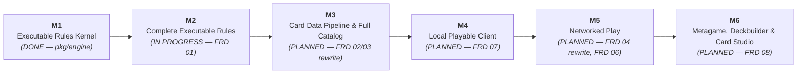

# Animus Mundi (Card Town) — Product Summary & Technical Roadmap

---

## 1. Executive Summary & Vision

**Animus Mundi** (working title: *Card Town*) is a competitive, digital collectible strategy card game (CCG) built with the **Godot 4.x Engine** and backed by a **server-authoritative game engine**. The game combines high-tactical depth with spatial battlefield positioning, a rich multi-resource economy, and an event-driven ability resolution stack.

### Key Game Pillars
- **Spatial Board Topology**: Combat and deployment are divided across dedicated battlefield zones: the frontline **Main Theater**, the tactical **Reserves**, and the fortified **Headquarters (HQ) Zone**. Units maneuver between reserves and the main theater to strike or regroup.
- **Dual Resource Economy**: Assets generate **Requisition** and **Tactics** by exhausting, creating dynamic turn-by-turn decisions between economy ramp and battlefield pressure.
- **Authoritative Determinism**: 100% of game logic, state transitions, fog-of-war security, and ability triggers execute on an authoritative server. The client is a thin, predictive visual presenter.
- **Declarative Architecture**: Card mechanics are defined not through ad-hoc script code, but through a structured, declarative Abstract Syntax Tree (AST) that the engine executes deterministically.
- **Executable Rules**: The game rules are specified in one version-controlled document ([FRD 01](frd/01_Game_Rules_FRD.md)) and executed by a headless Go kernel (`pkg/engine`) whose scenario tests pin each rule by requirement ID. Other specifications are written when their milestone starts, and technical choices are recorded as decision records when the code needs them.

---

## 2. What We Have Built (Current Foundation)

The repository is currently organized around authoritative specifications, verified balance datasets, and automated quality assurance tooling:

```text
animus-mundi/
├── docs/
│   ├── AGENTS.md                          # Engineering & agent guidelines
│   ├── PRODUCT_SUMMARY.md                 # This product roadmap & architecture summary
│   ├── audit/                             # Socratic audit registry, guidelines & pending reviews
│   ├── architecture/decisions/            # One-page decision records (ADRs)
│   ├── tdd/                               # Technical design documents (TDD 03 parked until M3)
│   └── frd/
│       ├── README.md                                    # Status, precedence & question-to-ruling workflow
│       ├── 01_Game_Rules_FRD.md                         # ACTIVE — Master FRD v3.6 (Pure Game Rules & Keywords)
│       ├── keyword_interaction_matrix.md                # ACTIVE — Bounded keyword edge-case register
│       ├── 02_Card_Data_Pipeline_FRD.md                 # FROZEN — FRD v1.3 (Ingestion, AST, 26 Primitives & Text Rules)
│       ├── 03_Card_Compiler_FRD.md                      # FROZEN — FRD v1.2 (Go Catalog Linker, Keyword Lookup, AST Registry & Parity)
│       ├── 04_Client_Engine_Protocol_Networking_FRD.md  # FROZEN — FRD v1.5 (Networking, Fog-of-War & Wire Protocol)
│       └── 05_Headless_Game_Engine_FRD.md               # FROZEN — Master FRD v1.4 (design reference for pkg/engine)
├── data/
│   ├── cards/                             # 10 Authoritative RFC-4180 CSV Balance Sheets
│   │   ├── maneuvers-{animus, concordia, path, soulless}.csv
│   │   └── units-and-structures-{animus, concordia, path, soulless, HQ, common}.csv
│   └── schemas/                           # Target directory for JSON schemas & blueprints.json
├── cmd/
│   └── cardtown/                          # Native Go developer CLI & toolchain
├── pkg/
│   ├── engine/                            # Executable FRD 01: rules kernel, scenario tests & fuzz playouts
│   └── toolchain/                         # High-performance validation, audit & slicing engine
└── tools/
    ├── audit/                             # Audit records & registry
    ├── linter/
    │   ├── card_standardization_audit.json# 167-card audit & review log
    │   └── pre-commit                     # Pre-commit hook template
    └── sheets/                            # Google Sheets synchronization tools
        ├── publish_card_sheets            # Freshness-checked export from local CSVs to Google Sheets
        ├── import_card_sheets             # Interactive diff ingestion from Google Sheets to local CSVs
        └── publish_audit                  # Card standardization audit Google Drive publisher
```

### 2.1 The Five Master FRDs (Core Architectural Pillars)

> [!IMPORTANT]
> Since 2026-10-19 only **FRD 01** is an active specification. FRDs 02–05 are frozen as design intent: summarized below for context, not audited or synced, and each is rewritten when its milestone starts (Section 4). See [`frd/README.md`](frd/README.md).

Requirement counts below are linter-registered IDs (`cardtown lint frd`). Following the SOC-002 de-duplication passes and the 2026-10-19 devil's-advocate audits, each FRD keeps superseded IDs as *Subsumed* traceability stubs that point to their canonical owner. The active count is given alongside the total.

1. **[Game Rules FRD](frd/01_Game_Rules_FRD.md) (Master FRD v3.6 — 70 Requirement IDs, 62 active; 8 subsumed)**
   - **Deck Construction, Match Setup & First-Turn Rules (`FR-SET-001` - `FR-SET-004`, `FR-DEK-001` - `FR-DEK-002`, `FR-WIN-001`)**: 50-card minimum main deck, 1 faction Headquarters, rarity copy limits (4/3/2/1), pre-mulligan First-Player Determination (15s clock), 6-card opening hand with single partial mulligan (25s clock), Turn 1 draw skip, absence of summoning sickness, mandatory post-search shuffle, empty-deck draw loss, and a simultaneous empty-deck **Match Draw** (`RESULT_MATCH_DRAW`).
   - **Pure Game Rules, Card Taxonomy & Spatial Zone Model (`FR-CRD-101`, `FR-ZON-001` - `FR-ZON-005`, `FR-ENT-102` - `FR-ENT-103`)**: 14 printed card characteristics, Battlefield Assets vs. non-battlefield Cards, ownership vs. control, uncapped zone capacities (Reserves, Main Theater, Headquarters Zone, Hand, Deck, Discard, Attached Sub-Zone, and Resolution Stack), double-blind `1/1/1/1` Scratch Company lifecycle, tucked cards, and face-down transformation. Runtime memory structs (`FR-ENT-001` - `FR-ENT-003`, `FR-SNP-101`) are owned by FRD 05 (`SOC-002`).
   - **Dual-Resource Economy, Turn Sequence & Clean-Stack Model (`FR-RES-001` - `FR-RES-003`, `FR-TRN-001` - `FR-TRN-003a`, `FR-CAP-001`, `FR-MNV-001`, `FR-QUE-001`)**: Explicit off-stack Requisition and Tactics generation, one-way `2R -> 1T` conversion, unified Inherent Capabilities Matrix (`FR-CAP-001`, subsuming `FR-INH-001` - `FR-INH-004`), discard-pile and in-resolution free deployments with destination-zone selection (`FR-TRN-003a`), Ready Phase (unexhaust + start-of-turn triggers), Draw Phase (draw + draw triggers), Main Phase (75s turn clock + 60s Reserve Time Bank, clean-stack priority), and End Phase (Sub-Phases 4a–4d).
   - **Trigger Timing & Delayed Triggers (`FR-TRG-002` - `FR-TRG-006`)**: APNAP simultaneous trigger ordering, optional trigger confirmation, and turn-scoped delayed triggered abilities (*Rage's Wake*, *Redline Infusion*).
   - **Targeting, Fizzle & Interactive Choice Rules (`FR-TGT-001` - `FR-TGT-003`, `FR-MOD-001`)**: Conjunction target filtering, upfront target selection for conditional triggers, two-stage target verification, distributed pool evaporation, composite clause survival, single-option fast-path, and 15s/10s choice clocks with deterministic timeout fallbacks.
   - **Six-Layer Attribute Calculation & 5-Stage Damage Mitigation (`FR-LAY-001` - `FR-LAY-003`, `FR-REP-001` - `FR-REP-004`)**: Continuous evaluation across Layers 1–6 (Base Printed/Face-Down $\rightarrow$ Type/Subtype $\rightarrow$ Keywords $\rightarrow$ Continuous Auras $\rightarrow$ Temp Modifiers $\rightarrow$ Exclusive Combat Power clamping at `0`), inline replacement effects, and 5-stage damage mitigation (Stage 1 Redirection $\rightarrow$ Stage 2 Flat `Resistant N` $\rightarrow$ Stage 3 `Stalwart` Combat Cap $\rightarrow$ Stage 4 Dynamic `Armor` $\rightarrow$ Stage 5 Health Commit).
   - **Deterministic 3-Step Combat Sequence (`FR-CBT-001` - `FR-CBT-003`)**: Step 1 (Declaration & Upfront Exhaustion), Step 2 (Pre-Combat Trigger & Reaction Window), and Step 3 (Simultaneous Combat Damage & 100% Symmetric Retaliation across Units, Structures, and Headquarters), with attacker-scoped `EVENT_COMBAT_KILL` attribution and simultaneous-defeat Match Draw.
   - **Canonical Keywords Catalog (`FR-KWD-002a` - `FR-KWD-002o`)**: Formal definitions for all 15 core game keywords (Unbowed, Resistant N, Stalwart, Heal N, Cornered, Aggressive N, Ethereal, Ward, Versatile, Guardian, Armor N, Deploys Exhausted, Scratch N, Regroup N, Berserk N). Berserk N deals flat N non-combat cleave damage to an upfront-bound secondary Main Theater target.

2. **[Card Data Pipeline & Ability Authoring FRD](frd/02_Card_Data_Pipeline_FRD.md) (FRD v1.3 — 33 Requirement IDs, 29 active; 4 subsumed)**
   - **Three-Tier Data Authority Lifecycle (`FR-DAT-001` - `FR-DAT-002`)**: Tier 1 (Authoritative Repository CSVs in `data/cards/*.csv`) $\leftrightarrow$ Tier 2 (Cloud Google Sheets Inspection Mirror synced via freshness-checked `tools/sheets/publish_card_sheets` and diff-verified `tools/sheets/import_card_sheets`) $\rightarrow$ Tier 3 (Compiled Production `blueprints.json` bound with 256-bit `catalogChecksum` and `cardDataVersion`). Compilation, bundling, checksum, and versioning (`FR-DAT-003`, `FR-DAT-004`) are subsumed by FRD 03 (`FR-CMP-002`, `FR-CMP-003`, `FR-CMP-024` - `FR-CMP-026`).
   - **Zero-Aliasing Target Enums & Normalization (`FR-DAT-005` - `FR-DAT-008`)**: Direct `CardBlueprint` schema header parity on all 10 CSVs with zero runtime aliases (`UNIT`, `STRUCTURE`, `MANEUVER`, `HEADQUARTERS`; `CONCORDIA`, `SOULLESS`, `PATH`, `ANIMUS`, `NEUTRAL`), deterministic immutable slug IDs (`<faction>_<snake_case_title>`, `FR-DAT-002`), Title Case subtype normalization with case-insensitive runtime filtering, and `"--"` sentinel handling.
   - **Declarative Ability AST & Extended Mechanics (`FR-ABL-001` - `FR-ABL-012`)**: Polymorphic schemas for `TRIGGERED`, `ACTIVATED`, `CONTINUOUS_AURA` (Layer 4 modifiers & `abilityGrants`), `REPLACEMENT_WATCHER`, `MANEUVER_EFFECT`, and `KEYWORD_GRANT`, supported by `FilterDef`, composable `ValueToken.query` aggregates, `CostDef` (`RESOURCE`, `EXHAUST_SELF`, `EXHAUST_ASSET`, `KILL_ASSET`, `DISCARD_CARD`, `MOVE_CARD_ZONE`), `TargetRef` (`DISTRIBUTED_POOL`), `maxPerTurn` gates, modal choices, and all 15 keyword AST mappings.
   - **Event Hook Taxonomy, 26 Atomic Primitives & Upfront Target Locking (`FR-TRG-001`, `FR-TRG-007`, `FR-PRM-001`, `FR-TGT-101`)**: Canonical catalog of 28 `EVENT_*` hooks and 3 `WOULD_*` replacement hooks with causality lineage, **26 standard atomic effect primitives** (including `REGISTER_DELAYED_TRIGGER`, plus `COMPOSITE_SEQUENCE` / `CONDITIONAL_CLAUSE`), upfront target locking (`bindingPolicy: "UPFRONT_LOCK"`) with the canonical `TargetRole` set, and 4 benchmark card AST implementations.
   - **MTG-Aligned Rules Text Standards (`FR-TXT-001` - `FR-TXT-006`)**: Standardized capitalization, trigger preambles (*When*, *Whenever*, *At*), cost notation (`[Cost]: [Effect].`), passive aura phrasing (*has*/*have*), temporary stat modification phrasing (*gets*/*get*), keyword grants (*gains*/*gain*), and conjunction targeting syntax (*chosen*), with two-stage dynamic filter verification owned by `FR-TGT-003`.
   - **Prototype Gating & Card Audit Register (`FR-VAL-003`, Domain 7)**: Two-tier compilation (`needsRework` cards allowed in dev builds, blocked by `ERR_STRICT_PROTOTYPE_REJECTED` under `--strict`) and canonical `DA-DAT-003` design rulings. Linter and text-to-AST parity verification (`FR-VAL-001`, `FR-VAL-002`) are subsumed by FRD 03 (`FR-CMP-001`, `FR-CMP-019` - `FR-CMP-022`).

3. **[Card Compiler & Blueprint Bundler FRD](frd/03_Card_Compiler_FRD.md) (FRD v1.2 — 28 Requirement IDs, 17 active; 11 subsumed)**
   - **Five-Stage Catalog Linker Pipeline & CLI Contract (`FR-CMP-001` - `FR-CMP-003`)**: Standalone, statically linked pure Go CLI (`cmd/compile-blueprints`) executing 5 deterministic stages (Environment & Schema Init $\rightarrow$ Atomic CSV Ingestion & Slug Derivation $\rightarrow$ Catalog Linking & Keyword Lookup $\rightarrow$ Parity/Strict/Schema Gates $\rightarrow$ RFC 8785 Fingerprinting & Atomic Emission) with a `< 500 ms` warm execution SLA, CI/CD exit codes `0`–`5` (absorbing `FR-CMP-028`), POSIX flags (`--source-dir`, `--overrides-file`, `--validate-only`, `--emit-schemas`, `--strict`, `--minify`, etc.), and atomic `.tmp.<pid>` staging with zero-corrupt rollback.
   - **CSV Reader Mechanics & Prototype Policy (`FR-CMP-004` - `FR-CMP-007`)**: BOM/CRLF-tolerant RFC-4180 reader across all 10 sheets, blank-row skipping, global `<faction>_<slug>` collision prevention (`ERR_SLUG_COLLISION`), deterministic coercion-error mapping (column schemas delegated to `FR-DAT-001` - `FR-DAT-008`), and `needsRework` cards rejected under `--strict`.
   - **Catalog Linking & Declarative AST Registry (`FR-CMP-013`, `FR-CMP-017`)**: **Architecture pivot (Decision 1):** the compiler is a deterministic Catalog Linker, Validator & Checksum Bundler, not a natural-language parser. Vanilla cards emit `abilities: []`, and cards whose rules text is entirely standalone keyword lines (10 of the 15 keywords) resolve from the `FR-ABL-012` lookup table. Every other ability, including the 5 non-standalone keywords (Unbowed, Cornered, Heal N, Scratch N, Regroup N) and all Maneuver payloads, must be hand-modeled in `data/schemas/ast_overrides.json`. The sentence-level regex NLP synthesizer (`FR-CMP-008` - `FR-CMP-012`, `FR-CMP-014` - `FR-CMP-016`, `FR-CMP-018`) is retired and subsumed by FRD 02 and `FR-CMP-017`.
   - **Build-Time Parity, Sign-Off & Schema Gates (`FR-CMP-019` - `FR-CMP-022`)**: Forward parity (`ERR_PARITY_UNMAPPED_TEXT`, `ERR_PARITY_VERB`), reverse parity (`ERR_PARITY_ORPHAN_AST`), mandatory designer sign-off per registry entry (`parityVerified`, `verifiedBy`, `verifiedAt` → `ERR_OVERRIDE_UNVERIFIED`), `rulesText` sync and orphan checks, and JSON Schema Draft 2020-12 validation (`CardBlueprint`, `AbilityDef`, `ast_overrides` schemas, generated from Go structs via standalone `--emit-schemas`). `FR-CMP-021` (strict review gate) is subsumed into `FR-CMP-005` / `FR-CMP-020`.
   - **RFC 8785 Fingerprinting, Envelope Emission & Diagnostics (`FR-CMP-023` - `FR-CMP-027`)**: 2-space indented, `id`-sorted `blueprints.json` envelope (plus optional `blueprints.min.json`), SHA-256 `catalogChecksum` over the RFC 8785 canonical `blueprints` array with the dev-only `needsRework` flag stripped, SemVer 2.0 `cardDataVersion`, and 25 active structured `ERR_*` diagnostic codes. Go domain structs are shared with the engine to eliminate type drift.

4. **[Client-Engine Protocol & Networking FRD](frd/04_Client_Engine_Protocol_Networking_FRD.md) (FRD v1.5 — 25 Requirement IDs, 22 active; 3 subsumed)**
   - **Transport & DoS-Hardened Liveness (`FR-NET-001` - `FR-NET-004`)**: Isolated stateful GCP match containers (GKE/Agones or Cloud Run) communicating over TLS WebSockets (`wss://` port 443) via Godot 4.x's native `WebSocketPeer`, using binary Protocol Buffers v3 (`ccg.network`) with JSON debug fallback, 1,000 ms `Ping`/`Pong` heartbeats (rate-limited to max 5/s), and 3,000 ms disconnect detection.
   - **Session Lifecycle & Zero-Trust Setup (`FR-SES-001` - `FR-SES-005`)**: Strict version/JWT handshake with 256-bit `catalogChecksum` verification, backend-fetched deck legality validation (`FR-SET-001`) with zero client card-list transmission, wire-level first-player prompts (rule owned by `FR-SET-003`; `FR-SES-003` subsumed), 25-second continuous partial mulligan negotiation, and reconnect/`StateSyncSnapshot` recovery.
   - **Fog-of-War & Double-Blind Security Boundary (`FR-SEC-001` - `FR-SEC-004`, `FR-ZON-005`)**: Ephemeral opaque proxy IDs (`proxy_scratch_<id>`) for Scratch Companies in server RAM, split owner/opponent zone-departure reveal packets (`DISCARD`, `HAND`/`DECK`, `ATTACHED`), and opponent hand/deck sanitization. Server randomness is the engine's seeded deterministic PRNG (`FR-SEC-005` subsumed by `FR-ENG-002` / `FR-DEK-002`), which removes the earlier CSPRNG-vs-replay-reproducibility contradiction.
   - **Full Command, Event & Rejection Taxonomy (`FR-MSG-001` - `FR-MSG-005`, `FR-ERR-001`)**: `GameEnvelope` framing 16 `ClientCommand` actions (session/orchestration, off-stack economy, stack-pushed tactical actions, stack card/ability actions, phase flow, choice responses, concede) with boundary clamping on `tactics_requested` `[1..50]` and canonical `TargetBinding` roles (including `SECONDARY_BERSERK_TARGET` and `MOVE_COST`). It also defines 21 `EngineEvent` detail schemas covering all 26 primitives and every `FR-PAC-004` hashed attribute, synchronous `PlayerChoicePrompt` modals (15s active / 10s non-active decision clocks), and 18 `CommandRejection` error codes plus the non-fatal `WARN_TARGET_INVALIDATED_FIZZLE`.
   - **Pacing, Desync Hashing & Quarantined Replays (`FR-PAC-001` - `FR-PAC-004`, `FR-SPC-002`)**: Client FIFO animation queue with 2,000 ms / 3.0x fast-forwarding, 5,000 ms turn-handover and 3,000 ms prompt animation grace buffers, 60-second Unified Reserve Time Bank with opponent-turn forfeiture protection, atomic 5-stage `DamagePipelineStageEvent` batching, per-batch 64-bit Layer 6 `PublicStateHash` verification (snapshot recovery throttled to 1 per 3,000 ms), and unmasked `.rec` match replays quarantined until tournament series completion.

5. **[Headless Game Engine FRD](frd/05_Headless_Game_Engine_FRD.md) (Master FRD v1.4 — 46 Requirement IDs, 35 active; 11 subsumed)**
   - **Standalone Go Kernel (`FR-ENG-001` - `FR-ENG-005`)**: Pure Go (`CGO_ENABLED=0`) headless engine (`cardtown/engine`) with isolated 3-stream PCG32/SplitMix64 PRNG (`StreamShuffle`, `StreamTargeting`, `StreamMatchDecisions`; seed derivation consolidated into `FR-ENG-002`), pure 32-bit discrete integer arithmetic, and rolling 64-bit FNV-1a state checksums (`FR-PAC-004`).
   - **Transactional State Machine, 3-Tier Entity Architecture & Phase Engine (`FR-ENG-006` - `FR-ENG-011`, `FR-ENT-001` - `FR-ENT-003`, `FR-SNP-101`)**: In-place mutable state with delta-memento rollback (including PRNG stream counters) and two-phase choice-prompt transaction boundaries. It covers the 3-tier runtime entity structs (`CardBlueprint` singleton $\rightarrow$ `CardInstance` $\rightarrow$ `AssetInstance` + `AssetSnapshot` LKI), a dedicated `StackZone`, and a turn-scoped `DelayedTriggers` registry. Also specified: the 4-step pre-game setup/mulligan handshake, deterministic turn sub-phases, off-stack resource operations vs. clean-stack manual actions, and 75s/15s/10s clocks cascading into the 60s Reserve Time Bank.
   - **LIFO Stack Runner & Replacement Interception (`FR-ENG-012` - `FR-ENG-017`)**: 5-archetype LIFO resolution stack, atomic upfront cost deduction (`EXHAUST_SELF`, `EXHAUST_ASSET`, `KILL_ASSET`, `DISCARD_CARD`), inline reactive `ReplacementWatcherDef` interception, and choice prompt yield/fast-path/resumption. APNAP ordering and two-stage target verification (`FR-ENG-014`, `FR-ENG-015`) are subsumed by their canonical rules owners (`FR-TRG-003`, `FR-TGT-003`).
   - **Declarative Ability AST Interpreter (`FR-ENG-018`, `FR-ENG-021` - `FR-ENG-023`)**: Exhaustive Go type-switch AST visitor evaluating all 6 `abilityType` archetypes plus `FilterDef`/`ValueToken` expressions (absorbing `FR-ENG-019`, `FR-ENG-020`), double-blind `Scratch Company` (`proxy_scratch_*`) lifecycle, continuous aura grant/revocation (including `HAND`/`DISCARD`-zone cost modifiers), and 1:1 execution handlers for all **26 canonical atomic primitives** (`FR-PRM-001`).
   - **Stateless 6-Layer Attribute Pipeline (`FR-ENG-025`, `FR-ENG-029`)**: Stateless continuous on-demand evaluation across Layers 1–6 with timestamp precedence and exclusive Layer 6 Combat Power clamping (`EffectivePower = max(0, RawPower)`), consolidated into `FR-ENG-025` (dirty-flag caching de-scoped; `FR-ENG-026` - `FR-ENG-028` subsumed), and End Phase Sub-Phase 4c modifier cleanup.
   - **3-Step Combat, 5-Stage Mitigation & Victory Engine (`FR-ENG-031` - `FR-ENG-035`, `FR-ENG-042`)**: Upfront `Berserk N` secondary target binding, 3-step combat sequence (`FR-CBT-002`), execution of the canonical 5-stage damage mitigation owned by `FR-REP-004` (with `EVENT_DEAL_DAMAGE` / `EVENT_TAKE_DAMAGE` emission), inter-resolution state-based death sweeps with buffered APNAP triggers, `ATTACHED` sub-zone cleanup, and authoritative match conclusion including simultaneous HQ-defeat and empty-deck Match Draws.
   - **Headless Test Harness & Diagnostics (`FR-ENG-036` - `FR-ENG-041`)**: Standalone CLI runner (`cmd/engine-sim`), scripted YAML/JSON scenario DSL, deterministic `.rec` replay validator (`FR-SPC-002`), combinatorial monkey/fuzz runner, throughput benchmarks ($\ge 10,000$ turns/sec/core), and wire-aligned error taxonomy (`FR-ERR-001`).

### 2.2 Balance Datasets & Card Standardization
- **10 Clean RFC-4180 CSV Balance Sheets** in `data/cards/` covering 4 distinct factions (Animus, Concordia, Path, Soulless), Neutral/Common units, and Headquarters. **169 card rows** are present today.
- **167 Cards Audited in the Standardization Pass**:
  - **127 Cards Standardized**: Rules text updated to adhere to MTG-style grammar and terminology.
  - **52 Cards Flagged for Design Review (56 Documented Entries)**: The historical text diff and standardization register is archived in [`docs/Card_Standardization_Audit_Report.md`](Card_Standardization_Audit_Report.md) and `tools/linter/card_standardization_audit.json`, including the resolved `DA-DAT-003` mechanical triage rulings (*Animoceps Rager*, *Funeral Fungus*, *Rift*, *Mutation Swell*, *Steel Rain*, and the *Daggerspine Rangers* $\rightarrow$ *Spoil Forest Irregulars* IP rename).
  - **Live Review Status**: Ongoing per-card review and parity status are tracked through the CSV `needsRework` column (`FR-VAL-003`) and per-entry designer sign-off in `data/schemas/ast_overrides.json` (`FR-CMP-020`). The FRD-embedded Master Review Register has been retired.

### 2.3 Verification & Quality Assurance Tooling
- **Executable Rules Verification (`pkg/engine`)**:
  - `go test ./pkg/engine` runs the FR-named scenario tests plus 300 seeded fuzz playouts that check termination and state invariants after every action.
  - `cardtown lint rules` traces every `TestFR_*` test to an active FRD 01 requirement and lists requirements with no executable test yet.
  - `cardtown sim` runs random-policy playouts between faction decks built from real card data.
  - `cardtown lint frd` enforces a single owner per requirement ID and rejects keyword definitions restated outside FRD 01.
- **Native Go Developer CLI & Automated Linter Suite (`cardtown lint`, `cmd/cardtown`)**:
  - Blazing-fast sub-100ms native Go toolchain replacing legacy PowerShell scripts.
  - Validates **202 defined requirement IDs** (165 active, 37 subsumed traceability stubs) across all 5 FRDs and verifies **1,944 cross-references** with **0 dangling references** (`cardtown lint frd`).
  - Validates CSV table integrity, column consistency, and target enum conformance across 10 balance sheets (`cardtown lint sheets`).
  - Audits card rules text against forbidden terminology (`friendly` $\rightarrow$ `allied`, raw `~`, raw `attack` $\rightarrow$ `power`) (`cardtown lint syntax`).
  - Audits TDD metadata, 100% FRD requirement coverage, and topological acyclic DAGs (`cardtown lint tdd`).
- **Audit Lifecycle & Pre-commit Hooks**:
  - Native Git pre-commit hook (`cardtown hook install`) enforcing zero lint violations in < 100ms prior to local commits.
  - Socratic audit triage and resolution engine (`cardtown audit status`, `cardtown audit resolve`) tracking audits in `docs/audit/audit_registry.md`.
  - Topological deliverable issue slicer (`cardtown tdd slice`) generating DAG-ordered GitHub Milestones and Issues with zero guesswork.
- **Sheets Publisher & Importer ([`tools/sheets/publish_card_sheets`](../tools/sheets/README.md), [`tools/sheets/import_card_sheets`](../tools/sheets/README.md))**:
  - Synchronizes local Tier 1 CSV balance data with Tier 2 Google Sheets workbooks using pre-publish timestamp freshness checks (`--Force` override) and interactive terminal diff ingestion (`FR-DAT-001`).

---

## 3. Current Milestone: M2 — Complete Executable Game Rules

The physical prototype has shown the core loop is fun, so the open risk is not whether the game is good. It is whether the digital rules are complete and consistent enough to referee every card. The roadmap is therefore ordered around making [FRD 01](frd/01_Game_Rules_FRD.md) executable first, and building everything else on top of a kernel that already plays the game (see [ADR-0001](architecture/decisions/0001-executable-rules-and-frozen-frds.md)).

### 3.1 Delivered in M1: Executable Rules Kernel (2026-10-19)
- **`pkg/engine`**: a pure Go rules kernel built directly from FRD 01. It covers match setup, first-player choice and partial mulligan, turn phases, the dual-resource economy, deploy/march/attack/Scratch Company actions, the LIFO stack with clean-stack actions, 3-step combat with symmetric retaliation, 5-stage damage mitigation, state-based death sweeps, HQ defeat, empty-deck loss and Match Draws. It also covers the ten standalone keywords (Resistant N, Stalwart, Aggressive N, Ethereal, Ward, Versatile, Guardian, Armor N, Deploys Exhausted, Berserk N).
- **Scenario tests named after FR IDs** (`TestFR_<DOM>_<NNN>_*`): 30 of 62 active FRD 01 requirements are pinned, including a regression for the FRD 01/05 Berserk contradiction.
- **Random-policy fuzz playouts**: 300 seeded matches per test run, checking termination and state invariants after every action. `cardtown sim` runs the same playouts on real card data.
- **29 of 169 cards** are executable (vanilla or standalone-keyword rules text). The rest load with their unsupported lines listed.
- **[Keyword Interaction Matrix](frd/keyword_interaction_matrix.md)**: all 105 keyword pairs and 15 self-stacking cases classified. 29 are defined and 87 have no interaction. Open items await rulings: 4 undefined pairs, plus 3 undefined and 4 inferred keyword-vs-core-rule cases, ranked by whether current cards can reach them.

### 3.2 M2 Deliverables
1. **Rulings for reachable open matrix items. ✅ Done 2026-10-19 (FRD 01 v3.3–v3.4).** Eleven items were ruled, covering Berserk targeting and fizzles, Berserk 2 on *Tempest Surge* and *Redline Infusion*, Scratch Companies entering Exhausted, committed combat targets, zero-yield generation, and HQ defeat and empty-deck loss both settling at the death sweep. The two remaining open items (`KIM-C01`, `KIM-B07`) are unreachable with current cards. New cards or new keywords reopen this.
2. **Animus vs Path starter set, fully executable.** These are the two factions with the most physical playtest time, so their matchup is the one we can check the digital rules against. Both decks run in full, including Maneuvers and Headquarters abilities, and are construction-legal under `FR-SET-001`. The [ability survey](design/m2_starter_set_ability_survey.md) maps every card and orders the work. Abilities are modeled directly as Go values in the kernel, with no compiler. At M2 start, 5 of 42 Animus cards and 4 of 42 Path cards are executable, and no Maneuvers are.
3. **Kernel coverage pulled by starter cards.** The kernel gains a rule when a starter card needs it, and each rule arrives with a `TestFR_*` scenario test plus a test that uses the card. Rules of FRD 01 that no starter card reaches move to M3. The candidates are triggered abilities and APNAP ordering (`FR-TRG-002`–`FR-TRG-006`), replacement effects (`FR-REP-001`–`FR-REP-003`), targeting and fizzle (`FR-TGT-001`–`FR-TGT-003`), interactive choices and timeout fallbacks (`FR-MOD-001`), Layers 2–4 and Cornered timing (`FR-LAY-001`–`FR-LAY-003`), tucked and face-down cards (`FR-ENT-102`, `FR-ENT-103`), deck search (`FR-DEK-001`), activated abilities (`FR-ACT-001`, `FR-ACT-002`), additional costs and free deployments (`FR-TRN-003a`), Maneuvers (`FR-MNV-001`), and the remaining keywords (Unbowed, Heal N, Cornered, Scratch N, Regroup N).
4. **`cardtown play`: a text-mode match.** One human plays a starter deck against the random policy in the terminal, so the digital rules can be compared with the physical prototype long before the M4 client.
5. **Write-up of the ability shapes the kernel needed.** This is the input to rewriting FRD 02/03 in M3.

**Done when:** every FRD 01 requirement that a starter card reaches is pinned by a scenario test (`cardtown lint rules`), every Animus and Path card plus the starter Headquarters (Animoceps Rager, Eternal Watchman) is executable, no reachable matrix item or survey ruling is open, `cardtown sim` runs clean on construction-legal Animus and Path decks, and a human can finish a `cardtown play` match.

> [!NOTE]
> **Why the card compiler moved from "Phase 2" to M3.** Retiring regex rules-text synthesis (FRD 03 v1.2, Decision 1) made hand-authored ability data the long pole: roughly 140 of 169 cards need a hand-modeled `ast_overrides.json` entry. Writing those against an ability format that no engine has executed yet risks redoing all of them. M2 settles the format by running real abilities; M3 then builds the pipeline around it. [TDD 03](tdd/03_Card_Compiler_TDD.md) is parked until then.

---

## 4. Roadmap (Milestones M1–M6)

Each milestone ends with something that runs. The FRD for a milestone is written or rewritten **when that milestone starts**, from what the earlier milestones taught us. Technical choices are recorded as [decision records](architecture/decisions/README.md) when the code needs them.



### M3: Card Data Pipeline & Full Catalog
- **Specs at start:** rewrite FRD 02 (card data and ability format) and FRD 03 (compiler) from the M2 ability write-up, then revise or replace TDD 03.
- **Build:** CSV ingestion, ability data for every card, a compiled catalog, and a pipeline that checks rules text against ability data. Each card gets at least one kernel scenario test. Soulless and Concordia cards, plus the Rift and Encampment Headquarters deferred from M2, pull in the FRD 01 rules that the M2 starter set did not reach.
- **Done when:** `cardtown lint rules` reports every active FRD 01 requirement pinned, every card without a `needsRework` flag compiles and executes in the kernel, and `cardtown sim` runs clean on full faction decks.

### M4: Local Playable Client
- **Specs at start:** draft FRD 07 (Godot client) around what the player sees and does: board and zones, stack visualization, choice prompts, animation pacing.
- **Build:** a Godot 4.x client driving the local Go kernel for hot-seat and bot play.
- **Done when:** a full match between any two factions is playable locally.

### M5: Networked Play
- **Specs at start:** rewrite FRD 04 (protocol, fog of war, reconnect) from what the local client actually exchanges with the kernel, and draft FRD 06 (server and matchmaking). Transport, serialization, hosting and PRNG-stream isolation get decision records (see [ADR-0002](architecture/decisions/0002-single-prng-stream-in-m1.md)).
- **Build:** server daemon, session lifecycle, hidden-information boundary, state sync and replays.
- **Done when:** two remote players complete a match without either client ever receiving the other's hidden information.

### M6: Metagame, Deckbuilder, Card Studio & Telemetry
- **Specs at start:** draft FRD 08.
- **Build:** in-game deckbuilder enforcing `FR-SET-001`, deck codes, the card authoring studio, and win-rate and play-frequency telemetry for balance patches.

---

### 4.1 Specification Status

| Document | Status | Serves | Next action |
| :--- | :--- | :--- | :--- |
| [`01_Game_Rules_FRD.md`](frd/01_Game_Rules_FRD.md) | **Active** (Master v3.6 — 70 IDs, 62 active) | M1–M3, and every milestone | Pin the requirements Animus and Path cards reach (M2), then the rest (M3); keep in lockstep with `pkg/engine` tests |
| [`keyword_interaction_matrix.md`](frd/keyword_interaction_matrix.md) | **Active** | M2 | Reachable items closed; reopen when new cards or keywords make an item reachable |
| [`02_Card_Data_Pipeline_FRD.md`](frd/02_Card_Data_Pipeline_FRD.md) | Frozen as design intent (v1.3) | M3 | Rewrite at M3 start |
| [`03_Card_Compiler_FRD.md`](frd/03_Card_Compiler_FRD.md) | Frozen as design intent (v1.2) | M3 | Rewrite at M3 start |
| [`03_Card_Compiler_TDD.md`](tdd/03_Card_Compiler_TDD.md) | Parked | M3 | Revise after FRD 03 rewrite |
| [`04_Client_Engine_Protocol_Networking_FRD.md`](frd/04_Client_Engine_Protocol_Networking_FRD.md) | Frozen as design intent (v1.5) | M5 | Rewrite at M5 start |
| [`05_Headless_Game_Engine_FRD.md`](frd/05_Headless_Game_Engine_FRD.md) | Frozen as design reference (v1.4) | M2 | Consult while extending `pkg/engine` |
| `06_Server_Daemon_Matchmaking_FRD.md` | Not started | M5 | Draft at M5 start |
| `07_Godot_Client_Architecture_FRD.md` | Not started | M4 | Draft at M4 start |
| `08_Deckbuilder_and_Card_Studio_FRD.md` | Not started | M6 | Draft at M6 start |
