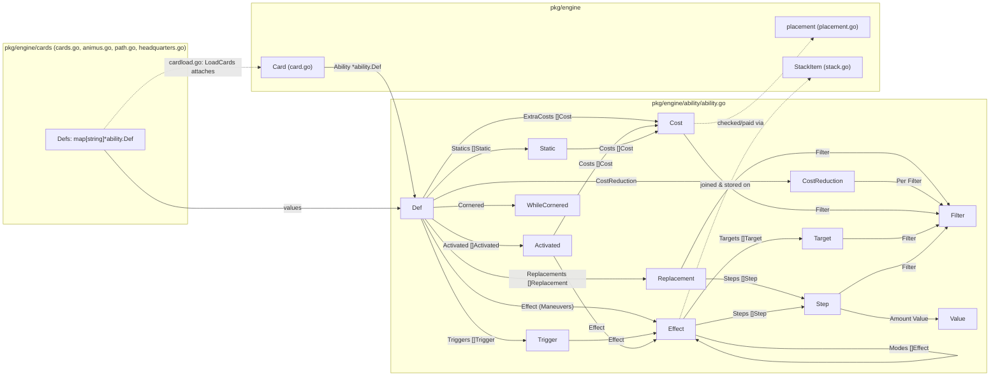

# Engine Struct & File Map

- **Scope:** `pkg/engine`, `pkg/engine/ability`, `pkg/engine/cards` | **Source spec:** [FRD 01](../frd/01_Game_Rules_FRD.md) | **Design note:** [M2 Ability Model](m2-ability-model.md)

This document maps every struct, interface, and function type across the executable rules kernel (`pkg/engine/...`), grouped by the `.go` file that defines it, together with the relationships between them.

- **Solid arrows (`-->`)** represent struct fields (ownership or references).
- **Dashed arrows (`-.->`)** represent runtime construction or data flow across files.

---

## 1. `pkg/engine` Structs by File

```mermaid
flowchart TB
    subgraph setup_go["setup.go"]
        Config["Config"]
    end

    subgraph deck_go["deck.go"]
        DeckList["DeckList"]
    end

    subgraph card_go["card.go (+ cardload.go)"]
        Card["Card"]
    end

    subgraph state_go["state.go"]
        Game["Game"]
        Player["Player"]
        Asset["Asset"]
        Instance["Instance"]
        Outcome["Outcome"]
        lastKnownRecord["lastKnownRecord (unexported)"]
        firingKey["firingKey (unexported)"]
    end

    subgraph layers_go["layers.go"]
        Modifier["Modifier"]
        EffectiveState["EffectiveState"]
    end

    subgraph actions_go["actions.go"]
        Action["Action"]
    end

    subgraph trigger_go["trigger.go"]
        triggerSource["triggerSource (unexported)"]
        pendingTrigger["pendingTrigger (unexported)"]
        sourcePos["sourcePos (unexported)"]
    end

    subgraph placement_go["placement.go"]
        placement["placement (unexported)"]
    end

    subgraph stack_go["stack.go"]
        StackItem["StackItem"]
        LockedZone["LockedZone"]
    end

    subgraph effects_go["effects.go"]
        resolution["resolution (unexported)"]
    end

    subgraph replace_go["replace.go"]
        replacementOption["replacementOption (unexported)"]
        usedKey["usedKey / usedReplacements (unexported)"]
    end

    subgraph freedeploy_go["freedeploy.go"]
        lookOutcome["lookOutcome (unexported)"]
    end

    subgraph damage_go["damage.go"]
        DamageResult["DamageResult"]
    end

    subgraph choice_go["choice.go"]
        Chooser["Chooser (func)"]
        Decision["Decision"]
        Option["Option"]
        Answer["Answer"]
    end

    subgraph events_go["events.go"]
        Observer["Observer (interface)"]
        Event["Event"]
        DecisionRecord["DecisionRecord"]
        MatchStart["MatchStart"]
        MatchEnd["MatchEnd"]
    end

    subgraph snapshot_go["snapshot.go"]
        Snapshot["Snapshot"]
        PlayerSnap["PlayerSnap"]
        AssetSnap["AssetSnap"]
        CardSnap["CardSnap"]
    end

    subgraph ability_pkg["pkg/engine/ability (ability.go, keywords.go)"]
        AbilityDef["ability.Def"]
        AbilityTrigger["ability.Trigger"]
        AbilityEffect["ability.Effect"]
        AbilityCost["ability.Cost"]
        AbilityReplacement["ability.Replacement"]
        Keywords["ability.Keywords"]
        keywordDef["keywordDef (unexported)"]
    end

    %% Setup & Deck relationships
    Config -->|"Decks [2]DeckList"| DeckList
    Config -->|"Choosers [2]Chooser"| Chooser
    Config -->|"Observer"| Observer
    Config -.->|"NewGame(cfg)"| Game
    DeckList -->|"HQ *Card, Main []*Card"| Card

    %% Card relationships
    Card -->|"Keywords"| Keywords
    Card -->|"Ability *ability.Def"| AbilityDef
    keywordDef -.->|"mutates/formats"| Keywords

    %% Core Game State relationships
    Game -->|"Players [2]*Player"| Player
    Game -->|"Theater []*Asset"| Asset
    Game -->|"Stack []*StackItem"| StackItem
    Game -->|"Outcome"| Outcome
    Game -->|"Log []Event"| Event
    Game -->|"choosers [2]Chooser"| Chooser
    Game -->|"obs Observer"| Observer
    Game -->|"lastKnown map[int]*lastKnownRecord"| lastKnownRecord
    Game -->|"pending []pendingTrigger"| pendingTrigger
    Game -->|"asking *Card"| Card
    Game -->|"firings map[firingKey]int"| firingKey

    Player -->|"HQ *Asset, Reserves []*Asset"| Asset
    Player -->|"Deck, Hand, Discard []*Instance"| Instance
    Asset -->|"Inst *Instance"| Instance
    Asset -->|"Modifiers []Modifier"| Modifier
    Instance -->|"Card *Card"| Card

    lastKnownRecord -->|"asset Asset"| Asset
    lastKnownRecord -->|"eff EffectiveState"| EffectiveState
    Modifier -->|"Keywords"| Keywords
    EffectiveState -->|"Keywords"| Keywords

    %% Action, Trigger, Placement, Stack & Resolution pipeline
    Action -.->|"Game.Apply(a)"| Game
    triggerSource -->|"card *Card"| Card
    triggerSource -->|"inst *Instance"| Instance
    triggerSource -->|"pos sourcePos"| sourcePos
    triggerSource -.->|"fireHook builds"| pendingTrigger

    pendingTrigger -->|"embeds placement"| placement
    pendingTrigger -->|"pos sourcePos"| sourcePos
    pendingTrigger -->|"trig ability.Trigger"| AbilityTrigger

    placement -->|"inst *Instance, discards []*Instance"| Instance
    placement -->|"costs []ability.Cost"| AbilityCost
    placement -->|"locked *LockedZone"| LockedZone
    placement -.->|"pl.stackItem() / declare()"| StackItem

    StackItem -->|"Inst *Instance"| Instance
    StackItem -->|"Effect ability.Effect"| AbilityEffect
    StackItem -->|"Locked *LockedZone"| LockedZone

    StackItem -.->|"resolveAbility(it)"| resolution
    resolution -->|"it *StackItem"| StackItem
    resolution -->|"chosen [][]*Asset, replaced *Asset, became map[int][]*Asset"| Asset
    resolution -->|"cards [][]*Instance"| Instance

    %% Replacement, FreeDeploy & Damage
    replacementOption -->|"src *Asset"| Asset
    replacementOption -->|"rep *ability.Replacement"| AbilityReplacement
    usedKey -->|"rep *ability.Replacement"| AbilityReplacement
    replacementOption -.->|"replaceDeath runs inline"| resolution
    lookOutcome -.->|"stepLookTop builds"| Option
    Game -.->|"dealDamage returns"| DamageResult

    %% Choices
    Chooser -.->|"takes (*Game, Decision)"| Decision
    Chooser -.->|"returns"| Answer
    Decision -->|"Options []Option"| Option
    Decision -->|"Source *Card"| Card

    %% Events & Snapshots
    Observer -.->|"Event(e)"| Event
    Observer -.->|"Settled(s)"| Snapshot
    Event -->|"Decision *DecisionRecord"| DecisionRecord
    Event -->|"Start *MatchStart"| MatchStart
    Event -->|"Snapshot *Snapshot"| Snapshot
    Event -->|"End *MatchEnd"| MatchEnd

    Snapshot -->|"Players [2]PlayerSnap"| PlayerSnap
    Snapshot -->|"Theater []AssetSnap"| AssetSnap
    PlayerSnap -->|"HQ *AssetSnap, Reserves []AssetSnap"| AssetSnap
    PlayerSnap -->|"Deck, Hand, Discard []CardSnap"| CardSnap
    AssetSnap -->|"Keywords"| Keywords
```

---

## 2. `pkg/engine/ability` & `pkg/engine/cards` Structs

---

## 3. File-by-File Inventory (Including Method-Only Files)

Several files in `pkg/engine` define no structs (or only an enum) because they hold methods on `*Game`, `*Player`, or `*Asset` for a single rule domain:

| Category | File | Structs / Interfaces Defined | Primary Responsibility (Methods on `*Game`) |
| :--- | :--- | :--- | :--- |
| **Core State** | [`state.go`](../../pkg/engine/state.go) | `Game`, `Player`, `Asset`, `Instance`, `Outcome`, `lastKnownRecord`, `firingKey` (+ `PlayerID`, `Zone`, `Phase`) | State lookups (`Assets`, `assetsByID`, `fixedOrderPositions`), `LastKnown`, `exhaust` |
| **Cards & Decks** | [`card.go`](../../pkg/engine/card.go) | `Card` (+ `CardType`) | Printed characteristics, Scratch Company face, `Supported()` |
| | [`cardload.go`](../../pkg/engine/cardload.go) | *(none)* | `LoadCards`, CSV parsing, attaching `cards.Defs`, `checkShapeReads` |
| | [`deck.go`](../../pkg/engine/deck.go) | `DeckList` | `LoadDeck`, `ValidateDeck` |
| | [`setup.go`](../../pkg/engine/setup.go) | `Config` | `NewGame` (HQ placement, first-player choice, draw 6, mulligan) |
| **Turn & Zones** | [`turn.go`](../../pkg/engine/turn.go) | *(none)* | `beginTurn`, `endTurn` (Ready, Draw, Main, End 4a–4d) |
| | [`zones.go`](../../pkg/engine/zones.go) | *(none)* | `deployCard`, `scratch`, `draw`, `discardFromHand`, `takeCard`, `putCard`, `leaveBattlefield`, `moveOnBattlefield` |
| | [`resources.go`](../../pkg/engine/resources.go) | *(enum `Resource` only)* | `generate`, `convert`, `canYield`, `canPay`, `pay` |
| **Actions & Stack** | [`actions.go`](../../pkg/engine/actions.go) | `Action` (+ `ActionKind`) | `Apply`, `check`, `LegalActions`, `canPlay`, `payAndTake` |
| | [`stack.go`](../../pkg/engine/stack.go) | `StackItem`, `LockedZone` (+ `StackKind`) | `push`, `resolveStack`, `resolve`, `StackLabel` |
| **Combat, Damage & Sweep** | [`combat.go`](../../pkg/engine/combat.go) | *(none)* | `checkAttack`, `CanAttack`, `declareAttack`, `resolveAttack` |
| | [`damage.go`](../../pkg/engine/damage.go) | `DamageResult` | `dealDamage` (5-stage mitigation pipeline) |
| | [`sweep.go`](../../pkg/engine/sweep.go) | *(none)* | `deathSweep`, `sweepDeaths`, `kill`, `destroyAll`, `end` |
| | [`replace.go`](../../pkg/engine/replace.go) | `replacementOption`, `usedKey`, `usedReplacements` | `replaceDeaths`, `replaceDeath`, `replacementsFor`, `chooseReplacement` |
| | [`layers.go`](../../pkg/engine/layers.go) | `Modifier`, `EffectiveState` (+ `Duration`) | `Power`, `MaxHealth`, `CurrentHealth`, `Keywords`, `cornered`, `IsLethal` |
| **Abilities & Effects** | [`trigger.go`](../../pkg/engine/trigger.go) | `pendingTrigger`, `triggerSource`, `sourcePos` | `fireHook`, `fire*` helpers, `flushTriggers`, `placeTrigger` |
| | [`placement.go`](../../pkg/engine/placement.go) | `placement` | `declare`, `chooseOnPlacement`, `placeable`, `couldDoNothing`, `chooseModes`, `SourceCard` |
| | [`costs.go`](../../pkg/engine/costs.go) | *(none)* | `EffectiveCost`, `PlayCost`, `ActivatedCost`, `DiscardDeployCost`, `costsPayable`, `payCosts` |
| | [`targeting.go`](../../pkg/engine/targeting.go) | *(none)* | `chooseTargets`, `targetDecision`, `pickAssets`, `pickCards` |
| | [`filter.go`](../../pkg/engine/filter.go) | *(none)* | `legalTarget`, `matchesFromSource`, `matchesFilterAt`, `matchesCard`, `cardMeets` |
| | [`effects.go`](../../pkg/engine/effects.go) | `resolution` | `resolveAbility`, `runSteps`, `step<Op>` methods, `stepAssets`, `stepCards`, `value` |
| | [`freedeploy.go`](../../pkg/engine/freedeploy.go) | `lookOutcome` | `stepDeployFree`, `stepLookTop`, `freeDeployZones` |
| **Choices, Events & Snapshots** | [`choice.go`](../../pkg/engine/choice.go) | `Decision`, `Option`, `Answer`, `Chooser` (+ `DecisionKind`) | `choose`, `askFor`, `fallbackPicks`, `RandomChooser` |
| | [`events.go`](../../pkg/engine/events.go) | `Observer`, `Event`, `DecisionRecord`, `MatchStart`, `MatchEnd` | `emit`, `logEvent`, `settled`, `emitDecision`, `emitAction` |
| | [`snapshot.go`](../../pkg/engine/snapshot.go) | `Snapshot`, `PlayerSnap`, `AssetSnap`, `CardSnap` | `Snapshot()`, `snapshot()`, `clone()` |
| **Verification & Build** | [`invariants.go`](../../pkg/engine/invariants.go) | *(none)* | `CheckInvariants` |
| | [`buildinfo.go`](../../pkg/engine/buildinfo.go) | *(none)* | `BuildInfo` |
| **Ability Shapes & Cards** | [`ability/ability.go`](../../pkg/engine/ability/ability.go) | `Def`, `Trigger`, `Activated`, `Replacement`, `Static`, `CostReduction`, `WhileCornered`, `Cost`, `Effect`, `Target`, `Step`, `Filter`, `Value` (+ enums) | Pure data shapes for printed abilities (`Aggressive(n)` constructor) |
| | [`ability/keywords.go`](../../pkg/engine/ability/keywords.go) | `Keywords`, `keywordDef` | The standalone keyword set, its printed names, `Lines`, `Add`, `ParseKeywordLine` |
| | [`cards/cards.go`](../../pkg/engine/cards/cards.go) (+ `animus.go`, `path.go`, `headquarters.go`) | *(none; `Defs` map & `NotYetExecutable` slice)* | Card-name-keyed `ability.Def` values |

