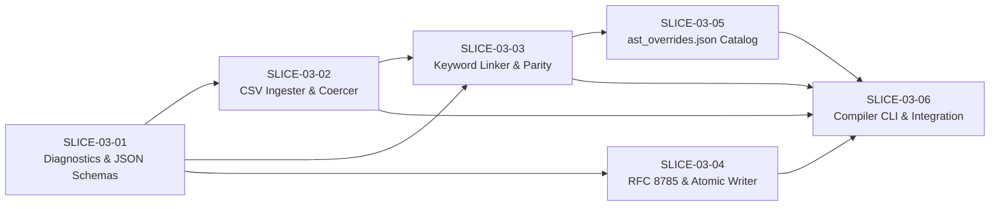

# Card Compiler, Blueprint Ingestion & Schema Pipeline — Technical Design Document (TDD v1.0)
**Deterministic CSV-to-AST Catalog Linker, JSON Schema Draft 2020-12 Validator & RFC 8785 Cryptographic Bundler (`tools/importer/compile_blueprints.ps1`)**

- **Source FRD:** [docs/frd/03_Card_Compiler_FRD.md](../frd/03_Card_Compiler_FRD.md) (with companion schemas from [docs/frd/02_Card_Data_Pipeline_FRD.md](../frd/02_Card_Data_Pipeline_FRD.md))
- **FRD Commit Hash:** `3a9c7f2`
- **TDD Version:** `v1.0`
- **GitHub Milestone:** `Phase 2: Card Compiler & Blueprint Ingestion (TDD 03)`
- **Phase Label:** `phase:2`
- **Component Label:** `component:compiler`

---

## 1. EXECUTIVE ARCHITECTURE & REPOSITORY FILE TREE

### 1.1 Architectural Overview & Component Dataflow

The Card Town Phase 2 Compiler Toolchain (`tools/importer/compile_blueprints.ps1`) is a deterministic, cross-platform PowerShell 5.1 / 7.4+ build pipeline that ingests the 10 authoritative RFC-4180 CSV card balance sheets (`data/cards/*.csv`, `FR-DAT-001`), links them with standalone canonical keyword definitions (`FR-CMP-013`, `FR-ABL-012`) and declarative Ability AST entries from the sidecar registry (`data/schemas/ast_overrides.json`, `FR-CMP-017`), validates 1-to-1 text-to-AST parity and JSON Schema Draft 2020-12 compliance (`FR-CMP-019`–`FR-CMP-022`), computes a 256-bit SHA-256 `catalogChecksum` over RFC 8785 Canonical JSON bytes (`FR-CMP-024`–`FR-CMP-025`), and atomically emits the production master catalog (`data/schemas/blueprints.json`, `FR-CMP-003`, `FR-CMP-023`).

In alignment with `DECISION 1` of `03_Card_Compiler_FRD.md`, the compiler operates strictly as a **Catalog Linker, Schema Validator, and Cryptographic Bundler** rather than a natural-language regex parser. All non-standalone-keyword card abilities are authored declaratively in `data/schemas/ast_overrides.json` per `02_Card_Data_Pipeline_FRD.md` (`FR-ABL-001`–`FR-ABL-012`, `FR-TRG-001`, `FR-PRM-001`, `FR-TGT-101`).

```text
+---------------------------------------------------------------------------------------------------+
|                                   TIER 1: AUTHORITATIVE INPUTS                                    |
|                                                                                                   |
|  +---------------------------------------------+  +--------------------------------------------+  |
|  | 10 RFC-4180 CSV Card Sheets (data/cards/)   |  | Sidecar AST Registry (data/schemas/)       |  |
|  | - 6 Asset Sheets (15 cols, FR-DAT-006)      |  | - ast_overrides.json (FR-CMP-017)          |  |
|  | - 4 Maneuver Sheets (9 cols, FR-DAT-006)    |  | - Declarative AbilityDef ASTs (FR-ABL-001) |  |
|  +----------------------+----------------------+  +---------------------+----------------------+  |
+-------------------------|-----------------------------------------------|-------------------------+
                          |                                               |
                          v                                               v
+---------------------------------------------------------------------------------------------------+
|                        tools/importer/compile_blueprints.ps1 (FR-CMP-001)                         |
|                                                                                                   |
|  [STAGE 1: CLI & Schema Init] (SchemaGenerator.ps1, CompilerDiagnostics.ps1)                      |
|    |-- Resolve paths, emit/load Draft 2020-12 schemas (-EmitSchemas, FR-CMP-022)                  |
|    v                                                                                              |
|  [STAGE 2: Atomic CSV Ingestion & Coercion] (CsvIngester.ps1)                                     |
|    |-- Strip BOM, normalize CRLF/LF, skip blank rows, derive <faction>_<slug> IDs (FR-DAT-002)    |
|    |-- Enforce zero-aliasing enums, numeric bounds & global ID uniqueness (FR-CMP-004 - 007)      |
|    v                                                                                              |
|  [STAGE 3: Catalog Linking & Keyword Lookup] (CatalogLinker.ps1)                                  |
|    |-- Bind ast_overrides.json entries by ID; check orphan keys & text parity (FR-CMP-017)        |
|    |-- Map "--"/"" to abilities: [] and standalone keyword lines via FR-ABL-012 (FR-CMP-013)      |
|    v                                                                                              |
|  [STAGE 4: Parity, -Strict & Schema Validation Gate] (CatalogLinker.ps1, SchemaGenerator.ps1)     |
|    |-- Verify forward/reverse parity, parityVerified sign-off & -Strict flags (FR-CMP-019 - 021)  |
|    |-- Validate all blueprints & AST nodes against Draft 2020-12 schemas (FR-CMP-022)             |
|    v                                                                                              |
|  [STAGE 5: RFC 8785 Hashing & Atomic Emission] (CanonicalJsonSerializer.ps1)                      |
|    |-- Sort blueprints by ID, strip currentProxy/needsRework, serialize RFC 8785 JCS (FR-CMP-024) |
|    |-- Compute SHA-256 catalogChecksum (0x<64-hex>, FR-CMP-025)                                   |
|    |-- Write blueprints.json.tmp.$PID -> atomic rename to blueprints.json (FR-CMP-003, 023)       |
+-------------------------------------------------|-------------------------------------------------+
                                                  |
                                                  v
+---------------------------------------------------------------------------------------------------+
|                   TIER 3: COMPILED MASTER CATALOG (data/schemas/blueprints.json)                  |
|            Consumed at boot by Headless Go Engine (FR-ENG-001) & Godot Client (FR-SES-001)        |
+---------------------------------------------------------------------------------------------------+
```

### 1.2 Target Repository File & Directory Tree

Every file created or modified by this TDD is locked to the following repository paths:

```text
animus-mundi/
├── data/
│   └── schemas/
│       ├── CardBlueprint.schema.json          # [CREATE] JSON Schema Draft 2020-12 for blueprints.json envelope & CardBlueprint (FR-DAT-005, FR-CMP-022)
│       ├── AbilityDef.schema.json             # [CREATE] JSON Schema Draft 2020-12 for polymorphic AbilityDef AST & 26 primitives (FR-ABL-001 - 012, FR-PRM-001)
│       ├── ast_overrides.schema.json          # [CREATE] JSON Schema Draft 2020-12 for sidecar AST registry envelope (FR-CMP-017, FR-CMP-022)
│       ├── ast_overrides.json                 # [CREATE] Authoritative sidecar registry mapping bespoke card IDs to AbilityDef ASTs (FR-CMP-017)
│       └── blueprints.json                    # [CREATE] Compiled production master card catalog with RFC 8785 SHA-256 checksum (FR-CMP-023 - 025)
├── tools/
│   ├── importer/
│   │   ├── compile_blueprints.ps1             # [CREATE] Main CLI entry point & 5-stage compilation orchestrator (FR-CMP-001 - 003)
│   │   ├── lib/
│   │   │   ├── CompilerDiagnostics.ps1        # [CREATE] Structured ERR_* diagnostic catalog, stderr formatter & exit code dispatcher (FR-CMP-027, FR-CMP-028)
│   │   │   ├── SchemaGenerator.ps1            # [CREATE] Canonical JSON Schema Draft 2020-12 emitter (-EmitSchemas) & AST validator (FR-CMP-022)
│   │   │   ├── CsvIngester.ps1                # [CREATE] RFC-4180 CSV reader, slug deriver, subtype/zone normalizer & type coercer (FR-CMP-004 - 007)
│   │   │   ├── CatalogLinker.ps1              # [CREATE] Standalone keyword lookup table, ast_overrides linker & parity gate (FR-CMP-013, 017, 019 - 021)
│   │   │   └── CanonicalJsonSerializer.ps1    # [CREATE] Session-cached RFC 8785 JCS serializer, SHA-256 fingerprinter & atomic file writer (FR-CMP-023 - 026)
│   │   └── tests/
│   │       ├── Invoke-CompilerTests.ps1       # [CREATE] Self-contained PowerShell test runner executing all compiler unit & integration test suites
│   │       ├── CsvIngester.Tests.ps1          # [CREATE] Unit tests for CSV parsing, slug collisions, numeric/enum coercion & prototype gates
│   │       ├── CatalogLinker.Tests.ps1        # [CREATE] Unit tests for keyword lookup, override binding, orphan/text mismatch & parity checks
│   │       ├── CanonicalJson.Tests.ps1        # [CREATE] Unit tests for RFC 8785 key sorting, metadata stripping, SHA-256 hashing & atomic rollback
│   │       └── CompilerIntegration.Tests.ps1  # [CREATE] End-to-end CLI tests verifying exit codes 0-5, -ValidateOnly, -Strict, -Minify & SLA budget
│   └── sheets/
│       └── import_card_sheets.ps1             # [CREATE] Bidirectional Google Sheets to local CSV interactive diff importer (FR-DAT-001)
└── docs/
    └── AGENTS.md                              # [MODIFY] Register docs/tdd/03_Card_Compiler_TDD.md in Master Documentation Architecture index
```

### 1.3 Runtime, Language & Dependency Constraints

- **Language / Runtime:** Cross-platform PowerShell compatible with both **Windows PowerShell 5.1** (`powershell.exe`) and **PowerShell 7.4+** (`pwsh`) across Windows, Linux, and macOS (`FR-CMP-001`). Every script file must begin with `Set-StrictMode -Version Latest` and `$ErrorActionPreference = "Stop"`.
- **Permitted Dependencies:** Zero external PSGallery modules or third-party binaries are required for core compilation (`compile_blueprints.ps1`). All CSV parsing, JSON AST validation, RFC 8785 canonical serialization, and SHA-256 hashing use the .NET Base Class Library (`System.IO`, `System.Text`, `System.Security.Cryptography.SHA256`, `System.Collections.Specialized.OrderedDictionary`) and an inline session-cached C# helper class (`CardTown.Compiler.Rfc8785Canonicalizer`) compiled once per PowerShell session via `Add-Type` (`FR-CMP-024`).
- **Performance & Determinism Invariants:**
  - Warm execution across all 10 CSV sheets (~169–200 cards) must complete in **`< 5,000 ms` on PowerShell 7+** and **`< 10,000 ms` on Windows PowerShell 5.1** (`FR-CMP-002`).
  - All emitted JSON files (`blueprints.json`, `*.schema.json`, `ast_overrides.json`) must be encoded as **UTF-8 without BOM** (`[System.Text.UTF8Encoding]::new($false)`) using Unix **`LF` (`\n`)** line endings and 2-space indentation (`FR-CMP-022`, `FR-CMP-023`).
  - Floating-point numbers are strictly forbidden in `CardBlueprint` attributes and `AbilityDef` AST numeric fields (`FR-DAT-005`, `FR-ENG-004`).

---

## 2. CONCRETE DATA STRUCTURES, SCHEMAS & TYPE DEFINITIONS

### 2.1 In-Memory Domain Objects & Ordered Dictionary Layout (`tools/importer/lib/CsvIngester.ps1`)

To preserve deterministic property ordering across PowerShell 5.1 and 7+, every ingested CSV row and compiled `CardBlueprint` is represented in memory as a `[System.Collections.Specialized.OrderedDictionary]` (`[ordered]@{}`) with exact typed fields (`FR-DAT-005`, `FR-DAT-006`):

```powershell
# Canonical Enum Sets & Column Header Constants (FR-DAT-006)
$script:ExpectedSheetFiles = @(
    "maneuvers-animus.csv",
    "maneuvers-concordia.csv",
    "maneuvers-path.csv",
    "maneuvers-soulless.csv",
    "units-and-structures-HQ.csv",
    "units-and-structures-animus.csv",
    "units-and-structures-common.csv",
    "units-and-structures-concordia.csv",
    "units-and-structures-path.csv",
    "units-and-structures-soulless.csv"
)

$script:ExpectedAssetHeaders = @(
    "name", "cardType", "faction", "subtypes", "requisitionCost", "tacticsCost",
    "deploymentZones", "rulesText", "power", "health", "requisitionYield",
    "tacticsYield", "rarity", "currentProxy", "needsRework"
)

$script:ExpectedManeuverHeaders = @(
    "name", "cardType", "faction", "requisitionCost", "tacticsCost",
    "rulesText", "rarity", "currentProxy", "needsRework"
)

$script:ValidCardTypes       = @("UNIT", "STRUCTURE", "MANEUVER", "HEADQUARTERS")
$script:ValidFactions        = @("CONCORDIA", "SOULLESS", "PATH", "ANIMUS", "NEUTRAL")
$script:ValidRarities        = @("COMMON", "UNCOMMON", "RARE", "MYTHIC", "HQ")
$script:ValidDeploymentZones = @("RESERVES", "MAIN_THEATER", "HEADQUARTERS")
$script:ValidBooleanLiterals = @("true", "false")

# Canonical Standalone Keyword Lookup Table (FR-CMP-013, FR-ABL-012)
# Maps standalone keyword lines to their KEYWORD_GRANT AbilityDef representation.
$script:StandaloneKeywordDefs = @{
    "Stalwart"          = @{ Keyword = "STALWART";          Parameterized = $false }
    "Ward"              = @{ Keyword = "WARD";              Parameterized = $false }
    "Guardian"          = @{ Keyword = "GUARDIAN";          Parameterized = $false }
    "Versatile"         = @{ Keyword = "VERSATILE";         Parameterized = $false }
    "Ethereal"          = @{ Keyword = "ETHEREAL";          Parameterized = $false }
    "Deploys Exhausted" = @{ Keyword = "DEPLOYS_EXHAUSTED"; Parameterized = $false }
    "Resistant"         = @{ Keyword = "RESISTANT";         Parameterized = $true  }
    "Aggressive"        = @{ Keyword = "AGGRESSIVE";        Parameterized = $true  }
    "Armor"             = @{ Keyword = "ARMOR";             Parameterized = $true  }
    "Berserk"           = @{ Keyword = "BERSERK";           Parameterized = $true  }
}

# Compiled CardBlueprint OrderedDictionary Factory (FR-DAT-005)
function New-CardBlueprintRecord {
    param(
        [Parameter(Mandatory = $true)][string]$Id,
        [Parameter(Mandatory = $true)][string]$Name,
        [Parameter(Mandatory = $true)][string]$CardType,
        [Parameter(Mandatory = $true)][string]$Faction,
        [Parameter()][AllowEmptyCollection()][string[]]$Subtypes = @(),
        [Parameter(Mandatory = $true)][int]$RequisitionCost,
        [Parameter(Mandatory = $true)][int]$TacticsCost,
        [Parameter()][AllowNull()][object[]]$AdditionalDeploymentCosts = $null,
        [Parameter()][AllowNull()][Nullable[int]]$Power = $null,
        [Parameter()][AllowNull()][Nullable[int]]$Health = $null,
        [Parameter(Mandatory = $true)][int]$RequisitionYield,
        [Parameter(Mandatory = $true)][int]$TacticsYield,
        [Parameter()][AllowEmptyCollection()][string[]]$DeploymentZones = @(),
        [Parameter(Mandatory = $true)][string]$Rarity,
        [Parameter()][AllowEmptyString()][string]$RulesText = "",
        [Parameter(Mandatory = $true)][bool]$CurrentProxy,
        [Parameter(Mandatory = $true)][bool]$NeedsRework,
        [Parameter()][AllowEmptyCollection()][object[]]$Abilities = @()
    )
    $bp = [ordered]@{
        id               = $Id
        name             = $Name
        cardType         = $CardType
        faction          = $Faction
        subtypes         = @($Subtypes)
        requisitionCost  = [int]$RequisitionCost
        tacticsCost      = [int]$TacticsCost
    }
    if ($null -ne $AdditionalDeploymentCosts -and $AdditionalDeploymentCosts.Count -gt 0) {
        $bp["additionalDeploymentCosts"] = @($AdditionalDeploymentCosts)
    }
    $bp["power"]            = if ($null -ne $Power)  { [int]$Power }  else { $null }
    $bp["health"]           = if ($null -ne $Health) { [int]$Health } else { $null }
    $bp["requisitionYield"] = [int]$RequisitionYield
    $bp["tacticsYield"]     = [int]$TacticsYield
    $bp["deploymentZones"]  = @($DeploymentZones)
    $bp["rarity"]           = $Rarity
    $bp["rulesText"]        = $RulesText
    $bp["currentProxy"]     = [bool]$CurrentProxy
    $bp["needsRework"]      = [bool]$NeedsRework
    $bp["abilities"]        = @($Abilities)
    return $bp
}
```

### 2.2 Formal JSON Schema Draft 2020-12 Definitions (`data/schemas/*.schema.json`)

#### 2.2.1 `data/schemas/CardBlueprint.schema.json` (`FR-DAT-005`, `FR-CMP-022`, `FR-CMP-023`)

```json
{
  "$schema": "https://json-schema.org/draft/2020-12/schema",
  "$id": "https://animusmundi.dev/schemas/CardBlueprint.schema.json",
  "title": "CardBlueprintCollection",
  "description": "Compiled production master card catalog envelope and CardBlueprint schema (FR-DAT-005, FR-CMP-022).",
  "type": "object",
  "required": [
    "catalogChecksum",
    "cardDataVersion",
    "generatedAt",
    "totalCardCount",
    "blueprints"
  ],
  "additionalProperties": false,
  "properties": {
    "$schema": {
      "type": "string"
    },
    "catalogChecksum": {
      "type": "string",
      "pattern": "^0x[0-9a-f]{64}$",
      "description": "256-bit SHA-256 digest over RFC 8785 canonical bytes of the stripped blueprints array (FR-CMP-025)."
    },
    "cardDataVersion": {
      "type": "string",
      "pattern": "^(0|[1-9]\\d*)\\.(0|[1-9]\\d*)\\.(0|[1-9]\\d*)(?:-((?:0|[1-9]\\d*|\\d*[a-zA-Z-][0-9a-zA-Z-]*)(?:\\.(?:0|[1-9]\\d*|\\d*[a-zA-Z-][0-9a-zA-Z-]*))*))?(?:\\+([0-9a-zA-Z-]+(?:\\.[0-9a-zA-Z-]+)*))?$",
      "description": "SemVer 2.0 dataset version string (FR-CMP-026)."
    },
    "generatedAt": {
      "type": "string",
      "pattern": "^\\d{4}-\\d{2}-\\d{2}T\\d{2}:\\d{2}:\\d{2}(?:\\.\\d+)?Z$"
    },
    "totalCardCount": {
      "type": "integer",
      "minimum": 1
    },
    "blueprints": {
      "type": "array",
      "minItems": 1,
      "items": {
        "$ref": "#/$defs/CardBlueprint"
      }
    }
  },
  "$defs": {
    "CardBlueprint": {
      "type": "object",
      "required": [
        "id",
        "name",
        "cardType",
        "faction",
        "subtypes",
        "requisitionCost",
        "tacticsCost",
        "power",
        "health",
        "requisitionYield",
        "tacticsYield",
        "deploymentZones",
        "rarity",
        "rulesText",
        "currentProxy",
        "needsRework",
        "abilities"
      ],
      "additionalProperties": false,
      "properties": {
        "id": {
          "type": "string",
          "pattern": "^(concordia|soulless|path|animus|neutral)_[a-z0-9_]+$"
        },
        "name": {
          "type": "string",
          "minLength": 1
        },
        "cardType": {
          "type": "string",
          "enum": ["UNIT", "STRUCTURE", "MANEUVER", "HEADQUARTERS"]
        },
        "faction": {
          "type": "string",
          "enum": ["CONCORDIA", "SOULLESS", "PATH", "ANIMUS", "NEUTRAL"]
        },
        "subtypes": {
          "type": "array",
          "items": {
            "type": "string",
            "minLength": 1
          }
        },
        "requisitionCost": {
          "type": "integer",
          "minimum": 0
        },
        "tacticsCost": {
          "type": "integer",
          "minimum": 0
        },
        "additionalDeploymentCosts": {
          "type": "array",
          "minItems": 1,
          "items": {
            "$ref": "./AbilityDef.schema.json#/$defs/CostDef"
          }
        },
        "power": {
          "type": ["integer", "null"],
          "minimum": 0
        },
        "health": {
          "type": ["integer", "null"],
          "minimum": 1
        },
        "requisitionYield": {
          "type": "integer",
          "minimum": 0
        },
        "tacticsYield": {
          "type": "integer",
          "minimum": 0
        },
        "deploymentZones": {
          "type": "array",
          "items": {
            "type": "string",
            "enum": ["RESERVES", "MAIN_THEATER", "HEADQUARTERS"]
          }
        },
        "rarity": {
          "type": "string",
          "enum": ["COMMON", "UNCOMMON", "RARE", "MYTHIC", "HQ"]
        },
        "rulesText": {
          "type": "string",
          "minLength": 0
        },
        "currentProxy": {
          "type": "boolean"
        },
        "needsRework": {
          "type": "boolean"
        },
        "abilities": {
          "type": "array",
          "items": {
            "$ref": "./AbilityDef.schema.json"
          }
        }
      }
    }
  }
}
```

#### 2.2.2 `data/schemas/AbilityDef.schema.json` (`FR-ABL-001`–`FR-ABL-012`, `FR-TRG-001`, `FR-PRM-001`, `FR-TGT-101`, `FR-CMP-022`)

```json
{
  "$schema": "https://json-schema.org/draft/2020-12/schema",
  "$id": "https://animusmundi.dev/schemas/AbilityDef.schema.json",
  "title": "AbilityDef",
  "description": "Polymorphic declarative Ability AST schema covering all 6 abilityType archetypes and 26 atomic effect primitives (FR-ABL-001 - 012, FR-PRM-001).",
  "type": "object",
  "required": ["abilityType"],
  "properties": {
    "abilityType": {
      "type": "string",
      "enum": [
        "TRIGGERED",
        "ACTIVATED",
        "CONTINUOUS_AURA",
        "REPLACEMENT_WATCHER",
        "MANEUVER_EFFECT",
        "KEYWORD_GRANT"
      ]
    },
    "triggerHook": {
      "oneOf": [
        { "$ref": "#/$defs/EventHookEnum" },
        {
          "type": "array",
          "minItems": 1,
          "items": { "$ref": "#/$defs/EventHookEnum" }
        }
      ]
    },
    "interceptHook": {
      "$ref": "#/$defs/ReplacementHookEnum"
    },
    "condition": {
      "$ref": "#/$defs/ConditionDef"
    },
    "optional": {
      "type": "boolean"
    },
    "optionalCosts": {
      "type": "array",
      "items": { "$ref": "#/$defs/CostDef" }
    },
    "costs": {
      "type": "array",
      "items": { "$ref": "#/$defs/CostDef" }
    },
    "targeting": {
      "oneOf": [
        { "$ref": "#/$defs/TargetRef" },
        {
          "type": "array",
          "minItems": 1,
          "items": { "$ref": "#/$defs/TargetRef" }
        }
      ]
    },
    "effect": {
      "$ref": "#/$defs/EffectDef"
    },
    "replacementAction": {
      "$ref": "#/$defs/EffectDef"
    },
    "maxPerTurn": {
      "type": "integer",
      "minimum": 1
    },
    "repeatable": {
      "type": "boolean"
    },
    "activeZone": {
      "type": "string",
      "enum": ["BATTLEFIELD", "HAND", "DISCARD"]
    },
    "scope": {
      "type": "string",
      "enum": ["SELF", "ALLIED_IN_ZONE", "OPPOSING_IN_ZONE", "ALL_IN_ZONE"]
    },
    "filter": {
      "$ref": "#/$defs/FilterDef"
    },
    "modifiers": {
      "type": "array",
      "items": { "$ref": "#/$defs/AttributeModifierDef" }
    },
    "abilityGrants": {
      "type": "array",
      "items": { "$ref": "#" }
    },
    "staticPermission": {
      "$ref": "#/$defs/StaticPermissionDef"
    },
    "modalCount": {
      "type": "integer",
      "minimum": 1
    },
    "options": {
      "type": "array",
      "minItems": 2,
      "items": { "$ref": "#/$defs/EffectDef" }
    },
    "keyword": {
      "$ref": "#/$defs/KeywordEnum"
    },
    "parameter": {
      "type": "integer",
      "minimum": 1
    }
  },
  "$defs": {
    "EventHookEnum": {
      "type": "string",
      "enum": [
        "EVENT_DEPLOY",
        "EVENT_DESTROY",
        "EVENT_ZONE_CHANGE",
        "EVENT_MARCH",
        "EVENT_EXHAUST",
        "EVENT_READY",
        "EVENT_ATTACK_DECLARE",
        "EVENT_DEAL_DAMAGE",
        "EVENT_TAKE_DAMAGE",
        "EVENT_ATTACK_RESOLVED",
        "EVENT_COMBAT_KILL",
        "EVENT_GENERATE_REQUISITION",
        "EVENT_SPEND_REQUISITION",
        "EVENT_CONVERT_REQUISITION",
        "EVENT_GENERATE_TACTICS",
        "EVENT_SPEND_TACTICS",
        "EVENT_DRAW_CARD",
        "EVENT_DISCARD_CARD",
        "EVENT_MULLIGAN",
        "EVENT_ENACT_MANEUVER",
        "EVENT_ACTIVATE_ABILITY",
        "EVENT_SCRATCH_COMPANY",
        "EVENT_READY_PHASE",
        "EVENT_DRAW_PHASE",
        "EVENT_MAIN_PHASE",
        "EVENT_END_PHASE",
        "EVENT_TURN_START",
        "EVENT_TURN_END"
      ]
    },
    "ReplacementHookEnum": {
      "type": "string",
      "enum": [
        "WOULD_TAKE_DAMAGE",
        "WOULD_BE_DESTROYED",
        "WOULD_DEPLOY"
      ]
    },
    "KeywordEnum": {
      "type": "string",
      "enum": [
        "STALWART",
        "RESISTANT",
        "WARD",
        "AGGRESSIVE",
        "GUARDIAN",
        "ARMOR",
        "VERSATILE",
        "ETHEREAL",
        "DEPLOYS_EXHAUSTED",
        "BERSERK"
      ]
    },
    "PrimitiveEnum": {
      "type": "string",
      "enum": [
        "DEAL_DAMAGE",
        "HEAL",
        "ADD_ARMOR",
        "MODIFY_STAT",
        "MOVE_ZONE",
        "RETURN_TO_HAND",
        "KILL",
        "DRAW_CARD",
        "DISCARD_CARD",
        "REVEAL_HAND",
        "SCRATCH",
        "REGROUP",
        "DEPLOY_FREE",
        "SEARCH_DECK",
        "LOOK_TOP_CARDS",
        "TUCK_UNDER",
        "GAIN_CONTROL",
        "MORPH_SCRATCH",
        "GENERATE_RESOURCE",
        "RECYCLE_DISCARD_TO_DECK",
        "REDIRECT_DAMAGE_TARGET",
        "PUT_CARD_ON_DECK",
        "EXHAUST",
        "GRANT_SUBTYPE",
        "GRANT_KEYWORD",
        "REGISTER_DELAYED_TRIGGER",
        "COMPOSITE_SEQUENCE",
        "CONDITIONAL_CLAUSE"
      ]
    },
    "FilterDef": {
      "type": "object",
      "properties": {
        "allegiance": { "type": "string", "enum": ["ALLIED", "OPPOSING", "ANY"] },
        "entityType": { "type": "string", "enum": ["UNIT", "STRUCTURE", "HEADQUARTERS", "ASSET", "CARD"] },
        "cardType": { "type": "string", "enum": ["UNIT", "STRUCTURE", "MANEUVER", "HEADQUARTERS"] },
        "subtypes": { "type": "array", "items": { "type": "string" } },
        "negateSubtypes": { "type": "boolean" },
        "excludeSelf": { "type": "boolean" },
        "excludeScratch": { "type": "boolean" },
        "excludeHQ": { "type": "boolean" },
        "excludeUnits": { "type": "boolean" },
        "readiness": { "type": "string", "enum": ["READIED", "EXHAUSTED", "ANY"] },
        "zone": {
          "type": "string",
          "enum": ["SAME_ZONE", "RESERVES", "MAIN_THEATER", "HEADQUARTERS", "BATTLEFIELD", "ATTACHED", "HAND", "DECK", "DISCARD"]
        },
        "statComparison": {
          "type": "object",
          "required": ["property", "operator", "value"],
          "properties": {
            "property": {
              "type": "string",
              "enum": ["COMBAT_POWER", "CURRENT_HEALTH", "MAX_HEALTH", "REQUISITION_COST", "TACTICS_COST"]
            },
            "operator": {
              "type": "string",
              "enum": ["EQ", "NEQ", "LT", "LTE", "GT", "GTE"]
            },
            "value": { "$ref": "#/$defs/ValueToken" }
          }
        }
      }
    },
    "ValueToken": {
      "type": "object",
      "required": ["type"],
      "properties": {
        "type": { "type": "string", "enum": ["STATIC", "DYNAMIC", "QUERY", "VARIABLE_X"] },
        "value": { "type": "integer" },
        "source": { "type": "string", "enum": ["SELF", "TARGET", "GAME_STATE", "CAUSALITY_CONTEXT"] },
        "property": {
          "type": "string",
          "enum": [
            "COMBAT_POWER",
            "CURRENT_HEALTH",
            "MAX_HEALTH",
            "BASE_REQUISITION_COST",
            "BASE_TACTICS_COST",
            "KILLED_COUNT",
            "RETURNED_COUNT",
            "DISCARDED_COUNT"
          ]
        },
        "query": {
          "type": "object",
          "required": ["zone", "aggregate"],
          "properties": {
            "zone": {
              "type": "string",
              "enum": ["RESERVES", "MAIN_THEATER", "HEADQUARTERS", "BATTLEFIELD", "ATTACHED", "HAND", "DECK", "DISCARD"]
            },
            "filter": { "$ref": "#/$defs/FilterDef" },
            "aggregate": { "type": "string", "enum": ["COUNT", "SUM_ATTRIBUTE"] },
            "targetAttribute": {
              "type": "string",
              "enum": ["REQUISITION_YIELD", "TACTICS_YIELD", "COMBAT_POWER", "CURRENT_HEALTH", "MAX_HEALTH", "ARMOR"]
            }
          }
        },
        "filter": { "$ref": "#/$defs/FilterDef" },
        "multiplier": { "type": "integer" },
        "divisor": { "type": "integer", "minimum": 1 }
      }
    },
    "CostDef": {
      "type": "object",
      "required": ["costType"],
      "properties": {
        "costType": {
          "type": "string",
          "enum": ["RESOURCE", "EXHAUST_SELF", "EXHAUST_ASSET", "KILL_ASSET", "DISCARD_CARD", "MOVE_CARD_ZONE"]
        },
        "resource": { "type": "string", "enum": ["REQUISITION", "TACTICS"] },
        "amount": { "type": "integer", "minimum": 1 },
        "target": { "$ref": "#/$defs/TargetRef" },
        "filter": { "$ref": "#/$defs/FilterDef" },
        "count": { "type": "integer", "minimum": 1 },
        "destinationPosition": { "type": "string", "enum": ["TOP", "BOTTOM", "SHUFFLED_IN"] }
      }
    },
    "TargetRef": {
      "type": "object",
      "required": ["selector"],
      "properties": {
        "selector": {
          "type": "string",
          "enum": ["SELF", "CHOSEN", "ALL", "DISTRIBUTED_POOL", "RANDOM", "BOUND_TARGET", "TRIGGER_EVENT_ENTITY"]
        },
        "filter": { "$ref": "#/$defs/FilterDef" },
        "count": { "type": "integer", "minimum": 1 },
        "minCount": { "type": "integer", "minimum": 0 },
        "maxCount": { "type": "integer", "minimum": 1 },
        "allowedCounts": { "type": "array", "items": { "type": "integer", "minimum": 1 } },
        "poolValue": { "type": "integer", "minimum": 1 },
        "targetIndex": { "type": "integer", "minimum": 0 },
        "bindingPolicy": { "type": "string", "enum": ["UPFRONT_LOCK", "ON_RESOLUTION"] }
      }
    },
    "ConditionDef": {
      "type": "object",
      "properties": {
        "source": { "type": "string", "enum": ["SELF", "ALLIED", "OPPOSING", "ANY"] },
        "turnOwner": { "type": "string", "enum": ["SELF", "OPPONENT", "ANY"] },
        "cornered": { "type": "boolean" },
        "deployedZone": { "type": "string", "enum": ["RESERVES", "MAIN_THEATER"] },
        "fromZone": { "type": "string", "enum": ["HAND", "DECK", "BATTLEFIELD", "DISCARD", "RESERVES", "MAIN_THEATER"] },
        "toZone": { "type": "string", "enum": ["HAND", "DECK", "BATTLEFIELD", "DISCARD", "RESERVES", "MAIN_THEATER"] },
        "targetRef": { "type": "string" },
        "handEmpty": { "type": "boolean" },
        "allegiance": { "type": "string", "enum": ["ALLIED", "OPPOSING", "ANY"] },
        "entityType": { "type": "string", "enum": ["UNIT", "STRUCTURE", "HEADQUARTERS", "ASSET", "CARD"] },
        "cardType": { "type": "string", "enum": ["UNIT", "STRUCTURE", "MANEUVER", "HEADQUARTERS"] },
        "zone": {
          "type": "string",
          "enum": ["SAME_ZONE", "RESERVES", "MAIN_THEATER", "HEADQUARTERS", "BATTLEFIELD", "ATTACHED", "HAND", "DECK", "DISCARD"]
        },
        "filter": { "$ref": "#/$defs/FilterDef" },
        "valueComparison": {
          "type": "object",
          "required": ["property", "operator", "value"],
          "properties": {
            "property": { "type": "string", "enum": ["KILLED_COUNT", "RETURNED_COUNT", "DISCARDED_COUNT"] },
            "operator": { "type": "string", "enum": ["EQ", "NEQ", "GT", "GTE", "LT", "LTE"] },
            "value": { "type": "integer" }
          }
        }
      }
    },
    "AttributeModifierDef": {
      "type": "object",
      "required": ["attribute", "operation", "value"],
      "properties": {
        "attribute": {
          "type": "string",
          "enum": ["COMBAT_POWER", "MAX_HEALTH", "REQUISITION_COST", "TACTICS_COST", "KEYWORD_GRANT", "SUBTYPE_GRANT"]
        },
        "operation": { "type": "string", "enum": ["ADD", "SUBTRACT", "SET"] },
        "value": { "$ref": "#/$defs/ValueToken" },
        "keyword": { "$ref": "#/$defs/KeywordEnum" },
        "subtype": { "type": "string" }
      }
    },
    "StaticPermissionDef": {
      "type": "object",
      "required": ["permissionType", "sourceZone"],
      "properties": {
        "permissionType": { "type": "string", "enum": ["ALLOW_DEPLOY_FROM_ZONE"] },
        "sourceZone": { "type": "string", "enum": ["DISCARD"] },
        "additionalCosts": {
          "type": "array",
          "items": { "$ref": "#/$defs/CostDef" }
        }
      }
    },
    "PartitionDestDef": {
      "type": "object",
      "properties": {
        "action": { "type": "string", "enum": ["MOVE_TO_ZONE", "DEPLOY_FREE"] },
        "zone": { "type": "string", "enum": ["HAND", "DISCARD", "TOP_OF_DECK", "BOTTOM_OF_DECK"] },
        "destinationZone": { "type": "string", "enum": ["RESERVES", "MAIN_THEATER"] },
        "count": { "type": ["integer", "string"] },
        "upTo": { "type": "boolean" },
        "filter": { "$ref": "#/$defs/FilterDef" },
        "order": { "type": "string", "enum": ["ANY_ORDER", "MAINTAIN_ORDER"] },
        "trackAs": { "type": "string" }
      }
    },
    "EffectDef": {
      "type": "object",
      "required": ["primitive"],
      "properties": {
        "primitive": { "$ref": "#/$defs/PrimitiveEnum" },
        "target": { "$ref": "#/$defs/TargetRef" },
        "damageSource": { "$ref": "#/$defs/TargetRef" },
        "hostTarget": { "$ref": "#/$defs/TargetRef" },
        "newTarget": { "$ref": "#/$defs/TargetRef" },
        "amount": { "$ref": "#/$defs/ValueToken" },
        "count": { "oneOf": [{ "$ref": "#/$defs/ValueToken" }, { "type": "integer", "minimum": 1 }] },
        "repeatCount": { "$ref": "#/$defs/ValueToken" },
        "attribute": { "type": "string", "enum": ["COMBAT_POWER", "MAX_HEALTH"] },
        "duration": { "type": "string", "enum": ["END_OF_TURN", "END_OF_OPPONENT_TURN", "PERSISTENT", "NEXT_OCCURRENCE"] },
        "destinationZone": { "type": "string", "enum": ["RESERVES", "MAIN_THEATER", "CHOSEN_ZONE"] },
        "sourceZone": { "type": "string", "enum": ["HAND", "DECK", "DISCARD"] },
        "destination": { "type": "string", "enum": ["HAND", "DISCARD", "TOP_OF_DECK", "BOTTOM_OF_DECK"] },
        "destinationPosition": { "type": "string", "enum": ["TOP", "BOTTOM", "SHUFFLED_IN"] },
        "targetPlayer": { "type": "string", "enum": ["SELF", "OPPONENT", "ALL_OPPONENTS"] },
        "selector": { "type": "string", "enum": ["CHOSEN", "RANDOM", "ALL"] },
        "upTo": { "type": "boolean" },
        "faceDown": { "type": "boolean" },
        "resourceType": { "type": "string", "enum": ["REQUISITION", "TACTICS"] },
        "subtype": { "type": "string" },
        "keyword": { "$ref": "#/$defs/KeywordEnum" },
        "parameter": { "$ref": "#/$defs/ValueToken" },
        "triggerHook": { "$ref": "#/$defs/EventHookEnum" },
        "filter": { "$ref": "#/$defs/FilterDef" },
        "partition": {
          "type": "object",
          "required": ["destinations"],
          "properties": {
            "destinations": {
              "type": "array",
              "minItems": 1,
              "items": { "$ref": "#/$defs/PartitionDestDef" }
            }
          }
        },
        "steps": {
          "type": "array",
          "minItems": 1,
          "items": { "$ref": "#/$defs/EffectDef" }
        },
        "condition": { "$ref": "#/$defs/ConditionDef" },
        "optionalCost": { "$ref": "#/$defs/CostDef" },
        "effect": { "$ref": "#/$defs/EffectDef" },
        "ifTrue": { "$ref": "#/$defs/EffectDef" },
        "ifFalse": { "$ref": "#/$defs/EffectDef" }
      }
    }
  }
}
```

#### 2.2.3 `data/schemas/ast_overrides.schema.json` (`FR-CMP-017`, `FR-CMP-020`, `FR-CMP-022`)

```json
{
  "$schema": "https://json-schema.org/draft/2020-12/schema",
  "$id": "https://animusmundi.dev/schemas/ast_overrides.schema.json",
  "title": "AstOverridesRegistry",
  "description": "Sidecar declarative Ability AST registry mapping blueprint IDs to verified AbilityDef arrays (FR-CMP-017).",
  "type": "object",
  "required": ["overrides"],
  "additionalProperties": false,
  "properties": {
    "$schema": {
      "type": "string"
    },
    "overrides": {
      "type": "object",
      "propertyNames": {
        "pattern": "^(concordia|soulless|path|animus|neutral)_[a-z0-9_]+$"
      },
      "additionalProperties": {
        "$ref": "#/$defs/AstOverrideEntry"
      }
    }
  },
  "$defs": {
    "AstOverrideEntry": {
      "type": "object",
      "required": [
        "rulesText",
        "parityVerified",
        "verifiedBy",
        "verifiedAt",
        "abilities"
      ],
      "additionalProperties": false,
      "properties": {
        "rulesText": {
          "type": "string",
          "minLength": 1
        },
        "parityVerified": {
          "type": "boolean"
        },
        "verifiedBy": {
          "type": "string",
          "minLength": 1
        },
        "verifiedAt": {
          "type": "string",
          "pattern": "^\\d{4}-\\d{2}-\\d{2}T\\d{2}:\\d{2}:\\d{2}(?:\\.\\d+)?Z$"
        },
        "rationale": {
          "type": "string"
        },
        "additionalDeploymentCosts": {
          "type": "array",
          "items": {
            "$ref": "./AbilityDef.schema.json#/$defs/CostDef"
          }
        },
        "abilities": {
          "type": "array",
          "items": {
            "$ref": "./AbilityDef.schema.json"
          }
        }
      }
    }
  }
}
```

### 2.3 Error Taxonomy, Exit Code Map & Diagnostic Structures (`tools/importer/lib/CompilerDiagnostics.ps1`)

Every error code defined in `FR-CMP-027` maps deterministically to a process exit code (`1`–`5`, `FR-CMP-001`, `FR-CMP-028`) and emits a structured single-line + multi-field diagnostic block to `stderr`:

```powershell
$script:CompilerErrorCatalog = @{
    # Exit Code 1: Environment / I/O
    "ERR_CSV_IO"                    = @{ ExitCode = 1; Category = "I/O & Environment";   Requirement = "FR-CMP-004" }
    "ERR_SCHEMA_IO"                 = @{ ExitCode = 1; Category = "I/O & Environment";   Requirement = "FR-CMP-022" }
    "ERR_OUTPUT_IO"                 = @{ ExitCode = 1; Category = "I/O & Environment";   Requirement = "FR-CMP-003" }

    # Exit Code 2: CSV Syntax / Parsing
    "ERR_CSV_MALFORMED"             = @{ ExitCode = 2; Category = "CSV & Coercion";      Requirement = "FR-CMP-004" }
    "ERR_NAME_EMPTY"                = @{ ExitCode = 2; Category = "CSV & Coercion";      Requirement = "FR-CMP-005" }

    # Exit Code 3: Type / Enum / Slug
    "ERR_NUM_PARSE"                 = @{ ExitCode = 3; Category = "CSV & Coercion";      Requirement = "FR-CMP-007" }
    "ERR_NUM_NEGATIVE_COST"         = @{ ExitCode = 3; Category = "CSV & Coercion";      Requirement = "FR-CMP-007" }
    "ERR_NUM_INVALID_POWER"         = @{ ExitCode = 3; Category = "CSV & Coercion";      Requirement = "FR-CMP-007" }
    "ERR_NUM_INVALID_HEALTH"        = @{ ExitCode = 3; Category = "CSV & Coercion";      Requirement = "FR-CMP-007" }
    "ERR_NUM_NEGATIVE_YIELD"        = @{ ExitCode = 3; Category = "CSV & Coercion";      Requirement = "FR-CMP-007" }
    "ERR_ENUM_INVALID_CARD_TYPE"    = @{ ExitCode = 3; Category = "CSV & Coercion";      Requirement = "FR-CMP-007" }
    "ERR_ENUM_INVALID_FACTION"      = @{ ExitCode = 3; Category = "CSV & Coercion";      Requirement = "FR-CMP-007" }
    "ERR_ENUM_INVALID_RARITY"       = @{ ExitCode = 3; Category = "CSV & Coercion";      Requirement = "FR-CMP-007" }
    "ERR_ENUM_INVALID_ZONE"         = @{ ExitCode = 3; Category = "CSV & Coercion";      Requirement = "FR-CMP-007" }
    "ERR_SUBTYPES_INVALID"          = @{ ExitCode = 3; Category = "CSV & Coercion";      Requirement = "FR-CMP-007" }
    "ERR_SLUG_COLLISION"            = @{ ExitCode = 3; Category = "CSV & Coercion";      Requirement = "FR-CMP-006" }

    # Exit Code 4: AST Registry / Schema
    "ERR_OVERRIDE_SCHEMA_INVALID"   = @{ ExitCode = 4; Category = "Linking & Schemas";   Requirement = "FR-CMP-022" }
    "ERR_OVERRIDE_TEXT_MISMATCH"    = @{ ExitCode = 4; Category = "Linking & Schemas";   Requirement = "FR-CMP-017" }
    "ERR_ORPHAN_OVERRIDE"           = @{ ExitCode = 4; Category = "Linking & Schemas";   Requirement = "FR-CMP-017" }

    # Exit Code 5: Parity / Strict Gate
    "ERR_OVERRIDE_UNVERIFIED"       = @{ ExitCode = 5; Category = "Parity & Strict Gate"; Requirement = "FR-CMP-020" }
    "ERR_PARITY_UNMAPPED_TEXT"      = @{ ExitCode = 5; Category = "Parity & Strict Gate"; Requirement = "FR-CMP-019" }
    "ERR_PARITY_ORPHAN_AST"         = @{ ExitCode = 5; Category = "Parity & Strict Gate"; Requirement = "FR-CMP-020" }
    "ERR_PARITY_VERB"               = @{ ExitCode = 5; Category = "Parity & Strict Gate"; Requirement = "FR-CMP-019" }
    "ERR_STRICT_PROTOTYPE_REJECTED" = @{ ExitCode = 5; Category = "Parity & Strict Gate"; Requirement = "FR-CMP-005" }
    "ERR_STRICT_UNRESOLVED_REVIEW"  = @{ ExitCode = 5; Category = "Parity & Strict Gate"; Requirement = "FR-CMP-021" }
}
```

---

## 3. MODULE-BY-MODULE FUNCTIONAL & ALGORITHMIC DESIGN

### 3.1 Module 1: Structured Diagnostics & Error Dispatcher (`tools/importer/lib/CompilerDiagnostics.ps1`)
**Governing Requirements:** `FR-CMP-001`, `FR-CMP-003`, `FR-CMP-027`, `FR-CMP-028`

#### 3.1.1 Public & Internal Signatures
```powershell
function New-CompilerDiagnostic {
    param(
        [Parameter(Mandatory = $true)][string]$ErrorCode,
        [Parameter(Mandatory = $true)][string]$SourceFile,
        [Parameter()][string]$CardIdentifier = "<N/A>",
        [Parameter()][string]$Field = "<N/A>",
        [Parameter()][string]$OffendingValue = "<N/A>",
        [Parameter(Mandatory = $true)][string]$Message
    )
}

function Write-CompilerDiagnostic {
    param(
        [Parameter(Mandatory = $true)][pscustomobject]$Diagnostic
    )
}

function Stop-CompilerWithDiagnostic {
    param(
        [Parameter(Mandatory = $true)][pscustomobject]$Diagnostic,
        [Parameter()][string]$StagingFilePath = ""
    )
}
```

#### 3.1.2 Deterministic Execution Algorithm
1. **`New-CompilerDiagnostic`**:
   - Looks up `$ErrorCode` in `$script:CompilerErrorCatalog`. If unknown, throws an internal assertion failure.
   - Returns a `[pscustomobject]` with properties: `ErrorCode`, `ExitCode`, `Category`, `Requirement`, `SourceFile`, `CardIdentifier`, `Field`, `OffendingValue`, and `Message`.
2. **`Write-CompilerDiagnostic`**:
   - Formats the diagnostic block:
     ```text
     [COMPILER ERROR] <ErrorCode> (Exit Code <ExitCode> | <Requirement>)
       Source File    : <SourceFile>
       Card / Row     : <CardIdentifier>
       Field / Value  : <Field> = '<OffendingValue>'
       Details        : <Message>
     ```
   - Writes the formatted block to `[Console]::Error.WriteLine(...)` so automated test runners and CI pipelines can capture `stderr` deterministically (`FR-CMP-027`).
3. **`Stop-CompilerWithDiagnostic`**:
   - Invokes `Write-CompilerDiagnostic -Diagnostic $Diagnostic`.
   - If `$StagingFilePath` is non-empty and `Test-Path -LiteralPath $StagingFilePath` is true, deletes `$StagingFilePath` via `[System.IO.File]::Delete($StagingFilePath)` (`FR-CMP-003`).
   - Throws a typed `System.Management.Automation.RuntimeException` carrying `Data["ExitCode"] = $Diagnostic.ExitCode` and `Data["ErrorCode"] = $Diagnostic.ErrorCode` caught by `compile_blueprints.ps1` (or in-process test runners) to exit with `$Diagnostic.ExitCode`.

---

### 3.2 Module 2: RFC-4180 CSV Ingester, Coercer & Slug Deriver (`tools/importer/lib/CsvIngester.ps1`)
**Governing Requirements:** `FR-CMP-004`, `FR-CMP-005`, `FR-CMP-006`, `FR-CMP-007`, `FR-DAT-001`, `FR-DAT-002`, `FR-DAT-005`, `FR-DAT-006`, `FR-DAT-007`, `FR-DAT-008`, `FR-VAL-003`

#### 3.2.1 Public & Internal Signatures
```powershell
function Get-DeterministicBlueprintId {
    param(
        [Parameter(Mandatory = $true)][string]$Faction,
        [Parameter(Mandatory = $true)][string]$CardName
    )
    # Returns [string] matching ^(concordia|soulless|path|animus|neutral)_[a-z0-9_]+$
}

function ConvertFrom-Rfc4180CsvText {
    param(
        [Parameter(Mandatory = $true)][AllowEmptyString()][string]$CsvText,
        [Parameter(Mandatory = $true)][string]$SourceFileName
    )
    # Returns [pscustomobject]@{ Headers = [string[]]; Rows = [pscustomobject[]] }
}

function ConvertTo-NormalizedSubtypes {
    param(
        [Parameter()][AllowNull()][AllowEmptyString()][string]$RawSubtypes,
        [Parameter(Mandatory = $true)][string]$SourceFile,
        [Parameter(Mandatory = $true)][string]$CardId
    )
    # Returns [string[]] of unique Title Case subtype tags
}

function ConvertTo-NormalizedDeploymentZones {
    param(
        [Parameter()][AllowNull()][AllowEmptyString()][string]$RawZones,
        [Parameter(Mandatory = $true)][string]$CardType,
        [Parameter(Mandatory = $true)][string]$SourceFile,
        [Parameter(Mandatory = $true)][string]$CardId
    )
    # Returns [string[]] of canonical deployment zones
}

function Import-AllCardSheets {
    param(
        [Parameter(Mandatory = $true)][string]$SourceDir,
        [Parameter()][switch]$Strict
    )
    # Returns [System.Collections.Generic.List[System.Collections.Specialized.OrderedDictionary]]
}
```

#### 3.2.2 Deterministic Execution Algorithm
1. **Low-Level RFC-4180 Character State Machine (`ConvertFrom-Rfc4180CsvText`, `FR-CMP-004`)**:
   - Strips leading UTF-8 BOM (`\uFEFF`) if present.
   - Scans characters one by one with `inQuotes = $false`:
     - Inside quotes (`"`): `""` appends a literal `"`; `\r\n` or `\n` appends a normalized `\n` inside the cell (`FR-CMP-004` item 3); a single `"` sets `inQuotes = $false` (if followed by anything other than `,`, `\r`, `\n`, or EOF, dispatches `ERR_CSV_MALFORMED`).
     - Outside quotes: `,` completes the current cell; `\r\n` or `\n` completes the current row.
     - If EOF is reached while `inQuotes == $true`, dispatches `ERR_CSV_MALFORMED` (Exit Code `2`).
   - Validates that the header row exists, has no duplicate columns, and matches `$script:ExpectedManeuverHeaders` (for `maneuvers-*.csv`) or `$script:ExpectedAssetHeaders` (for `units-and-structures-*.csv`) using case-sensitive string comparison (`-cne`). Any mismatch dispatches `ERR_CSV_MALFORMED` (`FR-CMP-004`, `FR-DAT-006`).
   - Validates that every subsequent non-blank row has the exact column count as the header row; otherwise dispatches `ERR_CSV_MALFORMED`.
2. **Blank Row Skipping & Mandatory Card Name (`FR-CMP-005`)**:
   - If every cell in a data row is empty or whitespace-only, the row is silently skipped.
   - If a row has at least one non-whitespace cell but `name.Trim()` is empty, dispatches `ERR_NAME_EMPTY` (Exit Code `2`).
3. **Zero-Aliasing Enum & Boolean Validation (`FR-DAT-006`, `FR-CMP-005`, `FR-CMP-007`)**:
   - `cardType`: Must case-sensitively match one of `UNIT`, `STRUCTURE`, `MANEUVER`, `HEADQUARTERS` (`$script:ValidCardTypes -ccontains $val`); else `ERR_ENUM_INVALID_CARD_TYPE` (Exit Code `3`). Additionally, maneuver sheets must only contain `MANEUVER` rows, and asset sheets must only contain `UNIT`, `STRUCTURE`, or `HEADQUARTERS` rows.
   - `faction`: Must case-sensitively match `CONCORDIA`, `SOULLESS`, `PATH`, `ANIMUS`, or `NEUTRAL`; else `ERR_ENUM_INVALID_FACTION` (Exit Code `3`).
   - `rarity`: Must case-sensitively match `COMMON`, `UNCOMMON`, `RARE`, `MYTHIC`, or `HQ` (with `HEADQUARTERS` cards requiring `HQ` and non-HQ cards forbidden from `HQ`); else `ERR_ENUM_INVALID_RARITY` (Exit Code `3`).
   - `currentProxy` & `needsRework`: Must case-sensitively equal `"true"` or `"false"`; else dispatches `ERR_CSV_MALFORMED` / coercion failure. When `-Strict` is passed, if either equals `"true"`, dispatches `ERR_STRICT_PROTOTYPE_REJECTED` (Exit Code `5`, `FR-CMP-005`, `FR-VAL-003`).
4. **Deterministic Slug Derivation & Global Collision Check (`Get-DeterministicBlueprintId`, `FR-DAT-002`, `FR-CMP-006`)**:
   - `cleanName = ($CardName -replace "[^A-Za-z0-9 ]", "").ToLowerInvariant().Trim()`
   - `slug = $cleanName -replace "\s+", "_"`
   - `id = "$($Faction.ToLowerInvariant())_$slug"`
   - Checks `$seenIds[$id]`. If already present, dispatches `ERR_SLUG_COLLISION` (Exit Code `3`) citing both card names and source CSV filenames.
5. **Subtype & Deployment Zone Normalization (`FR-DAT-007`, `FR-DAT-008`, `FR-CMP-007`)**:
   - For `MANEUVER` rows: `subtypes = @()`, `deploymentZones = @()`.
   - For Asset rows (`UNIT`, `STRUCTURE`, `HEADQUARTERS`):
     - `ConvertTo-NormalizedSubtypes`: If `subtypes` is `""`, whitespace, `"--"`, or `"N/A"`, returns `@()`. Otherwise splits by `,`, trims each token, verifies non-empty and Title Case (`^[A-Z][A-Za-z0-9-]*(?: [A-Z][A-Za-z0-9-]*)*$`; else `ERR_SUBTYPES_INVALID`), and deduplicates while preserving order.
     - `ConvertTo-NormalizedDeploymentZones`: Splits `deploymentZones` by `,`, trims each token, verifies each token is in `@("RESERVES", "MAIN_THEATER", "HEADQUARTERS")` (else `ERR_ENUM_INVALID_ZONE`). For `HEADQUARTERS`, requires strictly `@("HEADQUARTERS")`. For `UNIT` and `STRUCTURE`, requires 1 or 2 zones from `@("RESERVES", "MAIN_THEATER")` sorted alphabetically; else `ERR_ENUM_INVALID_ZONE`.
6. **Integer Coercion & Domain Range Validation (`FR-DAT-005`, `FR-CMP-007`)**:
   - Parses `requisitionCost` and `tacticsCost` via `[int]::TryParse` with strict integer regex `^-?\d+$` (rejecting floats/hex with `ERR_NUM_PARSE`). If `< 0`, dispatches `ERR_NUM_NEGATIVE_COST`.
   - For `MANEUVER`: sets `power = $null`, `health = $null`, `requisitionYield = 0`, `tacticsYield = 0`.
   - For `UNIT`, `STRUCTURE`, `HEADQUARTERS`:
     - Parses `power`: must be integer (else `ERR_NUM_PARSE`) and `>= 0` (else `ERR_NUM_INVALID_POWER`).
     - Parses `health`: must be integer (else `ERR_NUM_PARSE`) and `>= 1` (else `ERR_NUM_INVALID_HEALTH`).
     - Parses `requisitionYield` and `tacticsYield`: must be integer (else `ERR_NUM_PARSE`) and `>= 0` (else `ERR_NUM_NEGATIVE_YIELD`).

---

### 3.3 Module 3: Standalone Keyword Lookup, Override Linker & Parity Engine (`tools/importer/lib/CatalogLinker.ps1`)
**Governing Requirements:** `FR-CMP-013`, `FR-CMP-017`, `FR-CMP-019`, `FR-CMP-020`, `FR-CMP-021`, `FR-ABL-001`–`FR-ABL-012`, `FR-TXT-001`–`FR-TXT-006`, `FR-VAL-002`

#### 3.3.1 Public & Internal Signatures
```powershell
function Import-AstOverridesRegistry {
    param(
        [Parameter(Mandatory = $true)][string]$OverridesFile
    )
    # Returns [hashtable] mapping blueprint_id -> override entry object
}

function ConvertFrom-StandaloneKeywordLines {
    param(
        [Parameter(Mandatory = $true)][AllowEmptyString()][string]$RulesText
    )
    # Returns [pscustomobject]@{ IsVanilla = [bool]; IsKeywordOnly = [bool]; KeywordAbilities = [object[]]; PrintedKeywordNodes = [object[]] }
}

function Join-CardCatalogWithAst {
    param(
        [Parameter(Mandatory = $true)][System.Collections.Generic.List[System.Collections.Specialized.OrderedDictionary]]$Blueprints,
        [Parameter(Mandatory = $true)][hashtable]$OverridesMap,
        [Parameter(Mandatory = $true)][string]$OverridesFile,
        [Parameter()][switch]$Strict
    )
}
```

#### 3.3.2 Deterministic Execution Algorithm
1. **Normalize `rulesText` & Extract Standalone Keywords (`ConvertFrom-StandaloneKeywordLines`, `FR-CMP-013`, `FR-ABL-012`)**:
   - Normalizes line endings in `rulesText` (`\r\n` $\rightarrow$ `\n`) and trims outer whitespace.
   - **Vanilla Check (`FR-CMP-013` item 1)**: If `rulesText` is `""` or `"--"`, marks `IsVanilla = $true`, sets blueprint `rulesText = ""`, and `abilities = @()`.
   - **Line-by-Line Standalone Keyword Inspection (`FR-CMP-013` item 2)**:
     - Splits `rulesText` on `\n` into non-empty trimmed lines.
     - Matches each line against the 10 standalone `KEYWORD_GRANT` patterns in `FR-ABL-012`:
       - Parameterless keywords: `^(Stalwart|Ward|Guardian|Versatile|Ethereal|Deploys Exhausted)$` $\rightarrow$ `[ordered]@{ abilityType = "KEYWORD_GRANT"; keyword = $mappedEnum }`.
       - Parameterized keywords: `^(Resistant|Aggressive|Armor|Berserk)\s+(\d+)$` (where `[int]$Matches[2] >= 1`) $\rightarrow$ `[ordered]@{ abilityType = "KEYWORD_GRANT"; keyword = $mappedEnum; parameter = [int]$Matches[2] }`.
     - Note: The 5 non-standalone keywords (`Unbowed`, `Cornered`, `Heal N`, `Scratch N`, `Regroup N`) intentionally do NOT match standalone `KEYWORD_GRANT` synthesis (`FR-CMP-013` item 3).
     - Records all matched standalone keyword lines in `PrintedKeywordNodes`, and sets `IsKeywordOnly = ($matchedLineCount -eq $lines.Count)` (provided `cardType -ne "MANEUVER"`, since Maneuvers require `MANEUVER_EFFECT` payloads per `FR-CMP-013` item 3).
2. **Orphan Override Detection (`FR-CMP-017` item 3)**:
   - Builds a hash set of all ingested blueprint IDs across the 10 CSV sheets.
   - Iterates over every `<blueprint_id>` key in `$OverridesMap.Keys`. If a key is not in the ingested CSV ID set, halts immediately with `ERR_ORPHAN_OVERRIDE` (Exit Code `4`).
3. **Per-Card Catalog Linking & Parity Enforcement (`FR-CMP-017`, `FR-CMP-019`, `FR-CMP-020`, `FR-CMP-021`)**:
   - **Case A — Card ID exists in `ast_overrides.json`**:
     1. **Vanilla Override Rejection (`FR-CMP-020` item 1)**: If the card is Vanilla (`IsVanilla == $true`) and the override injects non-empty `abilities`, halts with `ERR_PARITY_ORPHAN_AST` (Exit Code `5`).
     2. **CSV-to-Override `rulesText` Synchronization (`FR-CMP-017` item 4)**: Normalizes whitespace (`(\r\n|\r)` $\rightarrow$ `\n`, `.Trim()`) on both the CSV row's `rulesText` and `$override.rulesText`. If they are not case-sensitively equal (`-cne`), halts with `ERR_OVERRIDE_TEXT_MISMATCH` (Exit Code `4`).
     3. **Designer Sign-Off Verification (`FR-CMP-020` item 2)**: Verifies `$override.parityVerified -eq $true`, non-empty `$override.verifiedBy`, and ISO-8601 UTC timestamp `$override.verifiedAt` (`^\d{4}-\d{2}-\d{2}T\d{2}:\d{2}:\d{2}(?:\.\d+)?Z$`). If any check fails, halts with `ERR_OVERRIDE_UNVERIFIED` (Exit Code `5`).
     4. **Standalone Keyword Coverage Check (`FR-CMP-019` item 2)**: For every standalone keyword line present on the card (`PrintedKeywordNodes`), verifies that `$override.abilities` contains a matching `KEYWORD_GRANT` node (`keyword` and `parameter`). If omitted, halts with `ERR_PARITY_UNMAPPED_TEXT` (Exit Code `5`).
     5. **Keyword-Only Extraneous AST Check (`FR-CMP-020` item 1)**: If `IsKeywordOnly == $true` and `$override.abilities.Count -gt $PrintedKeywordNodes.Count`, halts with `ERR_PARITY_ORPHAN_AST` (Exit Code `5`).
     6. Binds `$override.abilities` (and optional `$override.additionalDeploymentCosts`) onto the `CardBlueprint`.
   - **Case B — Card ID does NOT exist in `ast_overrides.json`**:
     1. If `IsVanilla == $true`: sets `rulesText = ""` and `abilities = @()`.
     2. Else if `IsKeywordOnly == $true`: sets `abilities = $PrintedKeywordNodes`.
     3. Else (card has bespoke text, non-standalone keywords `Unbowed`/`Cornered`/`Heal N`/`Scratch N`/`Regroup N`, or is a Maneuver): halts immediately with `ERR_PARITY_UNMAPPED_TEXT` (Exit Code `5`, `FR-CMP-013` item 3, `FR-CMP-019` item 1).
   - **Strict Mode Canonical Targeting Verb Gate (`FR-CMP-019` item 3, `FR-TXT-004`)**:
     - When `-Strict` is active, inspects non-empty `rulesText` for forbidden MTG targeting phrasing (`(?i)\btarget\s+(allied|opposing|unit|structure|asset|card|player)\b` or `\btargets\b`). If matched, halts with `ERR_PARITY_VERB` (Exit Code `5`).

---

### 3.4 Module 4: JSON Schema Generator & Structural Validator (`tools/importer/lib/SchemaGenerator.ps1`)
**Governing Requirements:** `FR-CMP-022`, `FR-DAT-005`, `FR-ABL-001`–`FR-ABL-012`, `FR-TRG-001`, `FR-PRM-001`, `FR-TGT-101`, `FR-VAL-001`

#### 3.4.1 Public & Internal Signatures
```powershell
function Export-CompilerJsonSchemas {
    param(
        [Parameter(Mandatory = $true)][string]$SchemaDir
    )
    # Writes CardBlueprint.schema.json, AbilityDef.schema.json, and ast_overrides.schema.json with 2-space indent & LF newlines
}

function Test-AbilityDefAstNode {
    param(
        [Parameter(Mandatory = $true)][object]$AbilityNode,
        [Parameter(Mandatory = $true)][string]$CardId,
        [Parameter(Mandatory = $true)][string]$SourceFile
    )
    # Validates polymorphic AbilityDef node and recursive sub-schemas; dispatches ERR_OVERRIDE_SCHEMA_INVALID on failure
}

function Test-AstOverridesEnvelope {
    param(
        [Parameter(Mandatory = $true)][object]$EnvelopeObject,
        [Parameter(Mandatory = $true)][string]$OverridesFile
    )
    # Validates root ast_overrides.json structure; dispatches ERR_OVERRIDE_SCHEMA_INVALID on failure
}
```

#### 3.4.2 Deterministic Execution Algorithm
1. **`Export-CompilerJsonSchemas` (`FR-CMP-022` item 4)**:
   - Serializes the embedded canonical JSON Schema Draft 2020-12 definitions (Section 2.2.1–2.2.3) to `$SchemaDir/CardBlueprint.schema.json`, `$SchemaDir/AbilityDef.schema.json`, and `$SchemaDir/ast_overrides.schema.json` using UTF-8 without BOM and `LF` newlines.
   - Any file I/O failure dispatches `ERR_SCHEMA_IO` (Exit Code `1`).
2. **Recursive Structural & Enum Validator (`Test-AbilityDefAstNode`, `FR-CMP-022` items 1–3)**:
   - Validates `abilityType` against `@("TRIGGERED", "ACTIVATED", "CONTINUOUS_AURA", "REPLACEMENT_WATCHER", "MANEUVER_EFFECT", "KEYWORD_GRANT")`.
   - Validates archetype-specific required fields and enum constraints:
     - `TRIGGERED` (`FR-ABL-002`): requires `triggerHook` (every hook in `$script:ValidEventHooks`, `FR-TRG-001`) and `effect` (`EffectDef`). Optional: `condition`, `optional`, `optionalCosts`, `targeting`, `maxPerTurn` (`>= 1`, `FR-ABL-008`).
     - `ACTIVATED` (`FR-ABL-003`): requires `costs` (non-empty array of `CostDef`, `FR-ABL-009`) and `effect` (`EffectDef`). Optional: `targeting`, `repeatable`, `maxPerTurn`.
     - `CONTINUOUS_AURA` (`FR-ABL-004`): requires `scope` (`SELF`, `ALLIED_IN_ZONE`, `OPPOSING_IN_ZONE`, `ALL_IN_ZONE`) and at least one of `modifiers`, `abilityGrants`, or `staticPermission`. Optional: `activeZone` (`BATTLEFIELD`, `HAND`, `DISCARD`), `filter`.
     - `REPLACEMENT_WATCHER` (`FR-ABL-005`): requires `interceptHook` (`WOULD_TAKE_DAMAGE`, `WOULD_BE_DESTROYED`, `WOULD_DEPLOY`) and `replacementAction` (`EffectDef`). Optional: `condition`.
     - `MANEUVER_EFFECT` (`FR-ABL-006`): requires either `effect` (`EffectDef`) or modal fields (`modalCount >= 1` and `options` array with `Count >= 2`, `FR-ABL-010`). Optional: `targeting`.
     - `KEYWORD_GRANT` (`FR-ABL-012`): requires `keyword` in `$script:ValidKeywords`; if `keyword` is parameterized (`RESISTANT`, `AGGRESSIVE`, `ARMOR`, `BERSERK`), requires integer `parameter >= 1`.
   - Recursively validates `EffectDef` (`primitive` in the 26 atomic primitives or `COMPOSITE_SEQUENCE` / `CONDITIONAL_CLAUSE`, `FR-PRM-001`), `FilterDef`, `ValueToken` (`type` in `STATIC`, `DYNAMIC`, `QUERY`, `VARIABLE_X`), `CostDef`, `TargetRef` (`selector`, `bindingPolicy`, `poolValue` for `DISTRIBUTED_POOL` per `FR-ABL-011`, `FR-TGT-101`), and `ConditionDef`.
   - On any violation, dispatches `ERR_OVERRIDE_SCHEMA_INVALID` (Exit Code `4`).

---

### 3.5 Module 5: RFC 8785 Canonical Serializer, SHA-256 Fingerprinter & Atomic Emitter (`tools/importer/lib/CanonicalJsonSerializer.ps1`)
**Governing Requirements:** `FR-CMP-003`, `FR-CMP-023`, `FR-CMP-024`, `FR-CMP-025`, `FR-CMP-026`

#### 3.5.1 Public & Internal Signatures
```powershell
function ConvertTo-Rfc8785CanonicalJson {
    param(
        [Parameter(Mandatory = $true)][AllowEmptyCollection()][object[]]$Blueprints
    )
    # Returns [string] RFC 8785 JCS canonical JSON string of the stripped blueprints array
}

function Get-CatalogSha256Checksum {
    param(
        [Parameter(Mandatory = $true)][AllowEmptyCollection()][object[]]$Blueprints
    )
    # Returns [string] 0x-prefixed 64-char lowercase hex SHA-256 digest
}

function ConvertTo-FormattedJson {
    param(
        [Parameter(Mandatory = $true)][object]$InputObject,
        [Parameter()][switch]$Minify
    )
    # Returns [string] deterministic 2-space indented (or minified) JSON with LF newlines
}

function Write-AtomicBlueprintCatalog {
    param(
        [Parameter(Mandatory = $true)][System.Collections.Specialized.OrderedDictionary]$CatalogEnvelope,
        [Parameter(Mandatory = $true)][string]$OutputDir,
        [Parameter()][switch]$Minify
    )
}
```

#### 3.5.2 Deterministic Execution Algorithm
1. **Session-Cached RFC 8785 Canonicalization (`ConvertTo-Rfc8785CanonicalJson`, `FR-CMP-024`)**:
   - Blueprints are first sorted lexicographically by `id` using ordinal UTF-16 comparison (`[System.StringComparer]::Ordinal`).
   - For each `CardBlueprint` in the sorted array, clones the dictionary and removes `"currentProxy"` and `"needsRework"` (`FR-CMP-024` item 2) so toggling prototype flags during development never alters `catalogChecksum`.
   - Serializes the stripped array without whitespace, sorting all object keys lexicographically by UTF-16 code units (`[System.StringComparer]::Ordinal`), formatting integers in base-10 without leading zeros or `.0` suffixes, and escaping strings per RFC 8785 (`\b`, `\t`, `\n`, `\f`, `\r`, `\"`, `\\`, and `\uXXXX` for control characters `U+0000`–`U+001F`).
2. **256-Bit SHA-256 Checksum (`Get-CatalogSha256Checksum`, `FR-CMP-025`)**:
   - Encodes the RFC 8785 canonical string as UTF-8 bytes without BOM (`[System.Text.Encoding]::UTF8.GetBytes($canonicalJson)`).
   - Computes the 32-byte digest via `[System.Security.Cryptography.SHA256]::Create().ComputeHash($bytes)`.
   - Formats as `"0x" + ([System.BitConverter]::ToString($hashBytes).Replace("-", "").ToLowerInvariant())`.
3. **Atomic `.tmp.$PID` File Staging & Rollback (`Write-AtomicBlueprintCatalog`, `FR-CMP-003`, `FR-CMP-023`)**:
   - Target path: `$targetPath = Join-Path $OutputDir "blueprints.json"`.
   - Staging path: `$stagingPath = Join-Path $OutputDir "blueprints.json.tmp.$PID"`.
   - Writes 2-space indented JSON (`LF` newlines, UTF-8 without BOM) to `$stagingPath`.
   - Atomically replaces `$targetPath` with `$stagingPath` (deleting existing `$targetPath` and moving `$stagingPath` to `$targetPath`).
   - If `-Minify` is set, repeats atomic `.tmp.$PID` staging for `blueprints.min.json` (`FR-CMP-023` item 2).
   - Any I/O exception deletes any leftover `.tmp.$PID` file and dispatches `ERR_OUTPUT_IO` (Exit Code `1`).

---

### 3.6 Module 6: CLI Orchestrator (`tools/importer/compile_blueprints.ps1`) & Cloud Importer (`tools/sheets/import_card_sheets.ps1`)
**Governing Requirements:** `FR-CMP-001`, `FR-CMP-002`, `FR-CMP-026`, `FR-DAT-001`

#### 3.6.1 CLI Orchestrator Execution Sequence (`tools/importer/compile_blueprints.ps1`)
1. Dot-sources `CompilerDiagnostics.ps1`, `SchemaGenerator.ps1`, `CsvIngester.ps1`, `CatalogLinker.ps1`, and `CanonicalJsonSerializer.ps1`.
2. Validates `$Version` matches SemVer 2.0 regex (`FR-CMP-026`).
3. **Stage 1**: If `-EmitSchemas` is passed (or schema files are missing in `$SchemaDir`), invokes `Export-CompilerJsonSchemas -SchemaDir $SchemaDir`. Loads and validates `$OverridesFile` via `Import-AstOverridesRegistry` and `Test-AstOverridesEnvelope`.
4. **Stage 2**: Invokes `Import-AllCardSheets -SourceDir $SourceDir -Strict:$Strict`.
5. **Stage 3 & 4**: Invokes `Join-CardCatalogWithAst -Blueprints $blueprints -OverridesMap $overrides -OverridesFile $OverridesFile -Strict:$Strict` and validates every compiled `AbilityDef` via `Test-AbilityDefAstNode`.
6. **Stage 5**: Sorts `$blueprints` by `id` (`[System.StringComparer]::Ordinal`), computes `$checksum = Get-CatalogSha256Checksum -Blueprints $blueprints`, and constructs the `CardBlueprintCollection` envelope (`$schema`, `catalogChecksum`, `cardDataVersion`, `generatedAt`, `totalCardCount`, `blueprints`).
7. If `-not $ValidateOnly`, invokes `Write-AtomicBlueprintCatalog -CatalogEnvelope $envelope -OutputDir $OutputDir -Minify:$Minify`.
8. Exits with code `0`.

#### 3.6.2 Bidirectional Cloud Sheet Importer (`tools/sheets/import_card_sheets.ps1`, `FR-DAT-001`)
- Accepts `[-RepoRoot <string>]`, `[-SourceCsvDir <string>]`, `[-DryRun]`, and `[-AutoConfirm]`.
- Compares incoming sheet rows (from remote Google Sheets API or staged export directory) against local `data/cards/*.csv` sheets, renders a color-coded per-card field diff in the terminal, validates candidate rows through `CsvIngester.ps1` coercion rules, and writes updated RFC-4180 CSVs only upon confirmation.

---

## 4. VERIFICATION MATRIX, TEST HARNESS & FIXTURE SPECIFICATION

### 4.1 Test Suite Organization & Runner Commands
- **Unified Test Runner:** `powershell -ExecutionPolicy Bypass -File tools/importer/tests/Invoke-CompilerTests.ps1`
- **Unit & Integration Suites:**
  - `tools/importer/tests/CsvIngester.Tests.ps1`
  - `tools/importer/tests/CatalogLinker.Tests.ps1`
  - `tools/importer/tests/CanonicalJson.Tests.ps1`
  - `tools/importer/tests/CompilerIntegration.Tests.ps1`

### 4.2 Concrete Test Case Specification

| Test ID | Target Module / Function | Requirement(s) | Input / Fixture Setup | Expected Output / Assertion |
| :--- | :--- | :--- | :--- | :--- |
| `TST-03-001` | `Get-DeterministicBlueprintId` | `FR-DAT-002`, `FR-CMP-006` | `Faction="SOULLESS", Name="NO-AH-5"` and `Faction="NEUTRAL", Name="Scratch Company"` | Returns `"soulless_no_ah_5"` and `"neutral_scratch_company"` |
| `TST-03-002` | `ConvertFrom-Rfc4180CsvText` | `FR-CMP-004`, `FR-DAT-006` | CSV with UTF-8 BOM, CRLF endings, embedded newline in quoted `rulesText`, and escaped `""` | Parses cleanly preserving embedded `\n` and unescaped `"` |
| `TST-03-003` | `Import-AllCardSheets` | `FR-CMP-004` | Missing CSV sheet or unreadable directory | Aborts with `ERR_CSV_IO` and Exit Code `1` |
| `TST-03-004` | `ConvertFrom-Rfc4180CsvText` | `FR-CMP-004`, `FR-DAT-006` | CSV with wrong header casing (`Name` instead of `name`) or unclosed quote | Aborts with `ERR_CSV_MALFORMED` and Exit Code `2` |
| `TST-03-005` | `Import-AllCardSheets` | `FR-CMP-005` | CSV with trailing blank row + row having empty `name` cell | Blank row skipped; empty-name row aborts with `ERR_NAME_EMPTY` (Exit Code `2`) |
| `TST-03-006` | `Import-AllCardSheets` | `FR-CMP-005`, `FR-VAL-003` | Card with `currentProxy="true"` or `needsRework="true"` under `-Strict` | Compiles in dev mode; aborts with `ERR_STRICT_PROTOTYPE_REJECTED` (Exit Code `5`) under `-Strict` |
| `TST-03-007` | `Import-AllCardSheets` | `FR-CMP-006` | Two rows deriving `"animus_spore_crawler"` across sheets | Aborts with `ERR_SLUG_COLLISION` and Exit Code `3` |
| `TST-03-008` | `Import-AllCardSheets` | `FR-CMP-007`, `FR-DAT-006` | Row with `cardType="Unit"` (aliased casing) | Aborts with `ERR_ENUM_INVALID_CARD_TYPE` and Exit Code `3` |
| `TST-03-009` | `Import-AllCardSheets` | `FR-CMP-007`, `FR-DAT-006` | Row with `faction="Animus"` | Aborts with `ERR_ENUM_INVALID_FACTION` and Exit Code `3` |
| `TST-03-010` | `Import-AllCardSheets` | `FR-CMP-007`, `FR-DAT-006` | Row with `rarity="C"` | Aborts with `ERR_ENUM_INVALID_RARITY` and Exit Code `3` |
| `TST-03-011` | `ConvertTo-NormalizedDeploymentZones` | `FR-CMP-007`, `FR-DAT-008` | Unit with `deploymentZones="RESERVES, MAIN_THEATER"` vs `"Main"` | Normalizes first to `@("MAIN_THEATER", "RESERVES")`; rejects second with `ERR_ENUM_INVALID_ZONE` (Exit Code `3`) |
| `TST-03-012` | `ConvertTo-NormalizedSubtypes` | `FR-CMP-007`, `FR-DAT-007` | `subtypes="--"` vs `"Infantry, Specialist"` vs `"lowercase"` | Maps `"--"` to `@()`; preserves Title Case array; rejects lowercase with `ERR_SUBTYPES_INVALID` (Exit Code `3`) |
| `TST-03-013` | `Import-AllCardSheets` | `FR-CMP-007`, `FR-DAT-005` | Non-integer cost `"abc"`, negative cost `"-1"`, power `"-2"`, health `"0"`, negative yield `"-1"` | Dispatches `ERR_NUM_PARSE`, `ERR_NUM_NEGATIVE_COST`, `ERR_NUM_INVALID_POWER`, `ERR_NUM_INVALID_HEALTH`, `ERR_NUM_NEGATIVE_YIELD` (Exit Code `3`) |
| `TST-03-014` | `ConvertFrom-StandaloneKeywordLines` | `FR-CMP-013`, `FR-ABL-012` | Vanilla `"--"` and standalone `"Guardian\nArmor 2\nResistant 1"` | Vanilla maps to `rulesText=""`, `abilities=@()`; keywords map to 3 `KEYWORD_GRANT` AST nodes |
| `TST-03-015` | `Join-CardCatalogWithAst` | `FR-CMP-013`, `FR-CMP-019` | Card with `"Scratch 1"` or bespoke text missing from `ast_overrides.json` | Aborts with `ERR_PARITY_UNMAPPED_TEXT` (Exit Code `5`) |
| `TST-03-016` | `Join-CardCatalogWithAst` | `FR-CMP-017` | `ast_overrides.json` containing key `"animus_nonexistent_card"` | Aborts with `ERR_ORPHAN_OVERRIDE` (Exit Code `4`) |
| `TST-03-017` | `Join-CardCatalogWithAst` | `FR-CMP-017` | Override `rulesText` differs from CSV `rulesText` | Aborts with `ERR_OVERRIDE_TEXT_MISMATCH` (Exit Code `4`) |
| `TST-03-018` | `Join-CardCatalogWithAst` | `FR-CMP-020`, `FR-CMP-021` | Override with `parityVerified: false` or empty `verifiedBy` | Aborts with `ERR_OVERRIDE_UNVERIFIED` (Exit Code `5`) |
| `TST-03-019` | `Join-CardCatalogWithAst` | `FR-CMP-019` | Hybrid card (`Ward\nR2: ...`) whose override omits `KEYWORD_GRANT` (`WARD`) | Aborts with `ERR_PARITY_UNMAPPED_TEXT` (Exit Code `5`) |
| `TST-03-020` | `Join-CardCatalogWithAst` | `FR-CMP-020`, `FR-VAL-002` | Vanilla or keyword-only card injected with extra `TRIGGERED` AST node | Aborts with `ERR_PARITY_ORPHAN_AST` (Exit Code `5`) |
| `TST-03-021` | `Join-CardCatalogWithAst` | `FR-CMP-019`, `FR-TXT-004` | Card `rulesText` using `"Deal 2 damage to target unit."` under `-Strict` | Aborts with `ERR_PARITY_VERB` (Exit Code `5`) |
| `TST-03-022` | `Test-AbilityDefAstNode` | `FR-CMP-022`, `FR-ABL-001`–`011`, `FR-PRM-001`, `FR-TRG-001`, `FR-TGT-101` | Valid 14 benchmark card ASTs vs malformed primitive `"INVALID_OP"` | 14 benchmark ASTs pass; malformed primitive aborts with `ERR_OVERRIDE_SCHEMA_INVALID` (Exit Code `4`) |
| `TST-03-023` | `ConvertTo-Rfc8785CanonicalJson` | `FR-CMP-024`, `FR-CMP-025` | Blueprints with toggled `currentProxy`/`needsRework` and shuffled key insertion order | Produces identical RFC 8785 canonical bytes and identical `0x<64-hex>` `catalogChecksum` |
| `TST-03-024` | `Write-AtomicBlueprintCatalog` | `FR-CMP-003`, `FR-CMP-023` | Simulated failure mid-pipeline vs successful emission with `-Minify` | Preserves pre-existing `blueprints.json` and deletes `.tmp.$PID` on error; writes `blueprints.json` + `blueprints.min.json` on success |
| `TST-03-025` | `compile_blueprints.ps1` | `FR-CMP-001`, `FR-CMP-002`, `FR-CMP-026` | Full production run across all 10 CSV sheets (`169` cards) | Completes in `< 5,000 ms` with Exit Code `0`, emitting valid `data/schemas/blueprints.json` |

---

## 5. REQUIREMENT-TO-IMPLEMENTATION TRACEABILITY MATRIX

### 5.1 Primary Source FRD Traceability (`docs/frd/03_Card_Compiler_FRD.md`)

Every `FR-CMP-YYY` requirement defined in `docs/frd/03_Card_Compiler_FRD.md` (17 Active, 11 Subsumed) is accounted for below:

| Requirement ID | Status | TDD Section(s) | Target File & Concrete Symbol | Verification Test ID(s) | Deliverable Slice |
| :--- | :--- | :--- | :--- | :--- | :--- |
| `FR-CMP-001` | `Active` | Section 1.1, 2.3, 3.6 | `tools/importer/compile_blueprints.ps1` (`param(...)`) | `TST-03-025` | `SLICE-03-06` |
| `FR-CMP-002` | `Active` | Section 1.1, 3.6 | `tools/importer/compile_blueprints.ps1` (Stages 1–5) | `TST-03-025` | `SLICE-03-06` |
| `FR-CMP-003` | `Active` | Section 3.1, 3.5 | `tools/importer/lib/CanonicalJsonSerializer.ps1` (`Write-AtomicBlueprintCatalog`) | `TST-03-024` | `SLICE-03-04`, `SLICE-03-06` |
| `FR-CMP-004` | `Active` | Section 3.2 | `tools/importer/lib/CsvIngester.ps1` (`ConvertFrom-Rfc4180CsvText`) | `TST-03-002`, `TST-03-003`, `TST-03-004` | `SLICE-03-02` |
| `FR-CMP-005` | `Active` | Section 3.2 | `tools/importer/lib/CsvIngester.ps1` (`Import-AllCardSheets`) | `TST-03-005`, `TST-03-006` | `SLICE-03-02` |
| `FR-CMP-006` | `Active` | Section 3.2 | `tools/importer/lib/CsvIngester.ps1` (`Get-DeterministicBlueprintId`) | `TST-03-001`, `TST-03-007` | `SLICE-03-02` |
| `FR-CMP-007` | `Active` | Section 3.2 | `tools/importer/lib/CsvIngester.ps1` (`Import-AllCardSheets`) | `TST-03-008`–`TST-03-013` | `SLICE-03-02` |
| `FR-CMP-008` | `Subsumed` | *(Subsumed by `FR-TXT-001`, `FR-CMP-013` & `FR-CMP-017`)* | Handled in `CatalogLinker.ps1` (`Join-CardCatalogWithAst`) | `TST-03-014`, `TST-03-017` | `SLICE-03-03` |
| `FR-CMP-009` | `Subsumed` | *(Subsumed by `FR-TXT-002`, `FR-TRG-001`, `FR-ABL-002` & `FR-CMP-017`)* | Handled in `SchemaGenerator.ps1` (`Test-AbilityDefAstNode`) | `TST-03-022` | `SLICE-03-01` |
| `FR-CMP-010` | `Subsumed` | *(Subsumed by `FR-TXT-003`, `FR-DAT-005`, `FR-ABL-007`, `FR-ABL-009` & `FR-CMP-017`)* | Handled in `SchemaGenerator.ps1` (`Test-AbilityDefAstNode`) | `TST-03-022` | `SLICE-03-01` |
| `FR-CMP-011` | `Subsumed` | *(Subsumed by `FR-TXT-004` & `FR-TGT-001`)* | Handled in `CatalogLinker.ps1` & `SchemaGenerator.ps1` | `TST-03-021`, `TST-03-022` | `SLICE-03-03` |
| `FR-CMP-012` | `Subsumed` | *(Subsumed by `FR-ABL-007` & `FR-CMP-017`)* | Handled in `SchemaGenerator.ps1` (`Test-AbilityDefAstNode`) | `TST-03-022` | `SLICE-03-01` |
| `FR-CMP-013` | `Active` | Section 2.1, 3.3 | `tools/importer/lib/CatalogLinker.ps1` (`ConvertFrom-StandaloneKeywordLines`) | `TST-03-014`, `TST-03-015` | `SLICE-03-03` |
| `FR-CMP-014` | `Subsumed` | *(Subsumed by `FR-ABL-002`, `FR-ABL-003`, `FR-TGT-101` & `FR-CMP-017`)* | Handled in `CatalogLinker.ps1` & `ast_overrides.json` | `TST-03-022` | `SLICE-03-05` |
| `FR-CMP-015` | `Subsumed` | *(Subsumed by `FR-ABL-004`, `FR-ABL-005` & `FR-CMP-017`)* | Handled in `CatalogLinker.ps1` & `ast_overrides.json` | `TST-03-022` | `SLICE-03-05` |
| `FR-CMP-016` | `Subsumed` | *(Subsumed by `FR-ABL-006`, `FR-ABL-010` & `FR-CMP-017`)* | Handled in `CatalogLinker.ps1` & `ast_overrides.json` | `TST-03-022` | `SLICE-03-05` |
| `FR-CMP-017` | `Active` | Section 2.2.3, 3.3 | `tools/importer/lib/CatalogLinker.ps1` (`Import-AstOverridesRegistry`, `Join-CardCatalogWithAst`) | `TST-03-016`, `TST-03-017` | `SLICE-03-03`, `SLICE-03-05` |
| `FR-CMP-018` | `Subsumed` | *(Subsumed by `FR-CMP-017` & FRD 02 Section 4.2)* | Handled in `data/schemas/ast_overrides.json` | `TST-03-022`, `TST-03-025` | `SLICE-03-05` |
| `FR-CMP-019` | `Active` | Section 3.3 | `tools/importer/lib/CatalogLinker.ps1` (`Join-CardCatalogWithAst`) | `TST-03-015`, `TST-03-019`, `TST-03-021` | `SLICE-03-03` |
| `FR-CMP-020` | `Active` | Section 3.3 | `tools/importer/lib/CatalogLinker.ps1` (`Join-CardCatalogWithAst`) | `TST-03-018`, `TST-03-020` | `SLICE-03-03`, `SLICE-03-05` |
| `FR-CMP-021` | `Subsumed` | *(Subsumed by `FR-CMP-005` & `FR-CMP-020`)* | Handled in `CsvIngester.ps1` & `CatalogLinker.ps1` | `TST-03-006`, `TST-03-018` | `SLICE-03-02`, `SLICE-03-03` |
| `FR-CMP-022` | `Active` | Section 2.2, 3.4 | `tools/importer/lib/SchemaGenerator.ps1` (`Export-CompilerJsonSchemas`, `Test-AbilityDefAstNode`) | `TST-03-022` | `SLICE-03-01`, `SLICE-03-06` |
| `FR-CMP-023` | `Active` | Section 2.2.1, 3.5 | `tools/importer/lib/CanonicalJsonSerializer.ps1` (`Write-AtomicBlueprintCatalog`) | `TST-03-024`, `TST-03-025` | `SLICE-03-04`, `SLICE-03-06` |
| `FR-CMP-024` | `Active` | Section 3.5 | `tools/importer/lib/CanonicalJsonSerializer.ps1` (`ConvertTo-Rfc8785CanonicalJson`) | `TST-03-023` | `SLICE-03-04` |
| `FR-CMP-025` | `Active` | Section 3.5 | `tools/importer/lib/CanonicalJsonSerializer.ps1` (`Get-CatalogSha256Checksum`) | `TST-03-023` | `SLICE-03-04` |
| `FR-CMP-026` | `Active` | Section 2.2.1, 3.6 | `tools/importer/compile_blueprints.ps1` (`-Version`) | `TST-03-025` | `SLICE-03-04`, `SLICE-03-06` |
| `FR-CMP-027` | `Active` | Section 2.3, 3.1 | `tools/importer/lib/CompilerDiagnostics.ps1` (`$script:CompilerErrorCatalog`) | `TST-03-003`–`TST-03-022` | `SLICE-03-01` |
| `FR-CMP-028` | `Subsumed` | *(Subsumed by `FR-CMP-001` & `FR-CMP-027`)* | Handled in `CompilerDiagnostics.ps1` (`Stop-CompilerWithDiagnostic`) | `TST-03-003`–`TST-03-022` | `SLICE-03-01` |

### 5.2 Companion Data Pipeline & Schema FRD Traceability (`docs/frd/02_Card_Data_Pipeline_FRD.md`)

All 33 requirements from `docs/frd/02_Card_Data_Pipeline_FRD.md` (30 Active, 3 Subsumed) implemented by the Phase 2 schemas and compiler are also mapped below:

| Requirement ID | Status | TDD Section(s) | Target File & Concrete Symbol | Verification Test ID(s) | Deliverable Slice |
| :--- | :--- | :--- | :--- | :--- | :--- |
| `FR-DAT-001` | `Active` | Section 1.1, 3.2, 3.6.2 | `tools/importer/lib/CsvIngester.ps1`, `tools/sheets/import_card_sheets.ps1` | `TST-03-002`, `TST-03-025` | `SLICE-03-02`, `SLICE-03-06` |
| `FR-DAT-002` | `Active` | Section 3.2 | `tools/importer/lib/CsvIngester.ps1` (`Get-DeterministicBlueprintId`) | `TST-03-001`, `TST-03-007` | `SLICE-03-02` |
| `FR-DAT-003` | `Subsumed` | *(Subsumed by `FR-CMP-002`, `FR-CMP-003`, `FR-CMP-027` & `FR-ENT-001`)* | Handled in `compile_blueprints.ps1` | `TST-03-024`, `TST-03-025` | `SLICE-03-04` |
| `FR-DAT-004` | `Subsumed` | *(Subsumed by `FR-CMP-024`–`FR-CMP-026`, `FR-SES-001` & `FR-SPC-002`)* | Handled in `CanonicalJsonSerializer.ps1` | `TST-03-023` | `SLICE-03-04` |
| `FR-DAT-005` | `Active` | Section 2.1, 2.2.1 | `data/schemas/CardBlueprint.schema.json`, `CsvIngester.ps1` (`New-CardBlueprintRecord`) | `TST-03-013`, `TST-03-025` | `SLICE-03-01`, `SLICE-03-02` |
| `FR-DAT-006` | `Active` | Section 2.1, 3.2 | `tools/importer/lib/CsvIngester.ps1` (`Import-AllCardSheets`) | `TST-03-004`, `TST-03-008`–`TST-03-010` | `SLICE-03-02` |
| `FR-DAT-007` | `Active` | Section 3.2, 3.3 | `tools/importer/lib/CsvIngester.ps1` (`ConvertTo-NormalizedSubtypes`) | `TST-03-012`, `TST-03-014` | `SLICE-03-02`, `SLICE-03-03` |
| `FR-DAT-008` | `Active` | Section 3.2 | `tools/importer/lib/CsvIngester.ps1` (`ConvertTo-NormalizedDeploymentZones`) | `TST-03-011` | `SLICE-03-02` |
| `FR-ABL-001` | `Active` | Section 2.2.2, 3.4 | `data/schemas/AbilityDef.schema.json`, `SchemaGenerator.ps1` (`Test-AbilityDefAstNode`) | `TST-03-022` | `SLICE-03-01`, `SLICE-03-05` |
| `FR-ABL-002` | `Active` | Section 2.2.2, 3.4 | `data/schemas/AbilityDef.schema.json`, `SchemaGenerator.ps1` (`Test-AbilityDefAstNode`) | `TST-03-022` | `SLICE-03-01` |
| `FR-ABL-003` | `Active` | Section 2.2.2, 3.4 | `data/schemas/AbilityDef.schema.json`, `SchemaGenerator.ps1` (`Test-AbilityDefAstNode`) | `TST-03-022` | `SLICE-03-01` |
| `FR-ABL-004` | `Active` | Section 2.2.2, 3.4 | `data/schemas/AbilityDef.schema.json`, `SchemaGenerator.ps1` (`Test-AbilityDefAstNode`) | `TST-03-022` | `SLICE-03-01` |
| `FR-ABL-005` | `Active` | Section 2.2.2, 3.4 | `data/schemas/AbilityDef.schema.json`, `SchemaGenerator.ps1` (`Test-AbilityDefAstNode`) | `TST-03-022` | `SLICE-03-01` |
| `FR-ABL-006` | `Active` | Section 2.2.2, 3.4 | `data/schemas/AbilityDef.schema.json`, `SchemaGenerator.ps1` (`Test-AbilityDefAstNode`) | `TST-03-022` | `SLICE-03-01` |
| `FR-ABL-007` | `Active` | Section 2.2.2, 3.4 | `data/schemas/AbilityDef.schema.json` (`FilterDef`, `ValueToken`, `CostDef`, `TargetRef`) | `TST-03-022` | `SLICE-03-01` |
| `FR-ABL-008` | `Active` | Section 2.2.2, 3.4 | `data/schemas/AbilityDef.schema.json` (`maxPerTurn`) | `TST-03-022` | `SLICE-03-01` |
| `FR-ABL-009` | `Active` | Section 2.2.2, 3.4 | `data/schemas/AbilityDef.schema.json` (`CostDef.costType: EXHAUST_SELF`) | `TST-03-022` | `SLICE-03-01` |
| `FR-ABL-010` | `Active` | Section 2.2.2, 3.4 | `data/schemas/AbilityDef.schema.json` (`modalCount`, `options`) | `TST-03-022` | `SLICE-03-01` |
| `FR-ABL-011` | `Active` | Section 2.2.2, 3.4 | `data/schemas/AbilityDef.schema.json` (`DISTRIBUTED_POOL`, `poolValue`) | `TST-03-022` | `SLICE-03-01` |
| `FR-ABL-012` | `Active` | Section 2.1, 2.2.2, 3.3 | `tools/importer/lib/CatalogLinker.ps1` (`$script:StandaloneKeywordDefs`) | `TST-03-014`, `TST-03-022` | `SLICE-03-01`, `SLICE-03-03` |
| `FR-TRG-001` | `Active` | Section 2.2.2, 3.4 | `data/schemas/AbilityDef.schema.json` (`EventHookEnum`, `ReplacementHookEnum`) | `TST-03-022` | `SLICE-03-01` |
| `FR-TRG-007` | `Active` | Section 2.2.2, 3.4 | `data/schemas/AbilityDef.schema.json` (`CAUSALITY_CONTEXT`) | `TST-03-022` | `SLICE-03-01` |
| `FR-PRM-001` | `Active` | Section 2.2.2, 3.4 | `data/schemas/AbilityDef.schema.json` (`PrimitiveEnum`, `EffectDef`) | `TST-03-022` | `SLICE-03-01`, `SLICE-03-05` |
| `FR-TGT-101` | `Active` | Section 2.2.2, 3.4 | `data/schemas/AbilityDef.schema.json` (`bindingPolicy: UPFRONT_LOCK`) | `TST-03-022` | `SLICE-03-01`, `SLICE-03-05` |
| `FR-TXT-001` | `Active` | Section 3.3 | `tools/importer/lib/CatalogLinker.ps1` (`Join-CardCatalogWithAst`) | `TST-03-017` | `SLICE-03-03` |
| `FR-TXT-002` | `Active` | Section 3.3 | `tools/importer/lib/CatalogLinker.ps1` (`Join-CardCatalogWithAst`) | `TST-03-017` | `SLICE-03-03` |
| `FR-TXT-003` | `Active` | Section 3.3 | `tools/importer/lib/CatalogLinker.ps1` (`Join-CardCatalogWithAst`) | `TST-03-017` | `SLICE-03-03` |
| `FR-TXT-004` | `Active` | Section 3.3 | `tools/importer/lib/CatalogLinker.ps1` (`ERR_PARITY_VERB`) | `TST-03-021` | `SLICE-03-03` |
| `FR-TXT-005` | `Active` | Section 3.3 | `tools/importer/lib/CatalogLinker.ps1` (`Join-CardCatalogWithAst`) | `TST-03-017` | `SLICE-03-03` |
| `FR-TXT-006` | `Active` | Section 3.3 | `tools/importer/lib/CatalogLinker.ps1` (`Join-CardCatalogWithAst`) | `TST-03-017` | `SLICE-03-03` |
| `FR-VAL-001` | `Subsumed` | *(Subsumed by `FR-CMP-001` & `FR-CMP-022`)* | Handled in `SchemaGenerator.ps1` & `compile_blueprints.ps1` | `TST-03-022`, `TST-03-025` | `SLICE-03-01` |
| `FR-VAL-002` | `Active` | Section 3.3 | `tools/importer/lib/CatalogLinker.ps1` (`Join-CardCatalogWithAst`) | `TST-03-015`–`TST-03-021` | `SLICE-03-03` |
| `FR-VAL-003` | `Active` | Section 3.2 | `tools/importer/lib/CsvIngester.ps1` (`Import-AllCardSheets`) | `TST-03-006` | `SLICE-03-02` |

---

## 6. DELIVERABLE & IMPLEMENTATION SLICE MANIFEST

This section defines the topologically ordered Directed Acyclic Graph (DAG) of engineering deliverables consumed by `tools/tdd/publish_tdd_issues.ps1`.



### [SLICE-03-01] Structured Diagnostics, Error Taxonomy & JSON Schema Draft 2020-12 Definitions
- **Slice ID:** `SLICE-03-01`
- **Labels:** `type:deliverable`, `phase:2`, `component:compiler`, `tdd:03`
- **Depends On:** `None`
- **Requirements Covered:** `FR-CMP-022`, `FR-CMP-027`, `FR-DAT-005`, `FR-ABL-001`, `FR-ABL-002`, `FR-ABL-003`, `FR-ABL-004`, `FR-ABL-005`, `FR-ABL-006`, `FR-ABL-007`, `FR-ABL-008`, `FR-ABL-009`, `FR-ABL-010`, `FR-ABL-011`, `FR-ABL-012`, `FR-TRG-001`, `FR-TRG-007`, `FR-PRM-001`, `FR-TGT-101`
- **TDD Sections:** `Section 1.2`, `Section 2.2`, `Section 2.3`, `Section 3.1`, `Section 3.4`, `Section 4.2`
- **Target Files:**
  - `tools/importer/lib/CompilerDiagnostics.ps1` (create)
  - `tools/importer/lib/SchemaGenerator.ps1` (create)
  - `data/schemas/CardBlueprint.schema.json` (create)
  - `data/schemas/AbilityDef.schema.json` (create)
  - `data/schemas/ast_overrides.schema.json` (create)

#### Implementation Blueprint & Signatures
- Implement `$script:CompilerErrorCatalog`, `New-CompilerDiagnostic`, `Write-CompilerDiagnostic`, and `Stop-CompilerWithDiagnostic` in `tools/importer/lib/CompilerDiagnostics.ps1` per **TDD Section 2.3** and **Section 3.1**:
  ```powershell
  function New-CompilerDiagnostic([string]$ErrorCode, [string]$SourceFile, [string]$CardIdentifier, [string]$Field, [string]$OffendingValue, [string]$Message)
  function Write-CompilerDiagnostic([pscustomobject]$Diagnostic)
  function Stop-CompilerWithDiagnostic([pscustomobject]$Diagnostic, [string]$StagingFilePath)
  ```
- Implement `Export-CompilerJsonSchemas`, `Test-AbilityDefAstNode`, and `Test-AstOverridesEnvelope` in `tools/importer/lib/SchemaGenerator.ps1` per **TDD Section 2.2** and **Section 3.4**:
  ```powershell
  function Export-CompilerJsonSchemas([string]$SchemaDir)
  function Test-AbilityDefAstNode([object]$AbilityNode, [string]$CardId, [string]$SourceFile)
  function Test-AstOverridesEnvelope([object]$EnvelopeObject, [string]$OverridesFile)
  ```
- Generate `CardBlueprint.schema.json`, `AbilityDef.schema.json`, and `ast_overrides.schema.json` into `data/schemas/` with 2-space indentation, UTF-8 without BOM, and `LF` line endings.

#### Acceptance Criteria
- [ ] `CompilerDiagnostics.ps1` maps all 25 `ERR_*` codes to their exact Exit Codes (`1`–`5`) and requirement IDs (`FR-CMP-027`).
- [ ] `Export-CompilerJsonSchemas` emits valid Draft 2020-12 schema files (`CardBlueprint.schema.json`, `AbilityDef.schema.json`, `ast_overrides.schema.json`) into `data/schemas/` (`FR-CMP-022`, `FR-DAT-005`).
- [ ] `Test-AbilityDefAstNode` validates all 6 `abilityType` variants, 28 event/replacement hooks (`FR-TRG-001`), 26 atomic primitives + `COMPOSITE_SEQUENCE` + `CONDITIONAL_CLAUSE` (`FR-PRM-001`), and sub-schemas (`FR-ABL-001`–`FR-ABL-012`, `FR-TGT-101`), rejecting invalid nodes with `ERR_OVERRIDE_SCHEMA_INVALID` (`TST-03-022`).

#### Verification Commands
```powershell
powershell -ExecutionPolicy Bypass -Command ". .\tools\importer\lib\CompilerDiagnostics.ps1; . .\tools\importer\lib\SchemaGenerator.ps1; Export-CompilerJsonSchemas -SchemaDir 'data\schemas'; Get-Item data\schemas\*.schema.json | ForEach-Object { $null = Get-Content $_.FullName -Raw | ConvertFrom-Json; Write-Host ('[OK] ' + $_.Name) }"
```

### [SLICE-03-02] RFC-4180 Multi-Sheet CSV Ingester, Slug Deriver & Type Coercion Engine
- **Slice ID:** `SLICE-03-02`
- **Labels:** `type:deliverable`, `phase:2`, `component:compiler`, `tdd:03`
- **Depends On:** `SLICE-03-01`
- **Requirements Covered:** `FR-CMP-004`, `FR-CMP-005`, `FR-CMP-006`, `FR-CMP-007`, `FR-DAT-001`, `FR-DAT-002`, `FR-DAT-005`, `FR-DAT-006`, `FR-DAT-007`, `FR-DAT-008`, `FR-VAL-003`
- **TDD Sections:** `Section 2.1`, `Section 3.2`, `Section 4.2`
- **Target Files:**
  - `tools/importer/lib/CsvIngester.ps1` (create)
  - `tools/importer/tests/CsvIngester.Tests.ps1` (create)

#### Implementation Blueprint & Signatures
- Implement `Get-DeterministicBlueprintId`, `ConvertFrom-Rfc4180CsvText`, `ConvertTo-NormalizedSubtypes`, `ConvertTo-NormalizedDeploymentZones`, `New-CardBlueprintRecord`, and `Import-AllCardSheets` in `tools/importer/lib/CsvIngester.ps1` per **TDD Section 2.1** and **Section 3.2**:
  ```powershell
  function Get-DeterministicBlueprintId([string]$Faction, [string]$CardName)
  function ConvertFrom-Rfc4180CsvText([string]$CsvText, [string]$SourceFileName)
  function ConvertTo-NormalizedSubtypes([string]$RawSubtypes, [string]$SourceFile, [string]$CardId)
  function ConvertTo-NormalizedDeploymentZones([string]$RawZones, [string]$CardType, [string]$SourceFile, [string]$CardId)
  function Import-AllCardSheets([string]$SourceDir, [switch]$Strict)
  ```
- Implement unit tests `TST-03-001` through `TST-03-013` in `tools/importer/tests/CsvIngester.Tests.ps1` per **TDD Section 4.2**.

#### Acceptance Criteria
- [ ] `ConvertFrom-Rfc4180CsvText` handles UTF-8 BOM, CRLF/LF normalization, embedded newlines inside quoted `rulesText`, and escaped double quotes (`FR-CMP-004`).
- [ ] `Get-DeterministicBlueprintId` derives `<faction>_<slug>` IDs and `Import-AllCardSheets` halts with `ERR_SLUG_COLLISION` (Exit Code `3`) on duplicate derived IDs (`FR-DAT-002`, `FR-CMP-006`).
- [ ] All zero-aliasing enum, subtype Title Case, deployment zone, integer range, and `-Strict` prototype checks dispatch their exact `ERR_*` codes (`FR-DAT-006`–`FR-DAT-008`, `FR-CMP-005`, `FR-CMP-007`, `FR-VAL-003`).
- [ ] All unit tests `TST-03-001`–`TST-03-013` in `CsvIngester.Tests.ps1` pass with 0 failures.

#### Verification Commands
```powershell
powershell -ExecutionPolicy Bypass -File tools/importer/tests/CsvIngester.Tests.ps1
```

### [SLICE-03-03] Standalone Keyword Lookup, AST Override Linker & Bidirectional Parity Validator
- **Slice ID:** `SLICE-03-03`
- **Labels:** `type:deliverable`, `phase:2`, `component:compiler`, `tdd:03`
- **Depends On:** `SLICE-03-01`, `SLICE-03-02`
- **Requirements Covered:** `FR-CMP-013`, `FR-CMP-017`, `FR-CMP-019`, `FR-CMP-020`, `FR-ABL-012`, `FR-TXT-001`, `FR-TXT-002`, `FR-TXT-003`, `FR-TXT-004`, `FR-TXT-005`, `FR-TXT-006`, `FR-VAL-002`
- **TDD Sections:** `Section 2.1`, `Section 3.3`, `Section 4.2`
- **Target Files:**
  - `tools/importer/lib/CatalogLinker.ps1` (create)
  - `tools/importer/tests/CatalogLinker.Tests.ps1` (create)

#### Implementation Blueprint & Signatures
- Implement `Import-AstOverridesRegistry`, `ConvertFrom-StandaloneKeywordLines`, and `Join-CardCatalogWithAst` in `tools/importer/lib/CatalogLinker.ps1` per **TDD Section 3.3**:
  ```powershell
  function Import-AstOverridesRegistry([string]$OverridesFile)
  function ConvertFrom-StandaloneKeywordLines([string]$RulesText)
  function Join-CardCatalogWithAst([System.Collections.Generic.List[System.Collections.Specialized.OrderedDictionary]]$Blueprints, [hashtable]$OverridesMap, [string]$OverridesFile, [switch]$Strict)
  ```
- Implement unit tests `TST-03-014` through `TST-03-021` in `tools/importer/tests/CatalogLinker.Tests.ps1` per **TDD Section 4.2**.

#### Acceptance Criteria
- [ ] Vanilla cards (`""` or `"--"`) normalize to `rulesText: ""` and `abilities: []`, and cards with only standalone `KEYWORD_GRANT` lines (`Stalwart`, `Resistant N`, `Ward`, `Aggressive N`, `Guardian`, `Armor N`, `Versatile`, `Ethereal`, `Deploys Exhausted`, `Berserk N`) resolve directly from the lookup table (`FR-CMP-013`, `FR-ABL-012`).
- [ ] Non-standalone keywords (`Unbowed`, `Cornered`, `Heal N`, `Scratch N`, `Regroup N`), bespoke text, and Maneuvers require a matching entry in `ast_overrides.json` or fail with `ERR_PARITY_UNMAPPED_TEXT` (`FR-CMP-013`, `FR-CMP-019`).
- [ ] Orphan overrides (`ERR_ORPHAN_OVERRIDE`), `rulesText` mismatches (`ERR_OVERRIDE_TEXT_MISMATCH`), unverified overrides (`ERR_OVERRIDE_UNVERIFIED`), missing printed standalone keyword ASTs (`ERR_PARITY_UNMAPPED_TEXT`), extraneous ASTs on vanilla/keyword cards (`ERR_PARITY_ORPHAN_AST`), and non-canonical targeting verbs under `-Strict` (`ERR_PARITY_VERB`) are enforced (`FR-CMP-017`, `FR-CMP-019`, `FR-CMP-020`, `FR-VAL-002`).
- [ ] Unit tests `TST-03-014`–`TST-03-021` in `CatalogLinker.Tests.ps1` pass with 0 failures.

#### Verification Commands
```powershell
powershell -ExecutionPolicy Bypass -File tools/importer/tests/CatalogLinker.Tests.ps1
```

### [SLICE-03-04] RFC 8785 JCS Canonical Serializer, SHA-256 Fingerprinter & Atomic File Emitter
- **Slice ID:** `SLICE-03-04`
- **Labels:** `type:deliverable`, `phase:2`, `component:compiler`, `tdd:03`
- **Depends On:** `SLICE-03-01`
- **Requirements Covered:** `FR-CMP-003`, `FR-CMP-023`, `FR-CMP-024`, `FR-CMP-025`, `FR-CMP-026`
- **TDD Sections:** `Section 3.5`, `Section 4.2`
- **Target Files:**
  - `tools/importer/lib/CanonicalJsonSerializer.ps1` (create)
  - `tools/importer/tests/CanonicalJson.Tests.ps1` (create)

#### Implementation Blueprint & Signatures
- Implement `ConvertTo-Rfc8785CanonicalJson`, `Get-CatalogSha256Checksum`, `ConvertTo-FormattedJson`, and `Write-AtomicBlueprintCatalog` in `tools/importer/lib/CanonicalJsonSerializer.ps1` per **TDD Section 3.5**:
  ```powershell
  function ConvertTo-Rfc8785CanonicalJson([object[]]$Blueprints)
  function Get-CatalogSha256Checksum([object[]]$Blueprints)
  function ConvertTo-FormattedJson([object]$InputObject, [switch]$Minify)
  function Write-AtomicBlueprintCatalog([System.Collections.Specialized.OrderedDictionary]$CatalogEnvelope, [string]$OutputDir, [switch]$Minify)
  ```
- Implement unit tests `TST-03-023` and `TST-03-024` in `tools/importer/tests/CanonicalJson.Tests.ps1` per **TDD Section 4.2**.

#### Acceptance Criteria
- [ ] `ConvertTo-Rfc8785CanonicalJson` sorts blueprints by `id`, strips `currentProxy` and `needsRework`, and sorts object keys by UTF-16 code units with zero insignificant whitespace (`FR-CMP-024`).
- [ ] `Get-CatalogSha256Checksum` produces a deterministic `0x`-prefixed 64-character lowercase hex SHA-256 digest invariant to prototype flag toggles (`FR-CMP-025`).
- [ ] `Write-AtomicBlueprintCatalog` stages to `blueprints.json.tmp.$PID`, atomically renames on success, and cleans up `.tmp.$PID` on error without corrupting existing `blueprints.json` (`FR-CMP-003`, `FR-CMP-023`).
- [ ] Unit tests `TST-03-023`–`TST-03-024` in `CanonicalJson.Tests.ps1` pass with 0 failures.

#### Verification Commands
```powershell
powershell -ExecutionPolicy Bypass -File tools/importer/tests/CanonicalJson.Tests.ps1
```

### [SLICE-03-05] Authoritative Sidecar AST Registry (`ast_overrides.json`) & Benchmark Card Bindings
- **Slice ID:** `SLICE-03-05`
- **Labels:** `type:deliverable`, `phase:2`, `component:compiler`, `tdd:03`
- **Depends On:** `SLICE-03-01`, `SLICE-03-03`
- **Requirements Covered:** `FR-CMP-017`, `FR-CMP-020`, `FR-ABL-001`, `FR-PRM-001`, `FR-TGT-101`
- **TDD Sections:** `Section 2.2.3`, `Section 3.3`, `Section 3.4`
- **Target Files:**
  - `data/schemas/ast_overrides.json` (create)

#### Implementation Blueprint & Signatures
- Author `data/schemas/ast_overrides.json` conforming to `data/schemas/ast_overrides.schema.json` (**TDD Section 2.2.3**), embedding the 14 canonical benchmark card implementations from `docs/frd/reference/02_Benchmark_Card_Blueprints.md` (`soulless_no_ah_5`, `soulless_piston_fist_prototype`, `animus_animoceps_spore_cloud`, `concordia_samsara_living_tempest`, `concordia_swirling_dustdevil`, `animus_veil_render`, `concordia_rages_wake`, `animus_funeral_fungus`, `animus_infested_apostle`, `concordia_soul_whip`, `path_allshans_battle_trance`, `concordia_consuming_earth`, `concordia_tempest_runner`, `animus_mutation_swell`) and declarative AST mappings for all remaining non-vanilla, non-standalone-keyword cards across the 10 CSV balance sheets (`140` total entries).
- Ensure every entry includes exact CSV-synchronized `rulesText`, `"parityVerified": true`, `verifiedBy`, `verifiedAt`, and schema-valid `abilities` (plus optional `additionalDeploymentCosts`).

#### Acceptance Criteria
- [ ] Every non-vanilla, non-standalone-keyword card across the 10 CSV sheets (`140` cards) has a corresponding key in `data/schemas/ast_overrides.json` with zero orphan keys (`FR-CMP-017`).
- [ ] Every override entry's `rulesText` matches its source CSV row's `rulesText` after newline normalization and passes `Test-AbilityDefAstNode` schema validation (`FR-CMP-017`, `FR-CMP-020`, `FR-CMP-022`).

#### Verification Commands
```powershell
powershell -ExecutionPolicy Bypass -Command ". .\tools\importer\lib\CompilerDiagnostics.ps1; . .\tools\importer\lib\SchemaGenerator.ps1; . .\tools\importer\lib\CsvIngester.ps1; . .\tools\importer\lib\CatalogLinker.ps1; $bps = Import-AllCardSheets -SourceDir 'data\cards'; $ovr = Import-AstOverridesRegistry -OverridesFile 'data\schemas\ast_overrides.json'; Join-CardCatalogWithAst -Blueprints $bps -OverridesMap $ovr -OverridesFile 'data\schemas\ast_overrides.json'; Write-Host ('[OK] Linked ' + $bps.Count + ' cards with ' + $ovr.Count + ' overrides')"
```

### [SLICE-03-06] End-to-End Compiler CLI (`compile_blueprints.ps1`), Cloud Importer & Integration Test Suite
- **Slice ID:** `SLICE-03-06`
- **Labels:** `type:deliverable`, `phase:2`, `component:compiler`, `tdd:03`
- **Depends On:** `SLICE-03-02`, `SLICE-03-03`, `SLICE-03-04`, `SLICE-03-05`
- **Requirements Covered:** `FR-CMP-001`, `FR-CMP-002`, `FR-CMP-003`, `FR-CMP-022`, `FR-CMP-023`, `FR-CMP-026`, `FR-DAT-001`
- **TDD Sections:** `Section 1.1`, `Section 3.6`, `Section 4.1`, `Section 4.2`
- **Target Files:**
  - `tools/importer/compile_blueprints.ps1` (create)
  - `tools/sheets/import_card_sheets.ps1` (create)
  - `tools/importer/tests/Invoke-CompilerTests.ps1` (create)
  - `tools/importer/tests/CompilerIntegration.Tests.ps1` (create)
  - `data/schemas/blueprints.json` (create)

#### Implementation Blueprint & Signatures
- Implement the CLI entry point `tools/importer/compile_blueprints.ps1` with the exact 10-parameter contract in `FR-CMP-001` (`-SourceDir`, `-OutputDir`, `-SchemaDir`, `-OverridesFile`, `-ValidateOnly`, `-EmitSchemas`, `-Strict`, `-Minify`, `-Version`, `-VerboseOutput`) and 5-stage orchestration pipeline per **TDD Section 3.6.1**.
- Implement `tools/sheets/import_card_sheets.ps1` per **TDD Section 3.6.2** (`FR-DAT-001`).
- Implement `tools/importer/tests/CompilerIntegration.Tests.ps1` (`TST-03-025`) and the master test runner `tools/importer/tests/Invoke-CompilerTests.ps1`.
- Execute `compile_blueprints.ps1 -EmitSchemas` to generate the production `data/schemas/blueprints.json` catalog.

#### Acceptance Criteria
- [ ] `compile_blueprints.ps1` compiles all 169 cards across the 10 CSV sheets into `data/schemas/blueprints.json` with Exit Code `0` in `< 5,000 ms` on PowerShell 7+ (`< 10,000 ms` on Windows PowerShell 5.1) (`FR-CMP-001`, `FR-CMP-002`, `FR-CMP-023`).
- [ ] CLI switches `-ValidateOnly`, `-EmitSchemas`, `-Strict`, `-Minify`, `-Version`, and `-VerboseOutput` behave per `FR-CMP-001` and exit codes `0`–`5` are verified by `CompilerIntegration.Tests.ps1`.
- [ ] `Invoke-CompilerTests.ps1` runs all 4 test files (`TST-03-001`–`TST-03-025`) and exits `0`.

#### Verification Commands
```powershell
powershell -ExecutionPolicy Bypass -File tools/importer/compile_blueprints.ps1 -EmitSchemas -VerboseOutput
powershell -ExecutionPolicy Bypass -File tools/importer/tests/Invoke-CompilerTests.ps1
```
