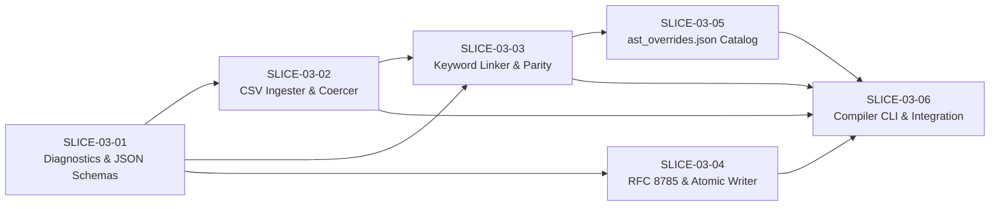

# Card Compiler, Blueprint Ingestion & Schema Pipeline — Technical Design Document (TDD v1.0)
**Deterministic CSV-to-AST Catalog Linker, JSON Schema Draft 2020-12 Validator & RFC 8785 Cryptographic Bundler (`cmd/compile-blueprints`)**

- **Source FRD:** [docs/frd/03_Card_Compiler_FRD.md](../frd/03_Card_Compiler_FRD.md) (FRD v1.2, with companion schemas from [docs/frd/02_Card_Data_Pipeline_FRD.md](../frd/02_Card_Data_Pipeline_FRD.md) v1.3)
- **FRD Commit Hash:** `17b1444`
- **TDD Version:** `v1.0`
- **GitHub Milestone:** `Phase 2: Card Compiler & Blueprint Ingestion (TDD 03)`
- **Phase Label:** `phase:2`
- **Component Label:** `component:compiler`

---

## 1. EXECUTIVE ARCHITECTURE & REPOSITORY FILE TREE

### 1.1 Architectural Overview & Component Dataflow

The Card Town Phase 2 Compiler Toolchain (`cmd/compile-blueprints`) is a deterministic, cross-platform standalone executable written in pure Go 1.22+ (`CGO_ENABLED=0`) that ingests the 10 authoritative RFC-4180 CSV card balance sheets (`data/cards/*.csv`, `FR-DAT-001`), links them with standalone canonical keyword definitions (`FR-CMP-013`, `FR-ABL-012`) and declarative Ability AST entries from the sidecar registry (`data/schemas/ast_overrides.json`, `FR-CMP-017`), validates 1-to-1 text-to-AST parity and JSON Schema Draft 2020-12 compliance (`FR-CMP-019`–`FR-CMP-022`), computes a 256-bit SHA-256 `catalogChecksum` over RFC 8785 Canonical JSON bytes (`FR-CMP-024`–`FR-CMP-025`), and atomically emits the production master catalog (`data/schemas/blueprints.json`, `FR-CMP-003`, `FR-CMP-023`).

In alignment with `DECISION 1` of `03_Card_Compiler_FRD.md`, the compiler operates strictly as a **Catalog Linker, Schema Validator, and Cryptographic Bundler** rather than a natural-language regex parser. All non-standalone-keyword card abilities are authored declaratively in `data/schemas/ast_overrides.json` per `02_Card_Data_Pipeline_FRD.md` (`FR-ABL-001`–`FR-ABL-012`, `FR-TRG-001`, `FR-PRM-001`, `FR-TGT-101`).

```text
+---------------------------------------------------------------------------------------------------+
|                                   TIER 1: AUTHORITATIVE INPUTS                                    |
|                                                                                                   |
|  +---------------------------------------------+  +--------------------------------------------+  |
|  | 10 RFC-4180 CSV Card Sheets (data/cards/)   |  | Sidecar AST Registry (data/schemas/)       |  |
|  | - 6 Asset Sheets (15 cols, FR-DAT-006)      |  | - ast_overrides.json (FR-CMP-017)          |  |
|  | - 4 Maneuver Sheets (9 cols, FR-DAT-006)    |  | - Declarative AbilityDef ASTs (FR-ABL-001) |  |
|  +----------------------+----------------------+  +---------------------+----------------------+  |
+-------------------------|-----------------------------------------------|-------------------------+
                          |                                               |
                          v                                               v
+---------------------------------------------------------------------------------------------------+
|                            cmd/compile-blueprints (FR-CMP-001)                                    |
|                                                                                                   |
|  [STAGE 1: CLI & Schema Init] (pkg/compiler/diagnostics, pkg/compiler/schemas)                    |
|    |-- Parse POSIX flags, emit/load Draft 2020-12 schemas (--emit-schemas, FR-CMP-022)             |
|    v                                                                                              |
|  [STAGE 2: Atomic CSV Ingestion & Coercion] (pkg/compiler/ingest)                                 |
|    |-- Strip BOM, normalize CRLF/LF, skip blank rows, derive <faction>_<slug> IDs (FR-DAT-002)    |
|    |-- Enforce zero-aliasing enums, numeric bounds & global ID uniqueness (FR-CMP-004 - 007)      |
|    v                                                                                              |
|  [STAGE 3: Catalog Linking & Keyword Lookup] (pkg/compiler/linker)                                |
|    |-- Bind ast_overrides.json entries by ID; check orphan keys & text parity (FR-CMP-017)        |
|    |-- Map "--"/"" to abilities: [] and standalone keyword lines via FR-ABL-012 (FR-CMP-013)      |
|    v                                                                                              |
|  [STAGE 4: Parity, --strict & Schema Validation Gate] (pkg/compiler/linker, schemas)              |
|    |-- Verify forward/reverse parity, parityVerified sign-off & --strict flags (FR-CMP-019 - 021) |
|    |-- Validate all blueprints & AST nodes against Draft 2020-12 schemas (FR-CMP-022)             |
|    v                                                                                              |
|  [STAGE 5: RFC 8785 Hashing & Atomic Emission] (pkg/compiler/canonical)                          |
|    |-- Sort blueprints by ID, strip currentProxy/needsRework, serialize RFC 8785 JCS (FR-CMP-024) |
|    |-- Compute SHA-256 catalogChecksum (0x<64-hex>, FR-CMP-025)                                   |
|    |-- Write blueprints.json.tmp.<pid> -> atomic rename to blueprints.json (FR-CMP-003, 023)      |
+-------------------------------------------------|-------------------------------------------------+
                                                  |
                                                  v
+---------------------------------------------------------------------------------------------------+
|                   TIER 3: COMPILED MASTER CATALOG (data/schemas/blueprints.json)                  |
|            Consumed at boot by Headless Go Engine (FR-ENG-001) & Godot Client (FR-SES-001)        |
+---------------------------------------------------------------------------------------------------+
```

### 1.2 Target Repository File & Directory Tree

Every file created or modified by this TDD is locked to the following repository paths:

```text
animus-mundi/
├── cmd/
│   └── compile-blueprints/
│       ├── main.go                            # [CREATE] Main CLI entry point & 5-stage compilation orchestrator (FR-CMP-001 - 003)
│       └── main_test.go                       # [CREATE] End-to-end integration & CLI flag tests (FR-CMP-001, 002, 026)
├── pkg/
│   ├── model/
│   │   ├── blueprint.go                       # [CREATE] Core CardBlueprint domain structs & envelope (FR-DAT-005, FR-CMP-022)
│   │   ├── ability.go                         # [CREATE] Polymorphic AbilityDef AST structs, CostDef, TargetRef (FR-ABL-001 - 012)
│   │   └── overrides.go                       # [CREATE] AstOverrides registry envelope & OverrideEntry structs (FR-CMP-017)
│   └── compiler/
│       ├── diagnostics/
│       │   ├── diagnostics.go                 # [CREATE] Structured ERR_* diagnostic catalog, stderr formatter & exit codes (FR-CMP-027, 028)
│       │   └── diagnostics_test.go            # [CREATE] Unit tests for error dispatch and formatting
│       ├── ingest/
│       │   ├── ingest.go                      # [CREATE] RFC-4180 CSV reader, slug deriver, subtype/zone normalizer & type coercer (FR-CMP-004 - 007)
│       │   └── ingest_test.go                 # [CREATE] Unit tests for CSV parsing, slug collisions, numeric/enum coercion & prototype gates
│       ├── linker/
│       │   ├── linker.go                      # [CREATE] Standalone keyword lookup table, ast_overrides linker & parity gate (FR-CMP-013, 017, 019 - 021)
│       │   └── linker_test.go                 # [CREATE] Unit tests for keyword lookup, override binding, orphan/text mismatch & parity checks
│       ├── schemas/
│       │   ├── schemas.go                     # [CREATE] Canonical JSON Schema Draft 2020-12 emitter (--emit-schemas) & AST validator (FR-CMP-022)
│       │   └── schemas_test.go                # [CREATE] Unit tests for JSON Schema validation of blueprints and overrides
│       └── canonical/
│           ├── canonical.go                   # [CREATE] Native RFC 8785 JCS serializer, SHA-256 fingerprinter & atomic file writer (FR-CMP-023 - 026)
│           └── canonical_test.go              # [CREATE] Unit tests for RFC 8785 key sorting, metadata stripping, SHA-256 hashing & atomic rollback
├── data/
│   └── schemas/
│       ├── CardBlueprint.schema.json          # [CREATE] JSON Schema Draft 2020-12 for blueprints.json envelope & CardBlueprint (FR-DAT-005, FR-CMP-022)
│       ├── AbilityDef.schema.json             # [CREATE] JSON Schema Draft 2020-12 for polymorphic AbilityDef AST & 26 primitives (FR-ABL-001 - 012, FR-PRM-001)
│       ├── ast_overrides.schema.json          # [CREATE] JSON Schema Draft 2020-12 for sidecar AST registry envelope (FR-CMP-017, FR-CMP-022)
│       ├── ast_overrides.json                 # [CREATE] Authoritative sidecar registry mapping bespoke card IDs to AbilityDef ASTs (FR-CMP-017)
│       └── blueprints.json                    # [CREATE] Compiled production master card catalog with RFC 8785 SHA-256 checksum (FR-CMP-023 - 025)
├── tools/
│   └── sheets/
│       ├── import_card_sheets/
│       │   └── main.go                        # [CREATE] Bidirectional Google Sheets to local CSV interactive diff importer (FR-DAT-001)
│       └── publish_card_sheets/
│           └── main.go                        # [CREATE] Freshness-checked export from local CSVs to Google Sheets (FR-DAT-001)
└── docs/
    └── AGENTS.md                              # [MODIFY] Register docs/tdd/03_Card_Compiler_TDD.md in Master Documentation Architecture index
```

### 1.3 Runtime, Language & Dependency Constraints

- **Language / Runtime:** Pure Go (Golang 1.22+) compiled with `CGO_ENABLED=0` for cross-platform execution across Windows, Linux, and macOS (`FR-CMP-001`). Zero PowerShell runtime dependency or shell wrapper indirection.
- **Permitted Dependencies:** Go standard library (`encoding/csv`, `encoding/json`, `crypto/sha256`, `fmt`, `os`, `path/filepath`, `strings`, `strconv`, `sort`, `flag`, `bytes`) and the approved standalone Draft 2020-12 validator `github.com/santhosh-tekuri/jsonschema/v5`.
- **Performance & Determinism Invariants:**
  - Warm execution across all 10 CSV sheets (~169–200 cards) must complete in **`< 500 ms`** (`FR-CMP-002`).
  - All emitted JSON files (`blueprints.json`, `*.schema.json`, `ast_overrides.json`) must be encoded as **UTF-8 without BOM** using Unix **`LF` (`\n`)** line endings and 2-space indentation (`FR-CMP-022`, `FR-CMP-023`).
  - Floating-point numbers are strictly forbidden in `CardBlueprint` attributes and `AbilityDef` AST numeric fields (`FR-DAT-005`, `FR-ENG-004`).

---

## 2. CONCRETE DATA STRUCTURES, SCHEMAS & TYPE DEFINITIONS

### 2.1 Core Domain Structs & Schema Types (`pkg/model/blueprint.go`, `pkg/model/ability.go`, `pkg/model/overrides.go`)

To enforce deterministic serialization and strict compile-time type safety, all domain models are defined in pure Go structs with explicit JSON serialization tags (`FR-DAT-005`, `FR-DAT-006`):

```go
package model

// Canonical Enum Values (FR-DAT-006)
const (
	CardTypeUnit         = "UNIT"
	CardTypeStructure    = "STRUCTURE"
	CardTypeManeuver     = "MANEUVER"
	CardTypeHeadquarters = "HEADQUARTERS"

	FactionConcordia = "CONCORDIA"
	FactionSoulless  = "SOULLESS"
	FactionPath      = "PATH"
	FactionAnimus    = "ANIMUS"
	FactionNeutral   = "NEUTRAL"

	RarityCommon   = "COMMON"
	RarityUncommon = "UNCOMMON"
	RarityRare     = "RARE"
	RarityMythic   = "MYTHIC"
	RarityHQ       = "HQ"

	ZoneReserves     = "RESERVES"
	ZoneMainTheater  = "MAIN_THEATER"
	ZoneHeadquarters = "HEADQUARTERS"
)

// Expected CSV Balance Sheet Filenames (FR-DAT-006)
var ExpectedSheetFiles = []string{
	"maneuvers-animus.csv",
	"maneuvers-concordia.csv",
	"maneuvers-path.csv",
	"maneuvers-soulless.csv",
	"units-and-structures-HQ.csv",
	"units-and-structures-animus.csv",
	"units-and-structures-common.csv",
	"units-and-structures-concordia.csv",
	"units-and-structures-path.csv",
	"units-and-structures-soulless.csv",
}

var ExpectedAssetHeaders = []string{
	"name", "cardType", "faction", "subtypes", "requisitionCost", "tacticsCost",
	"deploymentZones", "rulesText", "power", "health", "requisitionYield",
	"tacticsYield", "rarity", "currentProxy", "needsRework",
}

var ExpectedManeuverHeaders = []string{
	"name", "cardType", "faction", "requisitionCost", "tacticsCost",
	"rulesText", "rarity", "currentProxy", "needsRework",
}

// StandaloneKeywordDef maps standalone rules text keywords to AST representations (FR-CMP-013, FR-ABL-012).
type StandaloneKeywordDef struct {
	Keyword       string
	Parameterized bool
}

var StandaloneKeywords = map[string]StandaloneKeywordDef{
	"Stalwart":          {Keyword: "STALWART", Parameterized: false},
	"Ward":              {Keyword: "WARD", Parameterized: false},
	"Guardian":          {Keyword: "GUARDIAN", Parameterized: false},
	"Versatile":         {Keyword: "VERSATILE", Parameterized: false},
	"Ethereal":          {Keyword: "ETHEREAL", Parameterized: false},
	"Deploys Exhausted": {Keyword: "DEPLOYS_EXHAUSTED", Parameterized: false},
	"Resistant":         {Keyword: "RESISTANT", Parameterized: true},
	"Aggressive":        {Keyword: "AGGRESSIVE", Parameterized: true},
	"Armor":             {Keyword: "ARMOR", Parameterized: true},
	"Berserk":           {Keyword: "BERSERK", Parameterized: true},
}

// CardBlueprint is the compiled production representation of a Card Town card (FR-DAT-005, FR-CMP-022).
type CardBlueprint struct {
	ID                        string        `json:"id"`
	Name                      string        `json:"name"`
	CardType                  string        `json:"cardType"`
	Faction                   string        `json:"faction"`
	Subtypes                  []string      `json:"subtypes"`
	RequisitionCost           int32         `json:"requisitionCost"`
	TacticsCost               int32         `json:"tacticsCost"`
	AdditionalDeploymentCosts []CostDef     `json:"additionalDeploymentCosts,omitempty"`
	Power                     *int32        `json:"power"`
	Health                    *int32        `json:"health"`
	RequisitionYield          int32         `json:"requisitionYield"`
	TacticsYield              int32         `json:"tacticsYield"`
	DeploymentZones           []string      `json:"deploymentZones"`
	Rarity                    string        `json:"rarity"`
	RulesText                 string        `json:"rulesText"`
	CurrentProxy              bool          `json:"currentProxy"`
	NeedsRework               bool          `json:"needsRework"`
	Abilities                 []AbilityDef  `json:"abilities"`
}

// BlueprintCollection is the production blueprints.json master catalog envelope (FR-CMP-023, FR-CMP-025).
type BlueprintCollection struct {
	Schema          string          `json:"$schema"`
	CatalogChecksum string          `json:"catalogChecksum"`
	CardDataVersion string          `json:"cardDataVersion"`
	GeneratedAt     string          `json:"generatedAt"`
	TotalCardCount  int             `json:"totalCardCount"`
	Blueprints      []CardBlueprint `json:"blueprints"`
}

// AbilityDef is the polymorphic ability definition AST node (FR-ABL-001 - 012).
type AbilityDef struct {
	AbilityType      string          `json:"abilityType"`
	Keyword          string          `json:"keyword,omitempty"`
	Parameter        *int32          `json:"parameter,omitempty"`
	TriggerHook      string          `json:"triggerHook,omitempty"`
	InterceptHook    string          `json:"interceptHook,omitempty"`
	Scope            string          `json:"scope,omitempty"`
	ActiveZone       string          `json:"activeZone,omitempty"`
	Effect           *EffectDef      `json:"effect,omitempty"`
	ReplacementAction *EffectDef     `json:"replacementAction,omitempty"`
	Costs            []CostDef       `json:"costs,omitempty"`
	OptionalCosts    []CostDef       `json:"optionalCosts,omitempty"`
	Condition        *ConditionDef   `json:"condition,omitempty"`
	Targeting        *TargetRef      `json:"targeting,omitempty"`
	Optional         *bool           `json:"optional,omitempty"`
	Repeatable       *bool           `json:"repeatable,omitempty"`
	MaxPerTurn       *int32          `json:"maxPerTurn,omitempty"`
	ModalCount       *int32          `json:"modalCount,omitempty"`
	Options          []EffectDef     `json:"options,omitempty"`
	Modifiers        []StatModifier  `json:"modifiers,omitempty"`
	AbilityGrants    []AbilityDef    `json:"abilityGrants,omitempty"`
	StaticPermission string          `json:"staticPermission,omitempty"`
}

// CostDef models upfront deployment or activation costs (FR-ABL-009).
type CostDef struct {
	CostType string      `json:"costType"`
	Amount   *ValueToken `json:"amount,omitempty"`
	Target   *TargetRef  `json:"target,omitempty"`
}

// TargetRef models upfront target locking and selection constraints (FR-TGT-101, FR-ABL-011).
type TargetRef struct {
	Selector      string      `json:"selector"`
	Filter        *FilterDef  `json:"filter,omitempty"`
	BindingPolicy string      `json:"bindingPolicy,omitempty"`
	PoolValue     *ValueToken `json:"poolValue,omitempty"`
}

// ValueToken models discrete values, dynamic counts, or variable X (FR-ABL-007).
type ValueToken struct {
	Type     string     `json:"type"`
	Value    *int32     `json:"value,omitempty"`
	Query    *FilterDef `json:"query,omitempty"`
	Property string     `json:"property,omitempty"`
}

// FilterDef models multi-criterion zone and attribute target filters (FR-ABL-007).
type FilterDef struct {
	Owner       string   `json:"owner,omitempty"`
	Zones       []string `json:"zones,omitempty"`
	CardTypes   []string `json:"cardTypes,omitempty"`
	Factions    []string `json:"factions,omitempty"`
	Subtypes    []string `json:"subtypes,omitempty"`
	ExcludeSelf bool     `json:"excludeSelf,omitempty"`
}

// ConditionDef models logical condition gates on triggers and effects (FR-ABL-007).
type ConditionDef struct {
	Predicate string      `json:"predicate"`
	Left      *ValueToken `json:"left,omitempty"`
	Right     *ValueToken `json:"right,omitempty"`
	Filter    *FilterDef  `json:"filter,omitempty"`
}

// EffectDef models atomic effect primitives or composite sequences (FR-PRM-001).
type EffectDef struct {
	Primitive        string          `json:"primitive"`
	Value            *ValueToken     `json:"value,omitempty"`
	Target           *TargetRef      `json:"target,omitempty"`
	DestinationZone  string          `json:"destinationZone,omitempty"`
	SourceZone       string          `json:"sourceZone,omitempty"`
	Sequence         []EffectDef     `json:"sequence,omitempty"`
	Condition        *ConditionDef   `json:"condition,omitempty"`
	ThenEffect       *EffectDef      `json:"thenEffect,omitempty"`
	ElseEffect       *EffectDef      `json:"elseEffect,omitempty"`
}

// StatModifier models Layer 4 continuous attribute modifications (FR-LAY-001, FR-ABL-004).
type StatModifier struct {
	Attribute string      `json:"attribute"`
	Operation string      `json:"operation"`
	Value     *ValueToken `json:"value"`
}

// AstOverridesEnvelope is the root container for data/schemas/ast_overrides.json (FR-CMP-017).
type AstOverridesEnvelope struct {
	Schema      string                   `json:"$schema"`
	Description string                   `json:"description"`
	Overrides   map[string]OverrideEntry `json:"overrides"`
}

// OverrideEntry is a single card override entry with designer sign-off metadata (FR-CMP-017, FR-CMP-020).
type OverrideEntry struct {
	RulesText                 string       `json:"rulesText"`
	ParityVerified            bool         `json:"parityVerified"`
	VerifiedBy                string       `json:"verifiedBy"`
	VerifiedAt                string       `json:"verifiedAt"`
	AdditionalDeploymentCosts []CostDef    `json:"additionalDeploymentCosts,omitempty"`
	Abilities                 []AbilityDef `json:"abilities"`
}
```

### 2.2 Formal JSON Schema Draft 2020-12 Definitions (`data/schemas/*.schema.json`)

#### 2.2.1 `data/schemas/CardBlueprint.schema.json` (`FR-DAT-005`, `FR-CMP-022`, `FR-CMP-023`)

```json
{
  "$schema": "https://json-schema.org/draft/2020-12/schema",
  "$id": "https://animusmundi.dev/schemas/CardBlueprint.schema.json",
  "title": "CardBlueprintCollection",
  "description": "Compiled production master card catalog envelope and CardBlueprint schema (FR-DAT-005, FR-CMP-022).",
  "type": "object",
  "required": [
    "catalogChecksum",
    "cardDataVersion",
    "generatedAt",
    "totalCardCount",
    "blueprints"
  ],
  "additionalProperties": false,
  "properties": {
    "$schema": {
      "type": "string"
    },
    "catalogChecksum": {
      "type": "string",
      "pattern": "^0x[0-9a-f]{64}$",
      "description": "256-bit SHA-256 digest over RFC 8785 canonical bytes of the stripped blueprints array (FR-CMP-025)."
    },
    "cardDataVersion": {
      "type": "string",
      "pattern": "^(0|[1-9]\\d*)\\.(0|[1-9]\\d*)\\.(0|[1-9]\\d*)(?:-((?:0|[1-9]\\d*|\\d*[a-zA-Z-][0-9a-zA-Z-]*)(?:\\.(?:0|[1-9]\\d*|\\d*[a-zA-Z-][0-9a-zA-Z-]*))*))?(?:\\+([0-9a-zA-Z-]+(?:\\.[0-9a-zA-Z-]+)*))?$",
      "description": "SemVer 2.0 dataset version string (FR-CMP-026)."
    },
    "generatedAt": {
      "type": "string",
      "pattern": "^\\d{4}-\\d{2}-\\d{2}T\\d{2}:\\d{2}:\\d{2}(?:\\.\\d+)?Z$"
    },
    "totalCardCount": {
      "type": "integer",
      "minimum": 1
    },
    "blueprints": {
      "type": "array",
      "minItems": 1,
      "items": {
        "$ref": "#/$defs/CardBlueprint"
      }
    }
  },
  "$defs": {
    "CardBlueprint": {
      "type": "object",
      "required": [
        "id",
        "name",
        "cardType",
        "faction",
        "subtypes",
        "requisitionCost",
        "tacticsCost",
        "power",
        "health",
        "requisitionYield",
        "tacticsYield",
        "deploymentZones",
        "rarity",
        "rulesText",
        "currentProxy",
        "needsRework",
        "abilities"
      ],
      "additionalProperties": false,
      "properties": {
        "id": {
          "type": "string",
          "pattern": "^(concordia|soulless|path|animus|neutral)_[a-z0-9_]+$"
        },
        "name": {
          "type": "string",
          "minLength": 1
        },
        "cardType": {
          "type": "string",
          "enum": ["UNIT", "STRUCTURE", "MANEUVER", "HEADQUARTERS"]
        },
        "faction": {
          "type": "string",
          "enum": ["CONCORDIA", "SOULLESS", "PATH", "ANIMUS", "NEUTRAL"]
        },
        "subtypes": {
          "type": "array",
          "items": {
            "type": "string",
            "minLength": 1
          }
        },
        "requisitionCost": {
          "type": "integer",
          "minimum": 0
        },
        "tacticsCost": {
          "type": "integer",
          "minimum": 0
        },
        "additionalDeploymentCosts": {
          "type": "array",
          "minItems": 1,
          "items": {
            "$ref": "./AbilityDef.schema.json#/$defs/CostDef"
          }
        },
        "power": {
          "type": ["integer", "null"],
          "minimum": 0
        },
        "health": {
          "type": ["integer", "null"],
          "minimum": 1
        },
        "requisitionYield": {
          "type": "integer",
          "minimum": 0
        },
        "tacticsYield": {
          "type": "integer",
          "minimum": 0
        },
        "deploymentZones": {
          "type": "array",
          "items": {
            "type": "string",
            "enum": ["RESERVES", "MAIN_THEATER", "HEADQUARTERS"]
          }
        },
        "rarity": {
          "type": "string",
          "enum": ["COMMON", "UNCOMMON", "RARE", "MYTHIC", "HQ"]
        },
        "rulesText": {
          "type": "string",
          "minLength": 0
        },
        "currentProxy": {
          "type": "boolean"
        },
        "needsRework": {
          "type": "boolean"
        },
        "abilities": {
          "type": "array",
          "items": {
            "$ref": "./AbilityDef.schema.json"
          }
        }
      }
    }
  }
}
```

#### 2.2.2 `data/schemas/AbilityDef.schema.json` (`FR-ABL-001`–`FR-ABL-012`, `FR-TRG-001`, `FR-PRM-001`, `FR-TGT-101`, `FR-CMP-022`)

```json
{
  "$schema": "https://json-schema.org/draft/2020-12/schema",
  "$id": "https://animusmundi.dev/schemas/AbilityDef.schema.json",
  "title": "AbilityDef",
  "description": "Polymorphic declarative Ability AST schema covering all 6 abilityType archetypes and 26 atomic effect primitives (FR-ABL-001 - 012, FR-PRM-001).",
  "type": "object",
  "required": ["abilityType"],
  "properties": {
    "abilityType": {
      "type": "string",
      "enum": [
        "TRIGGERED",
        "ACTIVATED",
        "CONTINUOUS_AURA",
        "REPLACEMENT_WATCHER",
        "MANEUVER_EFFECT",
        "KEYWORD_GRANT"
      ]
    },
    "triggerHook": {
      "oneOf": [
        { "$ref": "#/$defs/EventHookEnum" },
        {
          "type": "array",
          "minItems": 1,
          "items": { "$ref": "#/$defs/EventHookEnum" }
        }
      ]
    },
    "interceptHook": {
      "$ref": "#/$defs/ReplacementHookEnum"
    },
    "condition": {
      "$ref": "#/$defs/ConditionDef"
    },
    "optional": {
      "type": "boolean"
    },
    "optionalCosts": {
      "type": "array",
      "items": { "$ref": "#/$defs/CostDef" }
    },
    "costs": {
      "type": "array",
      "items": { "$ref": "#/$defs/CostDef" }
    },
    "targeting": {
      "oneOf": [
        { "$ref": "#/$defs/TargetRef" },
        {
          "type": "array",
          "minItems": 1,
          "items": { "$ref": "#/$defs/TargetRef" }
        }
      ]
    },
    "effect": {
      "$ref": "#/$defs/EffectDef"
    },
    "replacementAction": {
      "$ref": "#/$defs/EffectDef"
    },
    "maxPerTurn": {
      "type": "integer",
      "minimum": 1
    },
    "repeatable": {
      "type": "boolean"
    },
    "activeZone": {
      "type": "string",
      "enum": ["BATTLEFIELD", "HAND", "DISCARD"]
    },
    "scope": {
      "type": "string",
      "enum": ["SELF", "ALLIED_IN_ZONE", "OPPOSING_IN_ZONE", "ALL_IN_ZONE"]
    },
    "filter": {
      "$ref": "#/$defs/FilterDef"
    },
    "modifiers": {
      "type": "array",
      "items": { "$ref": "#/$defs/AttributeModifierDef" }
    },
    "abilityGrants": {
      "type": "array",
      "items": { "$ref": "#" }
    },
    "staticPermission": {
      "$ref": "#/$defs/StaticPermissionDef"
    },
    "modalCount": {
      "type": "integer",
      "minimum": 1
    },
    "options": {
      "type": "array",
      "minItems": 2,
      "items": { "$ref": "#/$defs/EffectDef" }
    },
    "keyword": {
      "$ref": "#/$defs/KeywordEnum"
    },
    "parameter": {
      "type": "integer",
      "minimum": 1
    }
  },
  "$defs": {
    "EventHookEnum": {
      "type": "string",
      "enum": [
        "EVENT_DEPLOY",
        "EVENT_DESTROY",
        "EVENT_ZONE_CHANGE",
        "EVENT_MARCH",
        "EVENT_EXHAUST",
        "EVENT_READY",
        "EVENT_ATTACK_DECLARE",
        "EVENT_DEAL_DAMAGE",
        "EVENT_TAKE_DAMAGE",
        "EVENT_ATTACK_RESOLVED",
        "EVENT_COMBAT_KILL",
        "EVENT_GENERATE_REQUISITION",
        "EVENT_SPEND_REQUISITION",
        "EVENT_CONVERT_REQUISITION",
        "EVENT_GENERATE_TACTICS",
        "EVENT_SPEND_TACTICS",
        "EVENT_DRAW_CARD",
        "EVENT_DISCARD_CARD",
        "EVENT_MULLIGAN",
        "EVENT_ENACT_MANEUVER",
        "EVENT_ACTIVATE_ABILITY",
        "EVENT_SCRATCH_COMPANY",
        "EVENT_READY_PHASE",
        "EVENT_DRAW_PHASE",
        "EVENT_MAIN_PHASE",
        "EVENT_END_PHASE",
        "EVENT_TURN_START",
        "EVENT_TURN_END"
      ]
    },
    "ReplacementHookEnum": {
      "type": "string",
      "enum": [
        "WOULD_TAKE_DAMAGE",
        "WOULD_BE_DESTROYED",
        "WOULD_DEPLOY"
      ]
    },
    "KeywordEnum": {
      "type": "string",
      "enum": [
        "STALWART",
        "RESISTANT",
        "WARD",
        "AGGRESSIVE",
        "GUARDIAN",
        "ARMOR",
        "VERSATILE",
        "ETHEREAL",
        "DEPLOYS_EXHAUSTED",
        "BERSERK"
      ]
    },
    "PrimitiveEnum": {
      "type": "string",
      "enum": [
        "DEAL_DAMAGE",
        "HEAL",
        "ADD_ARMOR",
        "MODIFY_STAT",
        "MOVE_ZONE",
        "RETURN_TO_HAND",
        "KILL",
        "DRAW_CARD",
        "DISCARD_CARD",
        "REVEAL_HAND",
        "SCRATCH",
        "REGROUP",
        "DEPLOY_FREE",
        "SEARCH_DECK",
        "LOOK_TOP_CARDS",
        "TUCK_UNDER",
        "GAIN_CONTROL",
        "MORPH_SCRATCH",
        "GENERATE_RESOURCE",
        "RECYCLE_DISCARD_TO_DECK",
        "REDIRECT_DAMAGE_TARGET",
        "PUT_CARD_ON_DECK",
        "EXHAUST",
        "GRANT_SUBTYPE",
        "GRANT_KEYWORD",
        "REGISTER_DELAYED_TRIGGER",
        "COMPOSITE_SEQUENCE",
        "CONDITIONAL_CLAUSE"
      ]
    },
    "FilterDef": {
      "type": "object",
      "properties": {
        "allegiance": { "type": "string", "enum": ["ALLIED", "OPPOSING", "ANY"] },
        "entityType": { "type": "string", "enum": ["UNIT", "STRUCTURE", "HEADQUARTERS", "ASSET", "CARD"] },
        "cardType": { "type": "string", "enum": ["UNIT", "STRUCTURE", "MANEUVER", "HEADQUARTERS"] },
        "subtypes": { "type": "array", "items": { "type": "string" } },
        "negateSubtypes": { "type": "boolean" },
        "excludeSelf": { "type": "boolean" },
        "excludeScratch": { "type": "boolean" },
        "excludeHQ": { "type": "boolean" },
        "excludeUnits": { "type": "boolean" },
        "readiness": { "type": "string", "enum": ["READIED", "EXHAUSTED", "ANY"] },
        "zone": {
          "type": "string",
          "enum": ["SAME_ZONE", "RESERVES", "MAIN_THEATER", "HEADQUARTERS", "BATTLEFIELD", "ATTACHED", "HAND", "DECK", "DISCARD"]
        },
        "statComparison": {
          "type": "object",
          "required": ["property", "operator", "value"],
          "properties": {
            "property": {
              "type": "string",
              "enum": ["COMBAT_POWER", "CURRENT_HEALTH", "MAX_HEALTH", "REQUISITION_COST", "TACTICS_COST"]
            },
            "operator": {
              "type": "string",
              "enum": ["EQ", "NEQ", "LT", "LTE", "GT", "GTE"]
            },
            "value": { "$ref": "#/$defs/ValueToken" }
          }
        }
      }
    },
    "ValueToken": {
      "type": "object",
      "required": ["type"],
      "properties": {
        "type": { "type": "string", "enum": ["STATIC", "DYNAMIC", "QUERY", "VARIABLE_X"] },
        "value": { "type": "integer" },
        "source": { "type": "string", "enum": ["SELF", "TARGET", "GAME_STATE", "CAUSALITY_CONTEXT"] },
        "property": {
          "type": "string",
          "enum": [
            "COMBAT_POWER",
            "CURRENT_HEALTH",
            "MAX_HEALTH",
            "BASE_REQUISITION_COST",
            "BASE_TACTICS_COST",
            "KILLED_COUNT",
            "RETURNED_COUNT",
            "DISCARDED_COUNT"
          ]
        },
        "query": {
          "type": "object",
          "required": ["zone", "aggregate"],
          "properties": {
            "zone": {
              "type": "string",
              "enum": ["RESERVES", "MAIN_THEATER", "HEADQUARTERS", "BATTLEFIELD", "ATTACHED", "HAND", "DECK", "DISCARD"]
            },
            "filter": { "$ref": "#/$defs/FilterDef" },
            "aggregate": { "type": "string", "enum": ["COUNT", "SUM_ATTRIBUTE"] },
            "targetAttribute": {
              "type": "string",
              "enum": ["REQUISITION_YIELD", "TACTICS_YIELD", "COMBAT_POWER", "CURRENT_HEALTH", "MAX_HEALTH", "ARMOR"]
            }
          }
        },
        "filter": { "$ref": "#/$defs/FilterDef" },
        "multiplier": { "type": "integer" },
        "divisor": { "type": "integer", "minimum": 1 }
      }
    },
    "CostDef": {
      "type": "object",
      "required": ["costType"],
      "properties": {
        "costType": {
          "type": "string",
          "enum": ["RESOURCE", "EXHAUST_SELF", "EXHAUST_ASSET", "KILL_ASSET", "DISCARD_CARD", "MOVE_CARD_ZONE"]
        },
        "resource": { "type": "string", "enum": ["REQUISITION", "TACTICS"] },
        "amount": { "type": "integer", "minimum": 1 },
        "target": { "$ref": "#/$defs/TargetRef" },
        "filter": { "$ref": "#/$defs/FilterDef" },
        "count": { "type": "integer", "minimum": 1 },
        "destinationPosition": { "type": "string", "enum": ["TOP", "BOTTOM", "SHUFFLED_IN"] }
      }
    },
    "TargetRef": {
      "type": "object",
      "required": ["selector"],
      "properties": {
        "selector": {
          "type": "string",
          "enum": ["SELF", "CHOSEN", "ALL", "DISTRIBUTED_POOL", "RANDOM", "BOUND_TARGET", "TRIGGER_EVENT_ENTITY"]
        },
        "filter": { "$ref": "#/$defs/FilterDef" },
        "count": { "type": "integer", "minimum": 1 },
        "minCount": { "type": "integer", "minimum": 0 },
        "maxCount": { "type": "integer", "minimum": 1 },
        "allowedCounts": { "type": "array", "items": { "type": "integer", "minimum": 1 } },
        "poolValue": { "type": "integer", "minimum": 1 },
        "targetIndex": { "type": "integer", "minimum": 0 },
        "bindingPolicy": { "type": "string", "enum": ["UPFRONT_LOCK", "ON_RESOLUTION"] }
      }
    },
    "ConditionDef": {
      "type": "object",
      "properties": {
        "source": { "type": "string", "enum": ["SELF", "ALLIED", "OPPOSING", "ANY"] },
        "turnOwner": { "type": "string", "enum": ["SELF", "OPPONENT", "ANY"] },
        "cornered": { "type": "boolean" },
        "deployedZone": { "type": "string", "enum": ["RESERVES", "MAIN_THEATER"] },
        "fromZone": { "type": "string", "enum": ["HAND", "DECK", "BATTLEFIELD", "DISCARD", "RESERVES", "MAIN_THEATER"] },
        "toZone": { "type": "string", "enum": ["HAND", "DECK", "BATTLEFIELD", "DISCARD", "RESERVES", "MAIN_THEATER"] },
        "targetRef": { "type": "string" },
        "handEmpty": { "type": "boolean" },
        "allegiance": { "type": "string", "enum": ["ALLIED", "OPPOSING", "ANY"] },
        "entityType": { "type": "string", "enum": ["UNIT", "STRUCTURE", "HEADQUARTERS", "ASSET", "CARD"] },
        "cardType": { "type": "string", "enum": ["UNIT", "STRUCTURE", "MANEUVER", "HEADQUARTERS"] },
        "zone": {
          "type": "string",
          "enum": ["SAME_ZONE", "RESERVES", "MAIN_THEATER", "HEADQUARTERS", "BATTLEFIELD", "ATTACHED", "HAND", "DECK", "DISCARD"]
        },
        "filter": { "$ref": "#/$defs/FilterDef" },
        "valueComparison": {
          "type": "object",
          "required": ["property", "operator", "value"],
          "properties": {
            "property": { "type": "string", "enum": ["KILLED_COUNT", "RETURNED_COUNT", "DISCARDED_COUNT"] },
            "operator": { "type": "string", "enum": ["EQ", "NEQ", "GT", "GTE", "LT", "LTE"] },
            "value": { "type": "integer" }
          }
        }
      }
    },
    "AttributeModifierDef": {
      "type": "object",
      "required": ["attribute", "operation", "value"],
      "properties": {
        "attribute": {
          "type": "string",
          "enum": ["COMBAT_POWER", "MAX_HEALTH", "REQUISITION_COST", "TACTICS_COST", "KEYWORD_GRANT", "SUBTYPE_GRANT"]
        },
        "operation": { "type": "string", "enum": ["ADD", "SUBTRACT", "SET"] },
        "value": { "$ref": "#/$defs/ValueToken" },
        "keyword": { "$ref": "#/$defs/KeywordEnum" },
        "subtype": { "type": "string" }
      }
    },
    "StaticPermissionDef": {
      "type": "object",
      "required": ["permissionType", "sourceZone"],
      "properties": {
        "permissionType": { "type": "string", "enum": ["ALLOW_DEPLOY_FROM_ZONE"] },
        "sourceZone": { "type": "string", "enum": ["DISCARD"] },
        "additionalCosts": {
          "type": "array",
          "items": { "$ref": "#/$defs/CostDef" }
        }
      }
    },
    "PartitionDestDef": {
      "type": "object",
      "properties": {
        "action": { "type": "string", "enum": ["MOVE_TO_ZONE", "DEPLOY_FREE"] },
        "zone": { "type": "string", "enum": ["HAND", "DISCARD", "TOP_OF_DECK", "BOTTOM_OF_DECK"] },
        "destinationZone": { "type": "string", "enum": ["RESERVES", "MAIN_THEATER"] },
        "count": { "type": ["integer", "string"] },
        "upTo": { "type": "boolean" },
        "filter": { "$ref": "#/$defs/FilterDef" },
        "order": { "type": "string", "enum": ["ANY_ORDER", "MAINTAIN_ORDER"] },
        "trackAs": { "type": "string" }
      }
    },
    "EffectDef": {
      "type": "object",
      "required": ["primitive"],
      "properties": {
        "primitive": { "$ref": "#/$defs/PrimitiveEnum" },
        "target": { "$ref": "#/$defs/TargetRef" },
        "damageSource": { "$ref": "#/$defs/TargetRef" },
        "hostTarget": { "$ref": "#/$defs/TargetRef" },
        "newTarget": { "$ref": "#/$defs/TargetRef" },
        "amount": { "$ref": "#/$defs/ValueToken" },
        "count": { "oneOf": [{ "$ref": "#/$defs/ValueToken" }, { "type": "integer", "minimum": 1 }] },
        "repeatCount": { "$ref": "#/$defs/ValueToken" },
        "attribute": { "type": "string", "enum": ["COMBAT_POWER", "MAX_HEALTH"] },
        "duration": { "type": "string", "enum": ["END_OF_TURN", "END_OF_OPPONENT_TURN", "PERSISTENT", "NEXT_OCCURRENCE"] },
        "destinationZone": { "type": "string", "enum": ["RESERVES", "MAIN_THEATER", "CHOSEN_ZONE"] },
        "sourceZone": { "type": "string", "enum": ["HAND", "DECK", "DISCARD"] },
        "destination": { "type": "string", "enum": ["HAND", "DISCARD", "TOP_OF_DECK", "BOTTOM_OF_DECK"] },
        "destinationPosition": { "type": "string", "enum": ["TOP", "BOTTOM", "SHUFFLED_IN"] },
        "targetPlayer": { "type": "string", "enum": ["SELF", "OPPONENT", "ALL_OPPONENTS"] },
        "selector": { "type": "string", "enum": ["CHOSEN", "RANDOM", "ALL"] },
        "upTo": { "type": "boolean" },
        "faceDown": { "type": "boolean" },
        "resourceType": { "type": "string", "enum": ["REQUISITION", "TACTICS"] },
        "subtype": { "type": "string" },
        "keyword": { "$ref": "#/$defs/KeywordEnum" },
        "parameter": { "$ref": "#/$defs/ValueToken" },
        "triggerHook": { "$ref": "#/$defs/EventHookEnum" },
        "filter": { "$ref": "#/$defs/FilterDef" },
        "partition": {
          "type": "object",
          "required": ["destinations"],
          "properties": {
            "destinations": {
              "type": "array",
              "minItems": 1,
              "items": { "$ref": "#/$defs/PartitionDestDef" }
            }
          }
        },
        "steps": {
          "type": "array",
          "minItems": 1,
          "items": { "$ref": "#/$defs/EffectDef" }
        },
        "condition": { "$ref": "#/$defs/ConditionDef" },
        "optionalCost": { "$ref": "#/$defs/CostDef" },
        "effect": { "$ref": "#/$defs/EffectDef" },
        "ifTrue": { "$ref": "#/$defs/EffectDef" },
        "ifFalse": { "$ref": "#/$defs/EffectDef" }
      }
    }
  }
}
```

#### 2.2.3 `data/schemas/ast_overrides.schema.json` (`FR-CMP-017`, `FR-CMP-020`, `FR-CMP-022`)

```json
{
  "$schema": "https://json-schema.org/draft/2020-12/schema",
  "$id": "https://animusmundi.dev/schemas/ast_overrides.schema.json",
  "title": "AstOverridesRegistry",
  "description": "Sidecar declarative Ability AST registry mapping blueprint IDs to verified AbilityDef arrays (FR-CMP-017).",
  "type": "object",
  "required": ["overrides"],
  "additionalProperties": false,
  "properties": {
    "$schema": {
      "type": "string"
    },
    "overrides": {
      "type": "object",
      "propertyNames": {
        "pattern": "^(concordia|soulless|path|animus|neutral)_[a-z0-9_]+$"
      },
      "additionalProperties": {
        "$ref": "#/$defs/AstOverrideEntry"
      }
    }
  },
  "$defs": {
    "AstOverrideEntry": {
      "type": "object",
      "required": [
        "rulesText",
        "parityVerified",
        "verifiedBy",
        "verifiedAt",
        "abilities"
      ],
      "additionalProperties": false,
      "properties": {
        "rulesText": {
          "type": "string",
          "minLength": 1
        },
        "parityVerified": {
          "type": "boolean"
        },
        "verifiedBy": {
          "type": "string",
          "minLength": 1
        },
        "verifiedAt": {
          "type": "string",
          "pattern": "^\\d{4}-\\d{2}-\\d{2}T\\d{2}:\\d{2}:\\d{2}(?:\\.\\d+)?Z$"
        },
        "rationale": {
          "type": "string"
        },
        "additionalDeploymentCosts": {
          "type": "array",
          "items": {
            "$ref": "./AbilityDef.schema.json#/$defs/CostDef"
          }
        },
        "abilities": {
          "type": "array",
          "items": {
            "$ref": "./AbilityDef.schema.json"
          }
        }
      }
    }
  }
}
```

### 2.3 Error Taxonomy, Exit Code Map & Diagnostic Structures (`pkg/compiler/diagnostics/diagnostics.go`)

Every error code defined in `FR-CMP-027` maps deterministically to a process exit code (`1`–`5`, `FR-CMP-001`, `FR-CMP-028`) and emits a structured single-line + multi-field diagnostic block to `stderr`:

```go
package diagnostics

type ErrorCategory string

const (
	CategoryIOEnvironment   ErrorCategory = "I/O & Environment"
	CategoryCSVCoercion     ErrorCategory = "CSV & Coercion"
	CategoryLinkingSchemas  ErrorCategory = "Linking & Schemas"
	CategoryParityStrict    ErrorCategory = "Parity & Strict Gate"
)

type ErrorMeta struct {
	ExitCode    int
	Category    ErrorCategory
	Requirement string
}

var CompilerErrorCatalog = map[string]ErrorMeta{
	// Exit Code 1: Environment / I/O
	"ERR_CSV_IO":                    {ExitCode: 1, Category: CategoryIOEnvironment,  Requirement: "FR-CMP-004"},
	"ERR_SCHEMA_IO":                 {ExitCode: 1, Category: CategoryIOEnvironment,  Requirement: "FR-CMP-022"},
	"ERR_OUTPUT_IO":                 {ExitCode: 1, Category: CategoryIOEnvironment,  Requirement: "FR-CMP-003"},

	// Exit Code 2: CSV Syntax / Parsing
	"ERR_CSV_MALFORMED":             {ExitCode: 2, Category: CategoryCSVCoercion,     Requirement: "FR-CMP-004"},
	"ERR_NAME_EMPTY":                {ExitCode: 2, Category: CategoryCSVCoercion,     Requirement: "FR-CMP-005"},

	// Exit Code 3: Type / Enum / Slug
	"ERR_NUM_PARSE":                 {ExitCode: 3, Category: CategoryCSVCoercion,     Requirement: "FR-CMP-007"},
	"ERR_NUM_NEGATIVE_COST":         {ExitCode: 3, Category: CategoryCSVCoercion,     Requirement: "FR-CMP-007"},
	"ERR_NUM_INVALID_POWER":         {ExitCode: 3, Category: CategoryCSVCoercion,     Requirement: "FR-CMP-007"},
	"ERR_NUM_INVALID_HEALTH":        {ExitCode: 3, Category: CategoryCSVCoercion,     Requirement: "FR-CMP-007"},
	"ERR_NUM_NEGATIVE_YIELD":        {ExitCode: 3, Category: CategoryCSVCoercion,     Requirement: "FR-CMP-007"},
	"ERR_ENUM_INVALID_CARD_TYPE":    {ExitCode: 3, Category: CategoryCSVCoercion,     Requirement: "FR-CMP-007"},
	"ERR_ENUM_INVALID_FACTION":      {ExitCode: 3, Category: CategoryCSVCoercion,     Requirement: "FR-CMP-007"},
	"ERR_ENUM_INVALID_RARITY":       {ExitCode: 3, Category: CategoryCSVCoercion,     Requirement: "FR-CMP-007"},
	"ERR_ENUM_INVALID_ZONE":         {ExitCode: 3, Category: CategoryCSVCoercion,     Requirement: "FR-CMP-007"},
	"ERR_SUBTYPES_INVALID":          {ExitCode: 3, Category: CategoryCSVCoercion,     Requirement: "FR-CMP-007"},
	"ERR_SLUG_COLLISION":            {ExitCode: 3, Category: CategoryCSVCoercion,     Requirement: "FR-CMP-006"},

	// Exit Code 4: AST Registry / Schema
	"ERR_OVERRIDE_SCHEMA_INVALID":   {ExitCode: 4, Category: CategoryLinkingSchemas,  Requirement: "FR-CMP-022"},
	"ERR_OVERRIDE_TEXT_MISMATCH":    {ExitCode: 4, Category: CategoryLinkingSchemas,  Requirement: "FR-CMP-017"},
	"ERR_ORPHAN_OVERRIDE":           {ExitCode: 4, Category: CategoryLinkingSchemas,  Requirement: "FR-CMP-017"},

	// Exit Code 5: Parity / Strict Gate
	"ERR_OVERRIDE_UNVERIFIED":       {ExitCode: 5, Category: CategoryParityStrict,   Requirement: "FR-CMP-020"},
	"ERR_PARITY_UNMAPPED_TEXT":      {ExitCode: 5, Category: CategoryParityStrict,   Requirement: "FR-CMP-019"},
	"ERR_PARITY_ORPHAN_AST":         {ExitCode: 5, Category: CategoryParityStrict,   Requirement: "FR-CMP-020"},
	"ERR_PARITY_VERB":               {ExitCode: 5, Category: CategoryParityStrict,   Requirement: "FR-CMP-019"},
	"ERR_STRICT_PROTOTYPE_REJECTED": {ExitCode: 5, Category: CategoryParityStrict,   Requirement: "FR-CMP-005"},
	"ERR_STRICT_UNRESOLVED_REVIEW":  {ExitCode: 5, Category: CategoryParityStrict,   Requirement: "FR-CMP-021"},
}

// Diagnostic carries structured diagnostic information for CI/CD and developer tooling (FR-CMP-027).
type Diagnostic struct {
	ErrorCode      string        `json:"errorCode"`
	ExitCode       int           `json:"exitCode"`
	Category       ErrorCategory `json:"category"`
	Requirement    string        `json:"requirement"`
	SourceFile     string        `json:"sourceFile"`
	CardIdentifier string        `json:"cardIdentifier,omitempty"`
	Field          string        `json:"field,omitempty"`
	OffendingValue string        `json:"offendingValue,omitempty"`
	Message        string        `json:"message"`
}
```

---

## 3. MODULE-BY-MODULE FUNCTIONAL & ALGORITHMIC DESIGN

### 3.1 Module 1: Structured Diagnostics & Error Dispatcher (`pkg/compiler/diagnostics/diagnostics.go`)
**Governing Requirements:** `FR-CMP-001`, `FR-CMP-003`, `FR-CMP-027`, `FR-CMP-028`

#### 3.1.1 Public & Internal Signatures
```go
package diagnostics

import "os"

// NewDiagnostic creates a structured Diagnostic looked up from CompilerErrorCatalog.
func NewDiagnostic(code string, sourceFile string, cardID string, field string, offendingVal string, msg string) *Diagnostic

// Error implements the standard error interface.
func (d *Diagnostic) Error() string

// StderrString formats the diagnostic block for console emission.
func (d *Diagnostic) StderrString() string

// ExitWithDiagnostic logs the diagnostic to stderr, deletes any staging file, and calls os.Exit.
func ExitWithDiagnostic(d *Diagnostic, stagingFilePath string)
```

#### 3.1.2 Deterministic Execution Algorithm
1. **`NewDiagnostic`**:
   - Looks up `code` in `CompilerErrorCatalog`. If unknown, panics with an internal compiler assertion failure.
   - Populates and returns a pointer to `Diagnostic` with `ExitCode`, `Category`, `Requirement`, and caller fields.
2. **`StderrString`**:
   - Formats the diagnostic block:
     ```text
     [COMPILER ERROR] <ErrorCode> (Exit Code <ExitCode> | <Requirement>)
       Source File    : <SourceFile>
       Card / Row     : <CardIdentifier>
       Field / Value  : <Field> = '<OffendingValue>'
       Details        : <Message>
     ```
3. **`ExitWithDiagnostic`**:
   - Emits `StderrString()` to `os.Stderr` (`FR-CMP-027`).
   - If `stagingFilePath != ""` and the staging file exists on disk, deletes it via `os.Remove(stagingFilePath)` (`FR-CMP-003`).
   - Calls `os.Exit(d.ExitCode)` to terminate with the standardized process exit code (`1`–`5`, `FR-CMP-028`).

---

### 3.2 Module 2: RFC-4180 CSV Ingester, Coercer & Slug Deriver (`pkg/compiler/ingest/ingest.go`)
**Governing Requirements:** `FR-CMP-004`, `FR-CMP-005`, `FR-CMP-006`, `FR-CMP-007`, `FR-DAT-001`, `FR-DAT-002`, `FR-DAT-005`, `FR-DAT-006`, `FR-DAT-007`, `FR-DAT-008`, `FR-VAL-003`

#### 3.2.1 Public & Internal Signatures
```go
package ingest

import (
	"io"
	"animus-mundi/pkg/model"
)

// DeriveSlug computes the deterministic <faction>_<slug> identifier (FR-DAT-002, FR-CMP-006).
func DeriveSlug(faction string, cardName string) (string, error)

// ParseRFC4180CSV parses raw CSV data with BOM stripping and strict header validation (FR-CMP-004).
func ParseRFC4180CSV(r io.Reader, sourceFileName string) (headers []string, rows [][]string, err error)

// NormalizeSubtypes trims, validates Title Case, and deduplicates subtype tags (FR-DAT-007).
func NormalizeSubtypes(rawSubtypes string, sourceFile string, cardID string) ([]string, error)

// NormalizeDeploymentZones validates and normalizes deployment zone tokens (FR-DAT-008).
func NormalizeDeploymentZones(rawZones string, cardType string, sourceFile string, cardID string) ([]string, error)

// IngestSheet parses and coercively validates a single CSV balance sheet (FR-CMP-004, FR-CMP-007).
func IngestSheet(filePath string, strict bool, seenIDs map[string]string) ([]*model.CardBlueprint, error)

// IngestAllCardSheets ingests all 10 canonical CSV balance sheets from sourceDir (FR-CMP-004).
func IngestAllCardSheets(sourceDir string, strict bool) ([]*model.CardBlueprint, error)
```

#### 3.2.2 Deterministic Execution Algorithm
1. **Low-Level RFC-4180 Character State Machine (`ParseRFC4180CSV`, `FR-CMP-004`)**:
   - Strips leading UTF-8 BOM (`\uFEFF`) if present.
   - Parses records using standard RFC-4180 semantics: embedded newlines within quotes are preserved as `\n` (`FR-CMP-004` item 3), quotes are unescaped from `""` to `"`. Any unclosed quote or syntax violation dispatches `ERR_CSV_MALFORMED` (Exit Code `2`).
   - Validates that the header row exists, has no duplicate columns, and matches `model.ExpectedManeuverHeaders` (for `maneuvers-*.csv`) or `model.ExpectedAssetHeaders` (for `units-and-structures-*.csv`) using exact case-sensitive comparison. Any mismatch dispatches `ERR_CSV_MALFORMED` (`FR-CMP-004`, `FR-DAT-006`).
   - Validates that every subsequent non-blank row has the exact column count as the header row; otherwise dispatches `ERR_CSV_MALFORMED`.
2. **Blank Row Skipping & Mandatory Card Name (`FR-CMP-005`)**:
   - If every cell in a data row is empty or whitespace-only, the row is silently skipped.
   - If a row has at least one non-whitespace cell but `strings.TrimSpace(name)` is empty, dispatches `ERR_NAME_EMPTY` (Exit Code `2`).
3. **Zero-Aliasing Enum & Boolean Validation (`FR-DAT-006`, `FR-CMP-005`, `FR-CMP-007`)**:
   - `cardType`: Must case-sensitively match one of `UNIT`, `STRUCTURE`, `MANEUVER`, `HEADQUARTERS`; else `ERR_ENUM_INVALID_CARD_TYPE` (Exit Code `3`). Maneuver sheets must only contain `MANEUVER` rows, and asset sheets must only contain `UNIT`, `STRUCTURE`, or `HEADQUARTERS` rows.
   - `faction`: Must case-sensitively match `CONCORDIA`, `SOULLESS`, `PATH`, `ANIMUS`, or `NEUTRAL`; else `ERR_ENUM_INVALID_FACTION` (Exit Code `3`).
   - `rarity`: Must case-sensitively match `COMMON`, `UNCOMMON`, `RARE`, `MYTHIC`, or `HQ` (with `HEADQUARTERS` cards requiring `HQ` and non-HQ cards forbidden from `HQ`); else `ERR_ENUM_INVALID_RARITY` (Exit Code `3`).
   - `currentProxy` & `needsRework`: Must case-sensitively equal `"true"` or `"false"`; else dispatches `ERR_CSV_MALFORMED`. When `--strict` is passed, if either equals `"true"`, dispatches `ERR_STRICT_PROTOTYPE_REJECTED` (Exit Code `5`, `FR-CMP-005`, `FR-VAL-003`).
4. **Deterministic Slug Derivation & Global Collision Check (`DeriveSlug`, `FR-DAT-002`, `FR-CMP-006`)**:
   - Strips non-alphanumeric characters: `cleanName = regexp.MustCompile("[^A-Za-z0-9 ]").ReplaceAllString(cardName, "")`
   - Replaces whitespace runs with `_`: `slug = regexp.MustCompile("\\s+").ReplaceAllString(strings.TrimSpace(strings.ToLower(cleanName)), "_")`
   - Canonical ID: `id = strings.ToLower(faction) + "_" + slug`
   - Checks `seenIDs[id]`. If already present, dispatches `ERR_SLUG_COLLISION` (Exit Code `3`) citing both card names and source CSV filenames.
5. **Subtype & Deployment Zone Normalization (`FR-DAT-007`, `FR-DAT-008`, `FR-CMP-007`)**:
   - For `MANEUVER` rows: `subtypes = []string{}`, `deploymentZones = []string{}`.
   - For Asset rows (`UNIT`, `STRUCTURE`, `HEADQUARTERS`):
     - `NormalizeSubtypes`: If `subtypes` is `""`, whitespace, `"--"`, or `"N/A"`, returns `[]string{}`. Otherwise splits by `,`, trims each token, verifies non-empty and Title Case (`^[A-Z][A-Za-z0-9-]*(?: [A-Z][A-Za-z0-9-]*)*$`; else `ERR_SUBTYPES_INVALID`), and deduplicates while preserving order.
     - `NormalizeDeploymentZones`: Splits `deploymentZones` by `,`, trims each token, verifies each token is in `{"RESERVES", "MAIN_THEATER", "HEADQUARTERS"}` (else `ERR_ENUM_INVALID_ZONE`). For `HEADQUARTERS`, requires strictly `[]string{"HEADQUARTERS"}`. For `UNIT` and `STRUCTURE`, requires 1 or 2 zones from `{"RESERVES", "MAIN_THEATER"}` sorted alphabetically; else `ERR_ENUM_INVALID_ZONE`.
6. **Integer Coercion & Domain Range Validation (`FR-DAT-005`, `FR-CMP-007`)**:
   - Parses `requisitionCost` and `tacticsCost` via `strconv.ParseInt` with strict integer regex `^-?\d+$` (rejecting floats/hex with `ERR_NUM_PARSE`). If `< 0`, dispatches `ERR_NUM_NEGATIVE_COST`.
   - For `MANEUVER`: sets `power = nil`, `health = nil`, `requisitionYield = 0`, `tacticsYield = 0`.
   - For `UNIT`, `STRUCTURE`, `HEADQUARTERS`:
     - Parses `power`: must be integer (else `ERR_NUM_PARSE`) and `>= 0` (else `ERR_NUM_INVALID_POWER`).
     - Parses `health`: must be integer (else `ERR_NUM_PARSE`) and `>= 1` (else `ERR_NUM_INVALID_HEALTH`).
     - Parses `requisitionYield` and `tacticsYield`: must be integer (else `ERR_NUM_PARSE`) and `>= 0` (else `ERR_NUM_NEGATIVE_YIELD`).

---

### 3.3 Module 3: Standalone Keyword Lookup, Override Linker & Parity Engine (`pkg/compiler/linker/linker.go`)
**Governing Requirements:** `FR-CMP-013`, `FR-CMP-017`, `FR-CMP-019`, `FR-CMP-020`, `FR-CMP-021`, `FR-ABL-001`–`FR-ABL-012`, `FR-TXT-001`–`FR-TXT-006`, `FR-VAL-002`

#### 3.3.1 Public & Internal Signatures
```go
package linker

import "animus-mundi/pkg/model"

// LoadAstOverridesRegistry loads and validates data/schemas/ast_overrides.json (FR-CMP-017).
func LoadAstOverridesRegistry(overridesFile string) (*model.AstOverridesEnvelope, error)

// ParseStandaloneKeywordLines inspects rulesText for standalone canonical keywords (FR-CMP-013, FR-ABL-012).
func ParseStandaloneKeywordLines(rulesText string, cardType string) (isVanilla bool, isKeywordOnly bool, nodes []model.AbilityDef, printedKeywords []string)

// JoinCardCatalogWithAst binds blueprints with standalone keywords or overrides with parity checks (FR-CMP-017 - 021).
func JoinCardCatalogWithAst(blueprints []*model.CardBlueprint, overrides *model.AstOverridesEnvelope, strict bool) error
```

#### 3.3.2 Deterministic Execution Algorithm
1. **Normalize `rulesText` & Extract Standalone Keywords (`ParseStandaloneKeywordLines`, `FR-CMP-013`, `FR-ABL-012`)**:
   - Normalizes line endings in `rulesText` (`\r\n` $\rightarrow$ `\n`) and trims outer whitespace.
   - **Vanilla Check (`FR-CMP-013` item 1)**: If `rulesText` is `""` or `"--"`, marks `isVanilla = true`, sets blueprint `rulesText = ""`, and `abilities = []model.AbilityDef{}`.
   - **Line-by-Line Standalone Keyword Inspection (`FR-CMP-013` item 2)**:
     - Splits `rulesText` on `\n` into non-empty trimmed lines.
     - Matches each line against the 10 standalone `KEYWORD_GRANT` patterns in `FR-ABL-012`:
       - Parameterless keywords: `^(Stalwart|Ward|Guardian|Versatile|Ethereal|Deploys Exhausted)$` $\rightarrow$ `AbilityDef{AbilityType: "KEYWORD_GRANT", Keyword: mappedEnum}`.
       - Parameterized keywords: `^(Resistant|Aggressive|Armor|Berserk)\s+(\d+)$` (where `parameter >= 1`) $\rightarrow$ `AbilityDef{AbilityType: "KEYWORD_GRANT", Keyword: mappedEnum, Parameter: &param}`.
     - Note: The 5 non-standalone keywords (`Unbowed`, `Cornered`, `Heal N`, `Scratch N`, `Regroup N`) intentionally do NOT match standalone `KEYWORD_GRANT` synthesis (`FR-CMP-013` item 3).
     - Records all matched standalone keyword lines in `printedKeywords`, and sets `isKeywordOnly = (len(matched) == len(lines))` (provided `cardType != "MANEUVER"`, since Maneuvers require `MANEUVER_EFFECT` payloads per `FR-CMP-013` item 3).
2. **Orphan Override Detection (`FR-CMP-017` item 3)**:
   - Builds a hash set of all ingested blueprint IDs across the 10 CSV sheets.
   - Iterates over every `<blueprint_id>` key in `overrides.Overrides`. If a key is not in the ingested CSV ID set, halts immediately with `ERR_ORPHAN_OVERRIDE` (Exit Code `4`).
3. **Per-Card Catalog Linking & Parity Enforcement (`FR-CMP-017`, `FR-CMP-019`, `FR-CMP-020`, `FR-CMP-021`)**:
   - **Case A — Card ID exists in `ast_overrides.json`**:
     1. **Vanilla Override Rejection (`FR-CMP-020` item 1)**: If the card is Vanilla (`isVanilla == true`) and the override injects non-empty `abilities`, halts with `ERR_PARITY_ORPHAN_AST` (Exit Code `5`).
     2. **CSV-to-Override `rulesText` Synchronization (`FR-CMP-017` item 4)**: Normalizes whitespace (`\r\n` $\rightarrow$ `\n`, `.Trim()`) on both the CSV row's `rulesText` and `override.RulesText`. If they are not case-sensitively equal, halts with `ERR_OVERRIDE_TEXT_MISMATCH` (Exit Code `4`).
     3. **Designer Sign-Off Verification (`FR-CMP-020` item 2)**: Verifies `override.ParityVerified == true`, non-empty `override.VerifiedBy`, and ISO-8601 UTC timestamp `override.VerifiedAt` (`^\d{4}-\d{2}-\d{2}T\d{2}:\d{2}:\d{2}(?:\.\d+)?Z$`). If any check fails, halts with `ERR_OVERRIDE_UNVERIFIED` (Exit Code `5`).
     4. **Standalone Keyword Coverage Check (`FR-CMP-019` item 2)**: For every standalone keyword line present on the card (`printedKeywords`), verifies that `override.Abilities` contains a matching `KEYWORD_GRANT` node (`keyword` and `parameter`). If omitted, halts with `ERR_PARITY_UNMAPPED_TEXT` (Exit Code `5`).
     5. **Keyword-Only Extraneous AST Check (`FR-CMP-020` item 1)**: If `isKeywordOnly == true` and `len(override.Abilities) > len(printedKeywords)`, halts with `ERR_PARITY_ORPHAN_AST` (Exit Code `5`).
     6. Binds `override.Abilities` (and optional `override.AdditionalDeploymentCosts`) onto the `CardBlueprint`.
   - **Case B — Card ID does NOT exist in `ast_overrides.json`**:
     1. If `isVanilla == true`: sets `rulesText = ""` and `abilities = []model.AbilityDef{}`.
     2. Else if `isKeywordOnly == true`: sets `abilities = nodes`.
     3. Else (card has bespoke text, non-standalone keywords `Unbowed`/`Cornered`/`Heal N`/`Scratch N`/`Regroup N`, or is a Maneuver): halts immediately with `ERR_PARITY_UNMAPPED_TEXT` (Exit Code `5`, `FR-CMP-013` item 3, `FR-CMP-019` item 1).
   - **Strict Mode Canonical Targeting Verb Gate (`FR-CMP-019` item 3, `FR-TXT-004`)**:
     - When `--strict` is active, inspects non-empty `rulesText` for forbidden MTG targeting phrasing (`(?i)\btarget\s+(allied|opposing|unit|structure|asset|card|player)\b` or `\btargets\b`). If matched, halts with `ERR_PARITY_VERB` (Exit Code `5`).

---

### 3.4 Module 4: JSON Schema Generator & Structural Validator (`pkg/compiler/schemas/schemas.go`)
**Governing Requirements:** `FR-CMP-022`, `FR-DAT-005`, `FR-ABL-001`–`FR-ABL-012`, `FR-TRG-001`, `FR-PRM-001`, `FR-TGT-101`, `FR-VAL-001`

#### 3.4.1 Public & Internal Signatures
```go
package schemas

import "animus-mundi/pkg/model"

// ExportCompilerJsonSchemas writes CardBlueprint, AbilityDef, and ast_overrides JSON schemas (FR-CMP-022).
func ExportCompilerJsonSchemas(schemaDir string) error

// ValidateAbilityDefAstNode validates a polymorphic AbilityDef node recursively against schemas (FR-CMP-022).
func ValidateAbilityDefAstNode(node *model.AbilityDef, cardID string, sourceFile string) error

// ValidateAstOverridesEnvelope validates the root structure of ast_overrides.json (FR-CMP-022).
func ValidateAstOverridesEnvelope(envelope *model.AstOverridesEnvelope, overridesFile string) error

// ValidateBlueprintCollection validates the full blueprints.json catalog against Draft 2020-12 (FR-CMP-022).
func ValidateBlueprintCollection(collection *model.BlueprintCollection, schemaDir string) error
```

#### 3.4.2 Deterministic Execution Algorithm
1. **`ExportCompilerJsonSchemas` (`FR-CMP-022` item 4)**:
   - Serializes the embedded canonical JSON Schema Draft 2020-12 definitions (Section 2.2.1–2.2.3) to `$schemaDir/CardBlueprint.schema.json`, `$schemaDir/AbilityDef.schema.json`, and `$schemaDir/ast_overrides.schema.json` using UTF-8 without BOM and `LF` newlines.
   - Any file I/O failure dispatches `ERR_SCHEMA_IO` (Exit Code `1`).
2. **Recursive Structural & Enum Validator (`ValidateAbilityDefAstNode`, `FR-CMP-022` items 1–3)**:
   - Validates `abilityType` against `{"TRIGGERED", "ACTIVATED", "CONTINUOUS_AURA", "REPLACEMENT_WATCHER", "MANEUVER_EFFECT", "KEYWORD_GRANT"}`.
   - Validates archetype-specific required fields and enum constraints:
     - `TRIGGERED` (`FR-ABL-002`): requires `triggerHook` (must match canonical hooks in `FR-TRG-001`) and `effect` (`EffectDef`). Optional: `condition`, `optional`, `optionalCosts`, `targeting`, `maxPerTurn` (`>= 1`, `FR-ABL-008`).
     - `ACTIVATED` (`FR-ABL-003`): requires `costs` (non-empty slice of `CostDef`, `FR-ABL-009`) and `effect` (`EffectDef`). Optional: `targeting`, `repeatable`, `maxPerTurn`.
     - `CONTINUOUS_AURA` (`FR-ABL-004`): requires `scope` (`SELF`, `ALLIED_IN_ZONE`, `OPPOSING_IN_ZONE`, `ALL_IN_ZONE`) and at least one of `modifiers`, `abilityGrants`, or `staticPermission`. Optional: `activeZone` (`BATTLEFIELD`, `HAND`, `DISCARD`), `filter`.
     - `REPLACEMENT_WATCHER` (`FR-ABL-005`): requires `interceptHook` (`WOULD_TAKE_DAMAGE`, `WOULD_BE_DESTROYED`, `WOULD_DEPLOY`) and `replacementAction` (`EffectDef`). Optional: `condition`.
     - `MANEUVER_EFFECT` (`FR-ABL-006`): requires either `effect` (`EffectDef`) or modal fields (`modalCount >= 1` and `options` with `len >= 2`, `FR-ABL-010`). Optional: `targeting`.
     - `KEYWORD_GRANT` (`FR-ABL-012`): requires `keyword` in valid keywords; if parameterized (`RESISTANT`, `AGGRESSIVE`, `ARMOR`, `BERSERK`), requires `parameter != nil && *parameter >= 1`.
   - Recursively validates `EffectDef` (`primitive` in the 26 atomic primitives or `COMPOSITE_SEQUENCE` / `CONDITIONAL_CLAUSE`, `FR-PRM-001`), `FilterDef`, `ValueToken` (`type` in `STATIC`, `DYNAMIC`, `QUERY`, `VARIABLE_X`), `CostDef`, `TargetRef` (`selector`, `bindingPolicy`, `poolValue` for `DISTRIBUTED_POOL` per `FR-ABL-011`, `FR-TGT-101`), and `ConditionDef`.
   - On any violation, dispatches `ERR_OVERRIDE_SCHEMA_INVALID` (Exit Code `4`).

---

### 3.5 Module 5: RFC 8785 Canonical Serializer, SHA-256 Fingerprinter & Atomic Emitter (`pkg/compiler/canonical/canonical.go`)
**Governing Requirements:** `FR-CMP-003`, `FR-CMP-023`, `FR-CMP-024`, `FR-CMP-025`, `FR-CMP-026`

#### 3.5.1 Public & Internal Signatures
```go
package canonical

import "animus-mundi/pkg/model"

// CanonicalizeRFC8785 produces the RFC 8785 canonical JSON bytes of the blueprints slice (FR-CMP-024).
func CanonicalizeRFC8785(blueprints []model.CardBlueprint) ([]byte, error)

// ComputeCatalogChecksum returns the 0x-prefixed 64-character lowercase hex SHA-256 digest (FR-CMP-025).
func ComputeCatalogChecksum(canonicalBytes []byte) string

// FormatJSON produces deterministic 2-space indented (or minified) JSON with LF newlines (FR-CMP-023).
func FormatJSON(v interface{}, minify bool) ([]byte, error)

// WriteAtomicBlueprintCatalog writes catalog to blueprints.json.tmp.<pid> and atomically renames (FR-CMP-003).
func WriteAtomicBlueprintCatalog(envelope *model.BlueprintCollection, outputDir string, minify bool) error
```

#### 3.5.2 Deterministic Execution Algorithm
1. **Native Go RFC 8785 Canonicalization (`CanonicalizeRFC8785`, `FR-CMP-024`)**:
   - Blueprints are first sorted lexicographically by `id` using standard byte/string comparison (`strings.Compare`).
   - For each `CardBlueprint` in the sorted array, creates a stripped copy removing `"currentProxy"` and `"needsRework"` (`FR-CMP-024` item 2) so toggling prototype flags during development never alters `catalogChecksum`.
   - Serializes the stripped array using RFC 8785 JSON Canonicalization Scheme (JCS): sorting all object keys lexicographically by UTF-16 code units, serializing numbers in shortest IEEE 754 format without leading zeros or `.0` suffixes, escaping strings per RFC 8785, and omitting insignificant whitespace.
2. **256-Bit SHA-256 Checksum (`ComputeCatalogChecksum`, `FR-CMP-025`)**:
   - Computes the 32-byte digest via `sha256.Sum256(canonicalBytes)`.
   - Formats as `"0x" + hex.EncodeToString(hashBytes[:])`.
3. **Atomic `.tmp.<pid>` File Staging & Rollback (`WriteAtomicBlueprintCatalog`, `FR-CMP-003`, `FR-CMP-023`)**:
   - Staging path: `filepath.Join(outputDir, fmt.Sprintf("blueprints.json.tmp.%d", os.Getpid()))`.
   - Target path: `filepath.Join(outputDir, "blueprints.json")`.
   - Writes 2-space indented JSON (`LF` newlines, UTF-8 without BOM) to the staging path.
   - Atomically replaces target path via `os.Rename(stagingPath, targetPath)`.
   - If `--minify` is set, repeats atomic `.tmp.<pid>` staging for `blueprints.min.json` (`FR-CMP-023` item 2).
   - Any I/O exception deletes any leftover `.tmp.<pid>` file and dispatches `ERR_OUTPUT_IO` (Exit Code `1`).

---

### 3.6 Module 6: CLI Orchestrator (`cmd/compile-blueprints/main.go`) & Sheet Tooling (`tools/sheets/import_card_sheets/main.go`)
**Governing Requirements:** `FR-CMP-001`, `FR-CMP-002`, `FR-CMP-026`, `FR-DAT-001`

#### 3.6.1 CLI Orchestrator Execution Sequence (`cmd/compile-blueprints/main.go`)
1. Parses standard command-line flags per `FR-CMP-001`:
   - `--source-dir` (default: `data/cards`)
   - `--output-dir` (default: `data/schemas`)
   - `--schema-dir` (default: `data/schemas`)
   - `--overrides-file` (default: `data/schemas/ast_overrides.json`)
   - `--validate-only` (default: `false`)
   - `--emit-schemas` (default: `false`)
   - `--strict` (default: `false`)
   - `--minify` (default: `false`)
   - `--version` (default: `0.1.0`)
   - `--verbose` (default: `false`)
2. Validates `--version` matches SemVer 2.0 regex (`FR-CMP-026`).
3. **Stage 1**: If `--emit-schemas` is passed (or schema files are missing in `--schema-dir`), invokes `schemas.ExportCompilerJsonSchemas(schemaDir)`. Loads and validates `--overrides-file` via `linker.LoadAstOverridesRegistry` and `schemas.ValidateAstOverridesEnvelope`.
4. **Stage 2**: Invokes `ingest.IngestAllCardSheets(sourceDir, strict)`.
5. **Stage 3 & 4**: Invokes `linker.JoinCardCatalogWithAst(blueprints, overrides, strict)` and validates every compiled `AbilityDef` via `schemas.ValidateAbilityDefAstNode`.
6. **Stage 5**: Sorts `blueprints` by `id` lexicographically, computes `checksum = canonical.ComputeCatalogChecksum(canonicalBytes)`, and constructs the `model.BlueprintCollection` envelope (`$schema`, `catalogChecksum`, `cardDataVersion`, `generatedAt`, `totalCardCount`, `blueprints`).
7. If `!validateOnly`, invokes `canonical.WriteAtomicBlueprintCatalog(collection, outputDir, minify)`.
8. Exits with code `0`. Warm execution completes within the `< 500 ms` SLA (`FR-CMP-002`).

#### 3.6.2 Bidirectional Cloud Sheet Importer (`tools/sheets/import_card_sheets/main.go`, `FR-DAT-001`)
- Standalone Go CLI tool accepting `--repo-root`, `--source-csv-dir`, `--dry-run`, and `--auto-confirm`.
- Compares incoming sheet rows (from remote Google Sheets API or staged export directory) against local `data/cards/*.csv` sheets, renders a terminal diff, validates candidate rows through `ingest.IngestSheet` coercion rules, and writes updated RFC-4180 CSVs only upon confirmation.

---

## 4. VERIFICATION MATRIX, TEST HARNESS & FIXTURE SPECIFICATION

### 4.1 Test Suite Organization & Runner Commands
- **Unified Test Runner:** `go test -v ./...`
- **Unit & Integration Suites:**
  - `cmd/compile-blueprints/main_test.go`
  - `pkg/compiler/diagnostics/diagnostics_test.go`
  - `pkg/compiler/ingest/ingest_test.go`
  - `pkg/compiler/linker/linker_test.go`
  - `pkg/compiler/schemas/schemas_test.go`
  - `pkg/compiler/canonical/canonical_test.go`
- **End-to-End CLI & Benchmark Runners:**
  - `go test -v -run TestCompileBlueprints_EndToEnd ./cmd/compile-blueprints`
  - `go test -bench=. -benchmem ./pkg/compiler/...`

### 4.2 Concrete Test Case Specification

| Test ID | Target Module / Function | Requirement(s) | Input / Fixture Setup | Expected Output / Assertion |
| :--- | :--- | :--- | :--- | :--- |
| `TST-03-001` | `ingest.DeriveSlug` | `FR-DAT-002`, `FR-CMP-006` | `Faction="SOULLESS", Name="NO-AH-5"` and `Faction="NEUTRAL", Name="Scratch Company"` | Returns `"soulless_no_ah_5"` and `"neutral_scratch_company"` |
| `TST-03-002` | `ingest.ParseRFC4180CSV` | `FR-CMP-004`, `FR-DAT-006` | CSV with UTF-8 BOM, CRLF endings, embedded newline in quoted `rulesText`, and escaped `""` | Parses cleanly preserving embedded `\n` and unescaped `"` |
| `TST-03-003` | `ingest.IngestAllCardSheets` | `FR-CMP-004` | Missing CSV sheet or unreadable directory | Aborts with `ERR_CSV_IO` and Exit Code `1` |
| `TST-03-004` | `ingest.ParseRFC4180CSV` | `FR-CMP-004`, `FR-DAT-006` | CSV with wrong header casing (`Name` instead of `name`) or unclosed quote | Aborts with `ERR_CSV_MALFORMED` and Exit Code `2` |
| `TST-03-005` | `ingest.IngestAllCardSheets` | `FR-CMP-005` | CSV with trailing blank row + row having empty `name` cell | Blank row skipped; empty-name row aborts with `ERR_NAME_EMPTY` (Exit Code `2`) |
| `TST-03-006` | `ingest.IngestAllCardSheets` | `FR-CMP-005`, `FR-VAL-003` | Card with `currentProxy="true"` or `needsRework="true"` under `--strict` | Compiles in dev mode; aborts with `ERR_STRICT_PROTOTYPE_REJECTED` (Exit Code `5`) under `--strict` |
| `TST-03-007` | `ingest.IngestAllCardSheets` | `FR-CMP-006` | Two rows deriving `"animus_spore_crawler"` across sheets | Aborts with `ERR_SLUG_COLLISION` and Exit Code `3` |
| `TST-03-008` | `ingest.IngestSheet` | `FR-CMP-007`, `FR-DAT-006` | Row with `cardType="Unit"` (aliased casing) | Aborts with `ERR_ENUM_INVALID_CARD_TYPE` and Exit Code `3` |
| `TST-03-009` | `ingest.IngestSheet` | `FR-CMP-007`, `FR-DAT-006` | Row with `faction="Animus"` | Aborts with `ERR_ENUM_INVALID_FACTION` and Exit Code `3` |
| `TST-03-010` | `ingest.IngestSheet` | `FR-CMP-007`, `FR-DAT-006` | Row with `rarity="C"` | Aborts with `ERR_ENUM_INVALID_RARITY` and Exit Code `3` |
| `TST-03-011` | `ingest.NormalizeDeploymentZones` | `FR-CMP-007`, `FR-DAT-008` | Unit with `deploymentZones="RESERVES, MAIN_THEATER"` vs `"Main"` | Normalizes first to `[]string{"MAIN_THEATER", "RESERVES"}`; rejects second with `ERR_ENUM_INVALID_ZONE` (Exit Code `3`) |
| `TST-03-012` | `ingest.NormalizeSubtypes` | `FR-CMP-007`, `FR-DAT-007` | `subtypes="--"` vs `"Infantry, Specialist"` vs `"lowercase"` | Maps `"--"` to `[]string{}`; preserves Title Case array; rejects lowercase with `ERR_SUBTYPES_INVALID` (Exit Code `3`) |
| `TST-03-013` | `ingest.IngestSheet` | `FR-CMP-007`, `FR-DAT-005` | Non-integer cost `"abc"`, negative cost `"-1"`, power `"-2"`, health `"0"`, negative yield `"-1"` | Dispatches `ERR_NUM_PARSE`, `ERR_NUM_NEGATIVE_COST`, `ERR_NUM_INVALID_POWER`, `ERR_NUM_INVALID_HEALTH`, `ERR_NUM_NEGATIVE_YIELD` (Exit Code `3`) |
| `TST-03-014` | `linker.ParseStandaloneKeywordLines` | `FR-CMP-013`, `FR-ABL-012` | Vanilla `"--"` and standalone `"Guardian\nArmor 2\nResistant 1"` | Vanilla maps to `rulesText=""`, `abilities=[]`; keywords map to 3 `KEYWORD_GRANT` AST nodes |
| `TST-03-015` | `linker.JoinCardCatalogWithAst` | `FR-CMP-013`, `FR-CMP-019` | Card with `"Scratch 1"` or bespoke text missing from `ast_overrides.json` | Aborts with `ERR_PARITY_UNMAPPED_TEXT` (Exit Code `5`) |
| `TST-03-016` | `linker.JoinCardCatalogWithAst` | `FR-CMP-017` | `ast_overrides.json` containing key `"animus_nonexistent_card"` | Aborts with `ERR_ORPHAN_OVERRIDE` (Exit Code `4`) |
| `TST-03-017` | `linker.JoinCardCatalogWithAst` | `FR-CMP-017` | Override `rulesText` differs from CSV `rulesText` | Aborts with `ERR_OVERRIDE_TEXT_MISMATCH` (Exit Code `4`) |
| `TST-03-018` | `linker.JoinCardCatalogWithAst` | `FR-CMP-020`, `FR-CMP-021` | Override with `parityVerified: false` or empty `verifiedBy` | Aborts with `ERR_OVERRIDE_UNVERIFIED` (Exit Code `5`) |
| `TST-03-019` | `linker.JoinCardCatalogWithAst` | `FR-CMP-019` | Hybrid card (`Ward\nR2: ...`) whose override omits `KEYWORD_GRANT` (`WARD`) | Aborts with `ERR_PARITY_UNMAPPED_TEXT` (Exit Code `5`) |
| `TST-03-020` | `linker.JoinCardCatalogWithAst` | `FR-CMP-020`, `FR-VAL-002` | Vanilla or keyword-only card injected with extra `TRIGGERED` AST node | Aborts with `ERR_PARITY_ORPHAN_AST` (Exit Code `5`) |
| `TST-03-021` | `linker.JoinCardCatalogWithAst` | `FR-CMP-019`, `FR-TXT-004` | Card `rulesText` using `"Deal 2 damage to target unit."` under `--strict` | Aborts with `ERR_PARITY_VERB` (Exit Code `5`) |
| `TST-03-022` | `schemas.ValidateAbilityDefAstNode` | `FR-CMP-022`, `FR-ABL-001`–`011`, `FR-PRM-001`, `FR-TRG-001`, `FR-TGT-101` | Valid 14 benchmark card ASTs vs malformed primitive `"INVALID_OP"` | 14 benchmark ASTs pass; malformed primitive aborts with `ERR_OVERRIDE_SCHEMA_INVALID` (Exit Code `4`) |
| `TST-03-023` | `canonical.CanonicalizeRFC8785` | `FR-CMP-024`, `FR-CMP-025` | Blueprints with toggled `currentProxy`/`needsRework` and shuffled key insertion order | Produces identical RFC 8785 canonical bytes and identical `0x<64-hex>` `catalogChecksum` |
| `TST-03-024` | `canonical.WriteAtomicBlueprintCatalog` | `FR-CMP-003`, `FR-CMP-023` | Simulated failure mid-pipeline vs successful emission with `--minify` | Preserves pre-existing `blueprints.json` and deletes `.tmp.<pid>` on error; writes `blueprints.json` + `blueprints.min.json` on success |
| `TST-03-025` | `cmd/compile-blueprints` | `FR-CMP-001`, `FR-CMP-002`, `FR-CMP-026` | Full production run across all 10 CSV sheets (`169` cards) | Completes in `< 500 ms` with Exit Code `0`, emitting valid `data/schemas/blueprints.json` |

---

## 5. REQUIREMENT-TO-IMPLEMENTATION TRACEABILITY MATRIX

### 5.1 Primary Source FRD Traceability (`docs/frd/03_Card_Compiler_FRD.md`)

Every `FR-CMP-YYY` requirement defined in `docs/frd/03_Card_Compiler_FRD.md` (17 Active, 11 Subsumed) is accounted for below:

| Requirement ID | Status | TDD Section(s) | Target File & Concrete Symbol | Verification Test ID(s) | Deliverable Slice |
| :--- | :--- | :--- | :--- | :--- | :--- |
| `FR-CMP-001` | `Active` | Section 1.1, 2.3, 3.6 | `cmd/compile-blueprints/main.go` (`main()`) | `TST-03-025` | `SLICE-03-06` |
| `FR-CMP-002` | `Active` | Section 1.1, 3.6 | `cmd/compile-blueprints/main.go` (Stages 1–5, `< 500 ms` SLA) | `TST-03-025` | `SLICE-03-06` |
| `FR-CMP-003` | `Active` | Section 3.1, 3.5 | `pkg/compiler/canonical/canonical.go` (`WriteAtomicBlueprintCatalog`) | `TST-03-024` | `SLICE-03-04`, `SLICE-03-06` |
| `FR-CMP-004` | `Active` | Section 3.2 | `pkg/compiler/ingest/ingest.go` (`ParseRFC4180CSV`) | `TST-03-002`, `TST-03-003`, `TST-03-004` | `SLICE-03-02` |
| `FR-CMP-005` | `Active` | Section 3.2 | `pkg/compiler/ingest/ingest.go` (`IngestAllCardSheets`) | `TST-03-005`, `TST-03-006` | `SLICE-03-02` |
| `FR-CMP-006` | `Active` | Section 3.2 | `pkg/compiler/ingest/ingest.go` (`DeriveSlug`) | `TST-03-001`, `TST-03-007` | `SLICE-03-02` |
| `FR-CMP-007` | `Active` | Section 3.2 | `pkg/compiler/ingest/ingest.go` (`IngestSheet`) | `TST-03-008`–`TST-03-013` | `SLICE-03-02` |
| `FR-CMP-008` | `Subsumed` | *(Subsumed by `FR-TXT-001`, `FR-CMP-013` & `FR-CMP-017`)* | Handled in `pkg/compiler/linker/linker.go` (`JoinCardCatalogWithAst`) | `TST-03-014`, `TST-03-017` | `SLICE-03-03` |
| `FR-CMP-009` | `Subsumed` | *(Subsumed by `FR-TXT-002`, `FR-TRG-001`, `FR-ABL-002` & `FR-CMP-017`)* | Handled in `pkg/compiler/schemas/schemas.go` (`ValidateAbilityDefAstNode`) | `TST-03-022` | `SLICE-03-01` |
| `FR-CMP-010` | `Subsumed` | *(Subsumed by `FR-TXT-003`, `FR-DAT-005`, `FR-ABL-007`, `FR-ABL-009` & `FR-CMP-017`)* | Handled in `pkg/compiler/schemas/schemas.go` (`ValidateAbilityDefAstNode`) | `TST-03-022` | `SLICE-03-01` |
| `FR-CMP-011` | `Subsumed` | *(Subsumed by `FR-TXT-004` & `FR-TGT-001`)* | Handled in `pkg/compiler/linker/linker.go` & `schemas.go` | `TST-03-021`, `TST-03-022` | `SLICE-03-03` |
| `FR-CMP-012` | `Subsumed` | *(Subsumed by `FR-ABL-007` & `FR-CMP-017`)* | Handled in `pkg/compiler/schemas/schemas.go` (`ValidateAbilityDefAstNode`) | `TST-03-022` | `SLICE-03-01` |
| `FR-CMP-013` | `Active` | Section 2.1, 3.3 | `pkg/compiler/linker/linker.go` (`ParseStandaloneKeywordLines`) | `TST-03-014`, `TST-03-015` | `SLICE-03-03` |
| `FR-CMP-014` | `Subsumed` | *(Subsumed by `FR-ABL-002`, `FR-ABL-003`, `FR-TGT-101` & `FR-CMP-017`)* | Handled in `pkg/compiler/linker/linker.go` & `ast_overrides.json` | `TST-03-022` | `SLICE-03-05` |
| `FR-CMP-015` | `Subsumed` | *(Subsumed by `FR-ABL-004`, `FR-ABL-005` & `FR-CMP-017`)* | Handled in `pkg/compiler/linker/linker.go` & `ast_overrides.json` | `TST-03-022` | `SLICE-03-05` |
| `FR-CMP-016` | `Subsumed` | *(Subsumed by `FR-ABL-006`, `FR-ABL-010` & `FR-CMP-017`)* | Handled in `pkg/compiler/linker/linker.go` & `ast_overrides.json` | `TST-03-022` | `SLICE-03-05` |
| `FR-CMP-017` | `Active` | Section 2.2.3, 3.3 | `pkg/compiler/linker/linker.go` (`LoadAstOverridesRegistry`, `JoinCardCatalogWithAst`) | `TST-03-016`, `TST-03-017` | `SLICE-03-03`, `SLICE-03-05` |
| `FR-CMP-018` | `Subsumed` | *(Subsumed by `FR-CMP-017` & FRD 02 Section 4.2)* | Handled in `data/schemas/ast_overrides.json` | `TST-03-022`, `TST-03-025` | `SLICE-03-05` |
| `FR-CMP-019` | `Active` | Section 3.3 | `pkg/compiler/linker/linker.go` (`JoinCardCatalogWithAst`) | `TST-03-015`, `TST-03-019`, `TST-03-021` | `SLICE-03-03` |
| `FR-CMP-020` | `Active` | Section 3.3 | `pkg/compiler/linker/linker.go` (`JoinCardCatalogWithAst`) | `TST-03-018`, `TST-03-020` | `SLICE-03-03`, `SLICE-03-05` |
| `FR-CMP-021` | `Subsumed` | *(Subsumed by `FR-CMP-005` & `FR-CMP-020`)* | Handled in `pkg/compiler/ingest/ingest.go` & `linker.go` | `TST-03-006`, `TST-03-018` | `SLICE-03-02`, `SLICE-03-03` |
| `FR-CMP-022` | `Active` | Section 2.2, 3.4 | `pkg/compiler/schemas/schemas.go` (`ExportCompilerJsonSchemas`, `ValidateAbilityDefAstNode`) | `TST-03-022` | `SLICE-03-01`, `SLICE-03-06` |
| `FR-CMP-023` | `Active` | Section 2.2.1, 3.5 | `pkg/compiler/canonical/canonical.go` (`WriteAtomicBlueprintCatalog`) | `TST-03-024`, `TST-03-025` | `SLICE-03-04`, `SLICE-03-06` |
| `FR-CMP-024` | `Active` | Section 3.5 | `pkg/compiler/canonical/canonical.go` (`CanonicalizeRFC8785`) | `TST-03-023` | `SLICE-03-04` |
| `FR-CMP-025` | `Active` | Section 3.5 | `pkg/compiler/canonical/canonical.go` (`ComputeCatalogChecksum`) | `TST-03-023` | `SLICE-03-04` |
| `FR-CMP-026` | `Active` | Section 2.2.1, 3.6 | `cmd/compile-blueprints/main.go` (`--version`) | `TST-03-025` | `SLICE-03-04`, `SLICE-03-06` |
| `FR-CMP-027` | `Active` | Section 2.3, 3.1 | `pkg/compiler/diagnostics/diagnostics.go` (`CompilerErrorCatalog`) | `TST-03-003`–`TST-03-022` | `SLICE-03-01` |
| `FR-CMP-028` | `Subsumed` | *(Subsumed by `FR-CMP-001` & `FR-CMP-027`)* | Handled in `pkg/compiler/diagnostics/diagnostics.go` (`ExitWithDiagnostic`) | `TST-03-003`–`TST-03-022` | `SLICE-03-01` |

### 5.2 Companion Data Pipeline & Schema FRD Traceability (`docs/frd/02_Card_Data_Pipeline_FRD.md`)

All 33 requirements from `docs/frd/02_Card_Data_Pipeline_FRD.md` (30 Active, 3 Subsumed) implemented by the Phase 2 schemas and compiler are also mapped below:

| Requirement ID | Status | TDD Section(s) | Target File & Concrete Symbol | Verification Test ID(s) | Deliverable Slice |
| :--- | :--- | :--- | :--- | :--- | :--- |
| `FR-DAT-001` | `Active` | Section 1.1, 3.2, 3.6.2 | `pkg/compiler/ingest/ingest.go`, `tools/sheets/import_card_sheets/main.go` | `TST-03-002`, `TST-03-025` | `SLICE-03-02`, `SLICE-03-06` |
| `FR-DAT-002` | `Active` | Section 3.2 | `pkg/compiler/ingest/ingest.go` (`DeriveSlug`) | `TST-03-001`, `TST-03-007` | `SLICE-03-02` |
| `FR-DAT-003` | `Subsumed` | *(Subsumed by `FR-CMP-002`, `FR-CMP-003`, `FR-CMP-027` & `FR-ENT-001`)* | Handled in `cmd/compile-blueprints/main.go` | `TST-03-024`, `TST-03-025` | `SLICE-03-04` |
| `FR-DAT-004` | `Subsumed` | *(Subsumed by `FR-CMP-024`–`FR-CMP-026`, `FR-SES-001` & `FR-SPC-002`)* | Handled in `pkg/compiler/canonical/canonical.go` | `TST-03-023` | `SLICE-03-04` |
| `FR-DAT-005` | `Active` | Section 2.1, 2.2.1 | `data/schemas/CardBlueprint.schema.json`, `pkg/model/blueprint.go` (`CardBlueprint`) | `TST-03-013`, `TST-03-025` | `SLICE-03-01`, `SLICE-03-02` |
| `FR-DAT-006` | `Active` | Section 2.1, 3.2 | `pkg/compiler/ingest/ingest.go` (`IngestAllCardSheets`) | `TST-03-004`, `TST-03-008`–`TST-03-010` | `SLICE-03-02` |
| `FR-DAT-007` | `Active` | Section 3.2, 3.3 | `pkg/compiler/ingest/ingest.go` (`NormalizeSubtypes`) | `TST-03-012`, `TST-03-014` | `SLICE-03-02`, `SLICE-03-03` |
| `FR-DAT-008` | `Active` | Section 3.2 | `pkg/compiler/ingest/ingest.go` (`NormalizeDeploymentZones`) | `TST-03-011` | `SLICE-03-02` |
| `FR-ABL-001` | `Active` | Section 2.2.2, 3.4 | `data/schemas/AbilityDef.schema.json`, `pkg/compiler/schemas/schemas.go` (`ValidateAbilityDefAstNode`) | `TST-03-022` | `SLICE-03-01`, `SLICE-03-05` |
| `FR-ABL-002` | `Active` | Section 2.2.2, 3.4 | `data/schemas/AbilityDef.schema.json`, `pkg/compiler/schemas/schemas.go` (`ValidateAbilityDefAstNode`) | `TST-03-022` | `SLICE-03-01` |
| `FR-ABL-003` | `Active` | Section 2.2.2, 3.4 | `data/schemas/AbilityDef.schema.json`, `pkg/compiler/schemas/schemas.go` (`ValidateAbilityDefAstNode`) | `TST-03-022` | `SLICE-03-01` |
| `FR-ABL-004` | `Active` | Section 2.2.2, 3.4 | `data/schemas/AbilityDef.schema.json`, `pkg/compiler/schemas/schemas.go` (`ValidateAbilityDefAstNode`) | `TST-03-022` | `SLICE-03-01` |
| `FR-ABL-005` | `Active` | Section 2.2.2, 3.4 | `data/schemas/AbilityDef.schema.json`, `pkg/compiler/schemas/schemas.go` (`ValidateAbilityDefAstNode`) | `TST-03-022` | `SLICE-03-01` |
| `FR-ABL-006` | `Active` | Section 2.2.2, 3.4 | `data/schemas/AbilityDef.schema.json`, `pkg/compiler/schemas/schemas.go` (`ValidateAbilityDefAstNode`) | `TST-03-022` | `SLICE-03-01` |
| `FR-ABL-007` | `Active` | Section 2.2.2, 3.4 | `data/schemas/AbilityDef.schema.json` (`FilterDef`, `ValueToken`, `CostDef`, `TargetRef`) | `TST-03-022` | `SLICE-03-01` |
| `FR-ABL-008` | `Active` | Section 2.2.2, 3.4 | `data/schemas/AbilityDef.schema.json` (`maxPerTurn`) | `TST-03-022` | `SLICE-03-01` |
| `FR-ABL-009` | `Active` | Section 2.2.2, 3.4 | `data/schemas/AbilityDef.schema.json` (`CostDef.costType: EXHAUST_SELF`) | `TST-03-022` | `SLICE-03-01` |
| `FR-ABL-010` | `Active` | Section 2.2.2, 3.4 | `data/schemas/AbilityDef.schema.json` (`modalCount`, `options`) | `TST-03-022` | `SLICE-03-01` |
| `FR-ABL-011` | `Active` | Section 2.2.2, 3.4 | `data/schemas/AbilityDef.schema.json` (`DISTRIBUTED_POOL`, `poolValue`) | `TST-03-022` | `SLICE-03-01` |
| `FR-ABL-012` | `Active` | Section 2.1, 2.2.2, 3.3 | `pkg/compiler/linker/linker.go` (`StandaloneKeywords`) | `TST-03-014`, `TST-03-022` | `SLICE-03-01`, `SLICE-03-03` |
| `FR-TRG-001` | `Active` | Section 2.2.2, 3.4 | `data/schemas/AbilityDef.schema.json` (`EventHookEnum`, `ReplacementHookEnum`) | `TST-03-022` | `SLICE-03-01` |
| `FR-TRG-007` | `Active` | Section 2.2.2, 3.4 | `data/schemas/AbilityDef.schema.json` (`CAUSALITY_CONTEXT`) | `TST-03-022` | `SLICE-03-01` |
| `FR-PRM-001` | `Active` | Section 2.2.2, 3.4 | `data/schemas/AbilityDef.schema.json` (`PrimitiveEnum`, `EffectDef`) | `TST-03-022` | `SLICE-03-01`, `SLICE-03-05` |
| `FR-TGT-101` | `Active` | Section 2.2.2, 3.4 | `data/schemas/AbilityDef.schema.json` (`bindingPolicy: UPFRONT_LOCK`) | `TST-03-022` | `SLICE-03-01`, `SLICE-03-05` |
| `FR-TXT-001` | `Active` | Section 3.3 | `pkg/compiler/linker/linker.go` (`JoinCardCatalogWithAst`) | `TST-03-017` | `SLICE-03-03` |
| `FR-TXT-002` | `Active` | Section 3.3 | `pkg/compiler/linker/linker.go` (`JoinCardCatalogWithAst`) | `TST-03-017` | `SLICE-03-03` |
| `FR-TXT-003` | `Active` | Section 3.3 | `pkg/compiler/linker/linker.go` (`JoinCardCatalogWithAst`) | `TST-03-017` | `SLICE-03-03` |
| `FR-TXT-004` | `Active` | Section 3.3 | `pkg/compiler/linker/linker.go` (`ERR_PARITY_VERB`) | `TST-03-021` | `SLICE-03-03` |
| `FR-TXT-005` | `Active` | Section 3.3 | `pkg/compiler/linker/linker.go` (`JoinCardCatalogWithAst`) | `TST-03-017` | `SLICE-03-03` |
| `FR-TXT-006` | `Active` | Section 3.3 | `pkg/compiler/linker/linker.go` (`JoinCardCatalogWithAst`) | `TST-03-017` | `SLICE-03-03` |
| `FR-VAL-001` | `Subsumed` | *(Subsumed by `FR-CMP-001` & `FR-CMP-022`)* | Handled in `pkg/compiler/schemas/schemas.go` & `cmd/compile-blueprints/main.go` | `TST-03-022`, `TST-03-025` | `SLICE-03-01` |
| `FR-VAL-002` | `Active` | Section 3.3 | `pkg/compiler/linker/linker.go` (`JoinCardCatalogWithAst`) | `TST-03-015`–`TST-03-021` | `SLICE-03-03` |
| `FR-VAL-003` | `Active` | Section 3.2 | `pkg/compiler/ingest/ingest.go` (`IngestAllCardSheets`) | `TST-03-006` | `SLICE-03-02` |

---

## 6. DELIVERABLE & IMPLEMENTATION SLICE MANIFEST

This section defines the topologically ordered Directed Acyclic Graph (DAG) of engineering deliverables consumed by `tools/tdd/publish_tdd_issues.ps1`.



### [SLICE-03-01] Structured Diagnostics, Error Taxonomy & JSON Schema Draft 2020-12 Definitions
- **Slice ID:** `SLICE-03-01`
- **Labels:** `type:deliverable`, `phase:2`, `component:compiler`, `tdd:03`
- **Depends On:** `None`
- **Requirements Covered:** `FR-CMP-022`, `FR-CMP-027`, `FR-DAT-005`, `FR-ABL-001`, `FR-ABL-002`, `FR-ABL-003`, `FR-ABL-004`, `FR-ABL-005`, `FR-ABL-006`, `FR-ABL-007`, `FR-ABL-008`, `FR-ABL-009`, `FR-ABL-010`, `FR-ABL-011`, `FR-ABL-012`, `FR-TRG-001`, `FR-TRG-007`, `FR-PRM-001`, `FR-TGT-101`
- **TDD Sections:** `Section 1.2`, `Section 2.1`, `Section 2.2`, `Section 2.3`, `Section 3.1`, `Section 3.4`, `Section 4.2`
- **Target Files:**
  - `pkg/model/blueprint.go` (create)
  - `pkg/model/ability.go` (create)
  - `pkg/compiler/diagnostics/diagnostics.go` (create)
  - `pkg/compiler/diagnostics/diagnostics_test.go` (create)
  - `pkg/compiler/schemas/schemas.go` (create)
  - `pkg/compiler/schemas/schemas_test.go` (create)
  - `data/schemas/CardBlueprint.schema.json` (create)
  - `data/schemas/AbilityDef.schema.json` (create)
  - `data/schemas/ast_overrides.schema.json` (create)

#### Implementation Blueprint & Signatures
- Implement domain structs in `pkg/model/blueprint.go` and `pkg/model/ability.go` per **TDD Section 2.1**:
  ```go
  type CardBlueprint struct { ... }
  type AbilityDef struct { ... }
  type CostDef struct { ... }
  type TargetRef struct { ... }
  type ValueToken struct { ... }
  type FilterDef struct { ... }
  type EffectDef struct { ... }
  ```
- Implement `CompilerErrorCatalog`, `NewDiagnostic`, `Diagnostic.Error`, `Diagnostic.StderrString`, and `ExitWithDiagnostic` in `pkg/compiler/diagnostics/diagnostics.go` per **TDD Section 2.3** and **Section 3.1**:
  ```go
  func NewDiagnostic(code string, sourceFile string, cardID string, field string, offendingVal string, msg string) *Diagnostic
  func (d *Diagnostic) StderrString() string
  func ExitWithDiagnostic(d *Diagnostic, stagingFilePath string)
  ```
- Implement `ExportCompilerJsonSchemas`, `ValidateAbilityDefAstNode`, `ValidateAstOverridesEnvelope`, and `ValidateBlueprintCollection` in `pkg/compiler/schemas/schemas.go` per **TDD Section 2.2** and **Section 3.4**:
  ```go
  func ExportCompilerJsonSchemas(schemaDir string) error
  func ValidateAbilityDefAstNode(node *model.AbilityDef, cardID string, sourceFile string) error
  func ValidateAstOverridesEnvelope(envelope *model.AstOverridesEnvelope, overridesFile string) error
  func ValidateBlueprintCollection(collection *model.BlueprintCollection, schemaDir string) error
  ```
- Generate `CardBlueprint.schema.json`, `AbilityDef.schema.json`, and `ast_overrides.schema.json` into `data/schemas/` with 2-space indentation, UTF-8 without BOM, and `LF` line endings.

#### Acceptance Criteria
- [ ] `diagnostics.go` maps all 25 `ERR_*` codes to their exact Exit Codes (`1`–`5`) and requirement IDs (`FR-CMP-027`).
- [ ] `ExportCompilerJsonSchemas` emits valid Draft 2020-12 schema files (`CardBlueprint.schema.json`, `AbilityDef.schema.json`, `ast_overrides.schema.json`) into `data/schemas/` (`FR-CMP-022`, `FR-DAT-005`).
- [ ] `ValidateAbilityDefAstNode` validates all 6 `abilityType` variants, 28 event/replacement hooks (`FR-TRG-001`), 26 atomic primitives + `COMPOSITE_SEQUENCE` + `CONDITIONAL_CLAUSE` (`FR-PRM-001`), and sub-schemas (`FR-ABL-001`–`FR-ABL-012`, `FR-TGT-101`), rejecting invalid nodes with `ERR_OVERRIDE_SCHEMA_INVALID` (`TST-03-022`).
- [ ] Unit tests in `pkg/compiler/diagnostics/diagnostics_test.go` and `pkg/compiler/schemas/schemas_test.go` pass with 0 failures.

#### Verification Commands
```powershell
go test -v ./pkg/compiler/diagnostics/...
go test -v ./pkg/compiler/schemas/...
```

### [SLICE-03-02] RFC-4180 Multi-Sheet CSV Ingester, Slug Deriver & Type Coercion Engine
- **Slice ID:** `SLICE-03-02`
- **Labels:** `type:deliverable`, `phase:2`, `component:compiler`, `tdd:03`
- **Depends On:** `SLICE-03-01`
- **Requirements Covered:** `FR-CMP-004`, `FR-CMP-005`, `FR-CMP-006`, `FR-CMP-007`, `FR-DAT-001`, `FR-DAT-002`, `FR-DAT-005`, `FR-DAT-006`, `FR-DAT-007`, `FR-DAT-008`, `FR-VAL-003`
- **TDD Sections:** `Section 2.1`, `Section 3.2`, `Section 4.2`
- **Target Files:**
  - `pkg/compiler/ingest/ingest.go` (create)
  - `pkg/compiler/ingest/ingest_test.go` (create)

#### Implementation Blueprint & Signatures
- Implement `DeriveSlug`, `ParseRFC4180CSV`, `NormalizeSubtypes`, `NormalizeDeploymentZones`, `IngestSheet`, and `IngestAllCardSheets` in `pkg/compiler/ingest/ingest.go` per **TDD Section 2.1** and **Section 3.2**:
  ```go
  func DeriveSlug(faction string, cardName string) (string, error)
  func ParseRFC4180CSV(r io.Reader, sourceFileName string) (headers []string, rows [][]string, err error)
  func NormalizeSubtypes(rawSubtypes string, sourceFile string, cardID string) ([]string, error)
  func NormalizeDeploymentZones(rawZones string, cardType string, sourceFile string, cardID string) ([]string, error)
  func IngestSheet(filePath string, strict bool, seenIDs map[string]string) ([]*model.CardBlueprint, error)
  func IngestAllCardSheets(sourceDir string, strict bool) ([]*model.CardBlueprint, error)
  ```
- Implement unit tests `TST-03-001` through `TST-03-013` in `pkg/compiler/ingest/ingest_test.go` per **TDD Section 4.2**.

#### Acceptance Criteria
- [ ] `ParseRFC4180CSV` handles UTF-8 BOM, CRLF/LF normalization, embedded newlines inside quoted `rulesText`, and escaped double quotes (`FR-CMP-004`).
- [ ] `DeriveSlug` derives `<faction>_<slug>` IDs and `IngestAllCardSheets` halts with `ERR_SLUG_COLLISION` (Exit Code `3`) on duplicate derived IDs (`FR-DAT-002`, `FR-CMP-006`).
- [ ] All zero-aliasing enum, subtype Title Case, deployment zone, integer range, and `--strict` prototype checks dispatch their exact `ERR_*` codes (`FR-DAT-006`–`FR-DAT-008`, `FR-CMP-005`, `FR-CMP-007`, `FR-VAL-003`).
- [ ] All unit tests `TST-03-001`–`TST-03-013` in `ingest_test.go` pass with 0 failures.

#### Verification Commands
```powershell
go test -v ./pkg/compiler/ingest/...
```

### [SLICE-03-03] Standalone Keyword Lookup, AST Override Linker & Bidirectional Parity Validator
- **Slice ID:** `SLICE-03-03`
- **Labels:** `type:deliverable`, `phase:2`, `component:compiler`, `tdd:03`
- **Depends On:** `SLICE-03-01`, `SLICE-03-02`
- **Requirements Covered:** `FR-CMP-013`, `FR-CMP-017`, `FR-CMP-019`, `FR-CMP-020`, `FR-ABL-012`, `FR-TXT-001`, `FR-TXT-002`, `FR-TXT-003`, `FR-TXT-004`, `FR-TXT-005`, `FR-TXT-006`, `FR-VAL-002`
- **TDD Sections:** `Section 2.1`, `Section 3.3`, `Section 4.2`
- **Target Files:**
  - `pkg/compiler/linker/linker.go` (create)
  - `pkg/compiler/linker/linker_test.go` (create)

#### Implementation Blueprint & Signatures
- Implement `LoadAstOverridesRegistry`, `ParseStandaloneKeywordLines`, and `JoinCardCatalogWithAst` in `pkg/compiler/linker/linker.go` per **TDD Section 3.3**:
  ```go
  func LoadAstOverridesRegistry(overridesFile string) (*model.AstOverridesEnvelope, error)
  func ParseStandaloneKeywordLines(rulesText string, cardType string) (isVanilla bool, isKeywordOnly bool, nodes []model.AbilityDef, printedKeywords []string)
  func JoinCardCatalogWithAst(blueprints []*model.CardBlueprint, overrides *model.AstOverridesEnvelope, strict bool) error
  ```
- Implement unit tests `TST-03-014` through `TST-03-021` in `pkg/compiler/linker/linker_test.go` per **TDD Section 4.2**.

#### Acceptance Criteria
- [ ] Vanilla cards (`""` or `"--"`) normalize to `rulesText: ""` and `abilities: []`, and cards with only standalone `KEYWORD_GRANT` lines (`Stalwart`, `Resistant N`, `Ward`, `Aggressive N`, `Guardian`, `Armor N`, `Versatile`, `Ethereal`, `Deploys Exhausted`, `Berserk N`) resolve directly from the lookup table (`FR-CMP-013`, `FR-ABL-012`).
- [ ] Non-standalone keywords (`Unbowed`, `Cornered`, `Heal N`, `Scratch N`, `Regroup N`), bespoke text, and Maneuvers require a matching entry in `ast_overrides.json` or fail with `ERR_PARITY_UNMAPPED_TEXT` (`FR-CMP-013`, `FR-CMP-019`).
- [ ] Orphan overrides (`ERR_ORPHAN_OVERRIDE`), `rulesText` mismatches (`ERR_OVERRIDE_TEXT_MISMATCH`), unverified overrides (`ERR_OVERRIDE_UNVERIFIED`), missing printed standalone keyword ASTs (`ERR_PARITY_UNMAPPED_TEXT`), extraneous ASTs on vanilla/keyword cards (`ERR_PARITY_ORPHAN_AST`), and non-canonical targeting verbs under `--strict` (`ERR_PARITY_VERB`) are enforced (`FR-CMP-017`, `FR-CMP-019`, `FR-CMP-020`, `FR-VAL-002`).
- [ ] Unit tests `TST-03-014`–`TST-03-021` in `linker_test.go` pass with 0 failures.

#### Verification Commands
```powershell
go test -v ./pkg/compiler/linker/...
```

### [SLICE-03-04] RFC 8785 JCS Canonical Serializer, SHA-256 Fingerprinter & Atomic File Emitter
- **Slice ID:** `SLICE-03-04`
- **Labels:** `type:deliverable`, `phase:2`, `component:compiler`, `tdd:03`
- **Depends On:** `SLICE-03-01`
- **Requirements Covered:** `FR-CMP-003`, `FR-CMP-023`, `FR-CMP-024`, `FR-CMP-025`, `FR-CMP-026`
- **TDD Sections:** `Section 3.5`, `Section 4.2`
- **Target Files:**
  - `pkg/compiler/canonical/canonical.go` (create)
  - `pkg/compiler/canonical/canonical_test.go` (create)

#### Implementation Blueprint & Signatures
- Implement `CanonicalizeRFC8785`, `ComputeCatalogChecksum`, `FormatJSON`, and `WriteAtomicBlueprintCatalog` in `pkg/compiler/canonical/canonical.go` per **TDD Section 3.5**:
  ```go
  func CanonicalizeRFC8785(blueprints []model.CardBlueprint) ([]byte, error)
  func ComputeCatalogChecksum(canonicalBytes []byte) string
  func FormatJSON(v interface{}, minify bool) ([]byte, error)
  func WriteAtomicBlueprintCatalog(envelope *model.BlueprintCollection, outputDir string, minify bool) error
  ```
- Implement unit tests `TST-03-023` and `TST-03-024` in `pkg/compiler/canonical/canonical_test.go` per **TDD Section 4.2**.

#### Acceptance Criteria
- [ ] `CanonicalizeRFC8785` sorts blueprints by `id`, strips `currentProxy` and `needsRework`, and sorts object keys by UTF-16 code units with zero insignificant whitespace (`FR-CMP-024`).
- [ ] `ComputeCatalogChecksum` produces a deterministic `0x`-prefixed 64-character lowercase hex SHA-256 digest invariant to prototype flag toggles (`FR-CMP-025`).
- [ ] `WriteAtomicBlueprintCatalog` stages to `blueprints.json.tmp.<pid>`, atomically renames on success, and cleans up `.tmp.<pid>` on error without corrupting existing `blueprints.json` (`FR-CMP-003`, `FR-CMP-023`).
- [ ] Unit tests `TST-03-023`–`TST-03-024` in `canonical_test.go` pass with 0 failures.

#### Verification Commands
```powershell
go test -v ./pkg/compiler/canonical/...
```

### [SLICE-03-05] Authoritative Sidecar AST Registry (`ast_overrides.json`) & Benchmark Card Bindings
- **Slice ID:** `SLICE-03-05`
- **Labels:** `type:deliverable`, `phase:2`, `component:compiler`, `tdd:03`
- **Depends On:** `SLICE-03-01`, `SLICE-03-03`
- **Requirements Covered:** `FR-CMP-017`, `FR-CMP-020`, `FR-ABL-001`, `FR-PRM-001`, `FR-TGT-101`
- **TDD Sections:** `Section 2.1`, `Section 2.2.3`, `Section 3.3`, `Section 3.4`
- **Target Files:**
  - `pkg/model/overrides.go` (create)
  - `data/schemas/ast_overrides.json` (create)

#### Implementation Blueprint & Signatures
- Define `AstOverridesEnvelope` and `OverrideEntry` in `pkg/model/overrides.go` (**TDD Section 2.1**).
- Author `data/schemas/ast_overrides.json` conforming to `data/schemas/ast_overrides.schema.json` (**TDD Section 2.2.3**), embedding the 14 canonical benchmark card implementations from `docs/frd/reference/02_Benchmark_Card_Blueprints.md` (`soulless_no_ah_5`, `soulless_piston_fist_prototype`, `animus_animoceps_spore_cloud`, `concordia_samsara_living_tempest`, `concordia_swirling_dustdevil`, `animus_veil_render`, `concordia_rages_wake`, `animus_funeral_fungus`, `animus_infested_apostle`, `concordia_soul_whip`, `path_allshans_battle_trance`, `concordia_consuming_earth`, `concordia_tempest_runner`, `animus_mutation_swell`) and declarative AST mappings for all remaining non-vanilla, non-standalone-keyword cards across the 10 CSV balance sheets (`140` total entries).
- Ensure every entry includes exact CSV-synchronized `rulesText`, `"parityVerified": true`, `verifiedBy`, `verifiedAt`, and schema-valid `abilities` (plus optional `additionalDeploymentCosts`).

#### Acceptance Criteria
- [ ] Every non-vanilla, non-standalone-keyword card across the 10 CSV sheets (`140` cards) has a corresponding key in `data/schemas/ast_overrides.json` with zero orphan keys (`FR-CMP-017`).
- [ ] Every override entry's `rulesText` matches its source CSV row's `rulesText` after newline normalization and passes `ValidateAbilityDefAstNode` schema validation (`FR-CMP-017`, `FR-CMP-020`, `FR-CMP-022`).

#### Verification Commands
```powershell
go test -v ./pkg/compiler/linker/... -run TestOverridesRegistryCoverage
```

### [SLICE-03-06] End-to-End Compiler CLI (`cmd/compile-blueprints`), Sheet Tooling & Integration Test Suite
- **Slice ID:** `SLICE-03-06`
- **Labels:** `type:deliverable`, `phase:2`, `component:compiler`, `tdd:03`
- **Depends On:** `SLICE-03-02`, `SLICE-03-03`, `SLICE-03-04`, `SLICE-03-05`
- **Requirements Covered:** `FR-CMP-001`, `FR-CMP-002`, `FR-CMP-003`, `FR-CMP-022`, `FR-CMP-023`, `FR-CMP-026`, `FR-DAT-001`
- **TDD Sections:** `Section 1.1`, `Section 3.6`, `Section 4.1`, `Section 4.2`
- **Target Files:**
  - `cmd/compile-blueprints/main.go` (create)
  - `cmd/compile-blueprints/main_test.go` (create)
  - `tools/sheets/import_card_sheets/main.go` (create)
  - `tools/sheets/publish_card_sheets/main.go` (create)
  - `data/schemas/blueprints.json` (create)

#### Implementation Blueprint & Signatures
- Implement the CLI entry point `cmd/compile-blueprints/main.go` with the exact 10-parameter contract in `FR-CMP-001` (`--source-dir`, `--output-dir`, `--schema-dir`, `--overrides-file`, `--validate-only`, `--emit-schemas`, `--strict`, `--minify`, `--version`, `--verbose`) and 5-stage orchestration pipeline per **TDD Section 3.6.1**.
- Implement `tools/sheets/import_card_sheets/main.go` and `tools/sheets/publish_card_sheets/main.go` per **TDD Section 3.6.2** (`FR-DAT-001`).
- Implement `cmd/compile-blueprints/main_test.go` (`TST-03-025`) verifying end-to-end execution, exit codes 0–5, flags, and warm execution budget (`< 500 ms`).
- Execute `go run ./cmd/compile-blueprints --emit-schemas` to generate the production `data/schemas/blueprints.json` catalog.

#### Acceptance Criteria
- [ ] `cmd/compile-blueprints` compiles all 169 cards across the 10 CSV sheets into `data/schemas/blueprints.json` with Exit Code `0` in `< 500 ms` (`FR-CMP-001`, `FR-CMP-002`, `FR-CMP-023`).
- [ ] CLI flags `--validate-only`, `--emit-schemas`, `--strict`, `--minify`, `--version`, and `--verbose` behave per `FR-CMP-001` and exit codes `0`–`5` are verified by `main_test.go`.
- [ ] `go test -v ./...` runs all test suites (`TST-03-001`–`TST-03-025`) and exits `0`.

#### Verification Commands
```powershell
go test -v ./...
go run ./cmd/compile-blueprints --emit-schemas --verbose
```
